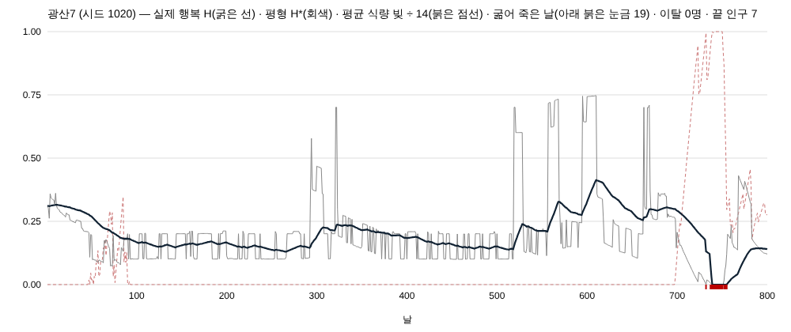

**한 줄 답: 행복을 마을 칸 H 로 기억하게 하고(평형 H\* 쪽으로 반감기 30일 · 손잡이 `T1075_HAPPY_EQ` 끔 기본 · 끔 = 바이트 같음), 굶으면 평형이 내려가고 굶어 죽으면 계단으로 뚝 떨어지게 했다. 불행은 더 죽이지 않는다 — 출생을 깎고 남는 몫은 몸이 이웃 마을로 걸어 나간다. T1074 켬 세계 3시드 800날: 기근 길 죽음 3,120 → 1,927 · 이탈 511명(전부 몸) · 800날 인구 14,878 → 15,886 · 해체 1 → 1 · 바닥 → 절반 회복 중앙 68일.**

# 보고 — T1075: 행복 · 평형 회귀(배너로드식) · 굶주림 평형 · 사망 계단 (2026-11-02)

지시: `지시/지시_T1075.md`(★재민 11-02) · 가지 `batch/happy-eq-1102` · 바탕 = T1074 가지(`batch/food-debt-1102`) 위.

## §1 한 것

| 카드 | 한 것 | 자리 |
|---|---|---|
| ① 평형 회귀 | 그날 공식 값(`_computeVillageStats`) = 평형 **H\*** · 실제 행복 **H** 는 마을 칸 `v._H`(plain number · 저장 줄이 싣는다) — 날마다 `H ← H + k(H* − H)` · k = 1 − 0.5^(1/30)(반감기 30일 = 카드 "바닥 → 절반 회복 한 달 남짓") · 소비자(일 배수 `happyWorkMul` · 도적 층 위기 · 마을 화면)는 H 를 읽는다(`lastStats.happiness` = H · H* 는 `lastStats.happinessEq`) | `sim/economy-sim.js` 인구 갱신 5 |
| ② 굶주림 | H\* × (1 − min(1, 마을 평균 식량 빚 ÷ 14)) — 빚 0 = 무변 · 평균 빚이 죽음 문턱(14 · T1074)에 닿으면 평형 0 · T1074 `foodDebtOf` 하나를 읽는다 | 〃 |
| ③ 사망 계단 | 굶어 죽은 사람 하나마다 그 자리에서 H −= 1 ÷ 인구(죽음 직전 수) — 비례 계수 1 · 빚 판이면 빚 죽음, 아니면 기근 고리 죽음 | `_t1075Starved` |
| ④ 불행은 안 죽인다 | `_happyTerm` 이 음수면 **출생을 먼저 깎고**(나머지 양수 dP 를 0 까지) 남는 몫은 **이탈 압력** `v._emigAccum` — 1 이 차면 가장 젊은 자유민 1명이 몸으로 가장 가까운 산 마을까지 걷는다(도적 층 길 위 장부 T765 · 표지 `t1075` · 닿는 날 받는 마을 econ 에 붙고 걷던 몸이 그 마을 주민 · 새 몸 0 · 소멸 0) · 하루 상한 = 인구 상한과 같은 N × `POP_MAX_DELTA_PCT` · 호스트 길이 없는 판(랩 · 헤드리스)은 아무도 안 떠난다(압력은 `_emigLost`) | econ · `server/bandits.js` `_t1075Leave` |
| ⑤ 평형 모듈 하나 | `eqStep(cur, target, halfDays)` export — T1076(원정 사기)이 같은 함수를 쓴다 | export |
| ⑥ 손잡이 · 3사본 · 판 · 그림 | `T1075_HAPPY_EQ`(`=1` 만 켬) · 번들 · 랩 인라인 다시 굽기 · 판 자 3시드 800날 끔 ↔ 켬(둘 다 T1074 켬) · 흉년 마을 H 곡선 | §3 · §4 |

### ⑤ 인터페이스(T1076 이 쓴다)

```
const { eqStep } = require('./economy-sim');
// cur: 지금 값 · target: 그날 평형 · halfDays: 반감기(일) → 다음 날 값(평형 쪽으로 남은 거리의 1 − 0.5^(1/halfDays) 만큼)
next = eqStep(cur, target, halfDays);
```
상태 칸은 쓰는 쪽이 들고(마을 `v._H` · 원정 `w._morale` 꼴) · 평형 계산과 계단(사건마다 한 번에 빼기)은 쓰는 쪽 몫이다.

## §2 판 자 — T1075 끔 ↔ 켬(둘 다 T1074 켬 · 3시드 800날 · 가상 시계)

| T1075 | 400날 인구 | 800날 인구 | 해체 | 빈 마을 | 이탈(몸) | 길 없어 못 떠난 압력 | 기근 길 죽음 | 빚 죽음 | 불행 마을-날(H < 0.5) | 마을별 H 최저 평균 | 바닥 → 절반 회복 날(중앙 · 표본) |
|---|---|---|---|---|---|---|---|---|---|---|---|
| 끔 | 7,644 | 14,878 | 1 | 0 | 0 | 0 | 3,120 | 110 | 58,326 / 122,400 | 0.112 | 34 · 136 |
| 켬 | 7,376 | 15,886 | 1 | 0 | **511** | 0 | **1,927** | 44 | 62,187 / 122,400 | 0.241 | **68** · 77 |

* T1075 끔 판은 T1074 켬 기본 판과 한 값이다(400날 7,644 · 800날 14,878 · 죽음 3,120 · 빚 죽음 110) — 끔 = 바이트 같음이 판에서도 선다.
* **불행은 죽이지 않는다**: 기근 길 죽음이 1,193명 줄었다(−38%). 그 압력은 출생 감소와 이탈 511명(전부 서버 길 위 장부로 걸었다 · 못 떠난 압력 0)으로 갔다. 800날 인구는 +6.8%.
* **행복 곡선**: 마을별 최저 H 평균이 0.112 → 0.241 로 높다(그날 값의 깊은 골을 평형 회귀가 메운다). 대신 H < 0.5 인 마을-날은 6.6% 늘었다 — 굶주림 평형과 사망 계단이 낮은 H 를 붙잡는다(카드 의도).
* **체감(반감기)**: 바닥에서 절반 회복까지 중앙 68일 — 카드의 "한 달 남짓"보다 길다. 반감기(30일)는 평형까지의 거리 절반이지만 바닥 뒤엔 평형 자체도 낮게 머물러(빚 · 식단) 걸음이 짧다. 줄이려면 반감기를 줄이는 게 아니라 평형이 먼저 오르는지 봐야 한다(회부 1).
* 빚 죽음 110 → 44: 이탈이 굶는 마을의 입을 줄인다.

## §3 흉년 마을 하나 — H 곡선

`증거_T1075/H곡선_시드1020.png`(광산7 · 시드 1020 · 빚 최대 15.4 · 굶어 죽은 날 19) · `H곡선_시드7.png`(광산1 · 시드 7).



* 굵은 선 H 가 회색 평형 H\* 의 날마다 흔들림을 고르게 따라간다(반감기 30일).
* 700날 무렵 흉년 — 평균 빚(붉은 점선 · ÷14)이 1 에 닿자 평형이 0 으로 내려가고, 굶어 죽은 날(아래 붉은 눈금)마다 H 가 계단으로 떨어져 바닥 0 에 붙는다.
* 빚이 갚아지자 평형이 오르고 H 가 천천히(두 달 남짓) 돌아온다.

## §4 회부

1. **[재민 · 체감]** 바닥 → 절반 회복이 판에서 중앙 68일(카드 "한 달 남짓"). 반감기 30일을 그대로 둘지 · 평형이 먼저 오르는지(빚 · 식단)를 볼지.
2. **[PM · 계단 크기]** 사망 계단 비례 계수 1(한 사람 = 1/N). 작은 마을에선 크고 큰 마을에선 작다 — 곡선에서 "뚝"은 작은 마을에서만 크게 보인다.
3. **[정보 · 이탈 길]** 이탈은 서버 도적 층 길 위 장부(T765 · 표지 `t1075`)로 걷는다. 랩 · 헤드리스(t17 · t176 게이트)는 걸을 길이 없어 아무도 안 떠난다 — 그 판들에선 불행 압력이 출생만 깎는다(`_emigLost`). S4 T1080(해체 걷기 · 길 위 먹고 늙기)과 같은 장부를 쓴다 — 그 카드가 길 위 사람을 먹이면 이탈도 같이 먹는다.
4. **[정보 · 하네스]** `test-cand-walk` ⑧ 글자 계약을 "몸 문 `t765Depart` 는 걷기 두 자리(해체 뒤 · 불행 이탈) 안에서만"으로 고쳤다(종전: 한 자리).
5. **[T1076]** 평형 모듈 `eqStep(cur, target, halfDays)` — §1 ⑤ 인터페이스.

## §5 재현

```
# 판(T1074 켬 세계 위 · 가상 시계)
env T745_VCLOCK=1 T1074_FOOD_DEBT=1 [T1075_HAPPY_EQ=1] NODE_OPTIONS="-r scripts/t815-observe.js -r scripts/t1075-observe.js -r scripts/t1074-observe.js" T577_TAG=base T577_DIR=<뿌리>/run-<off|on> node scripts/t577-server-run.js 800 1020,7,42
node scripts/t1075-table.js <뿌리> --json 계측/T1075_판_2026-11-02.json
node scripts/t1075-curve.js <뿌리>/run-on <출력.svg> 1020
node scripts/test-t1075-happy-eq.js   # 14/0
```
