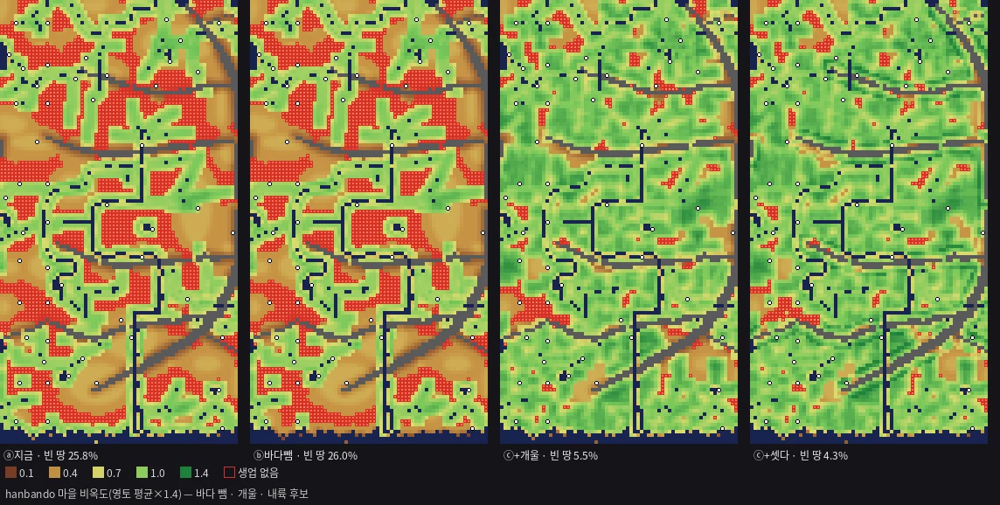

# T1173 보고 — 비옥도의 물에서 바다 빼기 · 내륙 비옥지 항 후보 (세션4 · 2026-11-05)

**바다 뺌 → 빈 땅 한반도 26.0% · 닛폰 18.9%(개울 넣으면 5.5% · 4.0%) · 내륙 후보 3개 — 가장 큰 것 곡간(지형 `valleys`)(빈 땅 26.0% → 24.6% · 닛폰 18.9% → 17.3%).**

- 바다를 비옥도의 물에서 빼도 빈 땅은 거의 안 늘어납니다(+0.2 · +0.3%p). 농사 축을 잃는 지금 마을은 한반도 1곳(어촌6), 닛폰 3곳(새후보2 · 3 · 5)입니다.
- 개울(T585)을 비옥도의 물로 세는 것(판정 1)이 압도적으로 큰 손잡이입니다. 다만 내륙 비옥도 중앙이 0.42 → 0.92 로 올라가 지역 차가 크게 줄어듭니다(§2 · 회부 1).
- 베이스 = main `b44dae38`(카드 커밋 · land1047 뒤). 가지 `batch/fert-inland-1105` = main + 이 카드 한 커밋 **[승인 대기 · T1173]**.
- 제품 코드 0 · 판정 0. T1153 계측기에 비옥도 갈래(`--fert` · `--add` · `--noscen`)를 더하고, 그림기 하나를 더했습니다(`scripts/t1173-draw.py`).
- 그림: 맥 `~/Mini/산그림/T1173/` 넷 · 레포 `보고/T1173/`(webp).

---

## §0 판 · 자

* 자 = T1153 계측기(`scripts/t1153-terrain-census.js`) — 정본 땅값 식 · econ 정본 축 판정(20명 · 40명) · 32셀 격자. 그대로 씁니다.
* **비옥도 갈래** — 갈래 장(`fieldVariant`)은 `fertility.fertAt` 정본 식 그대로입니다(상자 62 EDT · 임상 비율 WOODY_R 창). 바뀌는 것은 "물 항의 물이 어느 칸이냐"와 산록 띠(켤 때)뿐입니다.
  * **검증**: 갈래 장으로 정본과 같은 물(ⓐ′)을 재면 정본 `buildField` 판(ⓐ)과 두 존 모두 빈 땅 · 축 · 분포가 한 자리까지 같습니다(표 둘째 줄).
* **바다** = 존 `isSeaTileLocal` 그 차집합입니다 — 해안 띠(`generateCoastlineWaterTiles`)이면서 강 · 호수(`terrain.isWaterCellLocal`)가 아닌 칸. 한반도 띠 221,796칸(강 · 호수와 겹침 742) · 닛폰 387,935칸(1,206).
* 물 땅값(어부 · `nearestWaterDist`) · 어장 상한(`scanLabor`)은 **바다를 그대로 셉니다**. 바다 뺌은 비옥도 물 항에만 겁니다(바닷물로 관개 못 한다 — 재민 확정).
* ⚠ **T1153 정정** — T1153 의 한반도 판은 t436 자의 기본값(`T17_COAST` 한반도 끔)을 따라 해안 띠를 아예 안 봤습니다. 라이브 존은 띠를 물로 봅니다. 그래서 이 판의 ⓐ(띠 포함 · `T17_COAST=1`)가 한반도 라이브와 같은 판이고, 빈 땅은 T1153 의 28.9% 가 아니라 **25.8%** 입니다. 닛폰은 처음부터 띠를 봐서 18.6% 그대로입니다.
* 판 16(두 존 × 여덟 갈래) · 판마다 2 ~ 3분.

---

## §1 바다 빼기의 크기 (할 일 ①)

| 판 | 한반도 빈 땅(20명) | 40명 | 먹거리 세 축 빈 땅 | 농사 축 칸 | 닛폰 빈 땅(20명) | 40명 | 먹거리 세 축 | 농사 축 칸 |
|---|---|---|---|---|---|---|---|---|
| ⓐ 지금(큰 물 전부) | 25.8% | 32.1% | 48.6% | 47.2% | 18.6% | 26.0% | 37.2% | 61.3% |
| ⓐ′ 같은 물 · 갈래 장(검증) | 25.8% | 32.1% | 48.6% | 47.2% | 18.6% | 26.0% | 37.2% | 61.3% |
| **ⓑ 바다 뺌(강 · 호수만)** | **26.0%** | 32.5% | 48.8% | 45.6% | **18.9%** | 27.6% | 37.9% | 55.2% |
| **ⓒ ⓑ + 개울** | **5.5%** | 8.0% | 12.5% | 86.0% | **4.0%** | 6.4% | 8.6% | 89.4% |

* 바다 뺌은 해안 띠 둘레만 바꿉니다. 그래서 빈 땅 몫은 거의 그대로이고, 농사 축 칸은 1.6%p(한반도 — 바다는 남쪽 하나) · 6.1%p(닛폰 — 바다가 섬을 두른다) 줍니다.
* **축이 바뀌는 지금 마을(ⓐ → ⓑ · 래스터 판 비옥도)**:
  * 한반도: **어촌6** 0.78 → 0.30 · 농사 · 고기잡이 → 고기잡이만.
  * 닛폰: **새후보2** 0.74 → 0.29(농사 · 숲 · 고기잡이 → 숲 · 고기잡이) · **새후보3** 0.81 → 0.42(농사 · 고기잡이 → 고기잡이) · **새후보5** 0.95 → 0.37(농사 · 고기잡이 → 고기잡이).
  * 나머지 해안 마을은 비옥도 차가 0.05 미만입니다. 바다 말고도 강 · 호수가 62셀 상자 안에 있기 때문입니다.
* 어촌 · 해안 농촌이 농사를 잃어도 고기잡이 축(바다 어장)은 남습니다 — 넷 모두 고기잡이 축이 있습니다.

---

## §2 비옥도 분포 (할 일 ④ 일부)

뭍 칸마다 그 자리 마을 비옥도(영토 평균 × 1.4)입니다. 물가 = 가장 가까운 물(바다 포함)이 80셀(물 항의 감쇠 길이) 안. 한반도 물가 3,857칸 · 내륙 3,650칸 · 닛폰 4,755 · 2,484칸.

| 판 | 한반도 중앙 · 편차 | 물가 중앙 | **내륙 중앙** | 닛폰 중앙 · 편차 | 물가 중앙 | **내륙 중앙** |
|---|---|---|---|---|---|---|
| ⓐ 지금 | 0.53 · 0.267 | 0.93 | **0.42** | 0.81 · 0.265 | 0.91 | **0.42** |
| ⓑ 바다 뺌 | 0.52 · 0.267 | 0.92 | 0.42 | 0.76 · 0.269 | 0.88 | 0.42 |
| ⓒ + 개울 | 0.99 · 0.241 | 1.03 | **0.92** | 0.97 · 0.210 | 1.00 | **0.88** |
| ⓑ + 곡간 | 0.55 · 0.262 | 0.92 | 0.42 | 0.78 · 0.261 | 0.89 | 0.42 |
| ⓑ + 둠벙 | 0.53 · 0.269 | 0.93 | 0.42 | 0.78 · 0.269 | 0.89 | 0.42 |
| ⓑ + 산록 띠 | 0.61 · 0.265 | 0.94 | 0.42 | 0.79 · 0.268 | 0.92 | 0.43 |
| ⓒ + 셋 다 | 1.01 · 0.226 | 1.04 | 0.97 | 1.00 · 0.204 | 1.02 | 0.95 |

* **내륙 중앙 0.42 = 물 항이 0 인 땅의 값**(0.12 + 0.18 바위 만점 + 숲 조금 → × 1.4)입니다. T1153 빈 땅의 비옥 0.42 가 이것입니다. 곡간 · 둠벙 · 산록 띠는 내륙 중앙을 못 움직입니다(근원이 적거나 띠가 좁음).
* **개울은 내륙 중앙을 0.42 → 0.92 로** 올립니다. 개울은 뭍의 0.9% · 0.65% 칸이지만 집수 문턱(1,500칸)마다 하나씩 고르게 깔려 있어, 거의 모든 62셀 상자에 닿기 때문입니다. 대신 편차가 줄어 지역 차가 엷어집니다(한반도 0.267 → 0.241 · 닛폰 0.269 → 0.210).

---

## §3 내륙 비옥지 고증 (할 일 ②)

| 땅 | 근거(유적 · 연구) | 확실도 |
|---|---|---|
| **곡저(골짜기 바닥) · 저지대 논** | 한국 초기 논 유적(논산 마전리 · 보령 관창리 · 무전동)의 결론: "the location of field itself was restricted to the lower land and valley bottom area" — 곽종철 계열 「우리나라의 초기 수전농경」 초록([KoreaScience](https://koreascience.or.kr/article/JAKO200011919823697.page?lang=ko)) | 확인(초록 문장) |
| **구릉 능선 + 그 사이 소곡** | 울산 무거동 옥현 — 주거는 "독립 구릉의 능선부에 형성된 4개의 정상부와 그 사이 소곡부" · 논은 "논경작에 유리한 입지선정과 논둑과 수구, 수로" — 배길희 2017 『韓國靑銅器學報』 21([KoreaScholar](https://db.koreascholar.com/Article/Detail/337759)) | 확인(초록 문장 · 논 자리 지형 이름은 초록에 없음) |
| **하천 굽이의 작은 충적지(가파른 구릉에 반쯤 둘린)** | 진주 대평리 — "several small, linked alluvial plains that are semi-circumscribed by steep hills" · "partially protected by a natural levee" · 밭 32,000㎡ 이상([Wikipedia Daepyeong](https://en.wikipedia.org/wiki/Daepyeong)) | 확인(위키 — 1차 보고서는 못 엶) |
| **강 지류 골짜기** | 무문 전기 취락은 "relatively concentrated in the river valleys formed by tributaries of the Geum River"([Wikipedia Mumun](https://en.wikipedia.org/wiki/Mumun)) | 확인(위키) |
| **평야 가운데 낮은 대지 + 둘레 충적지 논** | 이타즈케 — "a plateau at an elevation of 7 to 9 meters" · "rice paddies … spread over the surrounding alluvial land"([Wikipedia Itazuke](https://en.wikipedia.org/wiki/Itazuke_Site)) | 확인(위키) |
| **산록 낮은 구릉 + 저습지 논** | 요시노가리 — "the southern end of the low hill extending out from the Sefuri Mountains" · "develop the low-lying marshes into rice paddies"([Wikipedia Yoshinogari](https://en.wikipedia.org/wiki/Yoshinogari_site)) | 확인(위키) |
| 선상지 · 하안단구(이름을 단 농경지) | 이번 판 출처에서 못 찾음 | **미확인** |
| 송국리 농경지 지형 | 이번 판에 안 열림 | **미확인** |
| 흙 차이(충적토 · 붕적토 · 화산회토) | 일본 흑보쿠(Andosol)의 인 흡수계수 9.90 ~ 15.00 P mg/g([JIRCAS JARQ 12-3](https://www.jircas.go.jp/en/publication/jarq/12/3/132)) — 비옥도 차로 바로 옮기는 문장은 없음 | **미확인**(수치는 있으나 비옥도 근거 아님) |

* 공통 꼴: 청동기 · 야요이 농경지는 **큰 강가만이 아니라 작은 물줄기 · 골짜기 바닥 · 구릉 사이 소곡 · 산록 저습지**에 섰습니다. 취락은 구릉 위, 밭 · 논은 그 아래 물이 모이는 낮은 땅입니다. 이 꼴은 지금 지도의 **개울(집수로 내려오는 물길 = 골짜기 바닥의 대용)**과 가장 가깝습니다.

---

## §4 후보 술어 — 이미 있는 층으로 (할 일 ③)

새 지도층 0 입니다. 항의 꼴은 지금 식의 자리에 맞췄습니다 — 물과 같은 근원이면 물 항(0.62 · e^(−d/80))을 그대로 공유합니다(가장 가까운 근원까지 거리). 띠라면 기존 바위 항 가중을 씁니다. 새 수 0 · 판정 칸입니다.

| 후보 | 층 | 고증 짝 | 항 | 크기(층) |
|---|---|---|---|---|
| **개울(ⓒ)** | `streams`(T585 · 집수 문턱 1,500칸 · 1 ~ 2셀) | 곡저 · 지류 골짜기 · 소곡 | 물 항 근원에 더함 | 뭍의 0.9% · 0.65% 칸 |
| **곡간** | 지형 `valleys`(산줄기를 가로지르는 통로 · 폭 320px = 10셀) | 골짜기 바닥(산간) | 물 항 근원에 더함 | 선 24 · 41줄 |
| **둠벙** | 군락 `groves` 의 `water_pool`(마을 어귀 둠벙 · r 40px) | 저습지 · 둠벙(관개 연못) | 물 항 근원에 더함 | 26 · 37곳 |
| **산록 띠** | 바위 거리(`ridges` 둘레) | 산록 완사면 · 구릉 아래 | 바위에서 ROCK_FULL/2 ~ 2·ROCK_FULL(30 ~ 120셀)에 + W_ROCK(0.18) | 띠 하나 |

* 산록 띠의 30 ~ 120셀 · 0.18 은 지금 식의 두 상수(ROCK_FULL 60 · W_ROCK 0.18)에서 바로 유도했습니다. 고증 수치는 없습니다(산록에 섰다는 꼴만 있음).

---

## §5 판 — 후보마다 · 합친 판 (할 일 ④)

| 판(바다 뺀 판 위) | 한반도 빈 땅 | Δ | 닛폰 빈 땅 | Δ | 한반도 먹거리 세 축 빈 땅 | 닛폰 |
|---|---|---|---|---|---|---|
| ⓑ 바다 뺌 | 26.0% | — | 18.9% | — | 48.8% | 37.9% |
| ⓑ + 곡간 | **24.6%** | −1.4 | **17.3%** | −1.6 | 45.4% | 34.2% |
| ⓑ + 둠벙 | 24.6% | −1.4 | 17.8% | −1.1 | 46.4% | 35.3% |
| ⓑ + 산록 띠 | 25.5% | −0.4 | 17.8% | −1.1 | 47.3% | 35.8% |
| ⓒ ⓑ + 개울 | **5.5%** | −20.5 | **4.0%** | −14.9 | 12.5% | 8.6% |
| ⓒ + 셋 다 | 4.3% | −21.7 | 3.1% | −15.8 | 9.7% | 6.5% |

**지금 마을 축 표(ⓐ → ⓒ + 셋 다 · 래스터 판)** — 축이 바뀌는 마을:

* 한반도 축 없음 넷(농촌14 · 15 · 18 · 20)이 모두 **농사**를 얻습니다(개울만으로 0.42 → 0.76 ~ 1.15).
  * 교역 축만 있던 광산1 · 광산3 · 광산7 · 농촌9 · 농촌10 · 임업1 · 4 · 5 도 농사를 얻습니다.
  * 바뀌는 마을은 개울만으로 30곳 · 셋 다 36곳입니다.
  * 어촌6 은 바다 뺌으로 농사를 잃습니다(개울 · 곡간 · 둠벙이 그 자리에 안 닿음 — 축 고기잡이만).
* 닛폰 축 없음(쿠라마 · 시로농촌 · 새후보9 · 후카임업)이 모두 농사를 얻습니다. 광업만이던 후지로 · 미도리광산과 숲만이던 마트노 · 오오임업 · 새후보4 도 농사를 얻습니다.
  * 바다 뺌으로 농사를 잃는 새후보2 · 3 · 5 가운데 3 · 5 는 개울로 되찾습니다(0.42 → 0.90 · 0.37 → 0.86). 2 는 못 되찾습니다.
* 전표: 계측 `계측/T1173_갈래표_2026-11-05.json`(판마다 마을별 비옥도 · 축).

그림(`~/Mini/산그림/T1173/`):

* `{존}_비옥도_전후.png` — ⓐ 지금 · ⓑ 바다 뺌 · ⓒ + 개울 · ⓒ + 셋 다.
* `{존}_내륙후보.png` — ⓑ 위에 곡간 · 둠벙 · 산록 띠.
* 칸 색 = 마을 비옥도 · 빨간 테두리 = 생업 없음 · 흰 점 = 지금 마을.

---

## §6 회부(판정 칸)

1. **개울을 비옥도의 물로 셀까 · 가중은** — 물 항과 같은 가중(0.62)이면 빈 땅이 5.5% · 4.0% 로 줄고, 내륙 비옥도 중앙이 0.42 → 0.92 로 올라 지역 차가 엷어집니다(편차 0.267 → 0.241 · 0.269 → 0.210). "지역 차는 있되 어딘가는 먹고살게"(livelihood 머리 주석 · 재민 11차)와 겨누려면 개울에 물 항보다 작은 가중이나 짧은 감쇠를 주는 갈래가 다음 판입니다. 가중은 재민 판정이고, 고증 수치는 없습니다.
2. **곡간 · 둠벙 · 산록 띠** — 각각 −0.4 ~ −1.6%p 로 작습니다. 넣을지 · 산록 띠의 거리와 가중(지금 상수 유도 30 ~ 120셀 · 0.18)은 판정입니다.
3. **바다 뺌 확정의 손** — 어촌6(한반도) · 새후보2(닛폰)는 개울로도 농사를 못 되찾고 고기잡이만 남습니다. 자리 옮김(T1153 §4 최소 변경 판)과 같이 볼 자리입니다.
4. **T1153 한반도 정정** — T1153 표의 한반도는 해안 띠 없는 판이었습니다(28.9%). 라이브와 같은 판은 25.8%(ⓐ)입니다. 마을별 축은 어촌 몇 곳의 고기잡이 축만 다릅니다.
5. 선상지 · 하안단구 · 송국리 농경지 · 흙 차이는 이번 판에 출처를 못 열었습니다(미확인).

* 산 계측: `계측/T1173_갈래표_2026-11-05.json`(판 16의 요약 · 마을별 비옥도 · 축) — 판 원 JSON 은 커서(판당 ~260KB × 16) 레포에 안 넣었습니다(같은 명령으로 다시 납니다: `T17_COAST=1 node scripts/t1153-terrain-census.js <존> <out> --noscen --fert <갈래> [--add …]`).
