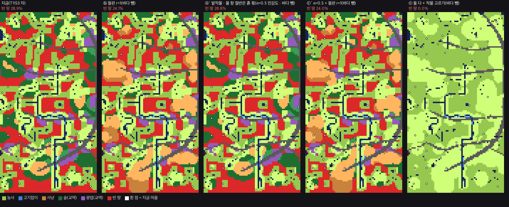
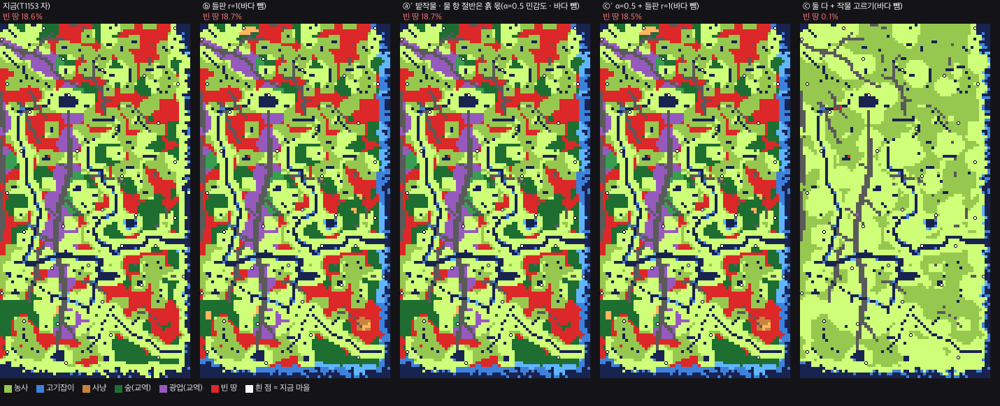

# T1178 보고 — 비옥도를 안 올리고 내륙 살리기: 밭작물 판 · 들판 판 · 자리 규칙 다시 (S-API · 2026-11-05)

**한 줄 답:** 밭작물 판 빈 땅 한반도 28.9% → **0.0%** · 닛폰 18.6%(바다 뺌 18.9%) → **0.1%**(물 항 절반을 흙 몫으로 남기면 28.8% · 18.7%) · 들판 판 **24.1% · 18.7%** · 둘 다 **0.0% · 0.1%**(α 0.5 판 24.0% · 18.5%) · 전체 재배치 자리 축 없음 **0 · 0** · 변동계수 **0.157 · 0.086**(α 0.5 판 0.186 · 0.233) — ★작물 표 그대로면 내륙이 통째로 보리밭이 되어 **평탄화가 생긴다**(내륙 농사 값 0.42 → 0.84 · 물가 0.83 → 0.95). 반대로 흙 몫을 조금만 남겨도(α ≥ 0.33) 아무것도 안 바뀐다. 가운데가 없는 칼날이다.
- 가지 `batch/api-t1178-1105` = `35162f6`(+ 이 보고 커밋 하나) · 베이스 `8250f1f`(main) · 커밋 제목 `[승인 대기 · T1178]` 셋.
- 제품 코드 0 · 판정 0. 계측기 둘(러너 밖 · 읽기만): `scripts/t1178-dryland.js`(T1153 자를 그대로 떠 와서 갈래만 얹음) · `scripts/t1178-draw.py`. 고증 `설계/고증_밭작물_들판.md`. 산 결과 `계측/T1178_한반도_2026-11-05.json` · `계측/T1178_닛폰_2026-11-05.json`.
- 자 맞춤: 작물 셀 식의 "벼 · 지금 물" 판 = 정본 `fertility.buildField` 값 **51/51 · 50/50** · 물 항을 뺀 나머지가 0.12 + 0.18·바위 + 0.08·숲 범위 밖인 셀 **0/158,090 · 0/156,925** · 지금 판 빈 땅 28.9% · 18.6% = T1153 그대로.
- ⓐ 의 식: 밭 작물 물 맞음 = `crops.waterMult(작물, 공급)` · 공급 = 1 + 4·e(e = 지금 물 항 몫 0 ~ 1 · 양 끝 1 · 5 = villages.js 생활 층 `supply: 밭 1 · 논 5`) · 논 작물(벼)은 지금 곡선 e 그대로 · 농사 값 = 비옥도 × (수확량 × kcal ÷ 벼). 새 수 0. **α(물 항 가운데 흙 몫)만 출처 없는 민감도**.
- 고증 한 줄: 한반도 청동기 큰 밭 유적은 **물가 충적지**(진주 대평리 3.2만㎡ · 남강) · 물 먼 대지 밭은 야요이 문헌이 적음 · 사냥만으로 정주 20명은 못 삼(고라니만이면 저지대 ≈ 380km²) · 『삼국지』 마한조 "不知乘牛馬". 광맥 · 산지 흙의 밭 비옥도 = **미확인**.
- 그림: 맥 `~/Mini/산그림/T1178/` 여섯 장(`{존}_1_판다섯` · `_2_작물` · `_3_자리규칙`) · 레포 `보고/T1178/*.webp` 같은 그림.
- ⚠ `~/Mini/산그림/T1178/` 에 이 세션 전(14:55)에 만들어진 그림 여섯 장(`*_비옥도_전후` · `*_생업_자리` · `*_작물`)이 있었다 — 손대지 않았다(누가 만든 것인지 모름 · 질문 4).
- 질문(판정 칸) 넷 — §5.

---

## §0 판 · 자

* T1153 자 그대로: 32셀 격자(한반도 뭍 7,728칸 · 닛폰 7,239칸) · 영토 원판 3,450셀 · 20명 판정 = min(자리, N) × 1인 산출 ≥ N × 하루 소비 1 · 축 다섯(농사 · 사냥 · 숲 교역 · 고기잡이 · 광업 교역).
* 판(물 바탕 × 농사 × 사냥):

| 판 | 물 바탕 | 농사 | 사냥 |
|---|---|---|---|
| 지금 | 큰 물 전부 | 벼(지금 econ) | 숲 띠 |
| 바다 뺌 | 해안선 띠 ∖ 강 · 호수를 비옥도 물에서 뺌(★재민 11-04) | 벼 | 숲 띠 |
| ⓐ | 바다 뺌 | 작물 9 중 농사 값이 가장 큰 것 | 숲 띠 |
| ⓐ′ | 바다 뺌 | ⓐ · 물 항 절반은 흙 몫(α = 0.5 · 민감도) | 숲 띠 |
| ⓑ | 바다 뺌 | 벼 | 들판도 숲처럼 사냥터(r = 1) · 민감도 r = 0.5 |
| ⓒ | 바다 뺌 | ⓐ | ⓑ r = 1 |
| ⓒ′ | 바다 뺌 | ⓐ′ | ⓑ r = 1 |

* 작물 9 = 청동기 출토 확인 · 조건부(`설계/고증_작물.md`): 벼 · 보리 · 밀 · 조 · 기장 · 수수 · 피 · 콩 · 팥(들깨는 기름 작물이라 뺌).
* 들판 = 뭍 · 숲 아님 · 바위 아님 · 큰 물에서 140셀(물 땅값 고리) 밖 — 한반도 뭍의 **19.5%** · 닛폰 **5.1%**.
* 한반도는 T1153 처럼 해안선 띠를 안 켠 판이라(`T17_COAST` 기본) **바다 뺌 = 지금과 같다**. 닛폰은 물 942,638셀 중 바다 386,729셀.
* 판 시간: 한반도 271초 · 닛폰 304초.

### 작물 값(표에서 유도 · 새 수 0)

| 작물 | 재배지 | 물요구 | 관리 | Y = 수확 × kcal ÷ 벼 | 물에서 멀 때(e = 0 · 공급 1) 물 맞음 | 그때 Y × 물 맞음 |
|---|---|---|---|---|---|---|
| 벼 | 논 | 5 | 5 | 1.000 | 0(논 = 지금 곡선) | 0 |
| **보리** | 밭 · 논 | 2 | 2 | **0.756** | 0.80 | **0.604** |
| 밀 | 밭 | 2 | 2 | 0.733 | 0.80 | 0.587 |
| 조 | 밭 | 1 | 2 | 0.571 | 1.00 | 0.571 |
| 수수 | 밭 | 1 | 2 | 0.540 | 1.00 | 0.540 |
| 콩 | 밭 | 2 | 2 | 0.635 | 0.80 | 0.508 |
| 기장 | 밭 | 1 | 1 | 0.457 | 1.00 | 0.457 |
| 팥 | 밭 | 2 | 2 | 0.419 | 0.80 | 0.335 |
| 피 | 밭 · 논 | 3 | 1 | 0.324 | 0.93 | 0.302 |

* 그래서 **물 먼 땅에선 언제나 보리(둘째 밀)** 가 이긴다 — 51 + 36 마을 전부 밭 1위 보리 · 2위 밀. 카드가 그린 "산자락 = 조 · 기장 · 콩"은 이 표로는 안 나온다. 여름 작물만 보면 물 먼 땅 조 > 수수 > 콩 · 물가 콩 > 조 이다(셈).
* 보리 · 밀은 월동 작물(10 ~ 11월 파종)이다. 같은 밭에 여름 조를 이어 짓는 두 그루는 청동기 근거를 못 찾아 안 셌다(미확인).

---

## §1 ⓐ 밭작물 판 — 빈 땅 · 평탄화

| 존 | 판 | 빈 땅(20명) | 40명 | 먹거리 세 축만 | 농사 축 몫 | 물가 빈 땅 | **내륙 빈 땅** | 물가 농사 값 중앙 | **내륙 농사 값 중앙** |
|---|---|---|---|---|---|---|---|---|---|
| 한반도 | 지금 = 바다 뺌 | 28.9% | 35.2% | 51.2% | 44.9% | 23.2% | 43.6% | 0.83 | 0.42 |
| | **ⓐ** | **0.0%** | 0.4% | 0.0% | 99.6% | 0.1% | **0.0%** | 0.95 | **0.839** |
| | ⓐ′(α 0.5) | 28.8% | 35.0% | 51.0% | 45.1% | 23.1% | 43.6% | 0.83 | 0.582 |
| 닛폰 | 지금 | 18.6% | 26.0% | 37.2% | 61.3% | 15.8% | 48.1% | 0.84 | 0.41 |
| | 바다 뺌 | 18.9% | 27.6% | 37.9% | 55.2% | 16.0% | 48.1% | 0.80 | 0.41 |
| | **ⓐ** | **0.1%** | 1.2% | 0.1% | 97.4% | 0.1% | **0.0%** | 0.914 | **0.831** |
| | ⓐ′(α 0.5) | 18.7% | 27.4% | 37.5% | 55.6% | 15.8% | 48.1% | 0.80 | 0.567 |

(물가 = 큰 물이 140셀 고리 안 · 내륙 = 그 밖 — 한반도 내륙 2,153칸 · 닛폰 642칸. 농사 값 = 비옥도 × Y.)

* **평탄화가 생긴다(판정 1 이 걱정한 그것)**: ⓐ 에서 물가 : 내륙 농사 값 비가 한반도 **1.98 → 1.13** · 닛폰 **2.05 → 1.10**. 지역 차도 사라진다 — T1153 의 "서쪽 열이 빈다"(서 30 ~ 36% · 동 24 ~ 29%)가 여덟 칸 전부 0 ~ 0.1%.
* **칼날**: 농사 축 문턱은 농사 값 0.667(= 1 ÷ 농부 base 1.5)이다. 내륙 땅은 고르게 바닥(0.42)이라 문턱을 넘느냐가 α 하나에 걸린다. 셈: 보리 0.756 × (0.42 + (1 − α) × 0.69) = 0.667 → **α\* ≈ 0.33**. α < 0.33 이면 내륙 전부 농사 · α ≥ 0.33 이면 내륙 거의 그대로. 가운데(내륙 일부만 사는 판)가 이 식으로는 안 나온다.
* 그 이유는 내륙의 땅이 다 같기 때문이다 — 비옥도 식에서 물 항을 빼면 남는 것(바위 거리 · 숲)이 내륙에서 거의 같다. 밭이 "어디는 되고 어디는 안 되게" 하려면 땅을 가르는 다른 항(흙 · 기울기)이 있어야 하는데, 그건 출처가 없다(광맥 · 산지 흙 = 미확인).
* 고증으로 보면: 한반도 청동기의 실제 큰 밭은 물가 충적지다(대평리). 그러니 ⓐ(α = 0 · 밭은 물을 안 본다)는 작물 표엔 맞지만 **유구 분포와는 어긋난다**. α 는 판정 칸이다(질문 1).

## §2 ⓑ 들판 판 — 사냥 축

| 존 | 판 | 빈 땅(20명) | 사냥 축 몫 | 내륙 빈 땅 | 먹거리 세 축만 빈 땅 |
|---|---|---|---|---|---|
| 한반도 | 바다 뺌 | 28.9% | 6.5% | 43.6% | 51.2% |
| | **ⓑ r = 1** | **24.1%** | **23.0%** | 26.8% | 34.8% |
| | ⓑ r = 0.5 | 28.9% | 11.5% | 43.5% | 46.3% |
| 닛폰 | 바다 뺌 | 18.9% | 1.1% | 48.1% | 37.9% |
| | **ⓑ r = 1** | **18.7%** | **1.8%** | 45.8% | 37.2% |
| | ⓑ r = 0.5 | 18.9% | 1.1% | 48.1% | 37.9% |

* r = 들판 1칸의 사냥감 ÷ 숲 1칸. 지금 `livelihood` 는 숲 띠 만점 2.25 · 숲 없는 땅 0.45(5 : 1). 오늘날 고라니는 **저지대 6.93 · 산지 1.91 마리/km²**(3.6 : 1)라 "숲이 짐승이 가장 많은 땅"은 아니다 — 그래서 r = 1(들판 = 숲)을 본 판으로, r = 0.5 를 민감도로 쟀다. r 를 3.6 으로 올리는 판은 상한 2.5 에 걸려 안 쟀다.
* 사냥 축 문턱은 사냥감 1.43(= 1 ÷ 사냥꾼 base 0.7) — 사냥 띠의 54% 넘게 들판 · 숲이어야 선다. 그래서 들판이 넓게 이어진 한반도 서 · 남(그림 ① 주황)만 살아나고, 닛폰은 들판이 뭍의 5.1% 뿐이라 거의 그대로다. 여기도 칼날이다(r = 0.5 이면 효과 0).
* ⚠**고증 셈은 사냥 축 하나로 정주 마을이 안 선다고 말한다**: 20명 × 2,450 kcal × 365일 ÷ 고라니 한 마리 ≈ 6,750 kcal ≈ 해마다 2,650 마리 — 저지대 6.93 마리/km² 를 다 잡아도 ≈ 380 km². 청동기 사람은 사냥감을 "주기적으로" 먹었지만 주 생업은 농사였다(토기 유기물). 게임 사냥 띠는 0.048 km²(1셀 = 1m)라 실제 밀도를 그대로 곱할 수 없다 — 비만 썼다. 사냥 산출에 지속 상한이 없다는 것(숲 · 고기잡이에는 있다)도 질문 2 로 남긴다.
* 사냥 **하나만** 가진 자리는 어느 판의 규칙 자리에도 0 이다(§4).

## §3 ⓒ 둘 다 + 작물 고르기 — 마을마다 고른 작물

| 존 | 판 | 빈 땅 | 칸에서 고른 작물 몫 | 시딩 마을이 고른 작물 |
|---|---|---|---|---|
| 한반도 | ⓒ | 0.0% | 보리 75.1% · 벼 24.9% | 보리 26 · 벼 25 |
| | ⓒ′ | 24.0% | 보리 57.4% · 벼 42.6% | 벼 35 · 보리 16 |
| 닛폰 | ⓒ | 0.1% | 보리 70.6% · 벼 29.4% | 보리 25 · 벼 11 |
| | ⓒ′ | 18.5% | 벼 52.6% · 보리 47.4% | 벼 18 · 보리 18 |

* **축이 생기는 마을**(이 래스터 판의 지금 축 없는 시딩 마을 아홉 — T1153 다섯 + 셋 · 후카임업은 T1153 실영토 판에선 숲 축이었다): ⓐ · ⓒ 에서 **아홉 다 농사 축**이 생긴다(한반도 농촌14 · 15 · 18 · 20 · 어촌6 · 닛폰 쿠라마 · 시로농촌 · 새후보9 · 후카임업 — 모두 보리). ⓐ′ · ⓑ · ⓒ′ 에서는 **하나도 안 생긴다**(들판 몫 0.09 ~ 0.34 — 사냥 문턱 아래).
* ⓑ 에서 사냥 축이 새로 생기는 마을: 한반도 광산1 · 농촌9 · 농촌10(라이브에서 해체된 농촌10 이 사냥 · 숲 둘이 된다).
* 바다 뺌으로 농사 축을 잃는 닛폰 해안 후보: 새후보2 · 3 · 5(셋 다 고기잡이는 남는다 · 시딩 안 된 자리).
* 마을마다 전표 — 부록 A.

## §4 자리 규칙 다시(T1153 §4 그대로 · 축 판정만 갈아 끼움)

| 존 | 판 | 간격(셀) | 가장 가까운 이웃 평균 · 표준편차 · **변동계수** | 4일(종전) 이웃 평균 · 표준편차 | **축 없음** | 축 둘 이상 | 외톨이(축 수) | 길로 못 닿는 자리 | 내륙 자리 | 지금 자리와 64셀 안 겹침 |
|---|---|---|---|---|---|---|---|---|---|---|
| 한반도 51 | 지금(T1153) | 373 | 446.4 · 77.3 · **0.173** | 3.53 · 1.55 | 0 | 37 | 1(3) | 1 | 6 | 4 |
| | **ⓒ** | 375 | 443.7 · 69.5 · **0.157** | 3.96 · 1.77 | **0** | 46 | 1(3) | 1 | 19 | 4 |
| | ⓒ′ | 365 | 451.1 · 83.7 · **0.186** | 3.57 · 1.95 | **0** | 45 | 4(4 · 3 · 2 · 2) | 3 | 10 | 4 |
| 닛폰 36 | 지금(T1153) | 446 | 599.9 · 154.0 · **0.257** | 1.78 · 0.95 | 0 | 33 | 3 | 0 | 1 | 4 |
| | 바다 뺌 | 431 | 586.6 · 149.0 · 0.254 | 2.22 · 1.18 | 0 | 31 | 2 | 0 | 3 | 2 |
| | **ⓒ** | 476 | 535.9 · 46.1 · **0.086** | 2.11 · 0.99 | **0** | 32 | **0** | 0 | 6 | 2 |
| | ⓒ′ | 431 | 570.7 · 133.1 · **0.233** | 2.33 · 1.15 | **0** | 32 | 1(3) | 0 | 4 | 3 |

* **축 없는 자리 0** — 규칙이 생업 있는 칸에서만 고르므로 어느 판이든 0이다(규칙 1 그대로).
* **변동계수 ≤ 0.2**: 한반도는 넷 다 통과. 닛폰은 **ⓒ 만 통과**(0.086). 닛폰은 빈 땅이 물가에서 멀리 떨어진 덩어리로 있어서, 그 덩어리가 살아나야(ⓒ) 간격이 고르게 된다.
* 외톨이는 모두 축 둘 이상 — "외톨이면 생업 둘" 조건을 어긴 자리 0.
* 길로 못 닿는 자리(코스 BFS 에서 다른 자리와 이어지지 않음): 한반도 ⓒ 1(규칙27) · ⓒ′ 3. 자리 규칙에 "길로 닿음"을 더할지는 질문 3.
* 규칙 자리의 축 몫(한반도 ⓒ): 농사 51 · 숲 29 · 사냥 26 · 광업 18 · 고기잡이 12 · 농사 하나뿐 5.
* 그림 `{존}_3_자리규칙` — 흰 점 = 지금 · 노란 네모 = 규칙 ⓒ · 하늘 세모 = 규칙 ⓒ′.

 

---

## §5 질문(판정 칸 — 손대지 않음)

1. **α — 비옥도 물 항(0.62) 가운데 "흙(충적토)" 몫을 얼마로 볼까.** α = 0(물 항 전부가 물 대기 · 밭작물은 물에서 멀어도 됨)이면 내륙이 통째로 보리밭이 되어 빈 땅 0% · 평탄화가 생긴다. α ≥ 0.33 이면 아무것도 안 바뀐다. 출처는 못 찾았다(광맥 · 산지 흙도 미확인). 고증(대평리 = 물가 밭)은 α 가 0 이 아니라는 쪽이다. 셋 중 하나: (가) α 를 출처로 정하는 고증 카드 (나) 내륙을 가르는 다른 항(흙 · 기울기)을 먼저 찾기 (다) 밭작물 판은 버리고 다른 축으로.
2. **사냥 축의 무게 · 지속 상한.** 고증 셈은 사냥 하나로 정주 20명이 안 선다고 말한다(저지대 ≈ 380 km²). 게임 사냥은 지속 상한이 없다(숲 · 고기잡이에는 있다). 들판 판(r)을 고증 비 3.6 까지 올릴지, 아니면 사냥을 "보탬 축"으로만 셀지.
3. **자리 규칙에 "길로 닿음"을 더할까** — 한반도 규칙 자리 중 1 ~ 3 곳이 코스 길로 다른 자리와 안 이어진다.
4. `~/Mini/산그림/T1178/` 의 14:55 그림 여섯 장(`*_비옥도_전후` · `*_생업_자리` · `*_작물`)은 이 세션이 만든 것이 아니다 — 다른 세션의 같은 카드 판이 있는지 확인이 필요하다.

* 가축 카드 감(고증 §③): 소 · 말 부리기 근거 없음(마한) · 개(사람 먹이 · 고남리) · 닭(야요이 중기 현지 번식) · 돼지(규모 미확인).

---

## 부록 A — 마을 전표(20명 · ⓐ · ⓑ · ⓒ · ⓒ′ 는 바다 뺌 바탕 · "지금"은 지금 정본)

### 한반도(새벌) — 시딩 마을 51

| 마을 | 물 고리(셀) | 들판 몫 | 지금 축 | ⓐ 축 | ⓑ 축 | ⓒ 축 | ⓒ′ 축 | ⓒ 작물 | ⓒ′ 작물 | 농사 값 지금 → ⓐ → ⓐ′ |
|---|---|---|---|---|---|---|---|---|---|---|
| 광산1 | 140 밖 | 0.59 | 광업 | 농사·광업 | 사냥·광업 | 농사·사냥·광업 | 사냥·광업 | 보리 | 보리 | 0.29 → 0.748 → 0.484 |
| 광산2 | 30 | 0.003 | 농사·광업 | 농사·광업 | 농사·광업 | 농사·광업 | 농사·광업 | 쌀(벼) | 쌀(벼) | 0.87 → 0.87 → 0.87 |
| 광산3 | 140 밖 | 0.307 | 숲 | 농사·숲 | 숲 | 농사·숲 | 숲 | 보리 | 보리 | 0.29 → 0.748 → 0.484 |
| 광산4 | 11 | 0 | 농사·고기잡이·광업 | 농사·고기잡이·광업 | 농사·고기잡이·광업 | 농사·고기잡이·광업 | 농사·고기잡이·광업 | 쌀(벼) | 쌀(벼) | 0.78 → 0.78 → 0.78 |
| 어촌1 | 11 | 0 | 고기잡이·광업 | 고기잡이·광업 | 고기잡이·광업 | 고기잡이·광업 | 고기잡이·광업 | 쌀(벼) | 쌀(벼) | 0.64 → 0.64 → 0.64 |
| 광산5 | 100 | 0.076 | 숲·광업 | 농사·숲·광업 | 숲·광업 | 농사·숲·광업 | 숲·광업 | 보리 | 보리 | 0.46 → 0.869 → 0.604 |
| 광산6 | 46 | 0.03 | 농사·광업 | 농사·광업 | 농사·광업 | 농사·광업 | 농사·광업 | 보리 | 쌀(벼) | 0.8 → 0.876 → 0.8 |
| 광산7 | 87 | 0.256 | 광업 | 농사·광업 | 광업 | 농사·광업 | 광업 | 보리 | 보리 | 0.3 → 0.748 → 0.484 |
| 어촌2 | 10 | 0 | 농사·사냥·숲 | 농사·사냥·숲 | 농사·사냥·숲 | 농사·사냥·숲 | 농사·사냥·숲 | 쌀(벼) | 쌀(벼) | 1.1 → 1.1 → 1.1 |
| 임업1 | 140 밖 | 0 | 사냥·숲·광업 | 농사·사냥·숲·광업 | 사냥·숲·광업 | 농사·사냥·숲·광업 | 사냥·숲·광업 | 보리 | 보리 | 0.38 → 0.808 → 0.552 |
| 임업2 | 29 | 0 | 농사·사냥·숲·고기잡이 | 농사·사냥·숲·고기잡이 | 농사·사냥·숲·고기잡이 | 농사·사냥·숲·고기잡이 | 농사·사냥·숲·고기잡이 | 쌀(벼) | 쌀(벼) | 1.11 → 1.11 → 1.11 |
| 임업3 | 60 | 0 | 농사·사냥·숲 | 농사·사냥·숲 | 농사·사냥·숲 | 농사·사냥·숲 | 농사·사냥·숲 | 보리 | 쌀(벼) | 1 → 1.058 → 1 |
| 농촌1 | 80 | 0 | 농사·사냥·숲 | 농사·사냥·숲 | 농사·사냥·숲 | 농사·사냥·숲 | 농사·사냥·숲 | 보리 | 보리 | 0.85 → 1.058 → 0.854 |
| 임업4 | 140 밖 | 0.428 | 사냥·숲 | 농사·사냥·숲 | 사냥·숲 | 농사·사냥·숲 | 사냥·숲 | 보리 | 보리 | 0.53 → 0.929 → 0.665 |
| 임업5 | 67 | 0.039 | 사냥·숲 | 농사·사냥·숲 | 사냥·숲 | 농사·사냥·숲 | 사냥·숲 | 보리 | 보리 | 0.36 → 0.793 → 0.536 |
| 어촌3 | 11 | 0 | 농사·숲·고기잡이 | 농사·숲·고기잡이 | 농사·숲·고기잡이 | 농사·숲·고기잡이 | 농사·숲·고기잡이 | 쌀(벼) | 쌀(벼) | 0.83 → 0.83 → 0.83 |
| 임업6 | 25 | 0.023 | 농사·숲 | 농사·숲 | 농사·숲 | 농사·숲 | 농사·숲 | 쌀(벼) | 쌀(벼) | 1.03 → 1.03 → 1.03 |
| 농촌2 | 11 | 0 | 농사·숲·고기잡이 | 농사·숲·고기잡이 | 농사·숲·고기잡이 | 농사·숲·고기잡이 | 농사·숲·고기잡이 | 쌀(벼) | 쌀(벼) | 0.77 → 0.77 → 0.77 |
| 농촌3 | 12 | 0 | 농사 | 농사 | 농사 | 농사 | 농사 | 쌀(벼) | 쌀(벼) | 0.83 → 0.83 → 0.83 |
| 어촌4 | 12 | 0 | 농사 | 농사 | 농사 | 농사 | 농사 | 쌀(벼) | 쌀(벼) | 0.96 → 0.96 → 0.96 |
| 농촌4 | 11 | 0 | 농사·고기잡이 | 농사·고기잡이 | 농사·고기잡이 | 농사·고기잡이 | 농사·고기잡이 | 쌀(벼) | 쌀(벼) | 0.79 → 0.79 → 0.79 |
| 농촌5 | 13 | 0 | 농사 | 농사 | 농사 | 농사 | 농사 | 쌀(벼) | 쌀(벼) | 0.8 → 0.8 → 0.8 |
| 어촌5 | 11 | 0 | 농사 | 농사 | 농사 | 농사 | 농사 | 쌀(벼) | 쌀(벼) | 1 → 1 → 1 |
| 어촌6 | 89 | 0.244 | **없음** | 농사 | **없음** | 농사 | **없음** | 보리 | 보리 | 0.42 → 0.839 → 0.582 |
| 어촌7 | 12 | 0 | 농사·숲 | 농사·숲 | 농사·숲 | 농사·숲 | 농사·숲 | 쌀(벼) | 쌀(벼) | 0.94 → 0.94 → 0.94 |
| 어촌8 | 11 | 0 | 농사 | 농사 | 농사 | 농사 | 농사 | 쌀(벼) | 쌀(벼) | 0.95 → 0.95 → 0.95 |
| 어촌9 | 10 | 0 | 농사 | 농사 | 농사 | 농사 | 농사 | 쌀(벼) | 쌀(벼) | 1 → 1 → 1 |
| 어촌10 | 12 | 0 | 농사 | 농사 | 농사 | 농사 | 농사 | 쌀(벼) | 쌀(벼) | 1.02 → 1.02 → 1.02 |
| 어촌11 | 11 | 0 | 농사 | 농사 | 농사 | 농사 | 농사 | 쌀(벼) | 쌀(벼) | 0.93 → 0.93 → 0.93 |
| 어촌12 | 11 | 0 | 농사·숲 | 농사·숲 | 농사·숲 | 농사·숲 | 농사·숲 | 쌀(벼) | 쌀(벼) | 0.97 → 0.97 → 0.97 |
| 어촌13 | 11 | 0 | 농사 | 농사 | 농사 | 농사 | 농사 | 쌀(벼) | 쌀(벼) | 0.97 → 0.97 → 0.97 |
| 어촌14 | 11 | 0 | 농사 | 농사 | 농사 | 농사 | 농사 | 쌀(벼) | 쌀(벼) | 1.01 → 1.01 → 1.01 |
| 어촌15 | 12 | 0 | 농사 | 농사 | 농사 | 농사 | 농사 | 쌀(벼) | 쌀(벼) | 0.96 → 0.96 → 0.96 |
| 농촌6 | 55 | 0.137 | 농사 | 농사 | 농사 | 농사 | 농사 | 보리 | 쌀(벼) | 0.88 → 0.975 → 0.88 |
| 어촌16 | 23 | 0.011 | 농사 | 농사 | 농사 | 농사 | 농사 | 쌀(벼) | 쌀(벼) | 0.96 → 0.96 → 0.96 |
| 농촌7 | 50 | 0.02 | 농사 | 농사 | 농사 | 농사 | 농사 | 보리 | 쌀(벼) | 0.92 → 0.975 → 0.92 |
| 농촌8 | 55 | 0.126 | 농사 | 농사 | 농사 | 농사 | 농사 | 보리 | 쌀(벼) | 0.87 → 0.975 → 0.87 |
| 농촌9 | 140 밖 | 0.513 | 숲 | 농사·숲 | 사냥·숲 | 농사·사냥·숲 | 사냥·숲 | 보리 | 보리 | 0.44 → 0.854 → 0.589 |
| 농촌10 | 140 밖 | 0.911 | 숲 | 농사·숲 | 사냥·숲 | 농사·사냥·숲 | 사냥·숲 | 보리 | 보리 | 0.42 → 0.839 → 0.582 |
| 농촌11 | 44 | 0 | 농사·숲 | 농사·숲 | 농사·숲 | 농사·숲 | 농사·숲 | 보리 | 쌀(벼) | 0.92 → 0.975 → 0.92 |
| 농촌12 | 70 | 0.097 | 농사·숲 | 농사·숲 | 농사·숲 | 농사·숲 | 농사·숲 | 보리 | 쌀(벼) | 0.9 → 1.058 → 0.9 |
| 농촌13 | 67 | 0.076 | 농사·숲 | 농사·숲 | 농사·숲 | 농사·숲 | 농사·숲 | 보리 | 쌀(벼) | 0.8 → 0.975 → 0.8 |
| 농촌14 | 86 | 0.31 | **없음** | 농사 | **없음** | 농사 | **없음** | 보리 | 보리 | 0.42 → 0.839 → 0.582 |
| 농촌15 | 135 | 0.26 | **없음** | 농사 | **없음** | 농사 | **없음** | 보리 | 보리 | 0.42 → 0.839 → 0.582 |
| 농촌16 | 76 | 0.164 | 농사 | 농사 | 농사 | 농사 | 농사 | 보리 | 보리 | 0.75 → 0.975 → 0.771 |
| 농촌17 | 18 | 0 | 농사·고기잡이 | 농사·고기잡이 | 농사·고기잡이 | 농사·고기잡이 | 농사·고기잡이 | 쌀(벼) | 쌀(벼) | 0.89 → 0.89 → 0.89 |
| 농촌18 | 118 | 0.339 | **없음** | 농사 | **없음** | 농사 | **없음** | 보리 | 보리 | 0.42 → 0.839 → 0.582 |
| 농촌19 | 46 | 0 | 농사 | 농사 | 농사 | 농사 | 농사 | 보리 | 쌀(벼) | 0.92 → 0.975 → 0.92 |
| 농촌20 | 109 | 0.09 | **없음** | 농사 | **없음** | 농사 | **없음** | 보리 | 보리 | 0.42 → 0.839 → 0.582 |
| 농촌21 | 51 | 0.113 | 농사 | 농사 | 농사 | 농사 | 농사 | 보리 | 쌀(벼) | 0.89 → 0.975 → 0.89 |
| 농촌22 | 11 | 0 | 농사·고기잡이 | 농사·고기잡이 | 농사·고기잡이 | 농사·고기잡이 | 농사·고기잡이 | 쌀(벼) | 쌀(벼) | 0.76 → 0.76 → 0.76 |

### 닛폰(아사기 열도) — 시딩 마을 36

| 마을 | 물 고리(셀) | 들판 몫 | 지금 축 | ⓐ 축 | ⓑ 축 | ⓒ 축 | ⓒ′ 축 | ⓒ 작물 | ⓒ′ 작물 | 농사 값 지금 → ⓐ → ⓐ′ |
|---|---|---|---|---|---|---|---|---|---|---|
| 네코로 | 68 | 0.013 | 농사·숲 | 농사·숲 | 농사·숲 | 농사·숲 | 농사·숲 | 보리 | 쌀(벼) | 0.87 → 0.99 → 0.87 |
| 후지로 | 78 | 0.04 | 광업 | 농사·광업 | 광업 | 농사·광업 | 광업 | 보리 | 보리 | 0.24 → 0.71 → 0.446 |
| 카토쿠 | 10 | 0 | 농사·고기잡이·광업 | 농사·고기잡이·광업 | 농사·고기잡이·광업 | 농사·고기잡이·광업 | 농사·고기잡이·광업 | 쌀(벼) | 쌀(벼) | 0.82 → 0.82 → 0.82 |
| 노라마 | 12 | 0.001 | 농사·고기잡이 | 농사·고기잡이 | 농사·고기잡이 | 농사·고기잡이 | 농사·고기잡이 | 쌀(벼) | 쌀(벼) | 0.81 → 0.81 → 0.81 |
| 이즈이 | 10 | 0 | 농사 | 농사 | 농사 | 농사 | 농사 | 쌀(벼) | 쌀(벼) | 0.92 → 0.92 → 0.92 |
| 쿠라마 | 69 | 0.051 | **없음** | 농사 | **없음** | 농사 | **없음** | 보리 | 보리 | 0.42 → 0.839 → 0.582 |
| 마트노 | 75 | 0.091 | 숲 | 농사·숲 | 숲 | 농사·숲 | 숲 | 보리 | 보리 | 0.53 → 0.929 → 0.665 |
| 쿠라다 | 104 | 0.009 | 숲·광업 | 농사·숲·광업 | 숲·광업 | 농사·숲·광업 | 숲·광업 | 보리 | 보리 | 0.25 → 0.71 → 0.446 |
| 히마쿠 | 50 | 0.005 | 농사 | 농사 | 농사 | 농사 | 농사 | 보리 | 쌀(벼) | 0.86 → 0.929 → 0.86 |
| 타카쿠 | 18 | 0.003 | 농사·고기잡이 | 농사·고기잡이 | 농사·고기잡이 | 농사·고기잡이 | 농사·고기잡이 | 쌀(벼) | 쌀(벼) | 0.71 → 0.71 → 0.71 |
| 타카노 | 42 | 0 | 농사 | 농사 | 농사 | 농사 | 농사 | 보리 | 쌀(벼) | 0.94 → 0.975 → 0.94 |
| 시로농촌 | 64 | 0 | **없음** | 농사 | **없음** | 농사 | **없음** | 보리 | 보리 | 0.42 → 0.839 → 0.582 |
| 쿠로어촌 | 10 | 0 | 농사·고기잡이 | 농사·고기잡이 | 농사·고기잡이 | 농사·고기잡이 | 농사·고기잡이 | 쌀(벼) | 쌀(벼) | 0.83 → 0.83 → 0.83 |
| 아오어촌 | 72 | 0 | 농사·숲 | 농사·숲 | 농사·숲 | 농사·숲 | 농사·숲 | 보리 | 보리 | 0.76 → 0.975 → 0.771 |
| 미도리광산 | 87 | 0.015 | 광업 | 농사·광업 | 광업 | 농사·광업 | 광업 | 보리 | 보리 | 0.31 → 0.756 → 0.499 |
| 하야어촌 | 17 | 0 | 농사 | 농사 | 농사 | 농사 | 농사 | 쌀(벼) | 쌀(벼) | 0.89 → 0.89 → 0.89 |
| 토오광산 | 90 | 0.005 | 농사·광업 | 농사·광업 | 농사·광업 | 농사·광업 | 농사·광업 | 보리 | 쌀(벼) | 0.81 → 0.975 → 0.81 |
| 사키농촌 | 62 | 0.062 | 농사 | 농사 | 농사 | 농사 | 농사 | 보리 | 쌀(벼) | 0.73 → 0.907 → 0.73 |
| 후카임업 | 91 | 0 | **없음** | 농사 | **없음** | 농사 | **없음** | 보리 | 보리 | 0.36 → 0.793 → 0.529 |
| 키요어촌 | 28 | 0 | 농사·고기잡이 | 농사·고기잡이 | 농사·고기잡이 | 농사·고기잡이 | 농사·고기잡이 | 쌀(벼) | 쌀(벼) | 0.99 → 0.99 → 0.99 |
| 나가임업 | 75 | 0 | 농사 | 농사 | 농사 | 농사 | 농사 | 보리 | 보리 | 0.72 → 0.975 → 0.756 |
| 히로농촌 | 55 | 0 | 농사·고기잡이 | 농사·고기잡이 | 농사·고기잡이 | 농사·고기잡이 | 농사·고기잡이 | 보리 | 쌀(벼) | 0.93 → 0.975 → 0.93 |
| 오오임업 | 89 | 0.056 | 숲 | 농사·숲 | 숲 | 농사·숲 | 숲 | 보리 | 보리 | 0.42 → 0.839 → 0.582 |
| 새후보2 | 10 | 0 | 농사·숲·고기잡이 | 숲·고기잡이 | 숲·고기잡이 | 숲·고기잡이 | 숲·고기잡이 | 보리 | 보리 | 0.74 → 0.544 → 0.385 |
| 새후보3 | 66 | 0 | 농사·고기잡이 | 농사·고기잡이 | 고기잡이 | 농사·고기잡이 | 고기잡이 | 보리 | 보리 | 0.81 → 0.839 → 0.582 |
| 새후보4 | 86 | 0.001 | 숲 | 농사·숲 | 숲 | 농사·숲 | 숲 | 보리 | 보리 | 0.48 → 0.892 → 0.627 |
| 새후보5 | 19 | 0 | 농사·고기잡이 | 농사·고기잡이 | 고기잡이 | 농사·고기잡이 | 고기잡이 | 보리 | 보리 | 0.95 → 0.725 → 0.506 |
| 새후보6 | 64 | 0 | 농사·숲 | 농사·숲 | 농사·숲 | 농사·숲 | 농사·숲 | 보리 | 쌀(벼) | 0.93 → 1.058 → 0.93 |
| 새후보8 | 12 | 0 | 농사·숲 | 농사·숲 | 농사·숲 | 농사·숲 | 농사·숲 | 쌀(벼) | 쌀(벼) | 0.87 → 0.87 → 0.87 |
| 새후보9 | 69 | 0.061 | **없음** | 농사 | **없음** | 농사 | **없음** | 보리 | 보리 | 0.42 → 0.839 → 0.582 |
| 새후보10 | 68 | 0.217 | 농사 | 농사 | 농사 | 농사 | 농사 | 보리 | 보리 | 0.74 → 0.929 → 0.748 |
| 새후보11 | 83 | 0 | 농사·숲 | 농사·숲 | 농사·숲 | 농사·숲 | 농사·숲 | 보리 | 보리 | 0.74 → 0.99 → 0.771 |
| 새후보12 | 33 | 0 | 농사 | 농사 | 농사 | 농사 | 농사 | 쌀(벼) | 쌀(벼) | 0.98 → 0.98 → 0.98 |
| 새후보16 | 21 | 0.001 | 농사·숲 | 농사·숲 | 농사·숲 | 농사·숲 | 농사·숲 | 쌀(벼) | 쌀(벼) | 1.03 → 1.03 → 1.03 |
| 새후보17 | 77 | 0 | 농사·숲 | 농사·숲 | 농사·숲 | 농사·숲 | 농사·숲 | 보리 | 보리 | 0.83 → 1.043 → 0.839 |
| 새후보21 | 22 | 0.016 | 농사 | 농사 | 농사 | 농사 | 농사 | 쌀(벼) | 쌀(벼) | 1.03 → 1.03 → 1.03 |
