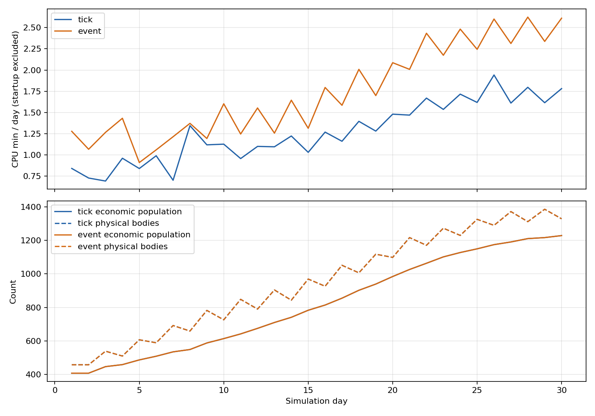

30날 CPU 틱 39.917분 · 사건 54.153분 · 1위 기타(사건 46.3%) · 2위 몸 틱(사건 42.0%) · 3위 저장·DB(사건 5.1%) · 몸 틱 몫 틱 42.3%/사건 42.0% · 400날 외삽 선형 보장 못함(일 단가 상승) · 1시간까지 줄일 배수 틱 8.50/사건 11.68 · 두 가지 차이 전역 지문 12/30 대 17/30·재시작 바인딩 상이 · 끈 판 1/1 · 회부 3

# T1262 — 몸 전부 30일 CPU 분해

**베이스:** main `7f5696bc`(land1066 포함). **가지:** `batch/body-profile-1110`. **계측 대상:** 독립 V4 `08bf7597` 고정본. 2026-11-11 KST. **제품 변경 0 · 가지 선택/채택 0.**

- 두 판 모두 51마을·몸 무제한·라이브 하루 1,440,000ms·농사 켬·시드1020·가상 시계로 **30일 완주**, 실제 종료0·시계 오류0.
- 사건 CPU는 이번 틱 대비 +35.67%. 과거 V4의 +3.711%와 별도 실행이다. 관측 비용과 실행 환경을 포함한 값이며 코드 개선/퇴보의 단독 인과로 쓰지 않는다.
- 원본과 관측판의 첫날 원시 세계 값은 두 갈래 각각 같음. 과거 V4 원자료와도 날별 대조하고 제품 SHA를 고정 커밋과 확인했다.
- 현재 main의 기본 시계 보정은 켬(새 기준선 인구3914). 요청한 구 기준선3867 검증은 `T1253_CLOCK_FIX=0 T1258_ARTISAN_CLOCK=0 T1241_DES=0`에서 **1/1·실행 종료0**.

## 1. 실제 CPU 분과 몫

`process.threadCpuUsage()`로 구간별 main thread CPU를 중첩 제외 적산했다. 존 프로세스의 다른 스레드 CPU는 기타에 둔다. 아홉 칸의 합 = 종료 관측 시점 존 `process.cpuUsage()` user+system. 관리자/스텁, wall 시간, 기존 nsStep/nsMove는 이 표의 CPU에 쓰지 않았다.

| 구간 | 틱 CPU분 | 틱 % | 사건 CPU분 | 사건 % |
|---|---:|---:|---:|---:|
| 몸 틱(결정·이동·밀기·DES 큐) | 16.870 | 42.26 | 22.727 | 41.97 |
| econ 하루·사건 장부 | 0.442 | 1.11 | 0.418 | 0.77 |
| 생활층 등 하루 끝 | 0.462 | 1.16 | 0.446 | 0.82 |
| 길찾기(path-core) | 0.856 | 2.15 | 0.774 | 1.43 |
| 교역로(길찾기 제외) | 0.180 | 0.45 | 0.173 | 0.32 |
| 저장·DB | 1.620 | 4.06 | 2.781 | 5.14 |
| 관찰기 | 0.046 | 0.12 | 0.050 | 0.09 |
| 기동(main thread) | 1.804 | 4.52 | 1.730 | 3.19 |
| 기타(몸 보조·이벤트 루프·다른 스레드 등) | 17.637 | 44.18 | 25.055 | 46.27 |
| 합 | 39.917 | 100 | 54.153 | 100 |

**몸 틱은 표에 적은 네 문이다.** 공간 재구축·WASM 이동 준비·개별 게이지 등 몸 보조 문은 기타에 포함된다. 따라서 기타를 모두 몸 바깥 비용이나 제거 가능한 비용으로 해석하지 않는다. 기존 `T1241_PROBE=1`의 NPC 안 clock 탐침도 원래 실행 그대로 포함했다. 새 전환 계량의 비용도 임의로 차감하지 않았다.

### 길찾기 호출과 평균

아래는 export API별 **전체 생애(기동 포함) inclusive main-thread CPU/호출**이다. 기동을 제외한 위 표의 길찾기 몫과 직접 곱셈 일치하는 수치가 아니다. 시작 호출·재개·smooth를 합쳐 새 A* 탐색 수로 부르지 않는다.

| API | 틱 호출 | 틱 평균 μs | 사건 호출 | 사건 평균 μs |
|---|---:|---:|---:|---:|
| `path:localPath` | 250,396 | 75.122 | 250,861 | 70.837 |
| `path:pathStep` | 936,024 | 114.981 | 937,932 | 105.755 |
| `path:routePathBegin` | 2,676 | 30.065 | 2,678 | 35.829 |
| `path:smoothPath` | 142,403 | 50.662 | 141,501 | 48.414 |

## 2. 날별 CPU·인구·실제 몸

첫날은 부분 날이며 기동 CPU를 포함한다. 위 곡선의 CPU는 분리한 기동 칸을 뺐다. 인구는 경제 명부, 몸은 `players.size`(캐러밴·병사 포함, 동물 mobs 제외)다. 둘은 같은 수가 아니다. 아래 표는 일별 실제 CPU이며, 원시 누적·AI Set·사건 소유 몸·NPCstep/몸 방문 수는 JSONL과 CSV에 있다.

| 날 | 틱 CPU분 | 틱 인구 | 틱 몸 | 사건 CPU분 | 사건 인구 | 사건 몸 |
|---:|---:|---:|---:|---:|---:|---:|
| 1 | 2.645 | 408 | 458 | 3.009 | 408 | 458 |
| 2 | 0.729 | 408 | 458 | 1.068 | 408 | 458 |
| 3 | 0.693 | 447 | 539 | 1.267 | 447 | 539 |
| 4 | 0.962 | 459 | 510 | 1.432 | 459 | 510 |
| 5 | 0.841 | 487 | 607 | 0.911 | 487 | 607 |
| 6 | 0.991 | 509 | 589 | 1.061 | 509 | 589 |
| 7 | 0.703 | 535 | 692 | 1.215 | 535 | 692 |
| 8 | 1.346 | 549 | 659 | 1.372 | 549 | 659 |
| 9 | 1.120 | 588 | 782 | 1.194 | 588 | 782 |
| 10 | 1.128 | 614 | 726 | 1.603 | 614 | 726 |
| 11 | 0.958 | 642 | 848 | 1.247 | 642 | 848 |
| 12 | 1.101 | 675 | 790 | 1.554 | 675 | 790 |
| 13 | 1.097 | 710 | 904 | 1.257 | 710 | 904 |
| 14 | 1.224 | 741 | 843 | 1.645 | 741 | 843 |
| 15 | 1.031 | 783 | 969 | 1.314 | 783 | 969 |
| 16 | 1.270 | 814 | 926 | 1.795 | 814 | 926 |
| 17 | 1.162 | 855 | 1051 | 1.585 | 855 | 1051 |
| 18 | 1.396 | 902 | 1006 | 2.008 | 902 | 1006 |
| 19 | 1.282 | 939 | 1117 | 1.700 | 939 | 1117 |
| 20 | 1.481 | 984 | 1098 | 2.087 | 984 | 1098 |
| 21 | 1.470 | 1026 | 1216 | 2.008 | 1026 | 1216 |
| 22 | 1.670 | 1063 | 1170 | 2.433 | 1063 | 1170 |
| 23 | 1.537 | 1101 | 1272 | 2.174 | 1101 | 1272 |
| 24 | 1.717 | 1127 | 1229 | 2.482 | 1127 | 1229 |
| 25 | 1.619 | 1149 | 1325 | 2.244 | 1149 | 1325 |
| 26 | 1.942 | 1174 | 1289 | 2.601 | 1174 | 1289 |
| 27 | 1.612 | 1190 | 1371 | 2.313 | 1190 | 1371 |
| 28 | 1.797 | 1210 | 1311 | 2.624 | 1210 | 1311 |
| 29 | 1.616 | 1216 | 1385 | 2.338 | 1216 | 1385 |
| 30 | 1.782 | 1228 | 1328 | 2.611 | 1228 | 1328 |

두 판의 일 마감 인구·몸 수는 30/30 시점에서 같다. 경제 인구는 408→1228, 실제 몸은 458→1328이며 아래 패널의 두 판 곡선이 겹친다.

| 지표 | 틱 | 사건 |
|---|---:|---:|
| 첫10일 평균 CPU분/날(기동 칸 제외) | 0.935 | 1.240 |
| 가운데10일 평균 CPU분/날 | 1.200 | 1.619 |
| 마지막10일 평균 CPU분/날 | 1.676 | 2.383 |
| CPU·경제 인구 상관(첫날 제외) | 0.926 | 0.940 |
| CPU·몸 수 상관(첫날 제외) | 0.887 | 0.888 |

인구/몸 증가와 CPU 증가가 함께 관측된다. 다만 일별 종단 몸 수와 하루 전체 작업량은 같지 않고, 상관은 인과 판정이 아니다. 30일 안에서도 단가가 바뀌므로 일정 일 단가의 400일 외삽을 실제 성능으로 주장할 수 없다. 생존·계절·교역·인구가 바뀌는 이후 370일은 미계측이다. 기존 V4의 같은 사건100일 실행에서도 첫30일 CPU63.915분(2.131분/날)과 전체100일298.066분(2.981분/날)은 하루 평균이 약39.9% 다르다. 이는 과거 실행 안의 자료이며 이번30일 계측값을 대신하지 않는다.

## 3. 400일 시나리오와 1시간 목표

분리된 기동 칸을 한 번만 더한 값은 `기동 + (30일 CPU−기동)×400/30`이다. 다른 스레드 CPU는 기타 원칙상 그대로 남는다. 모두 **외삽**이며 400일 몸 전부 실측이 아니다.

| 시나리오 | 틱 분 | 사건 분 |
|---|---:|---:|
| 단순 30일×400/30 | 532.226 | 722.046 |
| 분리한 기동 칸 1회 | 509.982 | 700.708 |
| 마지막10일 일 단가×400+기동 | 672.203 | 954.879 |
| 60 CPU분까지 전체를 같은 비율로 줄일 배수 | 8.500 | 11.678 |
| 기동 칸 고정 시 나머지를 줄일 배수 | 8.732 | 11.996 |

### 이 구간만 비용 0이면

다른 구간은 관측 단가 그대로라는 가정이다. 30일/400일 분을 함께 쓴다. 단일 구간만 줄여 60분에 도달할 수 없는 경우, 그 구간은 몇 배를 줄여도 목표에 못 닿는다. CPU 목표의 필요 절감량이며 wall 1시간 달성 보장은 아니다.

| 0으로 만든 구간 | 틱 30일/400일 분 | 사건 30일/400일 분 | 해당 구간만 줄일 필요 배수(틱/사건) |
|---|---:|---:|---|
| 몸 틱 | 23.047 / 285.049 | 31.427 / 397.684 | 불가(나머지>60분) / 불가(나머지>60분) |
| econ | 39.475 / 504.085 | 53.735 / 695.134 | 불가(나머지>60분) / 불가(나머지>60분) |
| 하루 끝 | 39.455 / 503.823 | 53.708 / 694.763 | 불가(나머지>60분) / 불가(나머지>60분) |
| 길찾기 | 39.061 / 498.564 | 53.380 / 690.391 | 불가(나머지>60분) / 불가(나머지>60분) |
| 교역로 | 39.737 / 507.582 | 53.980 / 698.401 | 불가(나머지>60분) / 불가(나머지>60분) |
| 저장·DB | 38.297 / 488.386 | 51.372 / 663.628 | 불가(나머지>60분) / 불가(나머지>60분) |
| 관찰기 | 39.871 / 509.368 | 54.104 / 700.048 | 불가(나머지>60분) / 불가(나머지>60분) |
| 기동 | 38.113 / 508.179 | 52.423 / 698.978 | 불가(나머지>60분) / 불가(나머지>60분) |
| 기타 | 22.280 / 274.822 | 29.098 / 366.640 | 불가(나머지>60분) / 불가(나머지>60분) |

## 4. 큰 비용의 반복 구조

호출별 통계는 중첩될 수 있어 서로 더하지 않는다. 표의 category CPU는 해당 함수가 열린 동안 같은 구간 칸에 들어간 비용이고, 단가는 그 값/완료 호출 수다. NPCstep 한 번의 순수 단가와 구별한다.

| 문 | 틱 호출 × 구간 μs/호출 | 사건 호출 × 구간 μs/호출 |
|---|---:|---:|
| `body:decision` | 1,288,428 × 629.153 | 1,288,428 × 798.093 |
| `body:movement` | 1,288,428 × 93.531 | 1,288,428 × 71.982 |
| `body:separation` | 1,288,428 × 62.925 | 1,288,428 × 105.388 |
| `body:events` | 0 | 3,865,285 × 27.630 |
| `villages:onGameTick` | 1,288,428 × 336.463 | 1,288,428 × 439.102 |
| `villages:deferLate` | 1,288,428 × 3.834 | 1,288,428 × 3.747 |
| `save:periodic` | 1,288,428 × 16.247 | 1,288,428 × 70.313 |
| `sqlite:run` | 2,974,042 × 13.768 | 2,990,607 × 13.442 |
| `econ:village` | 1,530 × 6156.869 | 1,530 × 6529.450 |
| `path:pathStep` | 936,024 × 114.981 | 937,932 × 105.755 |

실제 NPCstep 호출 합은 틱 1,022,779,369회 / 사건 181,223,059회다. 전체 AI 몸×틱 방문 잠재량은 각각 1,022,779,369/1,022,779,369회이며, 방문/계획/깨움 한 번의 비용은 같지 않다.

1. **몸 결정/이동:** 약 130만 프레임에서 문 자체가 반복된다. 사건 판은 소유 몸의 NPCstep을 줄여도 남은 NPCstep 뒤 `_desTry`를 매번 호출해 작업 계획·기한·시설·경로를 확인한다. 실제 nStep/전체 bodyTicks는 원자료에 있어 호출 감소와 구간 CPU 감소를 분리할 수 있다. 위 결정 문 비용은 경로·DB 같은 다른 칸을 뺀 값이다. 이 관측만으로 개별 내부 함수의 원인 비율을 확정하지 않는다.
2. **기타:** 평시에도 이동 준비·공간 재구축·게이지·몹 처리·각종 타이머/이벤트 루프가 반복되고 다른 스레드 CPU도 여기에 남는다. 별도 FARM1 틱 1일 계측은 첫날 세계 값이 plain과 같았다. `_wwPre`는 35,625회×75.61μs=2.694초, 마을 틱의 기타 부분 1.392초, reach 선계산 문 1.226초, 몸 sweep 1.204초, 몹 AI 문 0.970초, 공간 재구축 0.801초였다. 이는 **한 날의 원인 자료**이며 30일 몫으로 확대하거나 합산 기타 전부를 설명했다고 하지 않는다.
3. **기동/저장:** 기동은 지도·광맥·교역 경로를 처음 굽는 한 번의 비용이다. pathStep의 생애 inclusive 단가에는 이 경로 굽기가 들어가므로 실행 중 길찾기 몫과 구별한다. 저장 칸은 `_periodicSave` 자체의 반복 비용도 포함한다. 이 문은 매 프레임 players 전체를 돌며 `p.isNpc`를 건너뛰고 끝에서 커서를0으로 되돌린다. 이번 1,288,428회 호출의 단가는 틱16.247μs/사건70.313μs였다. SQLite run은 각각 약297만/299만 회였다. 저장용 전수 순회의 반복 단가가 사건 판에서 높게 관측됐다. 상위 세 번째 칸의 실제 순위와 크기는 §1, 호출×단가는 위 표로 확인한다.

계측 자체 빈 enter/leave 쌍은 같은 Node에서 5×20만 회, 약 0.648–0.784μs/쌍이었다. 실제 문은 JIT·키 분포·중첩·공유 부하가 달라 이 값을 정확한 overhead로 빼지 않았다. 짧은 plain과 관측판의 CPU 차이도 단독 인과로 해석하지 않는다.

## 5. 두 T1248 가지 비교 — 선택은 PM

원격을 고정한 SHA와 보고 원문/제품 diff를 증거 폴더에 보존했다. 다른 시점의 제품·기준 세계·부하 조건이므로 열 간 시간 차이를 가지 우열로 단정하지 않는다.

| 항목 | `batch/des-work-1110` `3c1793b0` | `batch/des-work-1110-independent` `08bf7597` |
|---|---|---|
| 제품/성능 소스 | 현재 복원 보완 a47e08a5 계열; 아래 긴 성능은 e1e65d6a | V4 제품 5ad9d3b8 네 파일; 08bf는 보고·원자료 고정 |
| 사건으로 옮긴 부분 | 걷기·잠/쉼·기존 작업 문턱, 개간/밭 진척; FIFO 다섯 접점 | WorkSpan/BodyQueue, 결정Set·이동Map 제외, 경로 셀 사건; 작물은 시작 효과 precommitted+후속 체류 종료 |
| 공간·생존·저장 | BodyIndex 궤적 셀·질의 보간, 비면제 게이지 틱 대체, 새 PID 정본 주인/0시계 복원·실패 몸 재진입 차단 | lazy 자리/각종 깨움·게이지 틱 대체, AI Set 이탈과 실제 몸 삭제를 분리; 새 PID 재시작 바인딩 진단 0/8 실패 |
| 전역 30일 날 지문 | 12/30; 첫13일 어촌9 생가죽 곳간 47.019927→0·세금1.454225→0 | 17/30; 첫18일 광산6 구리 곳간1.410779→1.422010·금고0.043667→0.044015 |
| 1마을 농사 켬 400일 지문(기존 보고) | 30/400; 첫31일 씨73→83 | 68/400; 첫68일 씨78→79. 같은 사건 판 독립 반복끼리는400/400 |
| 전역 자리: **공통 10·20일** | 이번 재집계 p50 **0.697m**, p90 32.299m, max60.387m, 1,736쌍/누락0 | 기존 원자료 p50 **0.353m**, p90 10.275m, max51.626m, 1,824쌍/누락0 |
| 시점별 p50: 10일/20일 | 0.264/1.748m | 0.215/0.689m |
| 기존 30일 실제 CPU(틱/사건) | **44.115/37.792분**, 관측 cpuSec 30행 합·첫 기동 구간 포함·마지막 scan 뒤 꼬리 제외 | **61.628/63.915분**, 사건은 완주100일 판의30일 불변 체크포인트 |
| 기존 30일 경과(틱/사건) | 65.125/71.495분 | 123.063/64.387분 |
| 기존 성능 범위 | 100일 실행 중인 중간 보고; 원격에 없는 종료를 완료로 세지 않음 | 사건100일 CPU298.066분·실제 종료0, 400일 CPU외삽1192.263분(실측 아님) |

**중간 보고의 953.266분은 CPU가 아니다.** `world-checkpoint30.json`의 `wallMinAt30=71.49492679`를 400/30배 한 경과 외삽이다. 실제 CPU는 관측 코드가 `process.cpuUsage(cpu0)` 후 cpu0를 갱신한 날별 차분이므로 30행을 합쳐 재계산했다. 기존 보고 원문은 고치지 않고 이 보고에서 단위를 바로 구분했다.

이번 새30일 대조도 17/30 날 지문이 같고 첫 차이는18일이다. 같은10·20일 자리 p50는 0.353m다. 기존 V4 세계 trace30/30 재현 여부는 historical-validation.json에 따로 기록했다.

자리의 기존 중간 보고 p50=1.298m는 0·10·20일 합산이었다. 이번 표는 독립 V4와 같은 10·20일 창만 재집계했다. 각 가지 내부 틱/사건의 안정 신원 비교이며 서로 다른 가지의 같은 세계 좌표를 직접 비교한 표가 아니다. 두 가지 모두 20일 단독 p50가0.5m를 넘는다.

FIFO는 두 가지 모두 정본 배정 권한 전체를 대체한 것으로 보지 않는다. 독립 V4는 기존 정본 선점 뒤 연결한 5군이며, 작물 효과도 모두 완료로 옮긴 구현이 아니다. 현재 커밋의 복원 검증과 이전 제품의 성능 수치를 섞지 않는다.

## 6. 검증·원자료·회부

- 배선: main/V4 각각 실패0·기존 경고1. sandbox의 spawn EPERM은 실제 검증 실패로 세지 않고 실행 권한으로 재실행한 로그를 보존했다.
- 끔: 구 8c 기준선 1020:400 **1/1·인구3867·실제 종료0**, 956초. main 기본값의3914와 구분한다.
- 본 계측: 각각 요청30일·프로세스 종료0·clock errs0·유효 T577 JSON. 고정 V4의 제품/원 관측 파일 SHA와 실행 후 파일 SHA를 확인했다.
- 새 도구: 첫날 raw world 값 두 갈래 각각 plain과 같음. 보조 기타 계측도 같은 첫날 세계. 30일 trace는 기존 같은 V4 trace와 대조했다.
- 변경 범위: `scripts/t1262/`, 이 보고와 `계측/T1262_2026-11-11/`뿐. 제품/정본/기준선 파일 변경0. 기존 두 가지는 합치거나 선택하지 않았다.

**회부 3:** (1) 전체 지문과 시점별 자리 기준 미충족은 두 가지 모두 남아 있으며 PM의 선택/후속 배정이 필요하다. (2) 400일 선형 외삽과 1시간 목표는 실측 달성이 아니며 몸 핵심 문 한 칸만 줄이는 것으로 해결되지 않는다. 기타 안 몸 보조·타이머 비용을 포함해 후속 절감 범위를 정해야 한다. (3) 독립 V4의 새 PID 바인딩 실패와 중간 가지 복원 보완은 성능과 별개로 유지해야 할 검증 근거다. 본 카드에서는 제품을 고치거나 판정을 대신하지 않았다.

재현·경계 정의: [METHODS](../계측/T1262_2026-11-11/METHODS.md). [요약 JSON](../계측/T1262_2026-11-11/summary.json), [틱 일별 CSV](../계측/T1262_2026-11-11/tick-daily.csv), [사건 일별 CSV](../계측/T1262_2026-11-11/event-daily.csv), [단위 교정 원자료](../계측/T1262_2026-11-11/intermediate-timing-evidence.json), [공통 자리 창](../계측/T1262_2026-11-11/intermediate-position-common-window.json). 원시 JSONL·종료·프로파일·소스 SHA·OFF는 같은 폴더의 `runs/`와 `source-validation.json`, `SHA256SUMS`에 있다.
