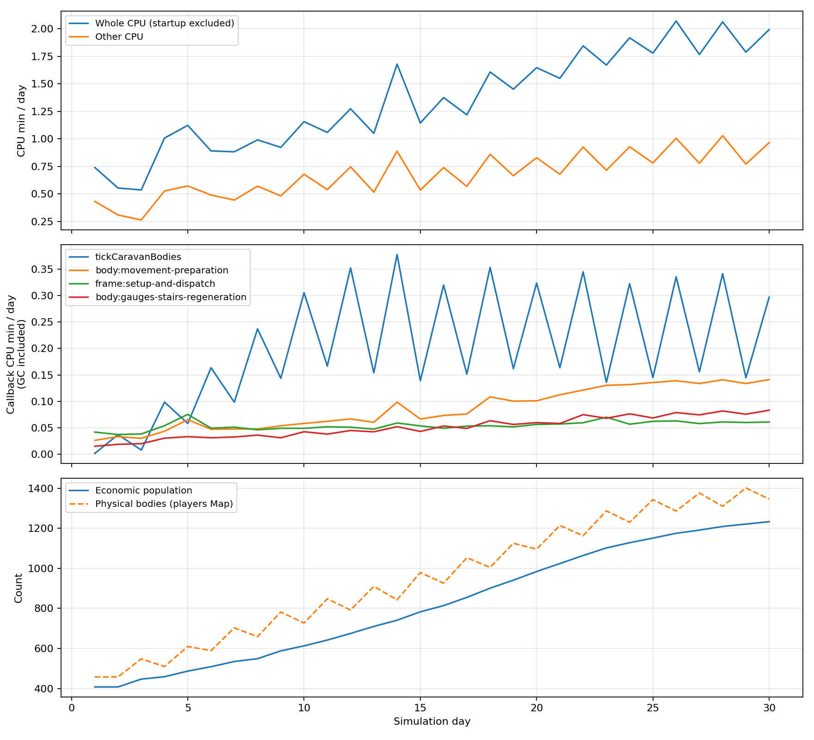

기타 20.255분 → 1위 캐러밴 몸 전진(29.3%) · 2위 이동 준비(_wwPre)(12.5%) · 3위 프레임 변수·클로저·계량 복귀(7.8%) · 쪼갠 합 96.98% · 날 단가 오르는 까닭 몸 증가에 따른 프레임당 반복 비용 증가 · 끈 판 1/1 · 회부 2

# T1270 — main 틱 판 기타 CPU 분해

**측정 대상:** 고정 main `b17f6089`(land1067 뒤). **가지:** `batch/body-profile-2-1111`. 2026-11-12 KST. **제품 변경0·채택/설계 판정0.**

- 몸 전부·라이브 하루 길이1,440,000ms·시드1020·농사 켬·가상 시계 **30일 완주**, 실제 존/러너 종료0·clock 오류0. CPU 총 **42.106분**, 그중 기타 **20.255분**.
- 기타의 이름 붙인 합 **19.643분(96.98%)**. 나머지 **0.612분**은 미분류로 남겨 분자에서 뺐다.
- 첫10일 기타 평균 **0.478분/날** → 마지막10일 **0.858분/날**. 인구/몸 수와 프레임당 비용 곡선을 함께 보존했다.
- 새 기준선 **인구3914·1020:400 같음1/1**, 실제 종료0. 제품/원 관측 파일 SHA는 고정 main과 일치한다.
- 간격 타이머15개를 전수 대조했다. 정적14개 밖 하나는 Node HTTP 연결 점검30초다. GC는 벽시간이 아닌 native thread CPU의 합집합으로 나눴다.
- 회부2: 남은 미분류의 추가 귀속과 계량 비용/펌프 합산 경계를 고려한 후속 범위는 PM이 정한다. 이번 카드는 CPU 표·원자료만 낸다.

## 1. CPU 합과 기타 분해

콜백·문·함수 전후 `threadCpuUsage()`로 실제 main thread CPU를 중첩 제외 계량했다. 프로세스 전체에서 뺀 나머지는 배경 CPU다. 아래 전체 갈래 합과 기타 세부 합은 같은 존 process CPU에 닫힌다. 모델/관리자 다른 프로세스는 제외한다. 기동·관찰기·계량 비용도 포함한 **관측된 CPU**다.

| 큰 갈래 | CPU분 | 전체 % |
|---|---:|---:|
| 몸 결정·이동·밀기 | 16.369 | 38.88 |
| econ 하루·모델 사건 장부 | 0.433 | 1.03 |
| 생활층 등 하루 끝 | 0.506 | 1.20 |
| path-core | 0.822 | 1.95 |
| 교역로 | 0.169 | 0.40 |
| 저장·DB/저장용 순회 | 1.721 | 4.09 |
| 감싼 관찰기 | 0.476 | 1.13 |
| 첫 gameTick 전 기동(main thread) | 1.353 | 3.21 |
| 기타 | 20.255 | 48.11 |
| 합 | 42.106 | 100 |

생활 마감·교역로·길찾기 등은 큰 갈래 경계로도 분리한다. 기타의 비율 분모에 이 갈래 CPU를 다시 더하지 않는다. 소문 그래프는 별도 이름으로 표시한다. T1262의 고정 V4와 이번 main은 소스/프로파일이 다르므로 두 실행의 분 수 차이를 제품 개선으로 판정하지 않는다.

### 기타 이름별 CPU와 이것만0인 30일

다른 칸은 그대로 두고 해당 칸 CPU만 뺀 산술 시나리오다. 실제 구현·제거 가능성 판정은 아니다. GC는 매칭한 양을 원래 함수 칸에서 덜어 별도 행으로 뒀다. 호출 수는 완료된 계량 문/함수 수이며, 조건이 거짓이어도 조건문 평가 완료는 센다. 마지막 열린 호출은 종료 지점에 따라 완료 수에 빠질 수 있다.

| 이름/구간 | CPU분 | 기타 % | 완료 계량 횟수 | 이것만0이면 전체30일 분 |
|---|---:|---:|---:|---:|
| 캐러밴 몸 전진 | 5.9345 | 29.30 | 1,289,688 | 36.171 |
| 이동 준비(_wwPre) | 2.5255 | 12.47 | 1,288,428 | 39.580 |
| 프레임 변수·클로저·계량 복귀 | 1.5719 | 7.76 | 1,288,428 | 40.534 |
| 계단·낙하·게이지·회복 | 1.4392 | 7.11 | 2,576,856 | 40.666 |
| 배경 스레드 GC | 1.2968 | 6.40 | native CPU/잔여 | 40.809 |
| 공간 인덱스 재구축 | 1.1171 | 5.52 | 1,288,428 | 40.988 |
| 동물 AI | 0.7041 | 3.48 | 5,153,712 | 41.401 |
| 미분류 배경 스레드 | 0.5403 | 2.67 | native CPU/잔여 | 41.565 |
| 주 스레드 GC | 0.4358 | 2.15 | native CPU/잔여 | 41.670 |
| zone:body:fishing-poll | 0.4239 | 2.09 | 1,288,428 | 41.682 |
| 마을 현지 하루 문 | 0.4151 | 2.05 | 1,288,428 | 41.690 |
| 활성 청크 | 0.3646 | 1.80 | 1,288,428 | 41.741 |
| zone:path:reachability-prebuild | 0.3463 | 1.71 | 1,288,428 | 41.759 |
| zone:villages:frame-call | 0.2774 | 1.37 | 1,288,428 | 41.828 |
| zone:network:players-AOI | 0.2760 | 1.36 | 1,288,428 | 41.830 |
| zone:path:resident-precompute | 0.2595 | 1.28 | 1,288,428 | 41.846 |
| zone:roads:frame | 0.2224 | 1.10 | 1,288,428 | 41.883 |
| 장마당 변화 방송 | 0.1958 | 0.97 | 1,288,429 | 41.910 |
| zone:plants:season-sweep | 0.1501 | 0.74 | 1,288,428 | 41.955 |
| zone:path:raycast-prebuild | 0.1285 | 0.63 | 1,288,428 | 41.977 |
| zone:villages:late-call | 0.1044 | 0.52 | 2,576,856 | 42.001 |
| villages:onGameTick:if (!state.tickJobs) { // Stage 4B: 캐러밴 실체 30Hz 전진 — zone.js idle 존 스킵보다 앞(호출 위치)이라 무인 존에서도 econ과 동행 | 0.0850 | 0.42 | 1,288,429 | 42.021 |
| 가상펌프·HTTP 연결 점검 | 0.0764 | 0.38 | 4,458 | 42.029 |
| villages:deferLate:if (state._t695W) { state._t695W = false; if (!state.tickJobs) { if (!TB.out(TICK_SLICE_MS, 'route') | 0.0762 | 0.38 | 1,288,428 | 42.029 |
| 미분류 주 스레드 | 0.0717 | 0.35 | native CPU/잔여 | 42.034 |
| zone:observer:frame-statistics | 0.0705 | 0.35 | 5,153,713 | 42.035 |
| villages:onGameTick:if (state.saveQueue && state.saveQueue.length) { const vil = state.saveQueue.shift(); try { state.db | 0.0648 | 0.32 | 1,288,429 | 42.041 |
| timer:interval:server/zone.js:17654 | 0.0589 | 0.29 | 429,475 | 42.047 |
| 전쟁 몸 전진 | 0.0469 | 0.23 | 1,148,439 | 42.059 |
| zone:storage:periodic-call | 0.0450 | 0.22 | 1,288,428 | 42.061 |
| zone:try { Wildlife.tick(now); } catch (e) { global._wlErr = (global._wlErr &#124;&#124; 0) + 1; if (global._wlErr  | 0.0433 | 0.21 | 1,288,428 | 42.062 |
| zone:if (SimVillages.t1005Flush) SimVillages.t1005Flush(); | 0.0345 | 0.17 | 1,288,428 | 42.071 |
| villages:onGameTick:try { _granBroadcast(now); } catch (e) { console.error(&#96;[${state.zoneId}] 🏘️ 곳간 재고 방송 실패:&#96;, e.messa | 0.0293 | 0.14 | 1,288,429 | 42.076 |
| villages:onGameTick:try { _mktBroadcast(); } catch (e) { console.error(&#96;[${state.zoneId}] 🏪 장마당 플래그 방송 실패:&#96;, e.message) | 0.0289 | 0.14 | 1,288,429 | 42.077 |
| zone:_diceTick.seed(_SEED.seedOf(_ZONE_SH, 0, 0, zoneGameDay(), _tick.n)); | 0.0288 | 0.14 | 1,288,429 | 42.077 |
| 곳간 변화 방송 | 0.0283 | 0.14 | 1,288,429 | 42.077 |
| zone:roads:raw-prebuild | 0.0260 | 0.13 | 1,288,428 | 42.079 |
| zone:TB.begin(SimVillages.tickSliceMs ? SimVillages.tickSliceMs() : 0); | 0.0259 | 0.13 | 1,288,429 | 42.080 |
| zone:if (_vein) _veinTick(now); | 0.0251 | 0.12 | 1,288,428 | 42.080 |
| villages:onGameTick:if (T731_ON) { _t731Tick(now); return; } | 0.0247 | 0.12 | 1,288,428 | 42.081 |
| zone:tickDowned(now); | 0.0241 | 0.12 | 1,288,428 | 42.081 |
| zone:TB.lateEnd(Date.now() - _decT0, 15, _stopAt !== null); | 0.0234 | 0.12 | 1,288,428 | 42.082 |
| zone:soil:frame | 0.0230 | 0.11 | 1,288,428 | 42.083 |
| 줄어드는 몸 | 0.0227 | 0.11 | 1,288,429 | 42.083 |
| zone:_npcCursor = _curHit ? _stopAt : null; | 0.0211 | 0.10 | 1,288,428 | 42.084 |
| zone:bandits:frame | 0.0211 | 0.10 | 1,288,428 | 42.084 |
| zone:roomsFlush(); | 0.0204 | 0.10 | 1,288,428 | 42.085 |
| zone:stepArrows(dt); | 0.0201 | 0.10 | 1,288,428 | 42.085 |
| zone:if (SimVillages.t1034Flush) SimVillages.t1034Flush(); | 0.0201 | 0.10 | 1,288,428 | 42.085 |
| zone:if (_desClk) { _desStat.nsMove += Number(_desClk() - _desM0); _desStat.nMoveTicks++; } | 0.0197 | 0.10 | 1,288,428 | 42.086 |
| villages:deferLate:if (state._t695C) { state._t695C = false; if (state.tickJobs) { if (TB.out(TICK_SLICE_MS, 'close'))  | 0.0184 | 0.09 | 1,288,428 | 42.087 |
| zone:if (T696) db.walTick(); | 0.0176 | 0.09 | 1,288,428 | 42.088 |
| zone:if (_t566RelPend.length) _t566FlushRel(); | 0.0175 | 0.09 | 1,288,428 | 42.088 |
| zone:TB.end(); | 0.0171 | 0.08 | 1,288,428 | 42.088 |
| zone:{ const _gd = zoneGameDay(); if (_gd !== _lastFarmStageDay) { _lastFarmStageDay = _gd; _farmStageQ = | 0.0161 | 0.08 | 1,288,428 | 42.089 |
| zone:if (_wwVerify && _WW) _wwCheck(_walk.steps - _wwSteps0); | 0.0159 | 0.08 | 1,288,428 | 42.090 |
| zone:network:observers-AOI | 0.0148 | 0.07 | 1,288,428 | 42.091 |
| zone:_decT0 = Date.now(); | 0.0143 | 0.07 | 1,288,428 | 42.091 |
| zone:lastTick = now; | 0.0136 | 0.07 | 1,288,429 | 42.092 |
| zone:network:ghosts | 0.0136 | 0.07 | 1,288,428 | 42.092 |
| zone:if (BC.VERIFY) BC.check(players); | 0.0133 | 0.07 | 1,288,429 | 42.092 |
| villages:onGameTick:if (T695_LATE()) { if (!state.tickJobs) state._t695W = true; } else if (!state.tickJobs) { if (!TB.o | 0.0129 | 0.06 | 1,288,429 | 42.093 |
| villages:deferLate:if (!TB.DEC_FIRST) return; | 0.0121 | 0.06 | 1,288,428 | 42.093 |
| zone:_decT0 = 0; | 0.0114 | 0.06 | 1,288,428 | 42.094 |
| villages:onGameTick:if (_t732BootWait) { try { _t732Boot(); } catch (e) { _t732BootWait = false; console.error(&#96;[${state | 0.0113 | 0.06 | 1,288,429 | 42.094 |
| zone:if (!T385_ONE_SWEEP) for (const p of players.values()) _inputTOStep(p, now); | 0.0109 | 0.05 | 1,288,428 | 42.095 |
| zone:if (!T385_ONE_SWEEP) for (const p of players.values()) _fallStepP(p); | 0.0109 | 0.05 | 1,288,428 | 42.095 |
| zone:if (_elapsed > _tick.maxGap) _tick.maxGap = _elapsed; | 0.0108 | 0.05 | 1,288,429 | 42.095 |
| zone:_tick.wall += _elapsed; | 0.0108 | 0.05 | 1,288,429 | 42.095 |
| villages:onGameTick:if (state.tickJobs) { const _due = T714_DUE_FIRST && TB.DEC_FIRST && (T731_ON ? _t731Due(now) : game | 0.0106 | 0.05 | 1,288,429 | 42.095 |
| timer:timeout:server/villages.js:5775 | 0.0105 | 0.05 | 15,024 | 42.095 |
| zone:if (T487_SNOW) { try { require('./snow').at(gameDayNow()); } catch (e) {} } | 0.0104 | 0.05 | 1,288,428 | 42.095 |
| zone:_tick.n++; | 0.0102 | 0.05 | 1,288,429 | 42.095 |
| zone:_tick.sim += dt; | 0.0102 | 0.05 | 1,288,429 | 42.095 |
| villages:onGameTick:if (!state._oreWarm && state.villages && state.villages.length) _oreWarmStart(); | 0.0097 | 0.05 | 1,288,429 | 42.096 |
| villages:onGameTick:_t1026Seq++; | 0.0097 | 0.05 | 1,288,429 | 42.096 |
| villages:onGameTick:if (!state.ready) return; | 0.0096 | 0.05 | 1,288,429 | 42.096 |
| zone:if (_elapsed > DT_MAX) { _tick.clip++; _tick.clipped += _elapsed - DT_MAX; } | 0.0095 | 0.05 | 1,288,429 | 42.096 |
| zone:if (!T385_ONE_SWEEP) for (const p of players.values()) _hpRegenStep(p); | 0.0095 | 0.05 | 1,288,428 | 42.096 |
| zone:_tick.debt = _tickDebt; | 0.0092 | 0.05 | 1,288,429 | 42.096 |
| zone:if (!T385_ONE_SWEEP) for (const p of players.values()) _stairStepP(p); | 0.0091 | 0.05 | 1,288,428 | 42.096 |
| zone:TB.lateBegin(); | 0.0090 | 0.04 | 1,288,428 | 42.096 |
| zone:if (!T385_ONE_SWEEP) for (const p of players.values()) _gaugeNetStep(p); | 0.0090 | 0.04 | 1,288,428 | 42.097 |
| zone:if (_stopAt !== null) _walk.cut++; | 0.0089 | 0.04 | 1,288,428 | 42.097 |
| timer:interval:server/zone.js:5454 | 0.0035 | 0.02 | 8,589 | 42.102 |
| timer:timeout:server/zone.js:5841 | 0.0030 | 0.01 | 10,199 | 42.103 |
| timer:timeout:server/villages.js:5759 | 0.0014 | 0.01 | 51 | 42.104 |
| timer:interval:server/zone.js:12224 | 0.0009 | 0.00 | 8,589 | 42.105 |
| timer:interval:server/zone.js:17657 | 0.0006 | 0.00 | 4,294 | 42.105 |
| timer:interval:server/zone.js:16357 | 0.0006 | 0.00 | 715 | 42.105 |
| timer:interval:server/village-view.js:50 | 0.0004 | 0.00 | 8,589 | 42.105 |
| timer:interval:server/zone.js:5446 | 0.0003 | 0.00 | 4,294 | 42.105 |
| timer:interval:server/zone.js:10376 | 0.0002 | 0.00 | 715 | 42.105 |
| timer:interval:server/zone.js:1849 | 0.0002 | 0.00 | 1,431 | 42.105 |
| timer:interval:server/newcomers.js:171 | 0.0001 | 0.00 | 143 | 42.105 |
| rumor:rowOf | 0.0001 | 0.00 | 844 | 42.105 |
| timer:timeout:server/villages.js:5777 | 0.0001 | 0.00 | 1 | 42.105 |
| timer:timeout:server/zone.js:16355 | 0.0001 | 0.00 | 1 | 42.105 |
| timer:timeout:server/newcomers.js:170 | 0.0000 | 0.00 | 1 | 42.106 |
| timer:interval:server/zone.js:2618 | 0.0000 | 0.00 | 1,431 | 42.106 |
| timer:timeout:server/claims.js:296 | 0.0000 | 0.00 | 1 | 42.106 |
| timer:interval:server/zone.js:10809 | 0.0000 | 0.00 | 47 | 42.106 |
| timer:interval:server/claims.js:297 | 0.0000 | 0.00 | 23 | 42.106 |

원시 이름·소스 위치·전체 갈래의 이것만0 값까지 [blocks.csv](../계측/T1270_2026-11-12/blocks.csv)에 있다. 미분류를 이름만 바꿔 넣지 않았고, 분해율은 미분류 주 스레드/배경 CPU를 제외해 계산했다.

## 2. 큰 셋: 호출 수 × 단가와 반복

1. **캐러밴 몸 전진 — 5.935분, 기타 29.30%:** 1,289,688회 × 276.091μs/완료 구간. 원시 키 `other::villages:tickCaravanBodies`. 소스 `server/villages.js`.
2. **이동 준비(_wwPre) — 2.526분, 기타 12.47%:** 1,288,428회 × 117.608μs/완료 구간. 원시 키 `other::zone:body:movement-preparation`. 소스 `server/zone.js:16775`.
3. **프레임 변수·클로저·계량 복귀 — 1.572분, 기타 7.76%:** 1,288,428회 × 73.200μs/완료 구간. 원시 키 `other::frame:setup-and-dispatch`. 소스 `server/zone.js:16408`.

**캐러밴 몸 전진:** 1,289,688회 × 276.091μs = 5.935분. `server/villages.js:4989`는 매 프레임 caravanBodies를 돌며 플레이어를 찾고, 해당 T1182 몸에는 T1253 econ 시각에 맞춘 30Hz 알갱이(한 번에 상한15개)로 걷기/머묾을 잇는다. 머묾에서도 호위의 정위치 수렴을 호출한다. 완료 교역 횟수와 다른 프레임 반복이며, 일별 곡선의 비용 증가는 첫10일 대비 마지막10일 약2.08배다. 주민 밖 실체가 늘어 같은 프레임에서 처리할 몸/걸음이 증가하는 구조를 source와 곡선이 함께 보여 준다.

**이동 준비:** 1,288,428회 × 117.608μs = 2.526분. `_wwPre`(`server/zone.js:16083`)는 임시 목록들을 비우고 players 전체에서 `_wwPreOne`을 부른 뒤 선택한 몸의 X/Y/VX/VY/RD 열을 다시 채운다. 걷는 몸이0인 경우에도 전체 몸 거름은 먼저 한다. 실제 이동 적용과 별도인 준비 순회가 매 프레임 반복되며, 일별 비용은 약2.92배로 늘었다.

**프레임 변수·클로저·계량 복귀:** 1,288,428회 × 73.200μs = 1.572분. 마킹한 문 사이의 gameTick self CPU다. 원본35개 선언에는 `Array.from(players.values())`, `Array.from(mobs.values())`, 결정/이동 클로저 준비가 있고, 새 계량기의 label 조회·구간 복귀 bookkeeping도 이 부모 범위에 들어간다. 이 둘의 개별 CPU를 재지 않았으므로 이 행은 혼합 self로 보존한다. 일별 증가 약1.24배는 위 두 몸 순회보다 작다. 이것만0 수치는 관측 포함 구간 전체를 빼는 산술값이고 순수 제품의 절감량은 추가 측정 대상이다.

`frame:setup-and-dispatch`는 다른 문을 뺀 실제 gameTick 함수 self CPU이며 변수/클로저 준비와 계량 bookkeeping이 함께 있다. 35개 선언은 frame-self-statements.json에 있다. 이 값 전부를 순수 모델 로직이라고 부르지 않는다. 원래 NPC 안 clock 두 번·카운터는 몸 결정에 남으므로 observer 행만으로 모든 관측 비용이 되지는 않는다.

빈 계량 쌍 실험 5×10만 회는 약1.36–2.06μs/쌍이었다. 실제 문은 키/중첩/GC/JIT 분포가 달라 정확한 보정값으로 빼지 않았다. 낮은 단가의 문은 관측 비용의 영향을 특히 받는다.

## 3. 날별 곡선: 인구·몸 수·프레임당 비용

첫날은 기동을 포함한 부분 날이다. 위 전체 CPU 선은 분리한 기동을 뺐다. 함수별 일 곡선은 **GC 포함 콜백 CPU**이며 전체30일 표의 GC 분리 뒤 값과 합쳐 더하지 않는다. 몸은 players Map(캐러밴·병사 포함, 동물 제외), 인구는 경제 명부다.

| 날 | 전체 CPU분 | 기타 CPU분 | 인구 | 몸 | 누적 frame |
|---:|---:|---:|---:|---:|---:|
| 1 | 2.094 | 0.433 | 408 | 458 | 35626 |
| 2 | 0.554 | 0.310 | 408 | 458 | 78826 |
| 3 | 0.537 | 0.265 | 447 | 548 | 122026 |
| 4 | 1.008 | 0.528 | 459 | 510 | 165226 |
| 5 | 1.123 | 0.573 | 487 | 610 | 208426 |
| 6 | 0.891 | 0.491 | 509 | 589 | 251626 |
| 7 | 0.883 | 0.445 | 535 | 703 | 294826 |
| 8 | 0.991 | 0.571 | 549 | 659 | 338026 |
| 9 | 0.923 | 0.483 | 588 | 782 | 381226 |
| 10 | 1.157 | 0.679 | 613 | 727 | 424426 |
| 11 | 1.059 | 0.540 | 642 | 848 | 467627 |
| 12 | 1.274 | 0.746 | 675 | 792 | 510827 |
| 13 | 1.050 | 0.518 | 710 | 910 | 554027 |
| 14 | 1.678 | 0.888 | 741 | 843 | 597227 |
| 15 | 1.145 | 0.536 | 783 | 979 | 640427 |
| 16 | 1.376 | 0.739 | 814 | 926 | 683627 |
| 17 | 1.219 | 0.569 | 855 | 1053 | 726827 |
| 18 | 1.607 | 0.861 | 901 | 1005 | 770027 |
| 19 | 1.451 | 0.666 | 941 | 1125 | 813227 |
| 20 | 1.647 | 0.829 | 984 | 1096 | 856428 |
| 21 | 1.550 | 0.679 | 1024 | 1214 | 899628 |
| 22 | 1.845 | 0.926 | 1064 | 1163 | 942828 |
| 23 | 1.670 | 0.716 | 1102 | 1287 | 986028 |
| 24 | 1.918 | 0.928 | 1128 | 1230 | 1029228 |
| 25 | 1.778 | 0.782 | 1151 | 1343 | 1072428 |
| 26 | 2.070 | 1.006 | 1175 | 1286 | 1115628 |
| 27 | 1.766 | 0.779 | 1191 | 1376 | 1158828 |
| 28 | 2.063 | 1.029 | 1209 | 1310 | 1202028 |
| 29 | 1.787 | 0.772 | 1221 | 1401 | 1245228 |
| 30 | 1.992 | 0.966 | 1233 | 1346 | 1288429 |

| 주요 콜백(곡선은 GC 포함) | 첫10일 분/날 | 마지막10일 분/날 | 배수 | 첫/끝10일 μs/전체frame |
|---|---:|---:|---:|---:|
| other::villages:tickCaravanBodies | 0.115 | 0.239 | 2.08 | 159.79 / 331.56 |
| other::zone:body:movement-preparation | 0.045 | 0.132 | 2.92 | 63.40 / 183.18 |
| other::frame:setup-and-dispatch | 0.049 | 0.061 | 1.24 | 69.19 / 84.27 |
| other::zone:body:gauges-stairs-regeneration | 0.029 | 0.074 | 2.56 | 40.50 / 102.51 |
| other::zone:space:rebuild-index | 0.018 | 0.056 | 3.07 | 25.79 / 78.42 |

날마다 frame 격자는 거의 일정하지만 인구·실제 몸 수와 함께 프레임당 처리 비용이 바뀐다. 일별 종단 몸 수와 하루 전체 방문량은 같지 않으며, 상관만으로 원인을 확정하지 않는다. 큰 셋의 반복 구조와 위 구간별 단가 변화가 어느 덩이에서 증가했는지의 근거다. 일정 날 단가로400일을 늘리는 가정은 이번30일에서도 고정되지 않았다. 이후370일은 이번 판에서 재지 않았다.

## 4. GC와 body 밖 타이머

### GC 실제 CPU

- main GC native CPU: **67.879초**, 그중 함수에 매칭해 별도 행으로 덜어낸 양 **54.928초**. 미매칭 **12.951초**는 원래 함수 칸에 남는다(진단량을 표에 다시 더하지 않음).
- 배경 GC native CPU: **77.809초**. 전체 배경 CPU **110.225초**의 나머지를 GC라고 부르지 않는다.
- CPU 필드는 `tts/tdur`, 경과 필드는 `ts/dur`다. 같은 tid에서 부모/자식 단계의 CPU 구간 합집합으로 중복을 뺐다. GC 이름 없는 ConcurrentMarking 등도 v8.gc 카테고리로 포함했다.
- 미매칭 main GC 전체를 추가로 기타의 미분류로 가정하는 보수적 상계도 분해율 **95.91%**다. 이는 CPU 표의 재배분이 아닌 불확실성 상계다.
- GC 소유 함수는 실제 PerformanceObserver 시작 시각과 최근 콜백 경계를 연결했다. 매칭 실패는 억지 분배하지 않았다. 추적 회전 파일을 모두 보존했고 Native 시간 예는 gc-clock-proof.json에 있다.

### 간격 타이머 전수

정적 등록기14개와 Node HTTP 서버의30초 연결 점검1개를 합쳐15개다. 아래의 콜백 CPU는 마킹한 하위 작업/GC를 뺀 self CPU다. 게임Tick 자체는 본문 여러 칸으로 나뉘므로 이 행만으로 전체 gameTick CPU가 되지는 않는다.

| 소스 | 요청 주기ms | 등록 | 실제 콜백 진입 | CPU분/범위 |
|---|---:|---:|---:|---|
| server/zone.js:1849 | 30000 | 1 | 1,431 | 0.0002 |
| server/zone.js:2618 | 30000 | 1 | 1,431 | 0.0000 |
| server/zone.js:5446 | 10000 | 1 | 4,294 | 0.0003 |
| server/zone.js:5454 | 5000 | 1 | 8,589 | 0.0035 |
| server/village-view.js:50 | 5000 | 1 | 8,589 | 0.0004 |
| server/claims.js:297 | 1800000 | 1 | 23 | 0.0000 |
| server/newcomers.js:171 | 300000 | 1 | 143 | 0.0001 |
| server/zone.js:10376 | 60000 | 1 | 715 | 0.0002 |
| server/zone.js:10809 | 900000 | 1 | 47 | 0.0000 |
| server/zone.js:12224 | 5000 | 1 | 8,589 | 0.0009 |
| server/zone.js:16357 | 60000 | 1 | 715 | 0.0006 |
| server/zone.js:16408 | 33.333333333333336 | 1 | 1,288,429 | 1.5719 |
| server/zone.js:17654 | 100 | 1 | 429,475 | 0.0589 |
| server/zone.js:17657 | 10000 | 1 | 4,294 | 0.0006 |
| node:_http_server setupConnectionsTracking | 30000 | 1 | 1,431 | 가상펌프와 합산 |

전체 interval 등록15개 중 gameTick1개를 뺀 body 밖 등록은14개다. Node HTTP 콜백의 본 판 호출 수 **1,431회**는 전체 가상 fired에서 포착한 콜백 진입 합을 빼서 구했다. 별도 한 날 감사에서는15개를 모두 등록 시 읽었고 Node HTTP 콜백39회·세계 raw plain 일치·종료0을 확인했다.

setTimeout 정적 소스 11종·등록 25,282회, setImmediate 정적 소스 1종도 원자료에 있다. 등록 수와 호출 수·종료 큐 길이는 구분했다. 자세한 전수 대조는 timer-inventory.json이다.

가상펌프는 매400개 가상 콜백 뒤 실제 I/O에 양보한다. 이 함수 CPU에는 독립 마킹하지 않은 Node HTTP 연결 점검이 포함된다. 따라서 펌프와 해당 Native콜백의 CPU를 합친 구간이며 독립 비용0이라고 하지 않는다. 이 펌프는 가속 판자에 속한다. setTimeout/setImmediate의 소스별 등록/호출/주기 분포도 summary.json의 timers에 있다.

## 5. 요청 범위와 검증

- 생활층 일 끝/econ 마을별/모델 사건 장부/교역로/path-core는 큰 갈래·이름별 원자료에 있다. npcLifeTick의 사람별 일과 선택은 몸 결정 안이며, 이를 기타에 중복해서 더하지 않는다. 별도 소문 그래프 호출은 rumor 이름으로 포착한다(호출0이면0으로 읽음).

### path-core 호출 수 × 평균

아래 평균은 기동/하위 호출/GC를 포함한 생애 inclusive CPU/완료 호출이다. 별도 runtime exclusive path 칸과 다르다. 시작 API·pathStep 재개·smooth는 서로 다른 수다.

| API | 호출 | inclusive CPU분 | 평균μs |
|---|---:|---:|---:|
| path:routePathBegin | 2,678 | 0.0023 | 50.459 |
| path:pathStep | 931,716 | 1.3611 | 87.652 |
| path:localPath | 244,723 | 0.3219 | 78.923 |
| path:smoothPath | 142,495 | 0.1129 | 47.557 |

- 본 판: 요청30일·실제 종료0·clock 오류0·51곳 양수 시딩·world JSON30일. 원본 JS/관측 helper SHA 고정 main/실행 시작·끝을 대조했다.
- 새 끔 기준선: `서버기준선_2026-11-11.json --vclock --plan 1020:400`, 인구3914·같음1/1·실제 종료0·645초. 시계 보정은 main 기본 켬 그대로다.
- 계측기: 첫날 raw world는 plain과 동일. 타이머 감사도 같은 첫날 world다. 빈 probe 비용은 별도 메커니즘 실험이며 완료 날로 세지 않았다.
- 회전: 앞 긴 시도는 파일명에 rotation이 없어18일에서 중단했다. 그 CPU/GC를 본 판에 이어 붙이지 않았다. 본 판은 시작부터30일을 다시 돌렸으며 회전 파일 전부를 보존했다. 별도60만 이벤트 시험도3파일에60만 init 보존을 확인했다.
- 변경: `scripts/t1270/`, 이 보고, `계측/T1270_2026-11-12/`만. 제품/계수/손잡이 기본값 변경0. 최적화·채택 판정0.

**회부2:** (1) 미분류 잔여의 추가 귀속 및 Node HTTP/가상펌프 합산을 더 나누는 후속 측정 여부. (2) 관측 비용과 반복 원자료를 바탕으로 실제 최적화 범위를 정하는 PM 판단. 본 카드는 목표90% 이상 분해와 표를 완료한 범위다.

[재현·단위 정의](../계측/T1270_2026-11-12/METHODS.md) · [전체 블록과 이것만0 CSV](../계측/T1270_2026-11-12/blocks.csv) · [일별 CSV](../계측/T1270_2026-11-12/daily.csv) · [주요 구간 일별 CSV](../계측/T1270_2026-11-12/daily-drivers.csv) · [요약 JSON](../계측/T1270_2026-11-12/summary.json). 원문 trace·JSON·로그·source SHA는 같은 폴더 runs/와 source-validation.json, SHA256SUMS에 있다.
