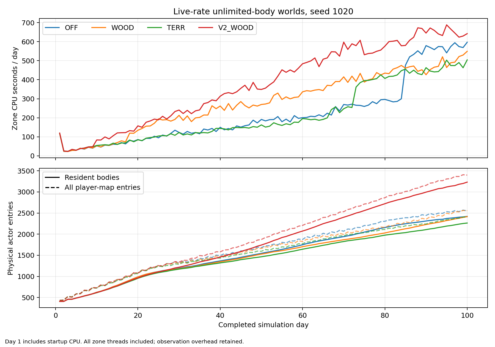

몸 세계 100날 끔비 — 묶음 1.392 · v2만 0.928 · 나무꾼만 0.992(빠른 판 1.184 · 0.743 · 0.784) · 방향 같음 ○ · 시계 고침 몫 -6명(-0.129%·둘 합) · 하루 CPU 221.3 / 283.4 / 215.6 / 377.5초(끔/나무꾼/v2/묶음·2~100일 평균) · 끈 판 1/1 · 회부 켬 기본은 재민 판정

# T1274 — 나무꾼+영토 v2, 몸 전부·라이브 비율 100일 (2026-11-12 시작 · GPT 1)

`[승인 대기 · T1274]` · 가지 `batch/wood-v2-body-1112` · 베이스 `a6b7aba5`(land1068) · 제품 변경 0 · 판정 0.

계측 완료: 2026-11-13 09:32 KST(감독 기록 UTC 00:32:06).

묶음은 인구 +39.2%, 2~100일 평균 CPU +70.6%(끔 대비)다. 다만 이탈 누계는 193 대 6이고, 묶음의 주민 몸/인구 최솟값은94.42%다. 영토 두 판의 실제 몸 완공 카운터는 모두0이며 비관측 일괄 경로를 포함한다. 이 조건과 한 시드·100일 범위를 함께 재민 판정에 회부한다.

## 1. 실제 100일 네 판

시드1020, 51마을의 새 세계. 마을 주민 몸 상한 없음, 하루1,440,000ms의 운영 비율, T745 가상 스케줄러. 집 행위0·캐러밴 상한0·밭 묶음0은 T1244/T1251 판 꼴 그대로다. `T1259_WOOD_CAP=0`을 전부 명시했다. OFF+WOOD, TERR+V2_WOOD를 둘씩 실행했다.

| 팔 | 실제 끝 인구 | 끔비 | T1264 빠른400 끔비 | 빈 마을 | 식량 빚 사망 | 주민 몸 아사 | 몸 노화 사망 | 관측 신규 주민 | 이탈 누계 |
|---|---:|---:|---:|---:|---:|---:|---:|---:|---:|
| 끔 | 2,459 | 1.000 | 1.000 | 0 | 0 | 0 | 2 | 2055 | 6 |
| 나무꾼만 | 2,440 | 0.992 | 0.784 | 0 | 0 | 0 | 2 | 2037 | 1 |
| v2만 | 2,281 | 0.928 | 0.743 | 0 | 0 | 0 | 23 | 1893 | 36 |
| 묶음 | 3,423 | 1.392 | 1.184 | 0 | 0 | 0 | 15 | 3036 | 193 |

주민 몸/인구의 일별 최솟값은 끔 98.35%(최대 인구−몸 40명) · 나무꾼만 98.93%(최대 인구−몸 26명) · v2만 99.21%(최대 인구−몸 18명) · 묶음 94.42%(최대 인구−몸 191명)이다. 몸 상한 Infinity는 실행 조건이며, 각 경계의 실제 몸 수를 인구와 같다고 강제하지 않았다. 퇴장·동기화 등의 native 경로를 그대로 재며 차이의 원인을 하나로 단정하지 않는다.

식량 빚 사망(`_fdDeadTot`)과 몸 아사(`bodyExit.died.starve`)는 별개 기록이며 서로 더하지 않는다. 신규 주민은 econ 틱 앞뒤 객체 차라는 관측 정의다. 이탈·외부 유입이 있어 출생−사망만으로 끝 인구를 분해하지 않는다. 켬 기본은 인구뿐 아니라 사망·이탈·빈 마을과 아래 관측 범위를 함께 보고 재민이 판정한다.

## 2. 10일 간격 — ledger 끝 상태

출생·이탈·벌목·입고·모델 몫은 앞10일 값이다. 식량 빚/몸 아사·말뚝·영토 완료·새 집 칸은 누계, 재고·영토·밭·주거는 그날 값이다. CPU는 앞10일 평균이며 첫 구간에 기동이 포함된다. `새 집 칸`은 최초 econ 틱 전 좌표 이외에 처음 더 관측한 완공 집 좌표이며, 같은 자리 재건 횟수는 아니다.

### 끔

| 날 | 인구 | 주민 몸 | 빈 마을 | 신규 주민10일 | 이탈10일 | 식량 빚 사망누계 | 몸 아사누계 | CPU초/일 |
|---|---:|---:|---:|---:|---:|---:|---:|---:|
| 10 | 623 | 623 | 0 | 215 | 0 | 0 | 0 | 43.7 |
| 20 | 988 | 988 | 0 | 365 | 0 | 0 | 0 | 65.5 |
| 30 | 1,192 | 1,192 | 0 | 204 | 0 | 0 | 0 | 105.1 |
| 40 | 1,366 | 1,366 | 0 | 176 | 0 | 0 | 0 | 129.8 |
| 50 | 1,545 | 1,545 | 0 | 179 | 0 | 0 | 0 | 159.8 |
| 60 | 1,749 | 1,749 | 0 | 204 | 0 | 0 | 0 | 193.0 |
| 70 | 1,943 | 1,941 | 0 | 195 | 0 | 0 | 0 | 224.1 |
| 80 | 2,173 | 2,157 | 0 | 230 | 0 | 0 | 0 | 274.5 |
| 90 | 2,338 | 2,311 | 0 | 165 | 0 | 0 | 0 | 435.2 |
| 100 | 2,459 | 2,420 | 0 | 122 | 6 | 0 | 0 | 572.4 |

| 날 | 영토 칸 | 밭 칸(순증) | 통나무 막힘 | 벌목반환10일 | 행위입고10일 | econ잠재몫10일 | 목재 재고 | 말뚝목재누계 | 개간후영토칸(몸) | 새 집 칸누계 | 주거 |
|---|---:|---:|---:|---:|---:|---:|---:|---:|---:|---:|---:|
| 10 | 175,950 | 5,337 (+129) | — (0/0) | 0.0 | 0.0 | 0.0 | 4,614.2 | 0.0 | 0 (0) | 99 | 1,004.8 |
| 20 | 181,110 | 7,910 (+2702) | — (0/0) | 0.0 | 0.0 | 53.1 | 2,566.5 | 0.0 | 0 (0) | 99 | 1,020.2 |
| 30 | 202,590 | 9,786 (+4578) | — (0/0) | 0.0 | 0.0 | 338.2 | 1,608.2 | 0.0 | 0 (0) | 119 | 1,161.3 |
| 40 | 216,330 | 11,048 (+5840) | — (0/0) | 0.0 | 0.0 | 762.2 | 1,047.6 | 0.0 | 0 (0) | 145 | 1,330.3 |
| 50 | 229,530 | 12,281 (+7073) | — (0/0) | 0.0 | 0.0 | 1,117.9 | 986.8 | 0.0 | 0 (0) | 172 | 1,506.8 |
| 60 | 243,210 | 13,657 (+8449) | — (0/0) | 0.0 | 0.0 | 1,461.2 | 773.4 | 0.0 | 0 (0) | 209 | 1,705.6 |
| 70 | 255,390 | 15,008 (+9800) | — (0/0) | 0.0 | 0.0 | 1,749.5 | 1,012.3 | 0.0 | 0 (0) | 236 | 1,890.3 |
| 80 | 267,510 | 16,415 (+11207) | — (0/0) | 0.0 | 0.0 | 1,705.2 | 837.6 | 0.0 | 0 (0) | 268 | 2,115.3 |
| 90 | 280,110 | 17,370 (+12162) | — (0/0) | 0.0 | 0.0 | 1,731.6 | 751.7 | 0.0 | 0 (0) | 291 | 2,271.7 |
| 100 | 290,970 | 17,966 (+12758) | — (0/0) | 0.0 | 0.0 | 2,070.3 | 1,051.5 | 0.0 | 0 (0) | 311 | 2,403.3 |

### 나무꾼만

| 날 | 인구 | 주민 몸 | 빈 마을 | 신규 주민10일 | 이탈10일 | 식량 빚 사망누계 | 몸 아사누계 | CPU초/일 |
|---|---:|---:|---:|---:|---:|---:|---:|---:|
| 10 | 623 | 623 | 0 | 215 | 0 | 0 | 0 | 44.0 |
| 20 | 987 | 987 | 0 | 364 | 0 | 0 | 0 | 81.8 |
| 30 | 1,181 | 1,181 | 0 | 194 | 0 | 0 | 0 | 178.8 |
| 40 | 1,347 | 1,347 | 0 | 168 | 0 | 0 | 0 | 217.9 |
| 50 | 1,527 | 1,527 | 0 | 180 | 0 | 0 | 0 | 261.9 |
| 60 | 1,703 | 1,703 | 0 | 176 | 0 | 0 | 0 | 305.6 |
| 70 | 1,868 | 1,868 | 0 | 166 | 0 | 0 | 0 | 365.4 |
| 80 | 2,035 | 2,028 | 0 | 167 | 0 | 0 | 0 | 411.7 |
| 90 | 2,246 | 2,228 | 0 | 211 | 0 | 0 | 0 | 454.8 |
| 100 | 2,440 | 2,415 | 0 | 196 | 1 | 0 | 0 | 495.5 |

| 날 | 영토 칸 | 밭 칸(순증) | 통나무 막힘 | 벌목반환10일 | 행위입고10일 | econ잠재몫10일 | 목재 재고 | 말뚝목재누계 | 개간후영토칸(몸) | 새 집 칸누계 | 주거 |
|---|---:|---:|---:|---:|---:|---:|---:|---:|---:|---:|---:|
| 10 | 175,950 | 5,337 (+129) | — (0/0) | 0.0 | 0.0 | 0.0 | 4,614.2 | 0.0 | 0 (0) | 99 | 1,004.8 |
| 20 | 181,110 | 7,921 (+2713) | — (0/0) | 77.0 | 43.8 | 56.2 | 2,560.6 | 0.0 | 0 (0) | 99 | 1,019.5 |
| 30 | 201,960 | 9,724 (+4516) | — (0/0) | 382.0 | 347.3 | 400.2 | 1,795.7 | 0.0 | 0 (0) | 117 | 1,150.9 |
| 40 | 215,100 | 10,909 (+5701) | — (0/0) | 851.0 | 844.4 | 874.5 | 1,317.0 | 0.0 | 0 (0) | 140 | 1,313.0 |
| 50 | 228,840 | 12,195 (+6987) | — (0/0) | 996.0 | 992.4 | 1,035.0 | 941.9 | 0.0 | 0 (0) | 170 | 1,491.0 |
| 60 | 242,820 | 13,372 (+8164) | — (0/0) | 1,168.0 | 1,159.9 | 1,197.3 | 803.3 | 0.0 | 0 (0) | 197 | 1,659.6 |
| 70 | 256,560 | 14,360 (+9152) | — (0/0) | 1,500.0 | 1,483.5 | 1,595.0 | 562.8 | 0.0 | 0 (0) | 228 | 1,817.3 |
| 80 | 266,520 | 15,205 (+9997) | — (0/0) | 2,157.0 | 2,151.0 | 2,206.9 | 965.4 | 0.0 | 0 (0) | 255 | 1,975.2 |
| 90 | 277,920 | 16,170 (+10962) | — (0/0) | 2,836.0 | 2,824.7 | 2,925.1 | 1,872.3 | 0.0 | 0 (0) | 284 | 2,183.0 |
| 100 | 290,280 | 17,100 (+11892) | — (0/0) | 3,085.0 | 3,102.2 | 3,341.9 | 2,409.2 | 0.0 | 0 (0) | 313 | 2,386.0 |

### v2만

| 날 | 인구 | 주민 몸 | 빈 마을 | 신규 주민10일 | 이탈10일 | 식량 빚 사망누계 | 몸 아사누계 | CPU초/일 |
|---|---:|---:|---:|---:|---:|---:|---:|---:|
| 10 | 613 | 613 | 0 | 205 | 0 | 0 | 0 | 46.0 |
| 20 | 955 | 955 | 0 | 342 | 0 | 0 | 0 | 67.5 |
| 30 | 1,172 | 1,172 | 0 | 217 | 0 | 0 | 0 | 103.0 |
| 40 | 1,319 | 1,319 | 0 | 148 | 0 | 0 | 0 | 123.7 |
| 50 | 1,464 | 1,464 | 0 | 145 | 0 | 0 | 0 | 148.5 |
| 60 | 1,646 | 1,643 | 0 | 182 | 0 | 0 | 0 | 168.7 |
| 70 | 1,834 | 1,825 | 0 | 189 | 0 | 0 | 0 | 212.8 |
| 80 | 1,983 | 1,976 | 0 | 149 | 6 | 0 | 0 | 368.8 |
| 90 | 2,114 | 2,107 | 0 | 139 | 11 | 0 | 0 | 437.0 |
| 100 | 2,281 | 2,263 | 0 | 177 | 19 | 0 | 0 | 470.2 |

| 날 | 영토 칸 | 밭 칸(순증) | 통나무 막힘 | 벌목반환10일 | 행위입고10일 | econ잠재몫10일 | 목재 재고 | 말뚝목재누계 | 개간후영토칸(몸) | 새 집 칸누계 | 주거 |
|---|---:|---:|---:|---:|---:|---:|---:|---:|---:|---:|---:|
| 10 | 96,970 | 5,387 (+179) | 61.4% (313/510) | 4,463.0 | 0.0 | 8.8 | 1,601.1 | 2,476.2 | 20,470 (0) | 20 | 1,004.8 |
| 20 | 102,956 | 7,674 (+2466) | 77.9% (795/1020) | 1,083.0 | 0.0 | 341.6 | 413.9 | 2,912.5 | 26,456 (0) | 27 | 1,011.7 |
| 30 | 103,900 | 9,850 (+4642) | 85.1% (1302/1530) | 343.0 | 0.0 | 810.1 | 433.5 | 2,987.6 | 27,400 (0) | 28 | 1,144.9 |
| 40 | 103,990 | 11,243 (+6035) | 88.8% (1812/2040) | 203.0 | 0.0 | 1,115.9 | 473.5 | 2,987.6 | 27,490 (0) | 28 | 1,288.3 |
| 50 | 104,000 | 12,359 (+7151) | 91.1% (2322/2550) | 132.0 | 0.0 | 1,261.7 | 472.1 | 2,987.6 | 27,500 (0) | 28 | 1,429.9 |
| 60 | 104,001 | 13,437 (+8229) | 92.5% (2832/3060) | 169.0 | 0.0 | 1,610.0 | 517.2 | 2,987.6 | 27,501 (0) | 28 | 1,615.9 |
| 70 | 104,001 | 14,670 (+9462) | 93.6% (3342/3570) | 278.0 | 0.0 | 2,384.3 | 679.5 | 2,987.6 | 27,501 (0) | 28 | 1,819.5 |
| 80 | 104,388 | 15,680 (+10472) | 94.3% (3847/4080) | 255.0 | 0.0 | 2,928.5 | 1,314.8 | 3,058.5 | 27,888 (0) | 28 | 1,999.8 |
| 90 | 105,185 | 16,653 (+11445) | 94.7% (4348/4590) | 735.0 | 0.0 | 2,974.3 | 1,812.9 | 3,242.7 | 28,685 (0) | 28 | 2,147.3 |
| 100 | 106,301 | 17,791 (+12583) | 95.0% (4843/5100) | 826.0 | 0.0 | 3,378.7 | 1,956.9 | 3,601.9 | 29,801 (0) | 28 | 2,347.0 |

### 묶음

| 날 | 인구 | 주민 몸 | 빈 마을 | 신규 주민10일 | 이탈10일 | 식량 빚 사망누계 | 몸 아사누계 | CPU초/일 |
|---|---:|---:|---:|---:|---:|---:|---:|---:|
| 10 | 619 | 619 | 0 | 211 | 0 | 0 | 0 | 48.9 |
| 20 | 962 | 962 | 0 | 343 | 0 | 0 | 0 | 116.1 |
| 30 | 1,217 | 1,217 | 0 | 255 | 0 | 0 | 0 | 197.7 |
| 40 | 1,459 | 1,459 | 0 | 244 | 0 | 0 | 0 | 261.1 |
| 50 | 1,743 | 1,742 | 0 | 285 | 0 | 0 | 0 | 347.7 |
| 60 | 2,073 | 2,073 | 0 | 331 | 0 | 0 | 0 | 426.3 |
| 70 | 2,407 | 2,400 | 0 | 335 | 0 | 0 | 0 | 520.8 |
| 80 | 2,757 | 2,720 | 0 | 350 | 0 | 0 | 0 | 562.3 |
| 90 | 3,094 | 2,995 | 0 | 346 | 14 | 0 | 0 | 618.4 |
| 100 | 3,423 | 3,232 | 0 | 336 | 179 | 0 | 0 | 649.7 |

| 날 | 영토 칸 | 밭 칸(순증) | 통나무 막힘 | 벌목반환10일 | 행위입고10일 | econ잠재몫10일 | 목재 재고 | 말뚝목재누계 | 개간후영토칸(몸) | 새 집 칸누계 | 주거 |
|---|---:|---:|---:|---:|---:|---:|---:|---:|---:|---:|---:|
| 10 | 103,219 | 5,400 (+192) | 34.7% (177/510) | 7,226.0 | 2,613.1 | 0.9 | 1,663.5 | 3,782.4 | 26,719 (0) | 22 | 1,004.8 |
| 20 | 117,820 | 7,626 (+2418) | 53.8% (549/1020) | 8,858.0 | 8,370.9 | 250.0 | 6,257.7 | 6,104.7 | 41,320 (0) | 52 | 1,015.2 |
| 30 | 133,978 | 10,128 (+4920) | 56.9% (871/1530) | 7,225.0 | 6,873.0 | 573.2 | 6,378.6 | 9,177.5 | 57,478 (0) | 77 | 1,196.2 |
| 40 | 150,134 | 11,875 (+6667) | 59.0% (1203/2040) | 7,648.0 | 7,860.1 | 928.5 | 8,240.7 | 12,655.0 | 73,634 (0) | 113 | 1,435.6 |
| 50 | 165,866 | 13,782 (+8574) | 60.2% (1535/2550) | 7,448.0 | 6,514.3 | 1,310.7 | 8,111.8 | 16,033.4 | 89,366 (0) | 150 | 1,721.9 |
| 60 | 179,943 | 15,954 (+10746) | 61.6% (1882/3056) | 7,708.0 | 7,191.0 | 1,546.6 | 8,253.4 | 19,166.6 | 103,443 (0) | 195 | 2,043.0 |
| 70 | 192,823 | 17,979 (+12771) | 62.9% (2236/3556) | 7,095.0 | 6,848.4 | 1,699.7 | 8,986.0 | 23,006.6 | 116,323 (0) | 227 | 2,386.1 |
| 80 | 204,873 | 19,750 (+14542) | 64.5% (2618/4056) | 8,721.0 | 8,801.2 | 1,481.9 | 9,741.9 | 25,912.7 | 128,373 (0) | 263 | 2,752.5 |
| 90 | 215,042 | 21,263 (+16055) | 65.7% (2982/4539) | 5,975.0 | 5,978.4 | 1,257.5 | 8,113.7 | 29,009.0 | 138,542 (0) | 286 | 3,113.5 |
| 100 | 223,138 | 22,723 (+17515) | 67.2% (3371/5016) | 5,251.0 | 5,867.4 | 1,570.3 | 8,523.9 | 30,985.0 | 146,638 (0) | 306 | 3,465.5 |

벌목반환은 정본 나무 베기 창구의 `loot.wood` 합으로 개간 등 같은 창구의 작업도 포함한다. 행위입고는 정산 전 inflow 누계와 마지막 미정산 inflow를 합한 정본 입구 값이며 나무꾼·개간이 함께 들어간다. econ 잠재몫은 현재 틱의 `_woodOutLast` 합이다. 세 수와 재고 증감을 같다고 가정하지 않는다. 기존 T1251 시점(이전 틱 모델 몫/정산 앞 입구)도 원문으로 남겼다.

개간후영토칸은 `_t1207.cells`로, 개간·말뚝을 마쳐 영토가 된 누계다. 괄호는 그중 native 몸 완료(`body`)다. 개간 중·말뚝 대기 칸의 총수는 별도 수집하지 않았으며, 밭 칸 순증을 그 수로 대신하지 않았다. 주민 몸 상한을 없애도 영토 과업은 관측자 여부를 따른다. 정본 `_t1207Pay`는 `_t449Seen`일 때 실제 일감 줄, 그 밖의 v2는 `_t1238Batch`를 고른다. 이 판에는 사람 관측자를 더하지 않았다. 따라서 이 표의 native `body`와 전체 `cells`를 함께 읽어야 하며, 주민 몸이 있는 판의 결과를 관측자 근처 영토 실제 과업의 검증으로 확대하지 않는다. v2 일괄의 전역 `bodyCells`는 그 이름만으로 물리 완공 증거가 아니다. 밭의 순증·지도 새 집·추상 주거도 각각 다른 수다.

## 3. 하루 CPU와 몸 수



| 팔 | 기동 포함 첫 경계 CPU초 | 2~100일 평균초 | 중앙초 | 가장 큰 날·CPU초 | ledger100까지 CPU분 |
|---|---:|---:|---:|---:|---:|
| 끔 | 118.8 | 221.3 | 183.7 | 100일 · 596.7 | 367.2 |
| 나무꾼만 | 117.7 | 283.4 | 278.4 | 100일 · 549.0 | 469.6 |
| v2만 | 117.6 | 215.6 | 155.8 | 100일 · 504.2 | 357.7 |
| 묶음 | 119.8 | 377.5 | 373.1 | 95일 · 688.2 | 624.8 |

매일의 원값은 `daily.csv`와 각 판의 `*.t1274-days.jsonl.gz`다. zone 프로세스의 사용자+시스템 CPU, 여러 스레드와 관찰 비용을 포함한다. Python monotonic 실제 경과와 구분하며 가상 hrtime/Date를 실제 CPU로 쓰지 않았다. CPU 차이는 각 판의 인구·몸·행동량도 다른 관측값이며 같은 부하의 알고리즘 속도 비교가 아니다.

## 4. 빠른 판·기간·시계 고침 대조

T1264 참고는 고정 베이스05b66c73의 빠른400일, 이번 몸 판은a6b7aba5의100일이다. 같은 a6b7aba5에서 빠른 묶음도 새로 재고, 같은400일 러너의100일 지점 인구도 읽어 기간 차이를 보조로 분리했다.

| 판 | 기간 | 끔 | 묶음 | 끔비 |
|---|---:|---:|---:|---:|
| 현재 몸 판 | 실제100일 종료 | 2,459 | 3,423 | 1.392 |
| 현재 같은 소스 빠른 판 | 실제400일 중100일 지점 | 2,371 | 3,503 | 1.477 |
| 현재 같은 소스 빠른 판 | 실제400일 종료 | 3,914 | 4,636 | 1.184 |
| T1264 참고(05b66c73) | 실제400일 종료 | 3,914 | 4,636 | 1.184 |

두 시계 손잡이만0으로 둔 현재 소스 빠른 묶음은 **4,642명**, 둘을1로 둔 묶음은 **4,636명**이다. 고침의 합친 차이는 **-6명(-0.129%)**다. 다른 판 조건·소스는 같다. T1253과T1258 각각의 몫은 나누지 않았다. 모든 수는 실제400일 완주이며400일 외삽이 아니다.

## 5. 방향과 마을 차이

T1264 빠른400일 대비 세 팔의 방향이 모두 같은가: **○**.

- 나무꾼만: 빠른 참고 0.784 → 몸100일 0.992, 방향 같음.
- v2만: 빠른 참고 0.743 → 몸100일 0.928, 방향 같음.
- 묶음: 빠른 참고 1.184 → 몸100일 1.392, 방향 같음.

1의 위·아래가 뒤집힌 팔이 없어 카드4의 조건부 다섯 마을 원인 분석 대상은 없다. 100일 한 시드 결과를 여러 시드·몸400일 결과로 확대하지 않는다.

## 6. 검증·재민 판정에 회부

- 네 몸 판 모두 실제100일·51마을·양의 초기 시딩, CLI와zone 실제 종료0, 시계오류0, 지정 관찰기 오류없음. 정본 끝 인구/식량 빚 사망/몸 아사와 새 관측 끝 수가 일치한다.
- 공식 끈 판: 새 기준선 **1/1·인구3,914**, 경제400일·판JSON·여덟 수와 **생활층 실제400/400일** 일치. raw t740를 별도로 다시 축약해 전체 객체를 대조했다. 0일 비교를 통과로 받지 않았다.
- 관찰기 유무의 첫1일 경제 지문 일치. 환경 전환으로 중단된 앞 실행은 모두 분리·제외했고, 새100일은0일부터 완료했다. 정상 종료0만으로100일을 받지 않는다.
- 제품 파일 SHA와 베이스 대비 diff가 모두 같다. 실행 중 관찰기·러너도 고정했다. DB는 커밋하지 않는다.
- 켬 기본은 재민 판정이다. 이 가지는 기본값·생산량·직업자리·영토 정책을 고치지 않는다. 100일·시드1020·집 행위끔 조건과 몸/입고/일괄의 측정 범위를 함께 회부한다.

## 원자료와 재실행

`계측/T1274_2026-11-12/`: `summary.json`, 일별 `daily.csv`, CPU PNG/SVG, `runs/`, `controllers/`, source/hash/환경/방법·체크섬. 각 관측 시점과 계량 정의는 `METHODS.md`를 따른다.

실행은 Node22와 Python matplotlib 환경에서 독립 POSIX 세션으로 `scripts/t1274-supervise.py <새 출력 폴더>`를 시작한다(현재 실행의 PID/그룹은 processes.json에 기록). 같은 폴더에 새 세계를 덮어 시작하지 않는다. 완료 후 다음을 실행한다.

```bash
source /workspace/.toolchains/activate-mini-node.sh
setsid python3 scripts/t1274-supervise.py /tmp/t1274-replay </dev/null >/tmp/t1274-replay.log 2>&1 &
python3 scripts/t1274-progress.py /tmp/t1274-replay
# supervisor-complete.json의 complete와 두 종료0을 확인한 뒤:
python3 scripts/t1274-collect.py <완료된 출력 폴더>
python3 scripts/t1274-report.py
```
