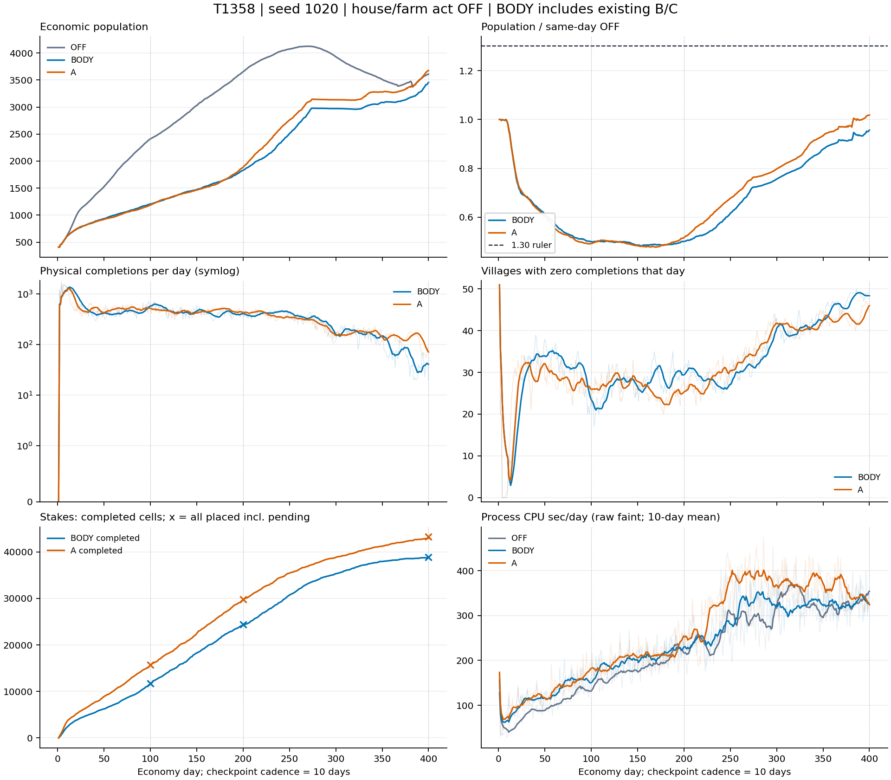
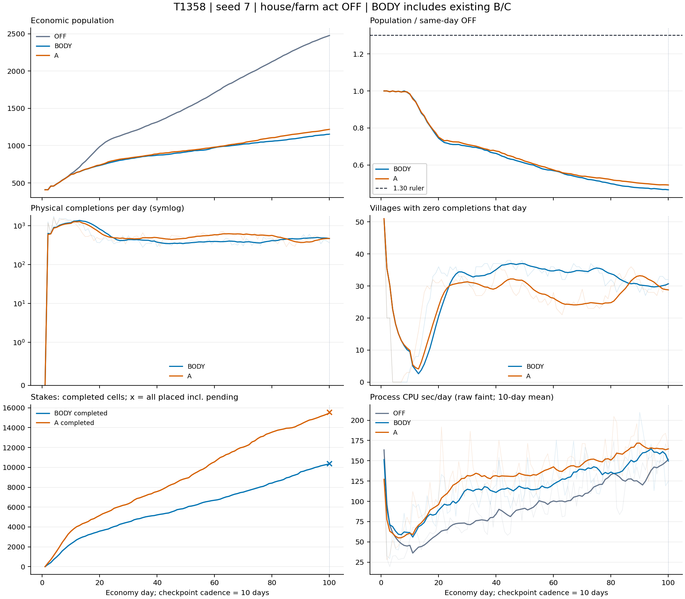

말뚝 값 몸 줄 0.224401 : 일괄 0.448946(역순 60칸·단/칸) · 안 ⓐ 0.448946 ⓑ 기존 ⓒ 기존 · 완공 0 마을 23 → 22(1020·100날) · 끔비 100날 0.493 · 400날 1.018 · CPU 261.2초/날 · 옛 코드 빨강 1/1 · 끈 판 1/1 · 하네스 12/12(새 8/0) · 미끼 6/6 · 회부 3

# T1358 — 몸 영토 말뚝 통나무 차례 · 같은 칸 진단과 100·400날 자 (GPT 1)

[승인 대기 · T1358] · 판정 0 · 배포 0 · force 0

- 베이스 `e96fb3455252ab97cd2ec4f798541e299bf8abff`(main, land1083 뒤 · 카드의 land1082 포함)
- 가지 `batch/terr-stake-1117` · 제품 구현 커밋 `fadb3c42fc8a686322803f4ec717695881b17824`
- 제품 두 파일: `server/villages.js`, `server/build-haul.js`. `sim/`·`lab/`·`public/` 변경 0. `T1358_STAKE_REQUOTE` 기본 끔.
- 판은 T1329 진단 묶음(출생 곳간 문 포함), 집 행위·농사 몸 끔, 주민 몸 상한 없음, 정본 하루·10날 체크포인트다.
- 끈 판 끝 줄 그대로: `=== 같음 1/1 · 경제 400/400 · 생활층 400/400 · 판 1649초 ===` · 인구 **3,917**.
- 랩 t17: **1020·800날 5,929**, 소멸 0/51. 게이트 셋 모두 초록. 새 하네스 8통과/0실패, 미끼 여섯은 각각 지정 단언에서 빨강.
- 원자료·방법·체크섬: `계측/T1358_2026-11-19/`. 원격 CI 조회는 API 403으로 미확인(푸시 자체와 지역 검사는 별도 확인).
- ⓑ·ⓒ는 이미 구현된 경로다. 같은 BODY 판으로 대표하며 별도 독립 반복이나 새 기능으로 세지 않았다.

## 1. 같은 영토 꼴 진단 — 항상 더 쓰는 것은 아니다

정본 picker가 고른 60칸을, 처음 영토 **1,500칸**에서 실제 몸과 일괄로 역순 완공시켰다. 처음과 마지막 영토 셀 집합이 같다. 몸은 정본 작업·운반·소비 함수, 일괄은 정본 `_t1238Batch`를 불렀다. 고립 하네스의 이동 도착만 주입했다.

| 같은 칸·완공 순서 | 몸 고정 견적 | 일괄 현재 이웃 | ⓐ 현재 이웃 | 해석 |
|---|---:|---:|---:|---|
| 1,500칸 + 정본이 고른 60칸 역순 | 13.464068단 / 60 = **0.224401단/칸** | 26.936769445단 / 60 = **0.448946단/칸** | 26.936770단 / 60 = **0.448946단/칸** | 종전 몸은 일괄의 **0.499840배**. ⓐ는 **1.000000021배**(기존 소수 6자리 직렬화 오차) |
| 줄에 실은 뒤 이웃 둘이 먼저 완공된 한 칸 | **0.1054단** | **0단** | **0단** | 종전 몸의 초과 소비 0.1054단. 일괄이 0이므로 배수는 정의하지 않음 |
| 이웃이 바뀌지 않은 한 칸 | 0.1054단 | 0.105399609단 | 0.1054단 | 동일 이웃, 기존 소수 6자리 반올림 |

줄의 `plus`는 앞 칸이 끝났다고 가정한다. 실제 몸의 완공 순서가 달라지면 아직 없는 이웃을 미리 셀 수도 있고, 나중에 생긴 이웃을 못 볼 수도 있다. 두 방향의 사례를 재현했다. 선행 판의 평균 0.21단/칸을 다른 모양·다른 완공 순서에 고정 배수로 적용하지 않는다.

## 2. 고침과 기존 ⓑ·ⓒ

| 안 | 실제 경로 | 고침/확인 |
|---|---|---|
| ⓐ 완공 때 말뚝 값 | `_t1358Requote` → `_t1207CellCost(vil,cx,cy)` | 개간·벌목이 끝난 뒤 현재 영토 이웃으로 말뚝만 재계산. 개간 전에는 원래 줄의 견적과 수요를 유지. dry 필터·인출 필요량·완공 직전 문이 같은 값을 읽음 |
| ⓐ 지불·운반 | `_t1181Step` → `build-haul.step` | 값이 늘면 부족한 말뚝을 실제로 더 나른다. 값이 줄면 초과분은 손에 남겨 기존 반환 다리로 원래 곳간까지 운반. 박히지 않은 몫은 소비로 찍지 않음 |
| ⓑ 말뚝 몫의 차례 | 영토 `woodSpare`; 숯·다리 `woodSpareAfterLand` | main이 이미 땅 몫 차감 전에 영토 말뚝을 꺼냄. 이를 뒤집는 미끼는 실제 인출 검사에서 빨강 |
| ⓒ 나무꾼 수요 | `_t1207Queue → _t1207Need → woodShareD → woodDemandLeft` | main이 이미 말뚝 줄의 모자람을 나무꾼 수요에 더함. 줄에서 만들어진 실제 수요 항을 지우는 미끼는 나무꾼 문 검사에서 빨강 |

개간에 이미 쓴 시간·이미 박은 말뚝을 되감거나 지우지 않는다. 나무꾼·재료·크루 수·속도·상한·금고 식에 새 수를 넣지 않았다. 몸 필드를 새로 추가하지 않았다. 반환 표지는 기존 `returning`을 쓴다.

날 장부 단면에서 빈 줄인데 말뚝 수요가 남은 마을·날 수: BODY1020 269 · A1020 52 · BODY7 0 · A7 2. 하루 사이 모든 틱의 갱신 시각을 판정한 수는 아니다.

## 3. 판 조건과 100·200·400날

**팔 구별:** BODY는 T1283·T1297·T1306까지 켠 T1329 진단 묶음 + T1329 크루다. T1329의 **1.048·0.904는 세 문을 끈 FIXB** 값이다. 이 둘을 동일 팔의 전후 효과로 비교하지 않는다. 본판은 카드의 출생 곳간 문 설명에 맞춘 팔이다. 조건 전부는 METHODS.md와 각 launch.json에 있다.

ⓑ·ⓒ의 주어진 차례는 BODY와 같다. A = BODY + ⓐ다. 1020은 각 400날 한 판의 단면이며, 7은 각 100날이다. 끔비 분모도 같은 시드·같은 날·같은 10날 재기동 자로 새로 잰 OFF다.

| 시드 | 팔 | 날 | 인구 | 실제 몸 | 빈 마을 | 끔비 | 영토 칸 | 몸 완공 | 말뚝 소비(완공+진행 중) | 완공 0 마을(당일 / 끝10날 평균) | 이탈 | 식량 빚 / 몸 굶음 | CPU 초/날(부팅 포함 / 마디 첫날 제외) |
|---:|---|---:|---:|---:|---:|---:|---:|---:|---:|---|---:|---|---|
| 1020 | OFF | 100 | 2,411 | 2,401 | 0 | 1.000 | 288,570 | 0 | 0.000 | — | 0 | 0 / 0 | 96.8 / 94.0 |
| 1020 | BODY | 100 | 1,207 | 1,207 | 0 | 0.501 | 134,898 | 58,398 | 11,672.826 | 23 / 23.4 | 0 | 0 / 0 | 123.7 / 120.5 |
| 1020 | A | 100 | 1,188 | 1,188 | 0 | 0.493 | 134,695 | 58,195 | 15,716.882 | 22 / 25.9 | 0 | 0 / 0 | 128.8 / 125.9 |
| 1020 | OFF | 200 | 3,653 | 3,647 | 0 | 1.000 | 405,030 | 0 | 0.000 | — | 341 | 0 / 0 | 141.8 / 139.5 |
| 1020 | BODY | 200 | 1,831 | 1,831 | 0 | 0.501 | 179,131 | 102,631 | 24,377.678 | 31 / 29.4 | 0 | 0 / 0 | 164.2 / 161.1 |
| 1020 | A | 200 | 1,885 | 1,885 | 0 | 0.516 | 180,270 | 103,770 | 29,795.482 | 28 / 25.3 | 0 | 0 / 0 | 168.8 / 165.7 |
| 1020 | OFF | 400 | 3,612 | 3,611 | 0 | 1.000 | 513,360 | 0 | 0.000 | — | 672 | 205 / 120 | 222.3 / 221.2 |
| 1020 | BODY | 400 | 3,455 | 3,455 | 1 | 0.957 | 225,887 | 149,387 | 38,914.556 | 49 / 48.4 | 94 | 19 / 19 | 236.7 / 234.4 |
| 1020 | A | 400 | 3,678 | 3,678 | 0 | 1.018 | 227,558 | 151,058 | 43,237.162 | 46 / 46.0 | 428 | 54 / 54 | 261.2 / 260.0 |
| 7 | OFF | 100 | 2,477 | 2,470 | 0 | 1.000 | 297,090 | 0 | 0.000 | — | 0 | 0 / 0 | 96.8 / 92.8 |
| 7 | BODY | 100 | 1,153 | 1,153 | 0 | 0.465 | 129,570 | 53,070 | 10,392.029 | 32 / 30.7 | 0 | 0 / 0 | 119.4 / 116.1 |
| 7 | A | 100 | 1,218 | 1,218 | 0 | 0.492 | 134,951 | 58,451 | 15,547.060 | 31 / 28.8 | 0 | 0 / 0 | 132.8 / 129.2 |

- OFF는 원본 `syncVillagePop`의 스폰 증분 제한 때문에 인구와 몸 수에 시간차가 있다. 최소 몸/인구 비율: 1020 0.995570, 7 0.994399; 최대 인구−몸 차이: 14·13명. 이 원본 조건을 유지했고 실제 몸 수를 표에 함께 냈다. BODY/A는 상한 없는 1:1 동기화와 주민 id 짝까지 검증했다.
- 식량 빚과 몸 굶음은 표현층이 달라 겹칠 수 있다. 둘을 더하지 않는다. 이탈은 실제 수락된 사람별 사건 수다.
- 몸 팔의 일괄 호출은 0이어야 하며, 매일 보존된 몸 완공 누계와 별도 `_terrAdd` 확장 호출 누계가 같아야 한다. 검사 결과는 summary/source validation에 있다.
- CPU는 존 프로세스 사용자+커널 실제 CPU다. 시드·팔별 인구가 달라지므로 전체 CPU 차를 가격 재계산 함수 하나의 단가로 해석하지 않는다. 관찰기 비용을 포함한다.

## 4. 1.30 문턱 — 100날과 400날의 답

| 시드·팔 | 100날 끔비 | ≥1.30 | 200날 끔비 | 400날 끔비 | ≥1.30 | 100·400 같은 답? |
|---|---:|---|---:|---:|---|---|
| 1020·BODY | 0.501 | 거짓 | 0.501 | 0.957 | 거짓 | 같음 |
| 1020·A | 0.493 | 거짓 | 0.516 | 1.018 | 거짓 | 같음 |
| 7·BODY | 0.465 | 거짓 | — | 카드 판 밖 | — | 비교 안 함 |
| 7·A | 0.492 | 거짓 | — | 카드 판 밖 | — | 비교 안 함 |

후보 A−BODY 인구 차이는 시드 1020에서 100날 -19명, 200날 +54명, 400날 +223명이다. 시드 7의 100날 차이는 +65명이다. 두 시드의 100날 방향과 1020의 100·200날 순서가 서로 달라, 한 단면의 인구 차이를 장기 효과로 일반화하지 않는다.

400날 A는 BODY보다 실제 박힌 목재가 4,322.606단 많고, 평균 CPU는 24.6초/날 높다. 식량 빚 사망은 19→54, 몸 굶음도 19→54, 실제 이탈은 94→428건이다. 인구 증가와 함께 이 비용도 비교해야 한다.

어느 날을 켬 기본의 자로 삼을지는 이 카드에서 정하지 않는다. 이 표는 실제로 같은 답인지 가르는 자료다.

## 5. 완공 0과 재료 장부

| 시드·팔·날 | 당일 완공 0 | 그중 줄 있음 | 그중 말뚝 모자람 | 말뚝 모자람+잉여 0 | 끝10날 내내 완공 0 | 인출 횟수 / 인출−소비 | 완공 칸 목재 | 진행 칸에 박힌 목재 | 총 소비−둘의 합 |
|---|---:|---:|---:|---:|---:|---|---:|---:|---:|
| 1020·BODY·100 | 23 | 22 | 22 | 21 | 7 | 2500 / 41.499 | 11610.595015 | 62.230828 | 8.52651283e-14 |
| 1020·BODY·400 | 49 | 42 | 42 | 41 | 47 | 7310 / 685.499 | 38748.608284 | 165.947369 | 3.49587026e-12 |
| 1020·A·100 | 22 | 20 | 20 | 18 | 10 | 6705 / 2469.225 | 15624.840817 | 92.041518 | -5.98276984e-12 |
| 1020·A·400 | 46 | 41 | 41 | 41 | 42 | 18254 / 3611.333 | 42956.912237 | 280.249293 | -7.69091457e-11 |
| 7·BODY·100 | 32 | 32 | 32 | 30 | 16 | 2269 / 41.121 | 10346.673197 | 45.356258 | 5.68434189e-14 |
| 7·A·100 | 31 | 30 | 30 | 28 | 11 | 6782 / 2206.975 | 15466.273655 | 80.786252 | -8.76809736e-12 |

완공 0만으로 재료 막힘을 단정하지 않고 줄·모자람·잉여를 함께 보았다. 인출−소비에는 손에 든 몫·반환한 몫 등이 들어가므로 그 전부를 소비라고 부르지 않는다. 마을별 모든 날은 villages-daily.csv, 긴 연속 완공 0 순서는 summary.json의 villageWorst다.
T1340은 `_t1207`·`_t1207Sum`을 재기동에 보존한다. 옛 모으개처럼 마디 끝 누계들을 더하지 않았다. 반면 프로세스마다 초기화되는 확장 호출·몸 굶음 계기는 마디별로 더했다.

## 6. 곡선

원자료 CSV와 SVG도 같은 폴더에 있다. CPU·완공 0·하루 완공의 진한 선은 10날 이동평균, 옅은 선은 원값이다. 목재 x 표지는 진행 칸까지 포함한 실제 박힌 목재다.

## 7. 검사·미끼·원자료

| 확인 | 결과·근거 |
|---|---|
| OFF | === 같음 1/1 · 경제 400/400 · 생활층 400/400 · 판 1649초 === · 인구 3917 · 실제 OS 종료 0 |
| 랩 t17 | 1020·800날 인구 5929, 소멸 0/51 |
| 게이트 셋 | 번들 회귀 16 일치/0 불일치, 인라인 둘 최신, 배선 실패 0·기존 경고 1 |
| 함수 접점 | 올바른 한글 diff 경로로 11종/11종 통과 + build-haul 직접 호출 하네스 1종 통과 |
| 새 하네스 | 8통과/0실패. 개간 전 견적·동적 가격 양방향·운반 중 반환·부족 지불·수요·체크포인트를 실제 제품 경로로 검사 |
| 파일 안 미끼 6 | 각각 바꾼 자리 정확히 1. 재견적 제거, 차례 뒤집기, 수요 항 제거, 초과분 박기, 지불 문 제거, 개간 전 재견적을 지정 단언에서 검출 |
| 옛 코드 빨강 | 현재 새 하네스 + origin/main 제품: 단언 빨강 1/1, 크래시 0 |
| CI 분류 | 새 하네스 Node 22 다섯 판 초록, core에 등재, 잡 수 5 유지. 원격 결과 조회는 403으로 미확인 |
| 누계·시계 | 완료된 마디 코드 0, 목표 날 수 누락·중복 0, 관찰 오류·시계 오류 0, 매일 독립 확장 호출과 몸 완공 일치 |

폐기한 예비 판은 별도 표식으로 보존했고 본판과 이어 붙이지 않았다. Node 24의 생활층 지문 차이는 Node 22로 가른 뒤 본판을 시작했다. 초과 말뚝 반환 전 초안과 개간 전 재견적 초안도 각각 검사 실패로 제외했다. 자세한 소스·런타임·기록은 METHODS.md와 provenance 자료에 있다.

## 8. 회부 3

1. **ⓑ·ⓒ의 다른 의도:** 현재 main은 지정한 차례와 수요 항을 이미 구현했다. 다른 몫을 앞세우거나 다른 갱신 시각을 뜻했다면 대상 식을 지정해야 한다. 새 경제 규칙·형식적 손잡이를 임의로 만들지 않았다.
2. **자 선택:** 100·400날의 1.30 참거짓은 §4와 같다. 어느 날 자를 채택할지, 집·농사 켬 몸 세계와 두 해·3시드를 다음 문으로 삼을지는 PM/재민 판정이다. 본 카드에서 켬 기본을 채택하지 않았다.
3. **접점 목록 도구:** 한글 경로가 Git에서 인용되면 도구가 헤더를 못 읽고 직전 제품 파일을 새 파일로 오인해 이름을 지운다. 이 카드에서 11종 → 6종으로 재현됐다. 도구 코드는 고치지 않았으며 호출에만 core.quotePath=false를 줘 11종을 모두 실행했다. 두 목록과 실행 로그를 근거로 남긴다.

## 9. 재실행·파일

- `계측/T1358_2026-11-19/METHODS.md`: 팔·시계·재기동·누계·CPU 정의 및 실행 명령.
- `summary.json`, `daily.csv`, `villages-daily.csv`, `*-state-*.json`: 전체와 마을별 표, 동일 시점 재료 장부.
- `runs/`: 여섯 판의 닫힌 마디 원자료·런처 조건·진행 기록. DB는 제외. 가상 시계·마디 출구 자료를 보존.
- `gates/`: 실제 종료 코드·전체 검사 로그, 옛 코드 빨강·정상/인용 접점 목록.
- `source-manifest.json`, `source-validation.json`, `environment.json`, `SHA256SUMS`: 고정 소스·런타임·원자료 검증.
