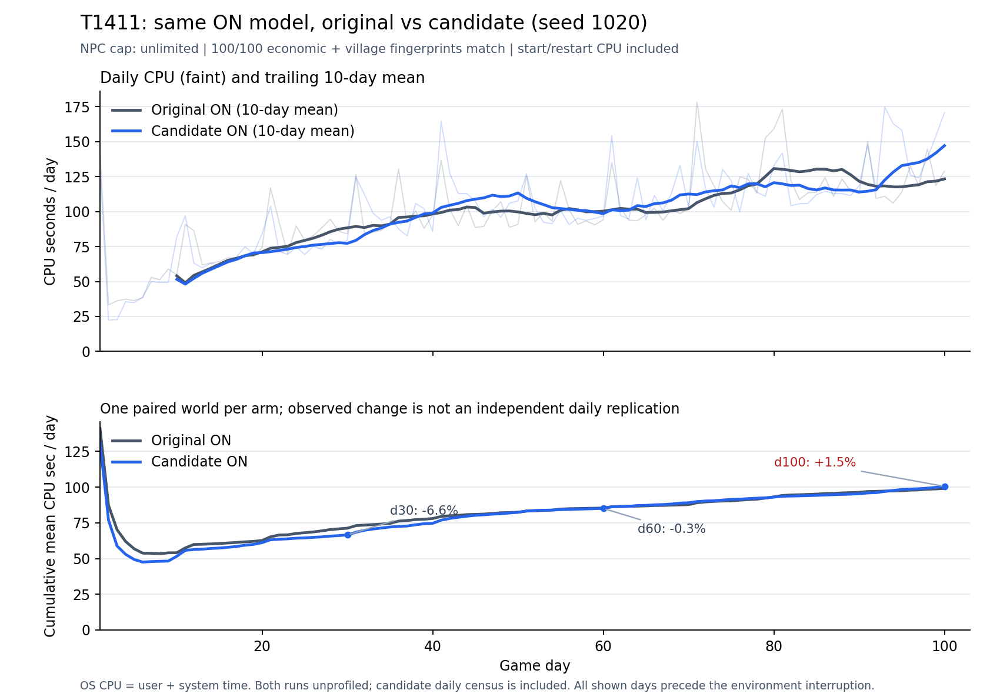

진행 중 · 같은100날 CPU 99.012→100.488초/날(관측 +1.5%·전체 개선 확인 못 함·30초 목표 미달·옛400날 261.2와 구분) · 잔여 꼭대기 메인 몸/걸음 준비/공간 색인 · 3시드 730날 미집계(1020 400날 끔비 0.996·빈 마을 켬0/끔1) · 후보 지문 100/100(필수30/30 포함) · 끈 판 1/1(경제·생활층 400/400) · 새 하네스 4/0 · 미끼 2/2 · 회부 미확정

## 0. 진행 상태

| 항목 | 현재 사실 |
|---|---|
| 베이스·가지 | main land1087 뒤 `1aa63e637` · `batch/terr-body-cpu-1121` |
| 구현 | 제품 후보 `768d740b0` 고정 · 아직 완료/채택 보고가 아님 |
| 해부 | ON/1020 네이티브 프로파일 30날 완료 · 같은 소스의 프로파일 유무 경제·모든 마을 필드 지문 30/30 같음 |
| 후보·긴 판 | 후보 경제·모든 마을 필드 지문 100/100 같음 · ON/OFF 1020 진행 중·나머지 4팔 대기 |
| 안전장치 | 기본 끔 `T1411_TERR_FAST` · T1358 묶음 안에서만 유효 · 경제 새 수 0 · 배포 0 · force 0 |
| 검증 | 새 하네스 4/0·미끼 2/2·옛 코드 단언 빨강 1(크래시 0) · 선택 10+영토 보충 3+CI 1종 통과 |
| 끈 판 | `=== 같음 1/1 · 경제 400/400 · 생활층 400/400 · 판 661초 ===` |
| 남은 것 | 3시드 730날 양팔 · 최종 승인 대기 커밋 |
| 원격 CI | 실제 Actions 조회 접근 거부(403) · 원격 초록으로 보고하지 않음 |

## 1. 원본 해부

[원본30날_해부](../계측/T1411_2026-11-21/원본30날_해부.md), [native 원표](../계측/T1411_2026-11-21/base-native/native-profile.json), [매일 CPU·몸 수](../계측/T1411_2026-11-21/base-30/daily.csv).

V8 표본 가중치 합 2,209.380초, 표본 1,944,933개다. 표본은 경과 시간이며 OS CPU와 다르다. 메인 프레임 자기 227.633초, `_wwPre` 자기 183.674초, `sepNpcs` 자기 74.950초가 위쪽이다. 영토 견적과 크루 선택 자기 시간의 합은 약 2.1%다. 길찾기는 처음 초기화 구간에서 크고 뒤 구간에서는 작다. 포함 시간은 서로 겹치므로 더하지 않는다.

비프로파일 첫 30날 OS CPU는 71.225초/날, 프로파일은 78.700초/날이다. 옛 T1358의 261.2초/날은 400날 전체 평균이다. 서로 다른 나이·main을 비교해 개선 배수로 부르지 않는다. 두 원본 판의 30날 지문 일치는 관찰기 영향 확인이며, 최적화 후보 일치와 구분한다.

## 2. 결과 보존 후보

- 말뚝 견적: 작업 개간·나무 문을 통과한 뒤, 실제 소유 Set 정체·크기·주변 이웃 수·목표·중심·원래 면적/레시피/말뚝 간격 입력이 같을 때 정본의 6자리 반올림 결과를 재사용한다. 같은 크기의 칸 교체도 주변 이웃이 바뀌면 다시 잰다.
- 크루 표: 기존 날짜·명부 길이·건축/곡간 표지·players 정체·선택된 몸의 생존 여부를 확인한다. 기존 `mark`와 직렬화 모양은 보존한다. 캐시는 비직렬화 WeakMap이다.
- 두 이동 고리: 기존 `Map.forEach` 콜백 경로를 같은 순서로 사용한다. 몸 처리·충돌·생존·저장을 건너뛰지 않는다.

새 하네스는 실제 마을의 실제 작업/견적 경로를 부른다. 크기 키 또는 이웃 키 한 자리씩을 지우는 미끼가 각각 지정 단언에서 실패한다. 옛 제품 위에서도 후보 재사용 단언이 실패한다. 칸·목표·중심·기둥 레시피·말뚝 간격 변경, 크루 몸 제거·날 변경도 검사했다.

[같은 30날 전후 원표](../계측/T1411_2026-11-21/feature-30/matched-cpu.json)와 [매일 값](../계측/T1411_2026-11-21/feature-30/matched-daily.csv), [압축 원자료에서 다시 확인한 지문](../계측/T1411_2026-11-21/feature-30/fingerprint30.json).

| 구간 | 원본 CPU 초/날 | 후보 CPU 초/날 |
|---|---:|---:|
| 1–10날 | 54.066 | 51.573 |
| 11–20날 | 71.188 | 70.641 |
| 21–30날 | 88.419 | 77.310 |
| 전체 30날(부팅 포함) | 71.225 | 66.508 |
| 보조: 각 마디 첫날 제외 | 66.212 | 61.598 |

1020 한 세계씩의 같은 30날이며 날 30개를 독립 반복 30개로 세지 않는다. 후보의 장부 census 비용도 포함했다. 관측 절감은 6.622%이며 절대 목표 30초/날은 미달이다. 원본/후보 모두 30날 인구 819명이고 경제·모든 마을 필드 지문이 30/30 같다. 두 판 모두 프로파일을 껐다. 후보 자료는 지금 도는 730날 세계의 첫 30날이며 독립 30날 판이 아니다.

**60날 추가 확인:** 같은 두 판의 지문은 60/60 같다. 누적 CPU는 원본 85.347·후보 85.066초/날로 차이가 약 0.3%까지 작아졌다. 41~50날 구간에서는 후보가 더 느렸다. [60날 원표](../계측/T1411_2026-11-21/matched60.json). 첫 30날의 6.6%를 일반적인 개선율로 해석하지 않는다. 같은 나이의 네이티브 전후 진단으로 원인과 잔여 비용을 확인한다.

**100날 추가 확인:** [같은 100날 원표](../계측/T1411_2026-11-21/matched100.json), [지문 100/100](../계측/T1411_2026-11-21/candidate-fingerprint100.json)·[압축 원자료 재확인](../계측/T1411_2026-11-21/archive-fingerprint100.json). 누적 OS CPU는 원본 99.012·후보 100.488초/날로 관측상 1.491% 늘었다. 각 마디 첫날을 빼면 94.741→96.738초/날이다. 같은 날의 경제·모든 마을 필드는 전부 같다. 첫 30날의 관측 절감을 전체 개선으로 주장할 수 없다. 한 세계씩이므로 호스트·V8 변동과 구현 효과를 분리한 인과 판정도 아니다. 현재 후보로 전체 성능 개선을 확인하지 못했으며 30초 목표도 미달이다.

위쪽은 실제 매일 CPU와 직전 10날 평균, 아래쪽은 1날부터의 누적 평균이다. 같은 T1358 묶음 켬에서 T1411 고침 전/후를 비교한다. 환경 중단 이전의 한 쌍이며 날별 값을 독립 반복으로 세지 않는다. [SVG](../계측/T1411_2026-11-21/matched100-cpu.svg)·[그림 생성 코드](../계측/T1411_2026-11-21/plot-matched100.py).

전체 몸을 훑는 메인 틀·걸음 준비·공간 색인·몸 분리는 계속 실행된다. 장부 경계의 일과 창 안 몸 수는 첫 10날 모두 0이라, 별도 진단에서 시간대별 일과 창과 실제 취침 라벨도 읽었다.

원본 100날은 인구·실제 몸 1,219명, 영토 135,340칸, 몸 완공 58,840칸, 당일 완공 0 마을 23곳, 빈 마을·이탈 0이다. 원본 CPU는 100날 평균 99.012초/날, 100날 당일 128.897초다. 100날 전 구간에서 몸/인구 최소 1.0·주민 id 짝 누락 0·관찰 오류 0을 확인했다. [원본100날 원표](../계측/T1411_2026-11-21/base-100/summary.json).

### 시간대별 몸 관찰

[첫날 진단 원자료·정의](../계측/T1411_2026-11-21/early-awake/awake-summary.json). 게임의 일과 창과 `_lifeAct` 라벨을 구분한다. 일과 창 안이라고 실제로 일했다고 추정하지 않는다.

| 구간 | 표본 | 구간 길이(게임 시간) | 주민 몸 평균 | 일과 창 안 평균(최대) | 취침 라벨 평균 | 그 밖의 기록된 라벨 | 라벨 미기록 | 속도칸 0 아님 |
|---|---:|---:|---:|---:|---:|---:|---:|---:|
| 기동~첫 장부 | 20 | 19.792시간 | 408 | 337.6(408) | 98.4 | 282.8 | 26.8 | 112.1 |
| 원본 100날 | 24 | 24.000시간 | 1,212.25 | 832.25(1,212) | 610.33 | 601.92 | 0 | 327.75 |

표본 평균이며 정확한 시간 적분은 아니다. 첫 구간은 24시간 전체가 아니므로 100날의 하루 평균과 같은 길이로 간주하지 않는다. 두 구간 모두 마지막 장부 시점의 일과 창 안 몸은 0이다. 일과 창과 취침 라벨은 다른 분류이며 서로 배타적 범주로 더하지 않는다. 새 관찰기가 게임을 바꾸지 않았는지 첫날 지문 1/1, 원본의 새 91~100날 재생 10/10(앞90날 공유·전체 비교100/100)도 확인했다.

[원본 100날 나이의 CPU·몸 해부](../계측/T1411_2026-11-21/원본100날_해부.md)와 [시간대 원표](../계측/T1411_2026-11-21/base-awake-91-100/awake-summary.json). 91~100날의 자기 표본 경과시간/날은 걸음 준비 19.444, 공간 색인·쓸기 11.264, 몸 판단·이동 콜백 13.399, 몸 분리 5.215다. 영토 견적·선택/크루 합은 2.379로 작다. 이는 OS CPU와 구분하는 표본 경과 시간이다.

공간 색인·쓸기 합계는 색인만 7.338과 생존·계단 등의 주기 쓸기 3.926으로 나뉜다. [덩이 정의](../계측/T1411_2026-11-21/native-age-groups.README.md)의 합계·하위 항목을 중복해 더하지 않는다.

### 같은 91~100날 네이티브 전후

[전후 원표](../계측/T1411_2026-11-21/native-matched-91-100.csv), [후보 프로파일](../계측/T1411_2026-11-21/fast-native-91-100/native-profile.json). 각자 자기 90날 체크포인트에서 새 10날을 재생했다. 앞 90날을 공유한 전체 비교 100/100은 독립 100날 재실행을 뜻하지 않는다. 원본과 후보의 진단은 각각 비프로파일 본판과 지문이 일치했다.

| 자기 표본 경과 초/날 | 원본 | 후보 |
|---|---:|---:|
| 메인 틱 프레임 자기 시간 | 14.718 | 15.794 |
| 영토 견적 | 1.060 | 0.651 |
| 영토 선택·크루 | 1.319 | 0.793 |
| 걸음 준비 | 19.444 | 20.826 |
| 공간 색인 구축 | 7.338 | 7.983 |
| 생존·계단 등 주기 쓸기 | 3.926 | 4.313 |
| 몸 판단·이동 콜백 | 13.399 | 13.990 |
| 몸 분리 | 5.215 | 5.424 |
| 길 갱신 | 6.600 | 6.587 |
| 길찾기 | 0.780 | 0.952 |
| 나르기 | 0.534 | 0.525 |
| 걸음 일과 검사 `_t1322Skip` | 3.414 | 3.707 |
| 걸음 시계 `_t1295Walk` | 3.199 | 3.431 |
| 농사 걸음 검사 `_t1348Walk` | 2.949 | 2.948 |
| 가상 시계 `pump` | 4.600 | 4.847 |

메인 프레임과 세 걸음 검사의 자기 시간도 [함수별 원표](../계측/T1411_2026-11-21/native-top-functions-91-100.csv)에 따로 냈다. 가상 시계 `pump`의 자기 시간은 벤치마크 러너의 비용이다. 포함 시간은 자기 시간과 구분한다.

견적·선택의 자기 시간 합은 2.379→1.444초/날로 약 39% 줄었다. 그러나 줄인 양은 원본 전체 표본의 약 0.7%에 해당하며 큰 몸 고리는 남아 있다. 두 Map 순회 변경에서도 전체 속도 이득이 확인되지 않았다. 위 그룹의 포함 시간은 겹치므로 더하지 않는다. 표본 전체 경과 합은 원본 1,366.628·후보 1,415.995초이며 CPU 속도 배수로 쓰지 않는다. `_t561Fit` 자기 시간은 각각 하루 0.000222·0.000220초로 이 구간의 병목이 아니다. 결과 보존을 위해 몸·충돌·생존·저장 고리를 생략하지 않았고, 경제 수나 동작 빈도를 바꾸지 않았다. 양팔 730날은 이 고정 후보를 사용하며 기본 켬 채택은 요청하지 않는다.

### 11월 21일 밤 환경 중단 · 22일 복구

마지막 진행 표기는 한국 시각 11월 21일 23:18이다. 그 뒤 실행 환경의 `stopped/offline`과 셸 연결 단절을 확인했다. 22일 다시 연결한 뒤 기존 실행 프로세스와 제품 종료 코드 파일이 모두 없는 것을 확인했고, 재민 님의 “다시” 지시에 따라 확정 체크포인트 켬 250날·끔 210날부터 복구했다. 끔의 마지막 관측 로그는 218날이었다. 원인을 특정할 별도 환경 진단 기록은 없었다.

[중단 증거·체크포인트 해시](../계측/T1411_2026-11-21/infra-recovery-1122/interruption.json). 재생으로 덮이는 미완성 마디는 먼저 별도 gzip 보존했다. 제품·계측기 해시, Node 22.23.0·SQLite ABI 127, 양팔 몸 상한 Infinity, 하루 24분, 저장된 시계·손잡이는 유지했다. 정상 마디와 이미 통과한 고정 소스 게이트를 다시 돌리지 않고 중단된 두 팔만 복구했다.

복구 뒤 끔 211~218날의 세 관찰기 일일 필드를 각각 8/8날 맞췄다. [재생 검사](../계측/T1411_2026-11-21/infra-recovery-1122/replay-check.json)·[정의와 명령](../계측/T1411_2026-11-21/infra-recovery-1122/README.md). CPU·프로세스 CPU 누계·가동시간 세 필드만 제외했고 가상 시각도 일치했다. 같은 판의 부분 구간 재생이며 전체 상태 지문 검증 범위는 기존 100날이다.

복구 뒤 첫 정본 마디도 양팔 모두 정상 마감했다(켬250→260·끔210→220, 존 종료0·시계 오류0). [마감 메타](../계측/T1411_2026-11-21/infra-recovery-1122/first-closed-segments.json)와 [실제 실행 손잡이](../계측/T1411_2026-11-21/infra-recovery-1122/running-flags-after-recovery.json)를 보존했다.

최종 일일 CPU 평균에는 복구 후 채택한 마디를 한 번씩 넣는다. 끔 211~218날의 버리는 부분 장부에서 관측한 CPU 합 1,969.854311초는 별도 복구 비용으로 보존했다. 켬의 미완성 기동과 양팔의 마지막 미완성 날 CPU는 관측값이 없다. 이 비용은 전체 중단 소모의 관측 하한이며, 완료 판 CPU 평균과 구분한다. 환경 중단 전 완료한 원본/후보 100날 성능 대조는 그대로다.

### 11월 22일 두 번째 환경 복구

한국 시각 11:23의 마지막 진행 표기 뒤 환경이 다시 unavailable로 표시됐다. 재연결 때 pending/offline→running/connected를 확인했고, 기존 프로세스와 제품 종료 코드 파일은 없었다. 사용자 “다시” 지시로 양팔 350날 체크포인트부터 이어갔다. 끔의 마지막 관측 장부는 358날이었다. [두 번째 증거](../계측/T1411_2026-11-21/infra-recovery-1122-2/interruption.json)는 첫 중단 자료와 분리해 보존했다. 기존 이력도 시각별 고정 경로를 가리키게 했으며 게임 상태는 바꾸지 않았다.

두 번째 중단에서 버리는 끔351~358날의 관측 CPU 합은 2,177.567587초다. 두 번의 끔 부분 장부에서 관측한 합계는 4,147.421898초이며, 미완성 기동/마지막 날의 미측정 소모를 더한 정확한 총량은 알 수 없다. CPU 표는 복구 후 채택한 마디를 한 번씩 포함한다. 두 번째 복구에서도 끔351~358날의 세 일일 관찰기를 각각8/8날 맞췄고 가상 시각도 일치했다. [검사 결과](../계측/T1411_2026-11-21/infra-recovery-1122-2/replay-check.json)와 복구 전/후 원자료를 모두 보존했다. CPU·가동시간 세 필드만 비교에서 제외했다.

복구 뒤 양팔의 첫 350→360날 마디가 실제 존 종료 코드 0·가상 시계 오류 0으로 닫혔다. [종료 메타·현재 실행 조건](../계측/T1411_2026-11-21/infra-recovery-1122-2/first-closed-segments.json)을 보존했다. 양팔 모두 몸 상한 없음·하루 24분이며 이후 730날까지 계속 진행한다.

### 11월 22일 밤 세 번째 환경 중단 · 23일 복구

한국 시각22일23:38의 마지막 진행 표기 뒤 제공자 `stopped/offline`과 셸 연결 실패를 확인했다. 23일 환경이 준비된 뒤 기존 세계 프로세스와 제품 종료 코드 파일이 없는 것을 확인하고 사용자 “다시” 지시로 켬460날·끔470날부터 복구했다. 마지막 부분 장부는 각각465날·475날이었다. [세 번째 증거·검증 범위](../계측/T1411_2026-11-21/infra-recovery-1123/README.md)·[체크포인트 해시](../계측/T1411_2026-11-21/infra-recovery-1123/interruption.json).

미완성 마디와 이진 체크포인트를 먼저 별도로 보존했으며 제품 소스·계측기·Node22.23.0/SQLite ABI127·양팔 몸 상한Infinity·하루24분 조건을 유지했다. 이번에 버린 부분 장부의 관측 CPU는 켬2,192.370204초·끔2,150.911160초, 세 번의 관측 하한 합계는8,490.703262초다. 미측정 기동/마지막 미완성 날의 비용은 알 수 없다. 켬461~465날·끔471~475날 세 관찰기의 복구 전/후 필드를 각각5/5날 맞췄고 가상 시각도 일치했다([검사 결과](../계측/T1411_2026-11-21/infra-recovery-1123/replay-check.json)). CPU·가동시간 세 필드만 제외했으며 기존100날 원본/후보 지문 범위를 늘려 부르지 않는다. 400날 표는 이번 중단 이전에 닫혀 푸시된 자료다.

복구 뒤 첫 켬460→470날·끔470→480날 마디도 실제 존 종료 코드0·가상 시계 오류0으로 닫혔다([종료 메타](../계측/T1411_2026-11-21/infra-recovery-1123/first-closed-segments.json)). 양팔은 이후730날까지 계속 진행한다.

## 3. 조건과 재시작

장기 실행의 공간을 확보하기 위해 현재 체크포인트보다 이전인 정상 마디의 루트 stop 덤프91개만 scratch에 압축 보존했다. 전체 내용을 풀어 읽은 SHA256 일치 후 중복 원본을 지웠고, 현재 이진 체크포인트·제품 소스 해시는 그대로다. 약2.38GiB를 줄였으며 반복 실행은0개였다([범위·실측 검증](../계측/T1411_2026-11-21/storage-pack-1123/README.md)). 라이브 상태·계측 자료·세계 실행 조건은 바꾸지 않았다.

[METHODS](../계측/T1411_2026-11-21/METHODS.md), [고정 소스 해시](../계측/T1411_2026-11-21/candidate-manifest.json), [재시작 자료](../계측/T1411_2026-11-21/RECOVERY.md).

긴 판 OFF도 T1358과 같은 전체 몸 조건이다. 카드의 2~3초/날 공식 기준선과 구분한다. 양팔 730날 비교에서는 몸 상한을 같게 유지한다. 공식 기준선 OFF/400날 동일성 검증은 별도다. 동시에 두 세계까지만 돌리고 정본 10날 체크포인트를 쓴다. 깨어 있는 몸 관찰치는 장부 시점의 실제 일과 창이며 하루 평균이 아니다.

재민 님 확인: “T1358과 동일: 켬·끔 모두 몸 상한 없음.” 현재 조건을 그대로 유지한다.

| 자 | 가상 하루 길이 | 마을 몸 상한 | 재기동 |
|---|---:|---|---|
| 공식 11-18 OFF 기준선 | 250ms | 1명 | 400날 한 프로세스 |
| T1358/T1411 몸 세계 ON·OFF | 1,440,000ms | 없음 | 10날마다 정본 체크포인트 |

기준선 파일의 `clock`과 t577의 `KID_CAP`·`kidEnv`를 직접 확인했다. 하루 길이는 5,760배 다르다. 옛 T1358의 같은 몸 조건 OFF 222.3초/날과 A 261.2초/날의 비는 1.175다(옛 400날 자료이며 새 최적화 성능 판정에 재사용하지 않는다). 절대 목표 30초/날 도달 여부와 같은 조건의 ON/OFF 비를 따로 낸다.

## 4. T1358 회부 1

[B·C 카드/코드 대조](../계측/T1411_2026-11-21/BC_대조.md)에 각 줄을 맞췄다. B는 영토 몸이 땅 예약 몫 전 잉여를 읽고, 다리는 땅 몫 뒤 잉여를 읽는다. 그 잉여는 이미 사람 예비·집 몫을 뺀 값이다. C는 미지급 대기열 값이 나무 수요에 들어간다. 대기열 수요는 줄 갱신 때 바뀌며, 매 틱 새로 잰다는 뜻까지 확장하지 않았다. 새 식·배분 순서는 만들지 않았다.

## 5. 긴 판·최종 검증

[검증 원자료](../계측/T1411_2026-11-21/gates/status.json)와 [하네스·제품 해시](../계측/T1411_2026-11-21/gates/manifest.json).

| 검사 | 실제 결과 |
|---|---|
| `touched-harness origin/main --list` | 10종·전부 통과 |
| 영토 보충 | T1238·T1334·T1358 3종 통과 |
| 규약 다섯 | 몸 필드 14/0·충돌 격자 20/0·HP 54/0·경도 하루 22/0·하네스 lint 102/0 |
| 새 하네스·미끼 | 4/0·2/2 · 옛 제품에서 단언 빨강 1·크래시 0 |
| 이동 하네스 | 287/0 · T1411 경로도 같은 몸·차례·횟수 |
| 게이트 셋 | bundle·inline·wiring 통과(기존 배선 경고 2) |
| 랩 t17 | 1020·800날·6,198명 |
| 공식 끈 판 | 1020·400날 경제/생활층 각각 400/400 같음·인구 3,345명 |
| CI | 새 하네스 5판 초록·core · 이동 하네스 실제 72.8초 초록·long · CI 목록 검사 통과 · 원격 조회 403 |

첫 이동 하네스 실행은 고립 함수 환경에 새 상수가 없어 ReferenceError였다. 환경 주입을 보완하고 새 경로의 차례 대조도 더했으며, 제품 소스는 바꾸지 않았다. 첫 빨강과 재실행 초록은 `gates/history`와 현재 로그에 구분해 보존했다. 이미 통과한 게이트는 고정 제품 해시를 확인한 뒤 재사용했다. 로컬 full regress는 돌리지 않았다. 검사 blackbox 파일과 PM 허락 목록은 수정하지 않았다.

### 1020 양팔의 닫힌 첫 100날

[양팔 원표·정의](../계측/T1411_2026-11-21/pair-1020-100/README.md), [집계](../계측/T1411_2026-11-21/pair-1020-100/summary.json). 두 730날 세계에서 닫힌 첫 10마디만 읽었고 새 세계를 돌리지 않았다. 다른 시드·730날 결과는 아직 아니다.

| 100날 | 인구 | 장부 시점 몸 | 영토 칸 | 당일 몸 완공 0 마을 | 빈 마을 | 마을 이주 수락 | CPU 초/날(누적) |
|---|---:|---:|---:|---:|---:|---:|---:|
| T1358 묶음 켬·후보 | 1,219 | 1,219 | 135,340 | 23 | 0 | 0 | 100.488 |
| 묶음 끔 | 2,435 | 2,424 | 290,970 | 해당 없음 | 0 | 2 | 83.897 |

인구 끔비는 0.500616, 같은 나이의 CPU 켬/끔 비는 1.197757이다. 이는 묶음의 세계 차이를 포함한다. 원본 ON과 후보 ON의 같은 결과 보존 성능 대조(99.012→100.488초/날)와 구분한다. 켬의 전체 몸 완공은 58,840칸이고 직전 10날 내내 완공이 없던 마을은 9곳이다. 이탈 열은 `t1075Emigrate` 마을 이주 수락 횟수다.

양팔의 `NPC_CAP_PER_VILLAGE`는 모두 Infinity다. 끔에는 종전 `syncVillagePop(..., POP_SYNC_PER_DAY)`의 하루 마을당 ±2명 반영이 남고, 켬은 T1302가 `_t1198Sync`의 사람·몸 1:1을 사용한다. 이 때문에 끔의 순간 몸 수를 항상 인구와 같다고 쓰지 않는다. 끔 첫 100날의 최소 몸/인구는 0.994487·최대 차이는 13명이며, 100날 장부에서는 11명 차이다. 켬은 첫 100날 몸/인구 1.0·id 짝 누락 0이다. 상한을 없앤 양팔의 기존 동작을 그대로 잰다.

### ON/1020의 닫힌 첫 200날

[200날 접두부 원표](../계측/T1411_2026-11-21/feature-200/summary.json). 같은 730날 세계의 첫 20마디이며, 원본/후보 지문 일치 검증 범위는 계속 100날이다.

| 날 | 인구·몸 | 영토 칸 | 몸 완공 누계 | 당일 완공 0 마을 | 직전10날 내내 완공 0 | 빈 마을 | 마을 이주 수락 | 누적 CPU 초/날 | 최근100날 CPU 초/날 |
|---|---:|---:|---:|---:|---:|---:|---:|---:|---:|
| 100 | 1,219 | 135,340 | 58,840 | 23 | 9 | 0 | 0 | 100.488 | 100.488 |
| 200 | 1,921 | 182,261 | 105,761 | 27 | 15 | 0 | 0 | 135.855 | 171.222 |

첫 200날의 최소 몸/인구 1.0·id 짝 누락 0·관찰 오류 0이다. 20마디의 실제 존 종료 코드·가상 시계 오류도 모두 0이다. 200날의 미완공 대기열 가운데 나무 미지급이 남은 마을은 21곳이고, 그중 나무 잉여가 0 이하인 곳은 19곳이다. 완료 나무 28,719.432955단·박힌 나무 28,808.540787단·대기열에 박힌 나무 89.107832단의 잔차는 −5.75e−11단이다. 같은 200날의 양팔 비교는 아래 표에 이어 적었다.

### 1020 양팔의 닫힌 첫 200날

[양팔 원표](../계측/T1411_2026-11-21/pair-1020-200/summary.json)·[보존 조건](../계측/T1411_2026-11-21/pair-1020-200/README.md). 각자 진행 중인 730날 판에서 같은 200날까지를 읽었다. 양팔 40마디의 실제 존 종료 코드·가상 시계 오류는 모두 0이다.

| 200날 | 인구 | 장부 시점 몸 | 영토 칸 | 당일 몸 완공 0 | 빈 마을 | 마을 이주 수락 | 누적 CPU 초/날 | 최근100날 CPU 초/날 |
|---|---:|---:|---:|---:|---:|---:|---:|---:|---:|
| T1358 묶음 켬·후보 | 1,921 | 1,921 | 182,261 | 27 | 0 | 0 | 135.855 | 171.222 |
| 묶음 끔 | 3,386 | 3,395 | 398,100 | 해당 없음 | 0 | 454 | 126.978 | 170.059 |

인구 끔비는 0.567336, 누적 CPU 켬/끔 비는 1.069913이다. 끔의 종전 몸 증감 동기화 때문에 장부 시점 몸 수가 인구보다 많을 수도 있다. 양팔의 마을 몸 상한은 계속 Infinity다. 이 비교는 T1358 묶음의 행동·인구 차이를 포함하고, 고침 전/후 같은 ON 판의 100날 성능 대조는 별도다. 7·42와 730날은 아직 완료되지 않았다.

### 1020 양팔의 닫힌 첫 300날

[300날 원표·범위](../계측/T1411_2026-11-21/pair-1020-300/README.md)·[집계](../계측/T1411_2026-11-21/pair-1020-300/summary.json). 같은 두 730날 세계의 첫 30마디를 읽었다. 양팔 60마디의 실제 존 종료 코드·가상 시계 오류는 모두 0이다. 원본/후보의 결과 보존 지문 대조는 기존 100날이며, 압축 보존본과 실행 파일의 무결성 검사는 별도다.

| 300날 | 인구 | 장부 시점 몸 | 영토 칸 | 당일 몸 완공 0 | 빈 마을 | 마을 이주 수락 | 누적 CPU 초/날 | 최근100날 CPU 초/날 |
|---|---:|---:|---:|---:|---:|---:|---:|---:|---:|
| T1358 묶음 켬·후보 | 3,205 | 3,205 | 216,596 | 40 | 0 | 62 | 189.948 | 298.134 |
| 묶음 끔 | 3,757 | 3,757 | 473,070 | 해당 없음 | 0 | 519 | 167.652 | 248.999 |

인구 끔비 0.853074·누적 CPU 켬/끔 비 1.132994다. 켬의 몸 완공은 누계140,096칸, 직전10날 내내 완공이 없는 마을은33곳이다. 켬의 첫300날 몸/인구 최저1.0·id짝 누락0·관찰오류0을 확인했다. 완료 나무38,504.805447단·박힌 나무38,661.501105단·대기열에 박힌 나무156.695659단의 잔차는 −7.58e−11단이다. 나무 미지급 대기 마을33곳 중 잉여가0 이하인 곳은32곳이다. 이 표의 범위는 1020 첫300날이다.

### 1020 양팔의 닫힌 첫 400날 · 첫해 포함

[400날 원표·범위](../계측/T1411_2026-11-21/pair-1020-400/README.md)·[집계](../계측/T1411_2026-11-21/pair-1020-400/summary.json). 같은 두 730날 세계의 확정 40마디를 읽었다. 양팔 80마디의 실제 존 종료 코드·가상 시계 오류는 모두 0이다. 압축 복사본과 실행 원자료의 경제·모든 마을 필드도 각각400/400날 같았다. 이는 보존 무결성 검사이며 고침 전/후 결과 보존 지문은 별도100/100날이다.

| 날·팔 | 인구 | 장부 시점 몸 | 영토 칸 | 당일 몸 완공 0 | 빈 마을 | 마을 이주 수락 | 누적 CPU 초/날 | 최근100날 CPU 초/날 |
|---|---:|---:|---:|---:|---:|---:|---:|---:|---:|
| 365·켬 | 3,305 | 3,305 | 228,306 | 44 | 0 | 83 | 218.080 | 348.302 |
| 365·끔 | 3,494 | 3,495 | 488,610 | 해당 없음 | 0 | 549 | 178.183 | 235.159 |
| 400·켬 | 3,678 | 3,678 | 231,122 | 48 | 0 | 210 | 231.124 | 354.651 |
| 400·끔 | 3,692 | 3,692 | 497,730 | 해당 없음 | 1 | 608 | 192.541 | 267.209 |

인구 끔비는365날0.945907·400날0.996208이다. 400날 누적 CPU 켬/끔 비는1.200389이며 이 비는 묶음의 행동·인구 차이를 포함한다. 옛 T1358의 다른 main400날261.2초와 비교해 T1411 고침의 개선율로 부르지 않는다. 고침 자체의 같은100날 대조는 여전히99.012→100.488초/날이며 전체 개선을 확인하지 못했다.

켬은 첫400날 몸/인구 최솟비1·연결 누락 주민0·관찰오류0이다. 몸 완공은누계154,622칸이고 직전10날 내내 완공0인 마을은46곳이다. 완료 나무42,063.408772단·박힌 나무42,257.951502단·대기열에 박힌 나무194.542730단의 잔차는−8.21e−11단이다. 나무 미지급 대기 마을42곳 모두 잉여가0 이하이다. 두 차례 환경 복구의 버린 부분 마디 CPU는 위 복구 기록에 따로 두었다.

730날 완료·실패 비율은 아직 집계하지 않는다. 긴 판이 끝나면 실제 수치로 갱신한다.
