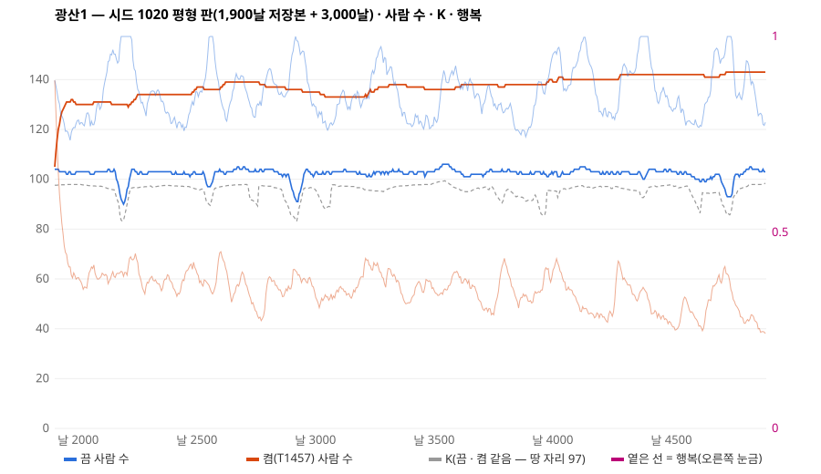

K 넘김 죽음 끔 3.4 %/해(305 ~ 317명/해 · 평형 판 세 시드) → 켬 0(로지스틱 몫 ≥ 0 · 하네스 ②) · 그 죽음이 일어나는 꼴 = 겨울 솎아내기(12 ~ 2월 72 % · 가장 늙은 사람부터 · 몸은 `old` "늙음·병·추위·붐빔" · 부장 20/117) · K 세 몫이 몸에 닿음 slot ✗ · prod ○(T1074 식량 빚 → `starve`) · fuel ✗(몸 추위는 땔감을 안 읽음 · econ 건강 몫으로만) · 평형 판 인구 9,900 · 10,122 · 10,146 → 10,199 · 10,357 · 10,269(+2 ~ +3 %) · N ÷ K 1.05 · 1.06 · 1.06 → 1.07 · 1.08 · 1.08 · 굶어 죽음 0 → 0(랩) · 서버 205 → 259 · 빈 마을 0 → 0(랩) · 서버 0 → 1(농촌18 · 360날 · 회부 2) · 행복(마을 중앙 끝 해) 0.152 · 0.103 · 0.043 → 0.083 · 0.092 · 0.045 · 평형 드는 날 2,630 · 2,630 · 2,630 → 2,630 · 4,388 · 2,630 · 새 세계 800날 6,198 · 6,344 · 6,258 → 6,676 · 6,318 · 6,379 · 서버 400날 3,345 → 3,849 · 끈 판 같음 ○(t17 6,198 · 서버 기준선 400/400) · 하네스 12/0 · 미끼 5 · 회부 4

# 보고 — T1457 식(式)이 사람을 지우지 않는다: K 넘김 죽음을 끈다 (2026-11-23 · S16)

[승인 대기 · T1457] · 베이스 `origin/batch/eq-bind-1122` + main merge · 가지 `batch/no-k-death-1122` · PR simjaemin1/Mini#170 · 손잡이 `T1457_NO_K_DEATH`(끔 기본 · `'1'` 만 켬) · 판정 0 · 배포 0 · force 0

## 0. 한눈에

| 물음 | 답 |
|---|---|
| K 넘김 죽음은 얼마나 | 평형 판(1,900날 저장본 + 3,000날) 끔 **305 ~ 317명/해 = 인구의 3.3 ~ 3.5 %/해**(자연사 130 ~ 136명/해의 2.3배 · 굶음 0) |
| 언제 · 누가 | **겨울**(12월 14 % · 1월 26 % · 2월 32 % = 72 %) — 땔감 흐름(fuelK)이 겨울에 꺼지고 θ = 4 로지스틱이 넘친 몫을 `_dPAccum` 빚으로 → "기아 사망" 고리가 **가장 늙은 사람**부터 지운다. 마을 꼴로는 농촌 4.3 ~ 4.8 %/해 · 광산 8.5 ~ 9.5 %/해 · 어촌 1.5 ~ 2.2 % · 임업 0.9 ~ 1.1 % |
| 고친 것 | `sim/economy-sim.js` 한 줄 — 켬이면 로지스틱 몫이 음수일 때 0(태어남 쪽 · K 셈 · T1074 빚 · 자연사 · 싸움 · 짐승 그대로) |
| 켬 평형 판 | K 넘김 죽음 **0** · 식 죽음은 건강 몫만 남음(67 ~ 75명/해 · 끔에도 23 ~ 31명/해 있던 그것) · 태어남 691 ~ 725 → 459 ~ 484명/해(**덜 태어나서 멎는다**) · 인구 +2 ~ +3 % · N ÷ K 1.05 → 1.08 · 행복 내림 |
| 몸 | 랩 굶음 0 → 0 · 빈 마을 0 → 0. 서버 400날: 인구 3,345 → 3,849 · econ 죽음 1,136 → 783 · 굶음(식량 빚) 205 → 259 · **빈 마을 0 → 1**(농촌18 · 회부 2) |
| 200 명 벽 없음(판정 76) | 가장 큰 마을 끝 해 629 · 626 · 552 → 631 · 658 · 562 — 끔도 켬도 **400 넘는 마을 2 ~ 3곳**(임업2 · 어촌2 · 임업3/임업6) · 다 "자리에 꽉 찬" 마을(N ÷ K 0.97 ~ 1.04 · 행복 0.00) — §5 |

## 1. 진단 — 식 해부(할 일 1)

`sim/economy-sim.js`(가지 끝 줄 번호):

| 줄 | 무엇 |
|---|---|
| 987 · 989 | `POP_GROWTH_RATE = 0.04` · `LOGISTIC_THETA = 4` |
| 5741 · 5789 · 5920 | K 세 몫 — `slotK`(식량 자리 = 농 · 어 · 사냥 · 채집 자리 · 땅 크기 × 밀도) · `prodK`(식량 흐름 EMA) · `fuelK`(땔감 흐름 EMA 0.98 — 벌목 자리 × 숲 · 볏짚 · 수입 · 재고 한 계절) |
| 5923 | `K = max(POP_MIN, min(slotK, prodK, fuelK))` |
| 5928 | `_logiTerm = r · N · (1 − (N/K)^θ)` — N > K 면 음수 |
| 5931 ~ 5935 | ★T1074(켬 기본) — 음수 몫은 식량 밖 K(`min(slotK, fuelK)`)를 넘긴 몫만 남긴다(식량 모자람은 사람마다 식량 빚이 치른다) |
| **5936** | ★**T1457** — 켬 = 음수면 0 |
| 5970 · 5972 | 행복 몫 `(h − 0.5)·0.6·N·r` · 건강 몫 `(h − 0.5)·0.4·N·r`(둘 다 그대로 — 건강 몫 음수가 남는 식 죽음의 주인) |
| 6061 ~ 6077 | `_dPAccum ≤ −1` 동안 **가장 늙은 징발 아닌 사람**을 지움 · `_deadTot++` · T1206 부장(`t1206Bury` — 사치품 곳간 × 20/117 ÷ 인구) · T1198 켬이면 몸이 눕는다 |

**누가 · 어떻게 죽나**(`_deadTot` 를 올리는 문은 셋뿐 — 식량 빚 `_fdDeadTot` · 자연사 `_natDeadTot` · 위 고리. 그래서 식 죽음 = 누계 − 자연사 − 굶음):
- econ: 가장 늙은 사람 · 직업 칸 하나 줄임 · 부장(사치품 곳간에서 몫만큼 지움 · 소비 흐름에 적음).
- 서버 몸: `server/villages.js` `_bxQ` 까닭 줄에 `old`("늙음·병·추위·붐빔" · 2163행) — 그 자리에 멈춰 눕고 · 지닌 것 절반을 떨구고 · `CORPSE_DECAY_MS` 동안 누운 채 · 살릴 수 없음. 몸은 econ 을 하루 `POP_SYNC_PER_DAY` = 2 번 따라간다.

**마을 꼴별 해마다 죽음**(평형 판 끔 · 세 시드 평균 · 명/해 · 괄호 = 그 꼴 인구의 %/해):

| | 1020 | 7 | 42 |
|---|---|---|---|
| 자연사 | 130 | 136 | 130 |
| 굶음(식량 빚) | 0 | 0 | 0 |
| **K 넘김**(식량 밖 K 위인 날의 식 죽음) | **317** | **304** | **306** |
| 건강 몫(K 아래 날의 식 죽음) | 27 | 31 | 23 |
| 농촌 | 157 (4.7 %) | 145 (4.3 %) | 166 (4.8 %) |
| 광산 | 81 (8.5 %) | 91 (9.5 %) | 82 (8.5 %) |
| 어촌 | 59 (2.1 %) | 49 (1.7 %) | 43 (1.5 %) |
| 임업 | 21 (1.1 %) | 18 (1.0 %) | 16 (0.9 %) |

**K 넘김 죽음 — 묶은 몫**(식량 밖 K = min(slot, fuel) 가 더 작은 쪽 · 명/해): slot 132 · 146 · 136 / fuel 184 · 158 · 170. 그 가운데 prodK 도 그날 더 작았던 몫 168 · 130 · 119(식량도 모자랐던 날 — 그래도 지운 문은 자리 · 땔감).
가장 많이 지운 마을: 농촌14 · 광산6 · 어촌6 · 농촌10 · 광산7(1020) — 땅이 좁거나(광산 · 비옥 0.21) 겨울 땔감이 꺼지는 마을.

## 2. K 세 몫이 몸에 닿나(할 일 2)

| 몫 | 몸에 닿는 길 | 닿음 |
|---|---|---|
| slotK(식량 자리) | 자리가 모자라도 서버 몸은 굶거나 다치지 않는다 — 일 없는 몸이 될 뿐. 닿는 길은 위 식 죽음 하나(`old`) | ✗ |
| prodK(식량 흐름) | T1074(켬 기본) — 식량이 모자라면 사람마다 식량 빚이 쌓여 그 사람이 죽는다(`_fdDeadTot` → 몸 `starve`). 로지스틱 음수에서는 이미 빠져 있다(5931) | ○ |
| fuelK(땔감 흐름) | 서버 몸의 추위(`server/body.js` 55행 · 옷 `warmth` · 노출)는 **마을 땔감 곳간을 안 읽는다** — 땔감이 꺼져도 몸이 춥지 않다. econ 안에서는 땔감 충당률이 건강을 깎고(130행 `(fuelCov − 1) × FUEL_HEALTH_W 0.4`) 그 건강이 건강 몫으로 식 죽음을 낸다 — 켬에서 남는 식 죽음(건강 몫)의 한 길이 이것이다(몸이 아니라 수로 닿는다) | ✗(몸) · △(econ 건강 몫) |

⇒ 켬이면 slot · fuel 넘김은 **아무도 안 죽인다**(태어남만 막는다). 땔감이 몸에 닿게 하는 일은 이 카드 밖이다(회부 1).

## 3. 고친 것(할 일 3)

```js
if (T1457_NO_K_DEATH && _logiTerm < 0) _logiTerm = 0;   // ★[T1457] 켬 = 부양력을 넘은 몫이 사람을 지우지 않는다
```
- K 셈 · 태어남 쪽(양수 몫) · T1074 식량 빚 · 자연사(T1206) · 건강 · 행복 몫 · 싸움 · 짐승 그대로. 끔 = 이 줄 무동작(바이트 같음 — 아래 §7).
- 번들(`sim/economy-engine.browser.js`) · 랩 HTML 둘 다시 구움(손잡이 줄을 같이 쥔다 — 하네스 ⑤). 브라우저 랩은 `process.env` 가 없어 끔으로만 돈다.
- 계측: `scripts/lib-eq-grow.js` 열(가장 큰 마을 · 200 · 300 · 400 넘는 마을 수 · 건강 몫 음수 합) · 마을마다 한 줄(`T1426_GROW_VILS` · `eq-run --grow-vils` — N · K · 세 몫 · 곳간 날치 · 죽음 셋 · 행복 · 떠남 · 땅).

## 4. 판(할 일 4)

### 4-1. 평형 판(1,900날 저장본 + 3,000날 · 끔 ↔ 켬 · 저장본은 T1426 지문 `94df…` — `--allow-stale`, 끔 = 종전 바이트)

| | 1020 끔 | 1020 켬 | 7 끔 | 7 켬 | 42 끔 | 42 켬 |
|---|---|---|---|---|---|---|
| 인구 1,901 → 4,900날 | 8,110 → **9,900** | 8,113 → **10,199** | 8,254 → **10,122** | 8,255 → **10,357** | 7,960 → **10,146** | 7,960 → **10,269** |
| 끝 해 오름 | +2.4 % | +1.6 % | +2.2 % | +1.9 % | +1.7 % | +2.0 % |
| N ÷ K(끝 해 평균) | 1.045 | 1.074 | 1.056 | 1.077 | 1.060 | 1.084 |
| 태어남(명/해) | 691 | 459 | 698 | 474 | 725 | 484 |
| 죽음 합(명/해) | 473 | 205 | 471 | 218 | 459 | 203 |
| ㄴ 자연사 | 130 | 138 | 136 | 143 | 130 | 135 |
| ㄴ K 넘김 | 317 | **0**¹ | 304 | **0**¹ | 306 | **0**¹ |
| ㄴ 건강 몫 | 27 | 67 | 31 | 75 | 23 | 68 |
| ㄴ 굶음 | 0 | 0 | 0 | 0 | 0 | 0 |
| 곳간 날치(중앙 · 끝 400날) | 78 | 81 | 69 | 80 | 70 | 76 |
| 식량 값(중앙 · 끝 400날) | 0.318 | 0.303 | 0.368 | 0.307 | 0.363 | 0.335 |
| 빈 마을 | 0 | 0 | 0 | 0 | 0 | 0 |
| 행복(마을 중앙 · 끝 해) | 0.152 | 0.083 | 0.103 | 0.092 | 0.043 | 0.045 |
| 떠남 · 주거 문 마을-날 | 0 · 0 | 0 · 0 | 0 · 0 | 0 · 0 | 0 · 0 | 0 · 0 |
| 땅(합 · 4,900날) | 10,386 | 10,489 | 10,566 | 10,626 | 10,559 | 10,462 |
| 평형 드는 날(C1 ≤ 0.05 ∧ C3 ≤ 0.1 ∧ C2 ≤ 0) | 2,630 | 2,630 | 2,630 | 4,388 | 2,630 | 2,630 |

¹ 켬에서 "K 넘김 날"에 일어난 식 죽음 42 · 51 · 45명/해는 그날 로지스틱 몫이 0 이라(하네스 ②) **건강 몫**이 지운 것이다 — 위 표는 그것을 건강 몫 줄로 옮겨 적었다(켬 건강 몫 = 25 + 42 · 24 + 51 · 23 + 45).
- 건강 몫(음수 합 −140 ~ −170/해)은 끔 · 켬이 같다 — 켬에서 더 커 보이는 것은 끔에서 K 넘김 고리가 같은 날 먼저 빚을 치러 건강 몫 몫이 묻혔기 때문이다.
- **덜 태어나서 멎는다**(판정 73): 켬에서 태어남이 −33 %. N 이 K 위에 서면 로지스틱 태어남이 0 이고 행복이 떨어져(붐빔) 행복 몫이 태어남을 먼저 깎는다(T1134 · T1205).

### 4-2. 새 세계 800날 × 3(t17 자 · 기준선 꼴)

| | 1020 | 7 | 42 |
|---|---|---|---|
| 인구 끔 → 켬 | **6,198** → 6,676 | 6,344 → 6,318 | 6,258 → 6,379 |
| 식 죽음 끔 → 켬 | 1,278 → 910 | 1,077 → 668 | 1,007 → 781 |
| 건강 몫 음수 합 | −6,516 → −6,738 | −5,751 → −6,882 | −6,325 → −6,362 |
| 굶음 · 빈 마을 | 2 → 0 · 0 → 0 | 2 → 0 · 0 → 0 | 0 → 0 · 0 → 0 |
| 가장 큰 마을 · 200 넘는 마을 | 238 → 246 · 3 → 4 | 303 → 296 · 4 → 4 | 258 → 255 · 4 → 4 |

- 성장 구간(첫 800날)의 가장 큰 식 죽음 주인은 K 넘김이 아니라 **건강 몫**이다(첫 해 건강 < 0.5) — 켬이 식 죽음을 25 ~ 40 % 만 줄인다(회부 3).

### 4-3. 서버 400날(1020 · `server-baseline-check --vclock --plan 1020:400`)

| | 끔 | 켬 |
|---|---|---|
| 기준선 견줌 | **같음**(경제 400/400 · 생활층 400/400 · 716초) | 다름 — 첫 갈림 139날(마을 칸 `_bxQ` · `_bxSeen` = 몸 나감 줄) · 793초 |
| 인구 400날 | 3,345 | **3,849** |
| econ 죽음 누계 | 1,136 | 783 |
| 굶음(식량 빚 누계) | 205 | 259 |
| 빈 마을 | 0 | **1**(농촌18 · 360날) |
| 가장 큰 마을 · 200 넘는 마을 | 189 · 0 | 256 · 2 |
| 몸 나감 — 전쟁 · 도적 굶음 | 84 · 32 | 100 · 32 |

- 농촌18(켬): 207 ~ 231날 econ 죽음 21(인구 21 → 7) → 235날 +26(태어남으로는 못 서는 수 — 로그에 그 마을 전쟁 · 이주 줄 없음) → 360날 0. 끔은 400날 내내 21 ~ 22. 회부 2.

### 4-4. 밭 세계 두 해(1020 · `T1243_FARM_ON=1 T1276_FARM_K=1` · t176 자 730날 — 한 줄)

| | 끔 | 켬 |
|---|---|---|
| 인구 730날 | 2,801 | **2,670**(−4.7 %) |
| 빈 마을 | 1 | **2** |
| 기근 마을-날 · 출생 문 마을-날 | 21,200 · 17,809 | 21,774 · 18,284 |
| 건강 · 행복(사람-날 평균) | 0.236 · 0.640 | 0.224 · 0.613 |
| 식량 값(평균) | 247 | 265 |

- 밭 세계를 묶는 것은 K 넘김이 아니라 **굶주림**이다(건강 0.24 · 기근 마을-날이 사람 사는 마을-날의 58 %). 켬이면 겨울 솎아내기가 없어 입이 남고 그 입이 다음 굶주림을 키운다 — 인구 −5 % · 빈 마을 +1. 밭 세계에서는 켬이 이롭지 않다(회부 3 과 같은 뿌리 — 건강 몫).

### 4-5. S2 `T1419_FOOD_NEED=seen`(가지 `batch/food-buffer-1122` 끝 `878dbab3a` · T1437)과 함께 — 평형 판 1020 · 3,000날

내 가지에 S2 가지를 merge 한 작업 나무(밀지 않음 · 충돌은 econ export 한 줄 · 번들 · 랩 HTML · CI 표 — 판에는 node econ 만 쓴다)에서 두 팔 다 `T1419_FOOD_NEED=seen`:

| | seen 만 | seen + T1457 켬 | (참고) 둘 다 끔 · T1457 만 켬 |
|---|---|---|---|
| 인구 4,900날 | 9,931 | **10,030** | 9,900 · 10,199 |
| N ÷ K(끝 해) | 1.051 | 1.078 | 1.045 · 1.074 |
| 태어남 · 죽음(명/해) | 654 · 433 | 476 · 242 | 691 · 473 · 459 · 205 |
| ㄴ K 넘김 · 건강 몫 · 굶음 | 259 · 41 · 0 | **0** · 108 · 0 | 317 · 27 · 0 · 0 · 67 · 0 |
| 곳간 날치 · 식량 값 | 87 · 0.526 | 79 · 0.454 | 78 · 0.318 · 81 · 0.303 |
| 행복(마을 중앙 끝 해) | 0.041 | **0.106** | 0.152 · 0.083 |
| 가장 큰 마을 · > 300 · > 400 | 임업2 659 · 6 · 2 | 임업2 617 · 6 · 2 | |
| 평형 드는 날 | 2,983 | 3,063 | 2,630 · 2,630 |

- 둘은 서로 안 부딪힌다 — seen 은 곳간 여유분(태어남 문 쪽)을, T1457 은 K 넘김 죽음을 만진다. 함께여도 K 넘김 0 · 굶음 0 · 빈 마을 0. seen 이 곳간을 두껍게 쥐어(식량 값 0.32 → 0.53) 켬과 함께일 때 식량 값이 조금 내리고(0.45) 행복은 seen 만보다 높다(0.04 → 0.11).

## 5. 한 마을 그림(할 일 5) — 켬에서 K 를 가장 많이 넘긴 마을 = **광산1**



| 해 | 끔 N(최소 ~ 최대) | 끔 죽음(자연사) | 끔 행복 | 켬 N | 켬 죽음(자연사) | 켬 행복 | 켬 곳간 날치 |
|---|---|---|---|---|---|---|---|
| 1 | 90 ~ 104 | 23 (2) | 0.86 | 105 ~ 134 | 4 (3) | 0.42 | 36 |
| 4 | 100 ~ 104 | 16 (3) | 0.85 | 133 ~ 138 | 5 (5) | 0.37 | 40 |
| 8 | 93 ~ 104 | 20 (1) | 0.86 | 141 ~ 143 | 1 (1) | 0.31 | 45 |

- 땅 138.96(한 번도 안 넓힘 — 비옥 0.21 · MB < MC) · slotK 97 이 묶는다(prod 99 ~ 129 · fuel 해 평균 119 ~ 166 · 겨울 바닥 83 ~ 113). 끔: 겨울마다 K 가 86 ~ 93 으로 내려앉으면 10 ~ 20명씩 지운다 · 행복 0.85. 켬: 143(N ÷ K 1.48)에서 멎는다 — 지우는 대신 **행복 0.31 의 붐빔이 태어남을 막아서**. 굶음 0 · 곳간 날치 36 ~ 46(끔 49 ~ 56보다 낮지만 넉넉).

## 6. 200 · 300 · 400 넘는 마을(판정 76 덧붙임 — 벽 없음)

해마다 가장 큰 마을(평형 판 끝 해 · 4,820날):

| 시드 | 끔 가장 큼 | 켬 가장 큼 | 끔 > 200 · > 300 · > 400 | 켬 > 200 · > 300 · > 400 |
|---|---|---|---|---|
| 1020 | 임업2 629 | 어촌2 631 | 9 · 6 · 2 | 9 · 7 · 2 |
| 7 | 어촌2 626 | 어촌2 658 | 10 · 6 · 2 | 11 · 7 · 3 |
| 42 | 임업2 552 | 임업2 562 | 14 · 6 · 3 | 11 · 6 · 3 |

300 넘는 마을(1020 끝 해 · 켬): 어촌2 631 · 임업2 618 · 농촌1 368 · 임업3 364 · 임업6 344 · 임업1 344 · 농촌2 304 — **모두 자리에 꽉 찬 마을**: N ÷ K 0.97 ~ 1.03 · 행복 0.00(붐빔) · 곳간 날치 41 ~ 103. 끔도 같은 마을들이다(임업2 · 어촌2 는 첫 해부터 400 위). 벽이 없으니 땅 · 숲이 큰 마을이 크게 선다 — **넉넉한가 = 식량은 ○ · 행복은 ✗**. 회부 4(300 넘는 마을 — 행복 0 으로 서는 것이 바라던 꼴인가).

## 7. 지킴 · 하네스(할 일 6)

- `scripts/test-t1457-no-k-death.js` **12/0** · 미끼 5(`kdeath` · `above` · `loose` · `famine` · `lab`) 모두 빨강 · 끔 = 손잡이 줄 지운 사본(⑥).
- main(`dfd3c3121`)을 merge 로 받은 뒤(충돌 0) 다시 잼: 문 셋(`build-econ-bundle --check` 16/0 → `inline-engine --check` 둘 최신 → `lab-wiring-check` 실패 0 · 경고 2) ○ · t17 1020 800날 = **6,198** ○ · `server-baseline-check 계측/서버기준선_2026-11-18.json --vclock --plan 1020:400` **같음**(merge 앞 · 뒤 둘 다 — 경제 400/400 · 생활층 400/400 · 838초) · 하네스 12/0(merge 뒤) · 옛 코드 빨강 ○(`pm-old-code-red.sh origin/main` — 3 통과 · 9 실패) · 손댄 하네스 `test-t1420-eq` 7/0 · `test-t1426-eq-bind` 10/0 · `test-harness-lint` 102/0.
- 판 상자: 한 번에 둘 · 판 자국(`/tmp` · 작업 나무) 정리.

## 회부

1. **땔감이 몸에 안 닿는다**(§2) — 켬이면 땔감 넘김은 아무도 안 죽이고 몸도 춥지 않다. 겨울 땔감이 몸의 추위(`body.js`)로 닿게 할지 — 재민.
2. **서버 켬 판 빈 마을 1**(농촌18 · 360날) — 207 ~ 231날 econ 죽음 21 · 235날 +26 의 주인을 이 카드에서 못 찾았다(로그에 그 마을 전쟁 · 이주 줄 없음). 켬을 서버에 올리기 전에 한 판 더(마을 칸 날 표).
3. **성장 구간의 식 죽음 주인 = 건강 몫**(§4-2) — 첫 800날 켬에서도 남는 식 죽음이 끔의 62 ~ 78 %. "식이 사람을 지우지 않는다"를 끝까지 가려면 건강 몫 음수도 같은 길(태어남만 막기)로 — 다음 카드 후보.
4. **300 넘는 마을이 행복 0 으로 선다**(§6) — 켬이면 지우는 대신 붐빔이 막는다. 300 넘는 마을이 끔 6 · 켬 6 ~ 7곳(모두 꽉 참 · 행복 0). 판정 76 은 벽을 두지 말라 했으니 그대로 둔다 — 행복 0 이 바라던 그림인지만 재민.
