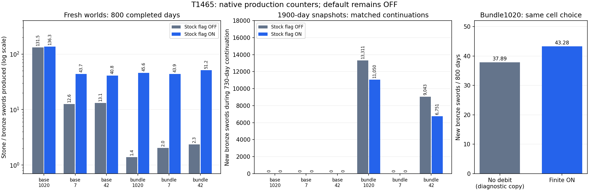

[30년 재계측 중] 세계 주석 기준 매장17,024,185kg(NPC권9,769,028kg) · 되참 상한 세계124,277/NPC71,314kg/해(현재 OFF묶음1020 배합 환산 동검57,705/33,113자루/해) · 현재 OFF econ 주석3,404kg/해(NPC 상한0.04774배) · NPC 기준 재고/흐름2,869해(되참 무시) · 재고50%·10% 산출58.17%·42.74% · ON묶음 석검:동검45.56·43.90·51.22:1(OFF1.39·2.04·2.35) · 광산5 끝 광부5·9·5→4·6·3 · 30년 판 독립 재실행 중 · 묶음 인구 OFF비0.9274·0.9782·0.9923 · 공유 주석331셀 · DB사본11마을 · 끈 판 서버1/1·동일기계800날6/6 · 새 하네스12/0·미끼8/8 · 전수159종 초회154통과·5실패(통제 재검3통과·기존/환경2종) · 회부8 · 기본 OFF

# T1465 — 공유 셀 유한 광맥 장부와 광종 전용 DB 문

`batch/ore-stock-1123` · 베이스 `origin/batch/tin-map-1122`의 `38deb9b4` + main `5ed13b79` merge · rebase0 · `[승인 대기 · T1465]` · 기본 OFF · 배포0 · force0.

**이 문서는 계측 중 초안이다.** 완료 표와 긴 판 수치를 채우기 전 채택 근거로 쓰지 않는다. 제품 구현 첫 커밋은 `5d8c5e84`이며, 이후 계측기·표·검증 자료를 별도 커밋한다.

## 1. 무엇이 바뀌나

- 손잡이는 `T1465_ORE_STOCK=1`만 켜진다. `ORE_K`, `oreRegen`, `mineChunkKg`, `oreMineralAt`의 조건부 기댓값, `_oreCellsOf`의 실제 목록을 읽는다. 재고·되참·노동권·조당 인원·광부 상한의 새 게임 수는 없다. 기존 셀 탐색의 6,000칸 제한과 노동권은 정본을 그대로 읽는다.
- 헤드리스 세계는 `world._oreStock.cells[zone:cx,cy]` 하나에 **건드린 셀만** 기록한다. 마을별 장부가 아니다. 처음 보는 셀은 정본 `ORE_K`; 지난 게임일만큼 정본 `oreRegen`을 적용한다. 광부가 만든 실제 원석량(생산 포만·건강·행복·노동 배수 뒤, 세금으로 나누기 전)을 덩이로 환산해 뺀다.
- 실제 존의 몸·플레이어는 종전 `oreStockAt`/`oreConsumeAt`의 같은 셀을 쓴다. econ은 호스트 읽개로 읽는다. 몸이 친 것을 econ 장부에서 다시 빼거나, 옛 일괄 채굴이 다시 빼는 길을 막았다. 독립 그림자 재고를 만들지 않는다.
- 헤드리스 산출의 **총 원석 흐름**은 종전 식에 실측 응답을 곱한다. 채광 조가 고른 정본 셀의 광종 기댓값으로 나누며, `oreValue`도 같은 정본 선택 절차로 광종과 남은 산출을 읽는다. 값 함수는 대표0조의 다음 칸, 실제 생산은 광부 조별 다음 칸을 쓴다. 모든 조의 값을 평균하는 추가 모형은 만들지 않았다. 별도 광부 정원·채굴 문턱은 만들지 않았다.
- 따라서 ON/OFF 차이는 재고 감소만의 차이가 아니다. 종전 `land.oreMix` 면적 평균과 실제 선택 셀의 광종이 다르면, 만재 때도 품목 구성·값이 달라진다. **차감을 뺀 동일 후보 대조 판**으로 이 효과와 고갈 효과를 나누어 보고한다. 드묾의 변화를 전부 "재고가 줄어서"라고 해석하지 않는다.
- 정본 셀 목록이 없는 광맥 세계를 ON으로 돌리면 공급자 누락 오류를 낸다. 조용히 무한 공급으로 되돌아가지 않는다. 광맥이 없다고 명시된 사금(`oreMix={}`)은 종전 사금 흐름을 유지한다.

## 2. 먼저 잰 매장량과 흐름

[전체 광맥 JSON](../계측/T1465_2026-11-23/광맥-진단.json), [787광맥 CSV](../계측/T1465_2026-11-23/광맥별.csv), [기존 6판의 마을별 흐름·재고 환산](../계측/T1465_2026-11-23/흐름-재고-진단.json).

| 범위 | 셀 | 덩이 | 기준 생원석 kg | 주석 기준 kg | 주석 되참 상한 kg/365날 |
|---|---:|---:|---:|---:|---:|
| 모든 광맥 후보 셀, 겹침은 한 번 | 395,675 | 395,675,000 | 1,384,862,500 | 17,024,185.42 | 124,276.55 |
| 현 NPC의 정본 셀 목록 합집합 | 26,921 | 26,921,000 | 94,223,500 | 9,769,027.53 | 71,313.90 |

`kg = 덩이 × CHUNK_KG`의 **기준 질량**이다. 실제 몸은 숙련별 `mineChunkKg`를 쓴다. ore 확률을 다시 곱해 덩이를 줄이지 않았고, 제련된 금속 kg도 아니다. 서로 겹친 광맥은 `oreMineralAt` 후보 가중으로 귀속해 세계 합에서 중복하지 않았다.

되참 열은 비운 셀의 순간 되참을 계속 수확하는 **상한**이다. 빈 채 365날 방치해 되찬 양과 다르다. 모든 노동권의 되참을 한 곳으로 모아 캘 수 있다는 뜻도 아니다. 품위 순으로 같은 셀에 몰리면 합계 흐름이 상한 아래여도 그 셀은 깊어질 수 있다.

| NPC권 광물 | 기준 매장 kg | 되참 상한 kg/해 |
|---|---:|---:|
| 주석 | 9,769,027.53 | 71,313.90 |
| 구리 | 14,357,225.23 | 104,807.74 |
| 금 | 6,448,023.62 | 47,070.57 |
| 철 | 274,677.57 | 2,005.15 |

광맥6은 실제1,666셀·주석5,831,000기준kg이며 광산5 전부·임업2의331셀이 겹친다. 광맥9는 실제1,372셀이고 광맥 겹침 귀속 뒤 주석4,679,685.42kg(현 NPC권3,938,027.53kg)이다. 광산5의 정본 목록은 총3,047셀이다. 카드의 공유240셀은 원형 근사였고, 워프된 실제 지형과 정본 스캐너는 **331셀**을 낸다.

**옛 econ의 광맥별 실측 차감량은 존재하지 않는다.** 셀·광맥을 고르지 않는 흐름 모델이었기 때문이다. 광맥별 재고·마을 노동권과 실제 마을별 품목 산출을 별도로 내놓았다. 같은 마을이 두 주석 광맥에 닿는다는 이유로 산출을 두 광맥에 각각 전부 적거나, 임의 배분을 실측이라고 쓰지 않았다. [광맥별 흐름 참고 CSV](../계측/T1465_2026-11-23/광맥별-흐름참고.csv)는6개의 OFF 판에서 그 광맥 권리 마을의 모든 실측 원석 산출을 보여 준다. 그 전부를 해당 광맥에 몰고 현재 평균 속도를 유지하며 되참을 무시한 빠른 쪽 기준 재고/흐름 연수를 별도 열에 뒀다. 실제 광맥 귀속량이나 고갈 예측이 아니며, 같은 마을이 여러 행에 나오므로 행들을 추출량으로 합산하면 안 된다.

동검 환산도 새 고정 배합을 만들지 않는다. 기존 각 판의 `castTin × kgOf(tin) / castBz`를 읽고 정본 제련 수율로 환산한다. 기존 묶음1020의 관측 배합·노동이 유지된다는 조건에서는 NPC 되참 상한이 약31,032자루/해다. 이는 노동·구리·연료·거래가 모두 충분하다는 공급 상한 환산이며 실제 생산 예측이 아니다. 마을별 산출·반복 시드별 환산은 진단 JSON에 있다.

서로 다른 실행 환경의 역사 자료와 현재 비교 판을 구분하기 위해, 아래에는 같은 기계에서 다시 잰 **현재 OFF 묶음1020**의800날 전체 흐름을 덧붙였다.

| 광물 | 실측 kg/해 | NPC 되참 상한 대비 | NPC 기준 재고/흐름 해(되참 무시) |
|---|---:|---:|---:|
| 주석 | 3,404.47 | 0.04774배 | 2,869.47 |
| 구리 | 15,904.95 | 0.15175배 | 902.69 |
| 금 | 1,799.90 | 0.03824배 | 3,582.43 |
| 철 | 0 | 0배 | 산출0·유한 연수 없음 |

이 판의 관측 배합·노동 환산은 NPC 되참 상한 기준 동검 약33,113자루/해, 모든 세계 후보 셀의 되참 상한 기준 약57,705자루/해다. 이 역시 물류·구리·연료·노동이 충분하다는 조건부 공급 환산이다.

## 3. 몸 실측 표

[몸 지형 실측](../계측/T1465_2026-11-23/몸-지형실측.json), 재생성 `node scripts/t1465-body-curve.js --out <원자료.json> --curve-out <표.json>`.

광산5의 정본 셀 목록, 정본 채굴·깎기·짐·곳간 입고 함수를 호출했다. 실제 지형의 A*와 서버 소스에서 읽은 `followNpcPath`로 걷는다. 수요 때문에 쉬는 효과를 배제하려고 값 미제공 시 계속 일하는 기존 갈래를 사용했다. 숙련5 광부1명·중앙 시험 곳간·24조건을 점마다30일씩 재며 매일 아침 제어 재고를 복구하고 낮 안의 되참은 고정한다. 되참은 별도 장부에서 정본 식으로 적용한다. 낮 끝 남은 짐은 정본 입고 함수로 넣고, 밤 귀환 시간은 재지 않았다. **시장과 함께 진화한 광산5 전체 서버 판이라는 뜻은 아니다.**

| 먼저 빈 목록 몫 | 남은 셀 재고 | 덩이/광부·날 | 일하는 시간 중 걸음 | 선택 셀까지 직선 px | 기준 산출 대비 |
|---:|---:|---:|---:|---:|---:|
| 0% | 100% | 14.5244 | 11.57% | 1,147.10 | 100.00% |
| 0% | 50% | 8.4494 | 6.94% | 1,147.10 | 58.17% |
| 0% | 10% | 6.2072 | 6.94% | 1,147.10 | 42.74% |
| 50% | 100% | 13.7591 | 16.28% | 1,659.69 | 94.73% |
| 50% | 50% | 8.1968 | 9.77% | 1,659.69 | 56.43% |
| 50% | 10% | 6.0213 | 9.77% | 1,659.69 | 41.46% |
| 90% | 100% | 12.4869 | 23.97% | 2,349.11 | 85.97% |
| 90% | 50% | 7.7726 | 14.38% | 2,349.11 | 53.51% |
| 90% | 10% | 5.7158 | 14.31% | 2,349.11 | 39.35% |

| 앞선 빈 셀 0%의 낮은 재고 | 덩이/광부·날 | 정상 대비 | 걸음 비중 |
|---:|---:|---:|---:|
| 1.00000000% | 5.857148 | 40.3263% | 6.9444% |
| 0.20000000% | 5.786738 | 39.8415% | 7.5794% |
| 0.11000000% | 5.190917 | 35.7393% | 15.5952% |
| 0.10166667% | 2.045041 | 14.0800% | 63.0258% |
| 0.10000000% | 0.756723 | 5.2100% | 82.9563% |

`sim/ore-stock-curve.json`은 이 실측값을 담는다. 재고와 목록의 채굴 전선 사이를 보간하며 별도 곡선 계수를 맞추지 않았다. 1덩이 미만을 건너뛰는 것은 몸의 기존 문턱이다. 기존 랩의 `0.4 + 0.6 × 잔량`은 쓰지 않았다. 처음9점은 재계측해 모두 같았고, 최종 표에는10% 아래1%·2덩이·1.1덩이·1+1/60덩이·1덩이의 실측을 더했다. 10%에서0까지 직선으로 내리지 않는다.

## 4. 새 세계 800날 ×3시드

<!-- T1465-MATRIX -->
행의 기본은 청동 묶음 끔, 묶음은 T1385_BRONZE_NOCAP=1·T1398_BRONZE_BAND=1이다. 열의 OFF/ON은 광맥 손잡이만 가리킨다.800날 전체의 실제 생산·정본 누계로 비교했다. 같은 실행 기계에서 구현 전 제품34b1978과 구현 후 OFF를 각각 돌렸다. 세계와 probe 원문 바이트가 각각6/6 같다. ON도 같은 기계·Node·지도 캐시에서 이어 비교했다. 서로 다른 실행 환경의 이전 T1427 원자료와는 누계 끝자리와 묶음 분기가 달라 [별도 기록](../계측/T1465_2026-11-23/원격-옛자료-차이.json)으로 남겼으며, 그 대조를 바이트 동일성으로 세지 않았다.

손잡이 ON에는 실제 선택 셀의 조성도 포함된다. 오른쪽 진단 사본은 그 조성 선택을 유지하고 차감 한 줄만 뺐다. [SVG 원본](../계측/T1465_2026-11-23/희소성-대조.svg).

| 세계·시드 | 석검:동검 OFF → ON | 주석원석 kg/해 OFF → ON | 광산5 평균광부 OFF → ON(끝) | 주석값 가운데 OFF → ON | 인구 OFF → ON(끔비) | 굶어죽음 OFF/ON | 빈 마을 OFF/ON |
| --- | --- | --- | --- | --- | --- | --- | --- |
| 기본 1020 | 131.51 → 136.25 | 1.28 → 12.85 | 1.95 → 2.72(6) | 0.04 → 0.04 | 6,181 → 6,305(1.0201) | 151/0 | 1/0 |
| 기본 7 | 12.57 → 43.75 | 673.75 → 15.02 | 2.95 → 2.74(5) | 0.16 → 0.04 | 6,685 → 6,781(1.0144) | 0/0 | 0/0 |
| 기본 42 | 13.14 → 40.83 | 1,289.72 → 11.95 | 2.89 → 2.51(3) | 0.12 → 0.04 | 6,530 → 6,548(1.0028) | 10/9 | 0/0 |
| 묶음 1020 | 1.39 → 45.56 | 3,404.47 → 20.29 | 3.08 → 2.34(4) | 0.46 → 0.04 | 6,377 → 5,914(0.9274) | 185/0 | 0/0 |
| 묶음 7 | 2.04 → 43.90 | 5,224.24 → 34.90 | 3.55 → 3.39(6) | 0.52 → 0.04 | 6,247 → 6,111(0.9782) | 0/0 | 0/0 |
| 묶음 42 | 2.35 → 51.22 | 3,032.51 → 25.85 | 2.89 → 1.31(3) | 0.57 → 0.04 | 6,095 → 6,048(0.9923) | 0/0 | 0/0 |

| 세계·시드 | ON 청동 보유 마을 | 주석 캐러밴 OFF → ON | ON NPC 주석 남음 | ON 빈 셀 최대·광맥 완전고갈 |
| --- | --- | --- | --- | --- |
| 기본 1020 | 실제 미상; 임업2(옛 대용값·800날) | 주석원석 0줄/0.00kg · 주석 3줄/11.01kg → 주석원석 0줄/0.00kg · 주석 2줄/12.30kg | 99.999995% | 0 · 0 |
| 기본 7 | 실제 미상; 임업2(옛 대용값·800날) | 주석원석 8줄/339.00kg · 주석 3줄/26.37kg → 주석원석 1줄/17.25kg · 주석 1줄/10.05kg | 99.999946% | 0 · 0 |
| 기본 42 | 실제 미상; 임업2(옛 대용값·800날) | 주석원석 3줄/380.85kg · 주석 13줄/371.10kg → 주석원석 0줄/0.00kg · 주석 1줄/14.61kg | 100.000000% | 0 · 0 |
| 묶음 1020 | 임업2 | 주석원석 24줄/2,497.65kg · 주석 10줄/888.27kg → 주석원석 1줄/18.50kg · 주석 2줄/12.99kg | 99.999829% | 2 · 0 |
| 묶음 7 | 임업2 | 주석원석 26줄/7,828.30kg · 주석 7줄/199.50kg → 주석원석 0줄/0.00kg · 주석 1줄/14.04kg | 99.999504% | 3 · 0 |
| 묶음 42 | 임업2 | 주석원석 10줄/1,540.05kg · 주석 3줄/100.23kg → 주석원석 0줄/0.00kg · 주석 1줄/12.12kg | 99.999705% | 2 · 0 |

평균 광부는800날 전체의 광산5 광부수 평균이다. 주석값은 양수인 기존 가격 캐시의 날별 가운데이며 새 값을 계산하지 않았다. 마을별 주석·구리·금·철 원석은 [마을별 CSV](../계측/T1465_2026-11-23/결과-마을별.csv), 모든 원석 품목은 결과 JSON에 있다. 최종 표의6조건은 모두 최종24점 실측표를 같은 실행 기계의 OFF와 함께 새로 돌렸다. 로컬에서 먼저 마친 판과 폐기 판을 섞지 않는다.

기존 관찰기의 청동 그림자 값은 콜백을 감싸는 순서에 민감하다. 동일한 세 관찰기를 같은 순서로 불러 옛 판과 비교했다. 묶음의 보유 마을은 제품의 실제 조성 장부를 읽고, 조성 추적을 끈 기본 세계는 옛 관찰기 대용값이라고 구분했다. 캐러밴 열은 양쪽 모두 기존 T1407의 같은 창·도착 기록이며, 현재 계측기가 따로 남긴 실제 장부 집계도 JSON에 보존했다.

두 해6판의 완전히 바닥난 광맥은0개다. 최종6판 모두 매일 접촉 셀을 읽은 고갈 증거를 남겼다. 각 광맥 권리자의 모든 원석을 한 광맥에 몰아도 전체를 비울 수 없다는 보수 상한도 별도로 확인했다. 셀 하나가1덩이 아래로 내려간 것과 광맥 전체 고갈을 구분한다.
<!-- /T1465-MATRIX -->

세부 품목·마을·캐러밴 수치는 각 판의 `t1407.json`·`probe.json`·`stock.json`에 있다. 기존 T1407 관찰기의 날 표시는 마지막 틱보다 하루 앞선 버퍼를 읽으므로, 그 흐름끼리는 같은 관찰 창으로 비교한다. 최종 인구는 양쪽 모두 `world.json.base.pop`을 쓴다. 전날 행의 인구와 최종 인구를 섞지 않는다. 굶어죽음은 빈 마을까지 포함한 제품 `_fdDeadTot` 합계다. 빈 마을 행을 null로 내보내는 옛 요약의 굶음 합계와 다를 수 있어, 그 표의0을 그대로 가져오지 않았다.

<!-- T1465-ABLATION -->
| 묶음1020 | 석검:동검 | 주석원석 kg/해 | 광산5 평균광부 | 인구 | NPC 주석 남음 |
| --- | --- | --- | --- | --- | --- |
| 차감 한 줄 제거 사본 | 75.49 | 22.29 | 2.96 | 6,207 | 100.000000% |
| 정상 유한 장부 | 45.56 | 20.29 | 2.34 | 5,914 | 99.999829% |

차감 한 줄만 제거한 진단 사본도 실제 셀의 광종과 값 선택은 유지한다. 따라서 옛 OFF와 이 사본 사이의 차이는 재고 감소로 설명할 수 없다. 이 사본과 정상 ON 사이가 유한 재고 응답의 효과이며, 진단 사본은 정상 합격 판에 포함하지 않는다. 이 시드에서는 정상 유한 장부의 동검이43.28자루로 차감 제거 사본37.89자루보다 오히려 많았다. 석검 생산도 함께 달라져 비율은75.49에서45.56으로 내려갔다. 따라서 재고 차감이 청동을 단조롭게 줄였다고 주장할 수 없다.
<!-- /T1465-ABLATION -->

## 5. 새 지도 1,900날 저장본 +730날

<!-- T1465-EQ -->
| 1900+730·세계·시드 | 추가 생산 석검:동검 OFF → ON | 주석원석 kg/해 OFF → ON | 광산5 평균광부 OFF → ON | 주석값 가운데 OFF → ON | 인구 OFF → ON(끔비) | 추가 굶어죽음 OFF/ON | 빈 마을 OFF/ON |
| --- | --- | --- | --- | --- | --- | --- | --- |
| 기본 1020 | 동검0 → 동검0 | 0.00 → 0.00 | 3.28 → 5.00 | 0.04 → 0.04 | 8,854 → 8,915(1.0069) | 0/0 | 1/1 |
| 기본 7 | 동검0 → 동검0 | 0.00 → 0.00 | 0.00 → 0.00 | 0.04 → 0.04 | 8,800 → 8,898(1.0111) | 0/0 | 0/0 |
| 기본 42 | 동검0 → 동검0 | 0.00 → 0.00 | 0.00 → 0.00 | 0.04 → 0.04 | 8,899 → 8,893(0.9993) | 0/0 | 0/0 |
| 묶음 1020 | 0.90 → 1.48 | 20,371.72 → 13,866.88 | 6.00 → 6.96 | 0.75 → 0.48 | 8,482 → 8,538(1.0066) | 0/0 | 0/0 |
| 묶음 7 | 동검0 → 동검0 | 0.00 → 0.00 | 5.74 → 4.53 | 0.04 → 0.04 | 8,167 → 8,395(1.0279) | 0/0 | 0/0 |
| 묶음 42 | 1.80 → 2.51 | 19,390.18 → 14,330.76 | 5.00 → 5.00 | 0.92 → 0.81 | 8,389 → 8,548(1.0190) | 0/0 | 0/0 |

| 세계·시드 | ON 실제 청동 보유 마을 | ON 캐러밴 | ON NPC 주석 남음 | ON 광맥 완전고갈 |
| --- | --- | --- | --- | --- |
| 기본 1020 | 실제 미상; 없음(옛 대용값·730날) | 주석원석 0줄/0.00kg · 주석 0줄/0.00kg | 100.000000% | 0 |
| 기본 7 | 실제 미상; 없음(옛 대용값·730날) | 주석원석 0줄/0.00kg · 주석 0줄/0.00kg | 100.000000% | 0 |
| 기본 42 | 실제 미상; 없음(옛 대용값·730날) | 주석원석 0줄/0.00kg · 주석 7줄/40.26kg | 100.000000% | 0 |
| 묶음 1020 | 임업1·임업2·임업3·농촌1·어촌6 | 주석원석 59줄/19,270.95kg · 주석 161줄/4,184.16kg | 99.785102% | 0 |
| 묶음 7 | 임업2·임업3 | 주석원석 0줄/0.00kg · 주석 0줄/0.00kg | 100.000000% | 0 |
| 묶음 42 | 광산5·임업1·임업2·임업3·어촌11 | 주석원석 18줄/15,712.65kg · 주석 46줄/2,586.42kg | 99.797664% | 0 |

현재 지도에서 기본·묶음3시드를 각각1900날까지 새로 구운6저장본과12개의730날 연속 판이다. 인구·곳간을 손으로 채우지 않았다. 검 비율은1901~2630날의 추가 생산이며, 저장 이전 생산을 섞지 않는다. 굶어죽음도 저장 시 누계를 뺐다. 모든 ON 판은730일 매일의 고갈 증거를 남겼다. 저장본 코드 지문과 실행 지문의 차이는 OFF 경로를 보존한 표 추가와 구현 시점 차이이며, 각 실행은 `--allow-stale`을 명시하고 원본 바이트 불변을 확인했다.
<!-- /T1465-EQ -->

옛 형식 저장본에는 새 셀 목록이 없다. 계측기가 정본 셀 목록을 같은 중심에 붙이고 좌표를 검증한다. 첫 ON 시도는 계절 보정 중 임시 `land`에만 목록을 붙여 보정 복원 후 목록이 사라졌다. 공급자 누락 오류로1901날에 중단한 것을 실패분으로 분리했다. 원본 `land`에도 붙이도록 계측기를 고치고 단기 재검증 뒤730날을 완주했다. 이 실패분을730날 결과로 세지 않는다. 정상 제품의 새 지도 시딩에는 원본 땅부터 목록이 들어간다.1900날까지는 유한 장부가 없는 OFF 세계였으므로 이전 채굴을 광맥에 임의 귀속해 역산하지 않았다. ON 활성화 시 장부가 없는 셀은 정본 만재에서 시작한다.

## 6. 10해·30해

<!-- T1465-LONG -->
800날 판은 `t176-ab.js`의 생활층 포함 자, 평형·장기 판은 `t17-metrics.js` 자다. 두 자 모두 밭 묶음 손잡이 `T1243_FARM_ON`은 기본 OFF이며, `t176-ab`는 생활층의 밭·개간 과정을 붙인다. 따라서 새 세계와 평형·장기의 차이를 세계 나이나 광맥 재고 하나의 효과로 읽지 않는다. 각 자 안에서 같은 초기 상태와 손잡이로 OFF/ON을 비교한다.

주석 흐름이 큰42시드의 청동 묶음을 같은 코드·Node22.23.4·지도 캐시·초기 조건에서 재고 OFF/ON으로10,950날 돌리는 중이다. 두 독립 원격 작업은 [체크포인트 실행](https://github.com/simjaemin1/Mini/actions/runs/45121115416)으로 추적한다. 열째 해는 같은 궤적의3,650날 기록을 쓰고, 매년 세계 전체와 기준 재고·실제 생산·인구·빈 마을·굶어 죽음을 남긴다. 앞선23년 중간 판은 최종 결과에 섞지 않는다.
<!-- /T1465-LONG -->

## 7. 광종 전용 DB 문

`node scripts/migrate-db-ore-only.js --db <사본.db>`는 SQLite를 **readOnly**로 열고 표만 출력한다. `--apply --backup <새파일.json>`을 줘야 쓴다. 되돌리기도 기본 미리보기이며 `--rollback <백업.json> --apply`를 명시한다. 라이브 DB에 실행하지 않았다.

[사본 검증](../계측/T1465_2026-11-23/DB-검증.json): 실제51마을 중심과 옛 지도 정본 광종 값으로 새로 구운 합성 DB 사본이다. 다른 필드는 보존 검사용 표식이다. 이11은 라이브 DB의 변경 예측이 아니다.

- 변경11마을: 광산1·광산2·광산4·어촌1·광산5·광산6·광산7·임업1·임업2·어촌11·어촌14.
- 바꾸는 키는 `ore`, `oreMix`, `oreP`, `oreDist`, `tin`뿐이다. 비옥도·물·숲·영토·곳간·행의 다른 열을51행 전부 대조했다.
- 미리보기 전후 DB 바이트 같음. 원본 사본 그대로. 적용 뒤 두 번째 적용은0건. 최초 백업 덮어쓰기0. 되돌린 전체 행의 내용이 원래와 같음.
- 적용 시 현재 광종 값이 미리 읽은 값과 다르면 거래를 되돌린다. 되돌리기도 백업의 적용 후 값과 맞는지 확인한다.

## 8. 코너와 랩 차이

| 경우 | 처리·근거 |
|---|---|
| 사금 | 광맥 셀이 없고 조성이 명시적으로 비었으면 `SMELT_PLACER` 그대로. 유한 광맥 재고를 지어내지 않는다. |
| 흑요석 | 정본 광맥 셀의 원석이다. 같은 재고·기댓값을 쓴다. 광산4·광산7 등에 실제 권리가 있다. |
| 옥 | `jade_raw` 광맥도 같은 유한 정의다. 현 NPC권에는0; 광맥10 등 권리 밖 옥을 사라진 재고나 NPC 공급으로 세지 않는다. |
| 공유·분촌 | 소유자 대신 `zone:cx,cy`로 기록한다. 같은 셀을 나눠 가진 마을도 같은 잔량을 읽는다. 상주 미끼가 마을별 복사 장부를 잡는다. |
| 영토 확장 | 현재 `_oreCellsOf`는 영토 면적이 아닌 중심의 고정 노동권을 읽는다. 그 안 셀은 처음부터 포함된다. 새 마을·새 목록으로 접근한 셀도 기존 전역 키가 있으면 그 잔량, 없으면 정본 만재를 쓴다. |
| 빈 마을·재건 | 주민 수를 재고 키로 쓰지 않는다. 주민이 사라져도 장부가 초기화되지 않는다. |
| 껐다 켜져 날이 뜀 | 마지막 갱신 날부터 지난 게임일만 정본 닫힌 해로 되찬다. 실제 세계 통째 저장→30날 재실행 일치를 검증했다. |
| 모든 노동권 밖 | 미접근 셀은 만재다. 이 권리 밖 재고를 현 NPC의 지속 공급량에 더하지 않는다. |
| 플레이어가 비움 | 호스트 같은 셀 읽개이므로 같은 날 값0을 읽는다. 실제 몸 진입점·일괄·econ을 함께 부른 하네스가 이중 차감을 검사한다. |
| 광부0·광종 몫0 | 장부를 보유했다는 이유로 추출하지 않는다. 생산자는 실제 생산 경로뿐이고 광종 분할은 정본 양수 몫만 쓴다. |
| 랩3생성물 | 번들 및 마을·전쟁 HTML의 엔진 인라인을 다시 구웠다. 손으로 쓴 생활층의 각자 `oreRich`와 `base×(0.4+0.6×oFrac)`는 다음 카드 대상이다. ON의 정본 공급자 없는 실험을 무한 공급으로 숨기지 않는다. |

특수석 표는 현재 기본인 `T1188_ORE_SPLIT=1`의 광물별 원석 경로를 가리킨다. 옛 손잡이 `T1188_ORE_SPLIT=0`의 직접 특수석 생산은 이 계측·채택 범위에 넣지 않았다.

`lib-lab-diff.js`에 마을·전쟁 손 몸의 응답 차이2줄을 `T1465_ORE_STOCK` 뒤 차이로 등록했다. 랩의 정본 `L_OREMAX=ORE_K`·되참 상수의 같음 검사는 유지했다. T1409 R03/R04의 `extractLandParamsApprox` 범위 해시는 다시 진단했다. 새 선택적 목록 한 줄을 빼면 **이전 규칙 해시와 정확히 같다**는 증거가 [T1409 재진단](../계측/T1465_2026-11-23/T1409-재진단.json)에 있다. 기존 비옥도·역할 정책을 바꾸지 않았다.

## 9. 검사와 겹침

- 구현 전 서버 기준선400/400, 구현 후에도400/400: 경제·생활층·마을 칸 지문·판 JSON·여덟 수 모두 같음, 인구3,468. [구현 후 기록](../계측/T1465_2026-11-23/기준선-구현후.txt).
- 새 하네스12/0: 실제 경제 생산의 질량 보존, 실제 몸의 한 덩이 차감, 별도 그림자 장부0, 플레이어 고갈 즉시 반영, 전체 세계 저장 후30날 재현을 포함한다.
- 상주 미끼8/8: 차감 누락·마을별 공유 복사·몸 이중 차감·되참 K초과·복원 만재·OFF 변경·DB 비옥도 변경·미리보기 쓰기. 각각 정본의 한 지점만 바꾸었고 assertion 실패를 확인했다.
- 옛 제품 `38deb9b4`에서는 `oreValue`가 남은 물리 산출을 무시한다는 사업 동작 단언이 빨강1, 크래시0이다. 새 모듈 부재로 죽는 것을 증거로 쓰지 않았다.
- 기존 T1266 몸 하네스63/0, 하네스 규약102/0, 랩 차이20/0, 배선 실패0. 새 하네스는 정적 분류→5회 계측 후 core로 등재하고 core5·server2잡을 생성했다. 최종 제품59d760f8의 [원격 CI](https://github.com/simjaemin1/Mini/actions/runs/45118251210)는13잡 전부 초록이다.

<!-- T1465-TESTS -->
영향 하네스 **159종을 모두 실행**했다. 중단 전105종의 확인된 종료코드와 재개54종을 합쳤다. 초회는154종 통과·5종 실패이며 전부 초록이라고 쓰지 않는다. 원래105종은 Node22.23.4, 재개54종은 Node24.22.1이다. 추가 통제 재검의 부모·서버 런타임도 각 기록에 남겼다. [종료코드 집계](../계측/T1465_2026-11-23/하네스-집계.json), [중단 전 로그](../계측/T1465_2026-11-23/touched-실행.txt.gz), [재개 로그](../계측/T1465_2026-11-23/touched-재개실행.txt).

| 초회 실패 하네스 | 초회 결과 | 통제 재검·판정 |
|---|---|---|
| `test-lab-mining` | 채광 배정·재고 감소2단언 실패 | T1427에도 같은2단언 실패. 손 HTML 생성 블록 밖과 하네스가 구현 전 원문과 같다. [기존 근거](../계측/T1465_2026-11-23/기존실패-근거.json). |
| `e2e-nature` | 빈터 보행1단언,145/1 | 구현 전·현재 각각146/0. 최초 빨강 보존, 원인 미확정 간헐 실패. [대조](../계측/T1465_2026-11-23/자연물-대조-결과.json). |
| `test-t1086-first-join` | Node22에서 `ERR_DLOPEN_FAILED` | 공유 `better-sqlite3` 바이너리는 Node24용. 호환되는 Node24에서 하네스 그대로82/0. [로그](../계측/T1465_2026-11-23/첫가입-Node24-재검.txt). |
| `test-slot-keep` | 실제 경합 전제1단언,8/1 | 구현 전 Node24·현재 Node22 각각9/0. 슬롯 보유 중 버림은 최초에도0. 원인 미확정 간헐 실패. [대조](../계측/T1465_2026-11-23/슬롯-대조-결과.json). |
| `test-xhost-env` |28/5 | 구현 전·현재 Node22 모두28/5. 운영 스크립트·하네스 원문 동일. Docker 대역보다 앞의 `/srv/durango/hanbando` 디렉터리 생성에 필요한 `/srv` 쓰기 권한이 현재 UID1000에 없다. [환경·대조](../계측/T1465_2026-11-23/존주소-대조-결과.json). |

통제 재검3종 통과와 기존/환경2종 잔여를 분리한다. 검은상자 하네스의 기대값은 바꾸지 않았다. 별도 사냥 검사78/0, 생성 번들 비교16/0, 실제 공유 셀 native↔번들 ON20날×만재/1%도 일치했다. 마지막 게임 변경59d760f8 이후 게임 수식·순서는 그대로이며, 보고·실행 자를 정리한47a6ac0f의 [CI](https://github.com/simjaemin1/Mini/actions/runs/45126453926)도13잡 전부 통과했다.
<!-- /T1465-TESTS -->

CI 첫 판에서는 기존 사냥 검사 `/T146/`가 광맥 카드의 지역 변수 `T1465`도 잡았다. 검은상자 하네스는 그대로 두고, 지역 변수명을 광맥 이름으로 바꾸며 공개 손잡이는 소유 모듈에서 같은 키·값·순서로 내보냈다. 사냥 검사78/0, 원본 정규화 동치와 옛 이름 native↔새 번들20날×만재/1% 세계 바이트 일치를 [별도 증거](../계측/T1465_2026-11-23/식별자-동치.json)로 남겼다. 장기 계측 중 숫자식이나 호출 차례는 바뀌지 않았다.

T1449와 공통 제품 파일은 `sim/economy-sim.js`다. 병기고·주조 판단문의 순서는 손대지 않았다.

| T1465 접점(현재 줄) | T1449와의 관계 | 합칠 때 지킬 것 |
|---|---|---|
| `oreValue` 423 | 원석 노동의 기대값. T1449 무기 가치와 같은 경제 파일 | 각 값 함수의 입력·호출 순서 보존 |
| `createVillage` 4491·선택적 목록 전달4512 | 마을 초기 상태가 있는 공통 함수 | 광맥 목록은 ON일 때만 추가 |
| `addProduce` 4956 | 원석 실현량을 배수 뒤·세금 전에 차감 | 무기·청동 주조 분기의 앞뒤를 이동하지 않음 |
| 엔진 번들·두 HTML 인라인 | 양쪽의 생성물이 충돌할 수 있음 | 원본 JS를 합친 뒤 세 생성물을 다시 굽기 |

T1449의 다른 가지 구현을 이 카드로 대신 채택하거나 끼워 넣지 않았다. 공통 베이스 위 이 변경의 실제 접점과 카드에 지정된 병기고 작업을 구분한 표다.

## 10. 재현과 판정 보류

- 광맥: `node scripts/t1465-ore-diagnose.js --out <JSON>` → `node scripts/t1465-diagnostic-table.js`.
- 실측·상주 미끼: `node scripts/t1465-body-curve.js --out <JSON>`; Node22.23.4로 `scripts/test-t1465-ore-stock.js`.
- 최종 비교는 새 작업 사본에서 `scripts/t1465-remote-matrix.sh <시드> <off|bundle>`로 구현 전 OFF·현재 OFF·ON을 같은 기계에서 돌린다. 평형은 `scripts/t1465-remote.sh eq <시드> <off|bundle>`, 장기는 `scripts/t1465-long-remote.sh <off|on>`과 전용 GitHub workflow를 쓴다. 시딩 캐시는 현재 지도로 새로 만들거나 `계측/T1465_2026-11-23/재현캐시`의 정본 캐시를 푼다. 독립 GitHub Actions 사본은 `scripts/t1465-remote.sh`가 같은 캐시와 관찰기 순서를 쓰며 실행 SHA·Node 버전을 따로 기록한다. 다른 지도 캐시는 재사용하지 않는다.
- 장기 판은 정본 생산·보유량을 직접 읽으며, 저장할 수 없는 과거 관찰기 `onCast` 콜백을 붙이지 않는다. 매365날의 세계 전체·난수·광맥 장부·계측 누계·고갈 기록을 함께 저장하고 `ready.json`을 마지막에 쓴다. 마지막 두 저장본과10년 저장본을 보존한다. 실제8셀에서 채굴한60일 연속 판과30일 저장+30일 재개의 세계 지문30개·모든 계측값·일별 고갈 기록이 정확히 같다([검증](../계측/T1465_2026-11-23/장기-채굴후-재개검증.json)).
- DB: `scripts/t1465-db-copy.js`로 시험 사본을 굽고 `scripts/t1465-db-verify.js`로 미리보기·적용·반복·되돌리기를 재현한다. 이 도구는 라이브 경로를 기본값으로 갖지 않는다.
- 폐기한 중간/불완전 판은 `/workspace/scratch/t1465-invalid-runs` 또는 각 실패 기록으로 분리했고 최종 표에서 제외한다. 앞선 로컬 장기 판과 전수 러너의 관리 프로세스 그룹이 SIGKILL로 종료된 일이 있었다. OOM 기록은 없었고 외부 종료 주체는 확인되지 않았다. ON23년 중간 통계는 `중단-장기판`에 남기고30년 판에 섞지 않았다. 장기는 독립 원격 작업으로 다시 돌렸고, 전수는 완주가 확인된105종을 보존한 뒤54종을 완주했다. 출처 해시는 [출처 JSON](../계측/T1465_2026-11-23/출처.json)에 있다.

<!-- T1465-REFERRALS -->
1. **유한 장부와 청동 희소성의 채택을 구분한다.** 정본 매장량·되참 합계는 기존 주석 흐름보다 훨씬 크다. 개별 우선 채굴 셀은 깊어져도 주석 광맥 전체가 고갈됐다는 뜻은 아니다.30년의 실제 고갈 날짜·잔량과 생산을 보고 판단해야 하며, 드묾에 맞추려고 `ORE_K`·되참·가격을 줄이지 않았다.
2. **어느 광종 셀을 고르는가.** 이번에는 정본 몸의 품위순 목록·조별 분산을 그대로 따르고, 같은 선택 절차로 원석과 대표0조의 `oreValue`를 맞췄다. 생산은 조별 칸, 직업 값은 대표조의 칸이므로 모든 조의 광종 값을 평균한 모형은 아니다. 옛 면적 평균 조성과 달라 만재에서도 결과가 바뀐다. 주석이 그대로 남아 있는데도 주석 채굴이 멎는 궤적이 있다. 몸과 econ의 셀 선택을 광종 가격·도보·깊이와 함께 다룰 다음 카드가 필요하다. 차감 제거 대조를 이 효과와 섞지 않는다.
3. **오래 자란 세계의 재고 관성.**1900날 저장본에는 이미 쌓인 주석·청동·장비가 있다. 생산 재고를 새로 유한하게 만들어도 그 물건을 없애지는 않는다. 새 세계와 평형 연속 판의 검 비율을 별도로 판정해야 한다. 평형 ON 묶음1020·42에서는 주석 원석도 각각13,867·14,331kg/해 계속 나왔다. 차이를 저장된 재화만으로 설명하지 않으며, 더 많은 광부와 선택 셀의 차이도 함께 관찰해야 한다. 이 카드는 물건·인구를 손으로 초기화하지 않았다.
4. **광부 반응은 표로 판정한다.** 광부 상한·다른 직업 문을 새로 만들지 않았다. 산출과 `oreValue`가 낮아졌어도 구리·금의 값이나 이미 있는 직업 규칙 때문에 광부가 남을 수 있다. 단기·평형·10년·30년의 실제 광산5 평균/끝 수를 함께 읽는다.
5. **두 랩의 손 생활층은 다음 카드.** 생성된 엔진3사본은 갱신했지만 손 몸의 `oreRich`와0.4·0.6 근사는 남아 있다. 생성 블록 밖 HTML은 구현 전과 바이트가 같으며 차이2줄을 장부에 등록했다. 랩 손 몸의 장부를 정본에 붙이는 일은 별도다.
6. **라이브 DB는 미실행.**11마을은 옛 지도 값으로 새로 구운51행 합성 사본의 결과다. 배포 줄에서 실DB의 미리보기와 독점 백업을 확인하고 적용해야 한다. 광종 전용 문으로 비옥도·영토·주민·축적 재화를 고치지 않는다.
7. **기존 청동 관찰기의 그림자 누계.** 콜백 표식이 다른 관찰기에서 사라지면 중복 래핑이 가능하다. 이번에는 같은 순서를 고정하고 묶음의 실제 제품 조성 장부·생산 누계를 우선했다. 기본 세계의 옛 그림자 보유량을 실제 조성 장부라고 쓰지 않았다. 관찰기 자체의 멱등성은 다음 계측 카드로 넘긴다.
8. **실행 환경이 다른 옛 산출물과 바이트 판정을 섞지 않는다.** 옛 T1427 원자료는 요구된 역사적 흐름 진단으로 보존한다. 원격 재실행의 기본 세계는 세계 JSON이 같아도 관찰기 누계 끝자리가 달랐고 묶음 궤적도 달랐다. 같은 기계의 구현 전후 OFF 대조와 ON 판을 새로 묶어 최종 비교하고, 다른 환경끼리의 실패 기록을 숨기지 않는다.

기본 OFF·승인 대기를 유지한다. 배포·라이브 DB 적용·main 이동은0이다.
<!-- /T1465-REFERRALS -->
