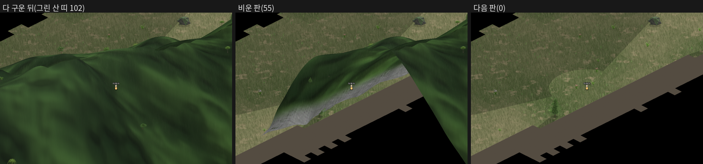

# T997 보고 — `T981_MT_NEAR` 켬 기본 · 산 청크 캐시 260 상한 통째 비우기 · 클라 메모리 마감 표 [승인 대기 · T997] (세션8 · 2026-10-29)

**한 줄 답:** `T981_MT_NEAR` 를 켬 기본으로 돌렸다(`!== '0'` · 되돌림 `=0` = 칸 없음 · 종전 그대로) — 열일곱째 판 위 가르기 자리 둘 × 크롬 · WebKit 에서 끔 · 켬 · 끔둘째 화면이 PNG 바이트로 같고 그린 산 띠 해시 84/84 · 109/109 · e2e 묶음 초록 · 서버 기준선 기본 · `=0` 3/3 이다. ② 260 상한 통째 비우기는 **화면의 산을 지운다** — 존 안에서 능선 옆을 걸어 상한에 닿은 세 번 모두 그린 산 띠 102 · 82 · 62 → 다음 판 0, 0 인 판 50 · 41 · 10, 다시 다 그리기까지 328 · 500 · 459판(12.7 · 18.9 · 25.2초)이고 여느 걸음 판엔 그런 떨어짐이 0 이다. 상한에 닿을 때 캐시가 든 띠 캔버스는 361 · 441 · 513M화소 · 크롬 렌더러 RSS 는 상한 바로 앞 2,113 · 2,452 · 2,680MB 다. ③ 마감 표 — 크롬 1시간(스냅샷 없는 판끼리 · 60분) JS 힙(GC 뒤) **51.7 → 25.7MB** · canvas(memory-infra) **203.2 → 131.1MB** · 렌더러 RSS **864 → 802.7MB**(T926 → T997) · WebKit 웹 프로세스 RSS 35~60분 평균 1,037.7 → 887.0MB · 살아 있는 캔버스 90.2 → 36.1M화소다. 바퀴 끝 표본이 못 보는 바퀴 안 산 청크 꼭대기는 134~153M화소(바퀴마다 존 넘기가 비운다)다.

[승인 대기 · T997] 가지 `batch/mt-near-on-1029`(main `525a2bb2` 위 · `origin/batch/three-on-1028`(T974 · 열일곱째 판 · `6999cc1f`) 합침 `4ca4031b` · `origin/batch/cut-near-on-1028`(T981 · `1149d87e`) 합침 `c5e48682`)
- `server/zone.js:6939`: T981 welcome 줄 `!== '0'`(켬 기본 · 되돌림 `T981_MT_NEAR=0` = 칸 없음).
- `public/client/11-r1-mountain.js`: T981 머리말(★T997 켬 기본) — 몸 무변.
- 계측 자(러너 밖): 새 `scripts/t997-chunk-cap-check.js`(260 상한 비우기 · 판마다 그린 산 띠 · 다잡은 비우기 · 걷기 두 길) · `scripts/t926-mem-hour.js` `--peak`(바퀴 안 산 청크 캐시 꼭대기).
- `계측/T997_그림손잡이.json` · `계측/T997_청크상한.json` · `계측/T997_마감.json` · `계측/T997_상한비우기.png` · `인계/손잡이_전수.md` T981 행 ON + 증분 한 줄 · `인계/회부.md` T997 절.
- 새 수 0 · 판정 0 · 하네스 무변(계측 자 하나 더함 · 한 자에 칸 하나) · force 0 · 배포 0.

| 할 것(카드) | 한 것 | 근거 |
|---|---|---|
| ① `!== '0'` 켬 기본 · 손잡이 전수 · 그림 같음(`t970-cut-near-check --knob --half`) · e2e 묶음(mountain · ui · zone-cross) | welcome 한 줄 `!== '0'` · 전수 행 ON · 같은 그림 크롬 · WebKit 자리 둘(세 장 바이트 같음 · 그린 산 띠 해시) · `e2e-mountain` · `e2e-ui` · `e2e-zone-cross` · `e2e-mtcut` · 되돌림 `=0` 둘 · 서버 기준선 기본 · `=0` | §1 · §4 |
| ② 남은 큰 몫 `_mt3Chunk`(평평 · 상한 260) — 상한에 닿는 대본(존 안에서 넓게 걷기)에서 통째 비우기가 그림을 깜빡이게 하나 한 판 | 깜빡인다 — 다잡은 비우기(산 자리) · 존 안 걷기 두 길(곧은 길 · 능선 옆)에서 실제로 닿은 상한 넷(산이 화면에 있던 셋 모두 산이 다 빠졌다 돌아옴) · 상한에 닿을 때 캐시 넓이 · 렌더러 RSS | §2 |
| ③ 클라 메모리 마감 표(T926 → T997 · 1시간 RSS · 힙 · 캔버스) | T997 기본 트리 크롬 · WebKit 1시간 + T926 · T970 · T981 판을 한 표로 · 바퀴 끝 표본이 못 보는 바퀴 안 꼭대기 | §3 |

---

## §1. ① `T981_MT_NEAR` 켬 기본

- `server/zone.js:6939`(열일곱째 판 · T981 합친 트리) — `...(process.env.T981_MT_NEAR !== '0' ? { mtNear: true } : {})` · 되돌림 `T981_MT_NEAR=0` 이면 칸이 없다(옛 welcome · 종전 그대로). 클라 몸(`_mtNearSweep`)은 T981 그대로(머리말만 ★T997 켬 기본).
- 기본 welcome 에 `mtNear: true` 한 칸이 실린다 — env 없이 띄운 판마다 welcome 줄: 상한 자 `{"mtBand":true,"cutNear":true,"mtNear":true}` · 같은 그림 자 `{"cutNear":true,"mtNear":true}` · 1시간 판 `mtNear: true`.
- 손잡이 전수 — `T981_MT_NEAR` 행을 ON 으로(T981 이 `T970_CUT_NEAR` 를 고친 꼴) · `T970_CUT_NEAR` 행은 읽는 자리만 6937 → 6938(합친 트리 — T974 주석 한 줄) · `t883-knob-compare` 새 갈림 0(§4).
- 이 가지는 T974 가지(`batch/three-on-1028` — 열일곱째 판)와 T981 가지(`batch/cut-near-on-1028`)를 합쳐 품는다 — 둘 다 main 에 아직 없다.

### ①-a 같은 그림(`t970-cut-near-check --knob mtNear --half` · 크롬 · WebKit · 가르기 자리 둘)

T981 의 같은 그림 자를 그대로 다시(갈래가 `uiCfg.mtNear` 를 지우고 세운다 — 기본 welcome 이 켬이어도 끔 갈래는 칸을 지운 페이지 = `=0` 과 같은 글).
굽다 만 청크 걸음(`--half` — 자리에서 굽는 중 청크가 생기면 곧바로 떠나 먼 곳 셋을 돌고 온다) · 끔 · 켬 · 끔둘째.

| 브라우저 | 자리 | 떠날 때 굽는 중 | 돌아오기 앞 굽는 중 끔 · 켬 · 끔둘째 | 켬이 버린 굽던 청크 · 되돌린 판(누적) | 돌아오기 앞 가르기 판 둘(화소) 켬 → 찍을 때 | 화면 끔↔켬 · 끔↔끔둘째 · 켬↔끔둘째 | 그린 산 띠 해시 끔↔켬 · 끔↔끔둘째 | 가르기 조각 해시 |
|---|---|---|---|---|---|---|---|---|
| 크롬 | 산 (2147,1956) | 1 · 1 · 1 | 3 · **1** · 3 | 2 · 2(켬 갈래 끝 3 · 2) | 16,384/16,384 → 1,032,192/884,736 | **바이트 같음 · 바이트 같음 · 바이트 같음** | 84/84 · 84/84 같음(23.42M화소) | 5/5 · 5/5 |
| 크롬 | 바위1112_2408 (1108,2404) | 1 · 1 · 1 | 3 · **1** · 3 | 5 · 4(켬 갈래 끝 6 · 4) | 16,384/16,384 → 1,032,192/884,736 | **바이트 같음 · 바이트 같음 · 바이트 같음** | 109/109 · 109/109 같음(28.55M화소) | 5/5 · 5/5 |
| WebKit | 산 (2147,1956) | 1 · 1 · 1 | 3 · **1** · 3 | 1 · 2(켬 갈래 끝 2 · 2) | 16,384/16,384 → 1,032,192/884,736 | **바이트 같음 · 바이트 같음 · 바이트 같음** | 84/84 · 84/84 같음(23.42M화소) | 5/5 · 5/5 |
| WebKit | 바위1112_2408 (1108,2404) | 1 · 1 · 1 | 3 · **1** · 3 | 4 · 4(켬 갈래 끝 5 · 4) | 16,384/16,384 → 1,032,192/884,736 | **바이트 같음 · 바이트 같음 · 바이트 같음** | 109/109 · 109/109 같음(28.55M화소) | 5/5 · 5/5 |

* 넷 모두 세 장이 PNG 바이트로 같고 이번 판 그린 산 띠 전부가 화소 해시로 같다(켬이 버렸다 처음부터 다시 구운 자리 청크 포함) — T981 ②-a 와 같은 수(84 · 109장 · 23.42 · 28.55M화소 · 판 16,384/16,384 → 1,032,192/884,736). 선 채 10초 새 조각 0 · 쓰러짐 거짓(스물넷 장 모두) · 오류 0.
* (계수는 판 안 누적이다 — 끔둘째 줄의 버린 수 +1 은 켬 갈래 끝 10초에 하나 더 버린 것 · T981 §2 와 같은 꼴.)

## §2. ② 남은 큰 몫 `_mt3Chunk` — 260 상한 통째 비우기가 그림을 깜빡이게 하나

**자리**(`public/client/11-r1-mountain.js:689` — `_mt3Bake` 끝 · 청크 하나를 다 구워 캐시에 넣기 직전):
`if (_mt3Chunk.size > 260) { _mt3Chunk.clear(); _mt3Jobs.clear(); }` — 캐시가 260 을 넘으면 **이번 판 화면에 걸린 청크까지 통째로** 버린다.
같은 파일 `:416` 머리말(T870) — "반쯤 구운 산은 안 그린다" · 한 판에 띠 하나(`MT3_BUDGET` 1 · `10-r1-terrain.js:1710`). 그래서 비운 뒤 화면의 산은 청크마다 띠를 다 구울 때까지 안 그려진다.
존 바뀜(`:808`) · 파괴(`:810` — 그 청크만) · 손잡이(`window.__mt3*`) · 나무 그림 로드(`40-r2-sprites.js:175` · `:228`)도 캐시를 비우지만 이 판(한 존 · 손잡이 무접촉)에서 상한 밖 비우기는 ⓐ 의 다잡은 한 번(그 밖 1)뿐이다.

**자**(`scripts/t997-chunk-cap-check.js` · 러너 밖 · 크롬 · 존 env 그대로 = T997 기본 · welcome `mtBand` · `cutNear` · `mtNear` 모두 true · §5):
- 갈고리 — `_mt3Chunk` 객체의 `clear` 를 감싸 부른 자리를 호출 더미로 가른다(`_mt3Bake` = 260 상한 · `_mt3Collect` = 존 바뀜 · 그 밖) · 비우기 앞 청크 수 · 띠 캔버스 장 수 · 넓이(같은 캔버스는 한 번).
- 판마다(rAF — 게임 판 `loop` 뒤) 그린 산 띠 수(`__mtDbg.segs` = 그 판 `_mt3Collect` 가 낸 수) · 청크 수 · 굽는 중 수 · 산 굽기 수 · 카메라(`myAbsRender`).
- 상한 비우기가 난 판 · 다음 판 · 열하나째 판의 본 캔버스를 그 판에서 뜨고, 그 자리에 선 채 다 구운 뒤 다시 떠 견준다(비우기마다 판 안 카메라 한 자리).
- 걸음 = 걷는 빠르기(존 `MOVE_SPEED` 64px/s = 1초에 2칸) 그대로 워프 걸음 · 막힌 칸이면 클라 정본 `isTerrainBlockedAtAbs` 로 둘레 3칸 안 가까운 칸 · 다 막혔으면 그 걸음을 건너뛴다.
- 결정론 — 물 · 바람 시각 · 비 0 · 해 몫 한낮 · 같은 자리 · 같은 길. 이 판(`cap2`) 앞에 같은 판을 세 번 돌았다(맛보기 둘 · 셈 고치기 앞 본 판 — §6). 겹치는 비우기마다 걸음째 · 칸 · 청크 수 · 장 수 · 그린 띠가 같고, 판 줄에서 다시 센 0 인 판 · 반 아래 판 · 돌아오기 판 수도 같다(넓이만 상한 ③ 443.23 ↔ 441.48M화소 — 같은 1,823장 · ④ 는 15분 끝 걸음(691째)에 이 판에서만 닿았다).

### ②-a 다잡은 견줌 — 산 자리 (2147,1956)에서 260 상한 줄과 같은 글자로 비운다

| 비우기 앞 캐시 | 그린 산 띠 앞 → 비운 다음 판 | 0 인 판 · 반 아래 판 | 다시 다 그리기까지 | 화면 A(다 구운 앞) ↔ 비운 다음 판 · 열째 판 | A ↔ 다 구운 뒤 B |
|---|---|---|---|---|---|
| 52청크 · 213장 · 48.40M화소 | **84 → 0** | 3 · 161 | **439판 · 13.4초** | 모든 화소(792,000) 갈림 · \|Δ\| 평균 20.5 · 24 넘게 갈린 10.8% · 열째 판 같은 꼴 | **바이트 같음** |

* 비운 다음 판에 화면의 산이 다 빠진다(밝은 자리의 산 · 어두운 자리의 산 모양 모두 — 어두운 자리는 검게) — 첫 셋 판 0 · 넷째 판부터 청크마다 다 구운 것이 하나씩 돌아와 439판(13.4초) 뒤 84 로 돌아온다. 다시 구운 그림은 처음과 PNG 바이트로 같다(그림 값 무변 — 깜빡임만).

### ②-b 존 안에서 넓게 걷기 — 걸음에서 실제로 상한에 닿는다

| 길 | 걸음 | 상한 비우기(걸음째 · 분 · 칸) | 비우기 앞 캐시(청크 · 장 · 넓이) | 그린 산 띠 앞 판 → 비운 판 → 다음 판 | 0 인 판 · 반 아래 판 | 다시 다 그리기까지 | 다 구운 뒤 ↔ 다음 판 화면 |
|---|---|---|---|---|---|---|---|
| ⓑ 곧은 길(산 → 바위 무더기 잇는 선) | 219 · 448칸 · 3.92분 | ① 219 · 3.92 · (1748,2133) | 261 · 333 · 63.86M화소 | **0** → 0 → 0(산 없는 들) | — | — | 바이트 같음(화면에 산이 없다) |
| ⓒ 능선 옆(산 자리 능선 서쪽 기슭 · 북 → 남) | 691(건너뜀 87) · 1,668칸 · 15.45분 | ② 229 · 4.49 · (2152,1800) | 261 · 1,547 · **361.27M화소** | **102 → 55 → 0** | **50 · 163** | **328판 · 12.7초** | 614,777화소(78%) 갈림 · \|Δ\| 30.2 · 24 넘게 64.4% |
| | | ③ 468 · 9.86 · (2145,2340) | 261 · 1,823 · **441.48M화소** | **82 → 82 → 0** | **41 · 114** | **500판 · 18.9초** | 모든 화소 갈림 · \|Δ\| 15.8 · 24 넘게 11.2% |
| | | ④ 691 · 15.45 · (1946,2856) | 261 · 1,976 · **513.00M화소** | **62 → 62 → 0** | **10 · 58** | **459판 · 25.2초** | 791,997화소 갈림 · \|Δ\| 22.2 · 24 넘게 15.2% |

* **깜빡인다** — 산이 화면에 있는 채 상한에 닿은 세 번 모두, 비운 다음 판에 화면의 산이 통째로 빠지고(0 인 판 50 · 41 · 10) 청크마다 다 구운 것부터 하나씩 돌아와 12.7 · 18.9 · 25.2초 뒤에 다 돌아온다. 걸음이 안 멈추면 그 사이 새 청크도 같은 예산(한 판 띠 하나)을 나눠 쓴다(이 판은 비운 뒤 선 채 쟀다).
* 비운 판(그 판 수집 도중에 비움)은 비우기 앞에 실린 청크까지 그려진다 — ② 55 · ③ 82 · ④ 62 — 빠지는 것은 다음 판부터다(0 · 반 아래 · 돌아오기는 빈 캐시로 처음 그린 판부터 셈).
* **여느 걸음 판엔 그런 떨어짐이 없다** — 걷기 판 19,567(그린 띠 앞 30판 가운데값 10 이상)에서 반 아래로 떨어진 판 0. 따로 센 64판은 모두 카메라 뜀(걸음 하나 = 길 2칸 + 양끝 둘레 3칸 · 256px 보다 먼 걸음 — 막힌 걸음을 건너뛴 뒤 1,198 · 1,441 · 1,713 · 2,179 · 290px 다섯 · 능선 옆 첫 자리 워프 28,250px 는 창째 뺐다) 뒤 그 자리가 다 구워지기 전이다(뜀 자리의 안 구운 새 청크 — 비우기와 무관 · 상한 비우기 뒤 선 채 다 구운 창도 뺐다).
* 상한에 닿는 데 걸린 걸음 — 곧은 길 3.92분(448칸) · 능선 옆 4.49분 → 다음 5.37분 → 다음 5.59분(선 채 다 구운 동안 포함). 존을 안 넘고 4~6분 걸으면 닿는다(T926 대본은 바퀴마다 존을 넘어 비우므로 바퀴 끝 표본에선 안 보였다 — T981 회부 4 · ③-b).
* 화면 |Δ| 은 같은 카메라에서 뜬 두 장 견줌이다. ③ · ④ 는 화면에서 밝은 산이 덮은 몫이 작은 자리다 — ③ 왼쪽 위 · 오른쪽 끝 산과 나를 가려 흐리게 그린 앞 산 · ④ 왼쪽 위 능선과 어두운 자리의 산 덩어리 — 비운 다음 판에 모두 빠진다(어두운 자리는 검게 · 그림은 ② 만 실었다).

### ②-c 상한에 닿을 때 캐시가 든 넓이 · 렌더러 RSS

| 길 · 상한 | 걸음 열마다 첫 줄(청크 · 넓이 · 렌더러 RSS) | 비우기 앞 마지막 줄 | 청크 하나에 넓이 | RSS ÷ 넓이 | 비우기 · 다 구운 뒤 RSS |
|---|---|---|---|---|---|
| ⓑ ① | 10걸음 · 36 · 56.08M화소 · 790MB | 210걸음 · 252 · 63.86 · 969MB | 30걸음 뒤 0(빈 들) | — | 986MB |
| ⓒ ② | 10걸음 · 60 · 45.92 · 955MB | 220걸음 · 252 · 349.20 · **2,113MB** | 1.58M화소 | 3.82MB/M화소 | 939MB |
| ⓒ ③ | 250걸음 · 54 · 80.59 · 1,067MB | 460걸음 · 253 · 419.38 · **2,452MB** | 1.70 | 4.09 | 1,053MB |
| ⓒ ④ | 490걸음 · 53 · 121.86 · 1,261MB | 690걸음 · 247 · 494.92 · **2,680MB** | 1.92 | 3.80 | 905MB |

* 260 상한은 청크 **수**만 묶는다 — 빈 들 청크는 넓이 0 으로 한 칸을 들고(곧은 길 상한 63.86M화소) 능선 청크는 1.58~1.92M화소씩 든다(능선 옆 상한 361.27 · 441.48 · 513.00M화소 — 4바이트로 1,378 · 1,684 · 1,957MB · 1MB = 1,048,576바이트 · 표의 px4MB 셈).
* 렌더러 RSS(ps)가 넓이를 따라 오른다 — 넓이 1M화소에 3.80~4.09MB(4바이트 꼴) · 상한 바로 앞 2,113 · 2,452 · 2,680MB → 비우고 다 구운 뒤 939 · 1,053 · 905MB.

## §3. ③ 클라 메모리 마감 표(T926 → T997 · 1시간)

같은 대본(`scripts/t926-mem-hour.js` — 바퀴 5분 = 걷기 네모 두 바퀴 · 워프 여덟(다시 가는 마을 넷 · 처음 가는 들 넷) · 존 넘기 · 광산2 머물기) 1시간 판을 카드마다 모아 한 표로.
값 = 바퀴 끝 표본(5분 · 60분 · 35~60분 여섯 평균). 렌더러 RSS = ps · JS 힙 = CDP 강제 GC 뒤 · canvas = memory-infra 렌더러 canvas · 넓이 = 살아 있는 캔버스(갈고리 WeakRef · 강제 GC 뒤).
**트리가 판마다 다르다**(세계 판 · 클라 손잡이) — 손잡이 하나의 몫은 각 카드의 같은 때 짝 판(T926 끔 · 켬 · T970 · T981 끔 · 켬 · 끔둘째)이 가른다. 이 표는 그 길의 마감이다.

### ③-a 크롬

| 판 | 트리 · 손잡이 | 렌더러 RSS MB 5분 → 60분 (35~60 평균) | JS 힙 GC 뒤 MB 5 → 60 (35~60) | canvas MB(memory-infra) 5 → 60 (35~60) | 살아 있는 캔버스 넓이 M화소 5 → 60 (35~60) | p95 평균 ms · 프레임 수 |
|---|---|---|---|---|---|---|
| T926 cr-h1 | main 1732d93a · 손잡이 없음 · 스냅샷 5·30·60 | 751 → 1063 (966.0) | 19.8 → 52.4 (45.4) | - → - (-) | 46.2 → 50.6 (50.1) | 59.8 · 135,365 |
| **T926 cr-ns** | T926 가지 끔(= main) · 스냅샷 없음 · memory-infra | 746 → 864 (857.3) | 20.0 → 51.7 (46.5) | 155.7 → 203.2 (196.5) | 41.0 → 53.5 (51.7) | 72.2 · 121,831 |
| T926 cr-on | T926_CELL_NEAR=1 · 스냅샷 5·30·60 | 751 → 826 (833.0) | 17.2 → 24.7 (23.7) | 159.4 → 172.5 (172.8) | 42.0 → 45.4 (45.5) | 69.4 · 126,433 |
| T970 cr-base | main a9190f9e(T926 켬 기본 · T947 끔) · 스냅샷 없음 | 721.3 → 861.2 (843.9) | 18.2 → 25 (24.0) | 153.3 → 175.4 (171.3) | 39.7 → 45.6 (44.5) | 83.3 · 98,570 |
| T970 cr-on | 같은 트리 · T970_CUT_NEAR=1 | 765.7 → 835.7 (836.2) | 18 → 25.2 (24.0) | 147.1 → 161.8 (157.5) | 38.8 → 42.6 (41.5) | 86.1 · 92,076 |
| T981 cr-off | main 241e4407 + T960 + T970(켬 기본) · T981 끔 | 781 → 836.6 (826.0) | 18 → 25.2 (23.7) | 156 → 159.2 (162.6) | 40.5 → 41.3 (42.2) | 77.8 · 104,772 |
| T981 cr-on | 같은 트리 · T981_MT_NEAR=1 | 704.5 → 840.3 (798.2) | 18.6 → 23.8 (23.9) | 135.1 → 135.1 (133.8) | 35.6 → 35.7 (35.3) | 72.3 · 105,501 |
| **T997 cr-t997** | T997 가지 기본(T926 · T947 · T970 · T981 켬 기본 · 열일곱째 판) | 765.7 → 802.7 (800.9) | 18.5 → 25.7 (24.8) | 134 → 131.1 (134.4) | 35.3 → 34.6 (35.5) | 73.6 · 103,820 |

* **JS 힙(GC 뒤) 60분 51.7 → 25.7MB** — T926 손잡이(물 · 바위 칸 캐시 카메라 둘레 · T936 켬 기본) 몫. T970 뒤 판들은 모두 5분 18.0~18.6 → 60분 23.8~25.7MB 꼴이다. T997 판에서 5 → 60분 수가 는 이름 캐시: 안개가 본 칸(`window._seenChunks` 299 → 1,118청크 · 49,335 → 204,555칸 — T926 이 안 만진 것) · 흐름 칸(`_flowCellCache` 7,944 → 17,276 — 25분부터 16,669~17,276) · 건물 가림 칸 셋(`clFloorCellMap` · `clMaxFloorMap` 127 → 2,359 · `clWallCellMap` 82 → 1,756 — 본 마을 건물 칸) · 자연물 청크(`_natChunk` 377 → 1,497). 물 · 바위 칸 캐시는 6,400 · 21,504(T926 켬 판과 같은 수)에 머문다.
* **canvas(memory-infra) 60분 203.2 → 131.1MB · 35~60분 평균 196.5 → 134.4MB** — T970(가르기 붙듦 카메라 둘레 · 171.3 → 157.5) · T981(굽다 만 청크 · 가르기 판 둘 · 162.6 → 133.8) 몫. T997 판 60분 붙든 이름: `_mt3Chunk` 122장 19.79M화소 · `_groundTiles` 68장 8.91 · `_mgl` 2장 2.65 · 그림자 · 산 흐림 판 · 지면 판(1장씩 1.04 · 0.79 · 0.52) — 이름 없음 0.
* **렌더러 RSS 60분 864 → 802.7MB · 35~60분 평균 857.3 → 800.9MB**(스냅샷 없는 판끼리 — T926 cr-h1 · cr-on 은 5 · 30 · 60분 힙 스냅샷이 렌더러 malloc 을 +44~50MB 올린 판이다 · T926 §4-③). T997 60분 렌더러 할당자: malloc 206.6(그 가운데 canvas 131.1) · partition_alloc 76.2 · v8 26.6 · blink GC 21.0 · 공유 74.6 · discardable 32.0(MB).
* 프레임 — p50 이 T926 판 16.7ms(바퀴 대부분) · T970 뒤 판 33.3ms 다(프레임 수 121,831 · 126,433 · 135,365 → 92,076~105,501). 같은 상자(오늘 이 컨테이너)에서 T926 트리(main `1732d93a` + 이 계측 자)와 T997 트리를 10분씩 같은 자(`--snap none`)로 돌리면 바퀴 둘 프레임 9,218 · 8,227 ↔ 9,216 · 8,068 · p50 33.2 · 33.3 ↔ 33.2 · 33.3 · p95 83.3 같음 — 판 사이 p50 갈림(16.7 → 33.3)은 트리가 아니라 상자(날)의 몫이다(그래서 이 표의 프레임 칸은 판끼리 견주지 않는다). 같은 10분 JS 힙(GC 뒤)은 19.0 → 32.7MB(T926 트리 — 칸 캐시) ↔ 17.7 → 20.7MB(T997 트리) · 렌더러 RSS 740 → 799 ↔ 735 → 773MB.

### ③-b 바퀴 안 꼭대기 — 바퀴 끝 표본이 못 보는 몫(T997 크롬 · `--peak`)

| 바퀴(끝 분) | 5 | 10 | 15 | 20 | 25 | 30 | 35 | 40 | 45 | 50 | 55 | 60 |
|---|---|---|---|---|---|---|---|---|---|---|---|---|
| 산 청크 캐시 꼭대기 M화소 | 134.3 | 143.1 | 144.4 | 144.4 | 134.9 | 144.4 | 134.9 | 143.1 | 134.9 | 144.4 | 134.9 | 148.5 |

* 바퀴마다 존 넘기가 캐시를 두 번 비운다(닛폰 들어감 · 한반도 돌아옴 — 열두 바퀴 존 바뀜 24 · 상한 비우기 0). 꼭대기 183~212청크 · 619~694장 · 134.3~148.5M화소(4바이트로 512~567MB)는 바퀴 끝 표본(광산2 · 존 넘기 뒤 — `_mt3Chunk` 39청크 · 122장 · 19.79M화소)이 못 본다. 바퀴 끝 memory-infra canvas 131.1MB 는 이 바닥 쪽 값이다.
* 존을 안 넘는 판에선 이 꼭대기가 260 상한까지 간다 — ② 능선 옆 361.27 · 441.48 · 513.00M화소.

### ③-c WebKit

| 판 | 트리 · 손잡이 | 웹 프로세스 RSS MB 5분 → 60분 (35~60 평균) | 살아 있는 캔버스 장 · 넓이 M화소 60분 (35~60 넓이) | p95 평균 ms · 프레임 수 |
|---|---|---|---|---|
| T926 wk-h1 | main 1732d93a · 손잡이 없음 | 935 → 1063 (1037.7) | 370 · 90.2 (89.1) | 54.3 · 115,321 |
| T926 wk-off2 | T926 가지 끔 | 998 → 1063 (1036.3) | 363 · 90.4 (86.7) | 60.5 · 101,725 |
| T926 wk-on | T926_CELL_NEAR=1 | 973 → 980 (973.3) | 359 · 90.1 (85.8) | 61.6 · 99,064 |
| **T997 wk-t997** | T997 가지 기본(T926 · T947 · T970 · T981 켬 기본 · 열일곱째 판) | 909.4 → 783.5 (887.0) | 215 · 36.1 (36.1) | 73.7 · 79,081 |

* **웹 프로세스 RSS 35~60분 평균 1,037.7(T926 main) · 973.3(T926 켬) → 887.0MB** — T997 판은 바퀴 끝마다 752.9~1,017.7MB 사이를 오르내린다(45 · 55 · 60분 785.8 · 752.9 · 783.5 — 내려놓는 바퀴가 있다 · T926 main 판 30~60분 1,014~1,068MB · 켬 판 939~1,016MB). WebKit 은 힙 API 가 없어 JS 힙 · memory-infra 칸이 없다(강제 GC 도 없다).
* **살아 있는 캔버스(WeakRef — 아직 안 거둔 것 포함) 60분 359~370장 · 90.1~90.4M화소 → 215장 · 36.1M화소** — 붙든 이름: `_mt3Chunk` 117장 19.59 · `_groundTiles` 86장 11.27 · `_mgl` 2장 2.65(M화소) · 이름 없음 0.
* 바퀴 안 산 청크 캐시 꼭대기 183~214청크 · 614~681장 · 133.3~152.7M화소(크롬과 같은 꼴 · 존 바뀜 24 · 상한 비우기 0).
* 프레임 — T997 WebKit 판은 바퀴마다 프레임 수가 7,263(5분) → 6,026(60분) · p50 36 → 46ms 로 줄어든다(T926 WebKit 판도 같은 쪽 — 켬 판 8,543 → 7,624 · p50 29 → 35). 이 표는 그 몫을 가르지 않는다(판정 0).

## §4. 하네스 · 서버 판 · 손잡이 전수

| 판 | 기본(T997 — T981 켬) | `T981_MT_NEAR=0`(되돌림 — 존이 env 를 받는다) |
|---|---|---|
| `e2e-mountain`(산 장벽 세그먼트) | **51/0**(306초) | **51/0** |
| `e2e-ui` | **151/0**(135초) | — |
| `e2e-zone-cross`(존 넘기 — 청크 캐시 비움 길) | **47/0** | — |
| `e2e-mtcut`(가르기 · v4 수직 평면 · `@pixel`) | **26/26** | **26/26** |
| 서버 기준선 `계측/서버기준선_2026-10-28_T974.json`(열일곱째 판 후보 — T974 `--make`) `--plan 1020:400,7:60,42:60` | **같음 3/3**(319초 · 시드 1020 400날 지문 · 판 JSON · 여덟 수 같음 · 인구 2,488 · 7 · 42 60날) | **같음 3/3**(319초) |
| `test-harness-lint` · `test-client-globals` · econ 번들 · 랩 인라인 | **68/0 · 26/0** · `build-econ-bundle --check` 8 일치 · `inline-engine --check` 두 랩 최신 | — |
| 손잡이 전수 대조 `t883-knob-compare` | 표 행 148 · 이름 137(main `525a2bb2` 146 · 135 → T974 `T958_HOUSE_REAL` 한 행 + T981 `T981_MT_NEAR` 한 행) · 표 ≠ 코드 글자 9 = main 과 같은 아홉(새 갈림 0 — `T981_MT_NEAR` 표 ON · 코드 `!== '0'` · `T970_CUT_NEAR` 표 ON · 코드 `!== '0'`) | — |

* 카드의 e2e 묶음(mountain · ui · zone-cross) + 산 가르기(`e2e-mtcut`) · 되돌림 둘. 서버 판은 welcome 칸 하나(`mtNear`)만 갈리므로 세계 값 견줌(T837 서버 띠 · T944 랩 띠 · 판 자 T959)은 둘 곳이 없다 — 세계 값이 같다는 것은 서버 기준선 세 판(기본 · `=0`)이 보인다.
* 서버 기준선 — 카드 캐논은 main 최신(land1030 뒤 `_2026-10-29.json`)이나 land1030 은 아직이다. 열일곱째 판(`batch/three-on-1028`)을 합친 위라 그 가지의 새 판 `서버기준선_2026-10-28_T974.json` 에 견줬다(main 최신 `서버기준선_2026-10-28.json` 은 열여섯째 판 — T974 §2-2 의 첫 갈림 날 1020 = 376 이 이 자의 400날 안에 든다).

## §5. 계측 자(러너 밖 · 제품 0)

- **새** `scripts/t997-chunk-cap-check.js` — §2 의 자. 갈고리는 적기만 한다(`_mt3Chunk` 객체의 `clear` 를 감싸 원래 `Map.prototype.clear` 를 부른다 · rAF 고리 하나 · 그림 무접촉). ⓐ 다잡은 비우기는 260 상한 줄과 같은 글자(`_mt3Chunk.clear(); _mt3Jobs.clear()`)를 페이지에서 부른다.
  - 길 둘 — ⓑ 곧은 길(t970-cut-near-check CENTERS 와 같은 식으로 고른 바위 무더기 잇는 선) · ⓒ 능선 옆(정본 바위 술어로 고른 산 자리 능선 서쪽 기슭 — 칸 y 1344 → 3200 · 손으로 고른 좌표는 산 자리 (2150,1959) 하나 — e2e-mtcut 의 그 자리).
  - 걸음 = 1초에 2칸 워프 걸음(존 `MOVE_SPEED` 64px/s) · 막힌 칸이면 둘레 3칸 · 다 막히면 건너뜀(능선 옆 84 걸음) — 건너뛴 뒤 걸음은 걸음 하나보다 멀다(카메라 뜀 — 아래 여느 판 셈에서 따로).
  - 셈 — 비운 판(상한은 그 판 수집 도중) · 빈 캐시로 처음 그린 판(그다음 판)부터 0 인 판 · 반 아래 판 · 돌아오기 · 여느 판 반 아래 떨어짐(뜀 뒤 다 구운 판이 없던 것은 따로) · 걸음 열마다 캐시 넓이 · 렌더러 RSS.
- `scripts/t926-mem-hour.js` — `--peak`(머리말 ★T997): 입장 뒤 같은 `clear` 갈고리 + 2초마다 캐시 넓이 최댓값 → 바퀴 끝 표본 `mtPeak`(그 바퀴 산 청크 캐시 꼭대기 · 상한 비우기마다 [청크 · 장 · 넓이] · 존 바뀜 · 그 밖) · 대본 무변 · `--peak` 없으면 종전 그대로.
- 같은 그림 자 `scripts/t970-cut-near-check.js` 는 T981 그대로(`--knob mtNear --half`).

## §6. 판 기록(UTC 2026-10-29 · 이 컨테이너 · 2코어)

| 판 | 때 | 초 | 결과 |
|---|---|---|---|
| 맛보기 — 상한 자(곧은 길만 · 상한 1) | 05:59~06:07 | 479 | ⓐ 84 → 0 · 439판 · ⓑ 219걸음째 상한(63.86M화소 · 그린 띠 0) |
| 맛보기 — 상한 자(두 길 · 능선 옆 상한 1) | 06:11~06:24 | 766 | ⓑ 같은 걸음 · 같은 수 · ⓒ 229걸음째 상한(361.27M화소 · 102 → 0 · 0 인 판 50) |
| 맛보기 — `t926-mem-hour --min 5 --peak` | 06:27~06:33 | 336 | 바퀴 안 꼭대기 211청크 · 133.8M화소(갈고리 확인) |
| `e2e-mountain` · `e2e-ui` · `e2e-zone-cross` · `e2e-mtcut` | 06:35~06:58 | 306 · 135 · 763 · 160 | 51/0 · 151/0 · 47/0 · 26/26 |
| 린트 넷 · `t883-knob-compare` | 06:37~06:40 | 123 | 68/0 · 26/0 · 8 일치 · 두 랩 최신 · 새 갈림 0 |
| `e2e-mountain` · `e2e-mtcut` `T981_MT_NEAR=0` | 06:58~07:04 | 235 · 161 | 51/0 · 26/26 |
| 서버 기준선 T974 판 기본 · `=0` | 07:04~07:15 | 320 · 318 | 3/3 · 3/3 |
| 상한 자 본 판(셈 고치기 앞) | 07:15~07:38 | 1,404 | 상한 ① ~ ③ — `cap2` 와 같은 걸음째 · 칸 · 청크 · 장 · 그린 띠(③ 넓이 443.23) · ④ 없음(15.01분 끝) · 0 인 판 셈을 비운 판부터 해 ③ 이 0 으로 적혔고 여느 판 64 를 뜀과 안 갈랐다 → 셈 고침(`7f8c5b7e`) · 판 줄로 다시 세면 `cap2` 와 같은 수 |
| 같은 그림 크롬 · WebKit(자리 둘) | 07:38~08:57 | 2,339 · 2,358 | §1 |
| 1시간 크롬 · WebKit(`--peak`) | 08:57~10:58 | 3,646 · 3,640 | §3 |
| 상한 자 `cap2`(고친 셈 · 이 보고의 수) | 10:58~11:22 | 1,427 | §2 |
| 같은 상자 10분 — T926 트리 · T997 트리 | 11:22~11:44 | 641 · 640 | §3 ③-a 프레임 |

* 한 판씩 차례로(포트 3010 · 3020 · e2e 둘 같이 0). 이 판들의 PNG · 판 줄 전부 · 날 표본은 커밋 밖(`/tmp/t997`).
