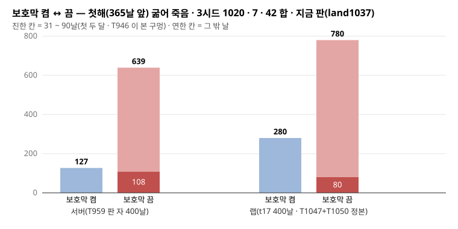

# 인계/판정대기.md — 판정 대기 한 곳

★규약: 판정 0 — 이 파일은 묻는 줄만 모은다(고르는 것은 PM · 재민). 절마다 낸 카드가 다르다: **PM 절** = T909(세션16) · 재민 절 · 묻는 차례 = T908(세션15). 원천은 T903 전수(`scripts/t903-referral-census.js` · 창 10-09 ~ 10-23).

## PM 절 (T909 · 2026-10-24 · main `4ac2ae12` 위 전수 다시 셈)

열린 PM 회부(판정자 PM · PM? · 미지정 140 — T903 때 102 + 35) 가운데 **PM 판정 93 항목 → 아래 70 줄**(같은 판정을 다른 카드가 다시 물은 것은 굵은 묶음 한 줄). 줄 꼴: 묻는 것 · 권고(보고에 있으면 그대로 · 없으면 "권고 없음") — 근거 회부(보고 파일). 나머지 47(ⓐ 고침 5 · ⓒ 재민 5 · ⓓ 닫힘 37)은 `보고/T909_2026-10-24.md` §2.

★[T922 · 세션15 · 2026-10-25 · 판정 0 — 권고만] 줄마다 아래에 한 줄을 붙였다: **권고 29** · **권고 없음 23**(이유 한 줄) · **닫힘 · 닫힘 후보 13**(커밋 · 족보) · **재민 절 · 다른 카드와 묶음 5**. 근거는 잰 수 · 족보 · 인계의 PM 규칙("같거나 나을 때만 켬 기본" 족보 640 · "랩이 목표" · "추상 없애기" 공통.md · "새 수 0" · "하네스를 느슨하게 만들지 않는다" · "T837 띠와 함께" 족보 672). 원문 줄은 그대로다.

★[T1150 · 세션3 · 2026-11-04 · main `9da93350` · 판정 0 — 권고만] 열린 53 줄을 지금 main 에서 다시 봤다: **닫힘 11**(줄긋기 · 커밋 · 족보) · **카드 감 7**(줄긋기 → 절 끝 「카드 감」 표) · **재민 절로 2**(줄긋기 → 문 23 전투 몸) · **PM 이 닫을 수 있음 33**(줄 아래 ★T1150 권고 + 근거 — 열림). 10-24 뒤 `인계/회부.md` T910 ~ T1149 블록 440 항목 전수: 닫힘 317 · PM 이 닫을 수 있음 50(→ 아래 「10-24 뒤 회부 — 새 PM 줄」 41 줄) · 재민 25(→ 재민 절 문 23 ~ 28 · 23 은 PM 절 두 줄과 한 문) · 카드 감 40(→ 「카드 감」 표) · 재민 손 일 8(→ 재민 손 일 표). ⇒ **열린 PM 줄 53 → 74**(옛 33 + 새 41 — 다 권고 붙음). ⚠ 10-24 ~ 11-04 main 보고의 회부 절 가운데 `인계/회부.md` 에 블록이 없는 카드 136 · 606 항목(결정 · 열림 155)은 이 셈 밖이다(카드 감 K29). 전수 대조 = `보고/T1150_2026-11-04.md`.

* `T652_WOOD_EARLY` 켤지 — 지금 끔 · 권고(보고): 400일 인구 못 가름 · 좁은 문 방향만(음) ⇒ 끔 유지 쪽 — T680 회부 2(`보고/T680_2026-10-10.md`)
  * ★권고(T922): 그대로 끔 — 근거: T680 회부 2 "400일 인구 못 가름 · 좁은 문 방향만(음)" · PM 규칙 "같거나 나을 때만 켬 기본"(족보 640) 못 맞춤 · 재민 10-12 "덤 자체가 추상"(족보 615)과 같은 결
  * ★T1150: PM 닫을 수 있음 — 끔 유지로 닫는다 — T680 회부 2(400일 못 가름 · 좁은 문만) · "같거나 나을 때만 켬 기본"(족보 640) · 벌목 몫은 ★재민 11-03 땔감 평형 ㄱ(족보 730 · T1135 끔 착지 · T1148 진행)이 수요로 다시 짠다 — 이른 배정 덤은 그 판 뒤 뜻이 없다
* 장 길이 정본 — 랩 `L_MKT_LINGER` 4게임시간 ↔ 서버 `CARAVAN_LINGER_DAY_FRAC` 1게임시간 · 권고 없음(값 고르기) — T684 회부 2(`보고/T684_2026-10-10.md`)
  * ★권고(T922): 서버를 4게임시간으로(카드로) — 근거: 재민 10-12 족보 618 "장부 도착이 장을 열고 **4시간**" · 캐논 "랩이 목표"(랩 `L_MKT_LINGER` 4) · 지금 서버 `CARAVAN_LINGER_DAY_FRAC` = 1/24(`server/villages.js:216`) — 새 수 0(재민 수)
  * ★PM 10-26(T939): 닫힘 후보 — 장은 이미 4게임시간이다: `T707_MARKET` 켬 기본(PM 10-13 · 재민 10-12 "켜자")이 장 끝 = 장부 도착 날 + `MKT_LINGER_DAY_FRAC` 4/24(`server/village-layout.js:61` · 랩 `L_MKT_LINGER` 와 같은 수)으로 세우고 상인 머묾도 장 끝까지다(`_t707Linger`). 1게임시간(`CARAVAN_LINGER_DAY_FRAC` `villages.js:216`)은 장을 안 여는 캐러밴(교차 존 `_t707Xz` · 되돌림 `T707_MARKET=0`)의 머묾에만 남는다 — 그 갈래를 4시간으로 맞출지는 회부(T939 §2 · 값 고침은 다음 카드)
  * ★T1028: `T952_XZ_STAY`(장 안 여는 캐러밴 머묾 4게임시간) 착지 끔 기본(족보 697) — 켬 기본은 판정 남음 · 열림
  * ★T1150: PM 닫을 수 있음 — 닫는다 — 장은 이미 4게임시간(T939) · 남은 `T952_XZ_STAY`(끔 · 코드 `=== '1'`)는 교차 존 장(`T1030_XZ_MARKET` 끔)을 켤 때 같이 본다 · 지금 캐러밴 시계는 몸 걸음(`T474_CARAVAN_WALK` 켬 기본 · 족보 750)
* **econ 하루 조각 더 쪼개기(발생기 · 상인 쉼표 · 마을별 씨)** · 권고 없음 — T687 회부 3 · T698 회부 2 · T712 회부 2
  * ★권고(T922): 권고 없음 — T910 · T896 켬 기본 뒤 econ 조각이 13.7 → 0.21 µs/사람(족보 688)이라 37 ms 교역 마을 몫을 다시 잰 판이 먼저 · 닫혔을 수 있다
  * ★PM 10-26(T939): 열림 — T910 의 econ 조각 13.7 → 0.21 µs/사람은 **다시 뜬 판**의 길 캐시 몫(버린 쌍 다시 파기)이다. 이 줄은 평시 한 마을 조각(교역 마을 37 ms · 상인 루프)의 크기라 그 표로 안 닫힌다
  * ★T1150: PM 닫을 수 있음 — 닫는다 — T1036 틱 정체 귀속(1위 = 부패 기준 온도 첫 풀이 → `T1036_SPOIL_WARM` 켬 기본 · 남은 100ms 대 = VM steal · `보고/T1036_2026-11-01.md` · land1038 족보 722)에 econ 하루 조각이 1위로 안 나온다 · 다시 서면 틱 max 표에서
* ~~**다일 실제 하루 판 · 몸이 걷는 자를 열지(판당 4시간 — 한 판 1시간 규칙 밖 · T914 가 실제 날 판 하나를 연다)** · 권고 없음 — T690 회부 2 · T712 회부 4 · T720 회부 6 · T733 회부 5 · T743 회부 2 · T765 회부 6~~ — **닫힘 · 족보 689 · 695(T939 ★PM 10-26)**(★T1028)
  * ★닫힘(T922): 닫힘 후보 — T914 판 자 고침 착지 "실제 날 판이 이 세계 곁"(족보 686) · 판정 다시 재기는 T925(세션5) 진행 중
  * ★PM 10-26(T939): 닫힘 — T914 표: 실제 날 판(24분 하루를 4분으로 · 60날 바이트 같음 · 180날)이 선다 — 판당 4시간 물음은 그 판으로 닫힌다 · 갈래마다 값 차는 T925 가 그 판으로 잰다
* ~~`T692_SEED_RESERVE` 켤지 — 지금 끔 · 권고(보고): 첫 달 목적이면 켜도 된다 · d100 · d400 은 못 가름 — T692 회부 1(`보고/T692_2026-10-11.md`)~~ — **닫힘 · 족보 615(★재민 10-12)**(★T1028)
  * ★닫힘(T922): 닫힘 — 재민 10-12 족보 615 "T692 시딩 비축 **안 켬**" · 코드 `T692_SEED_RESERVE === '1'`(끔) 그대로
* 몸 상한 60(설계 §6) — 시드 42 200일 뒤 묶임 · 권고 없음 — T693 회부 5(`보고/T693_2026-10-11.md`)
  * ★권고(T922): 권고 없음 — 운영 기본은 몸 무제한(T864 회부 1 "운영 기본에선 0")이라 판 자의 상한 꼴 · 제품 쪽 득실 표 없음
  * ★T1150: PM 닫을 수 있음 — 닫는다 — 운영 기본 몸 무제한(`server/villages.js:204` `VILLAGE_NPC_CAP` 없으면 Infinity) · 판 자 크루 몫은 회부 T1055 1(카드 감 K16)이 맡는다
* ~~**GC 손잡이 셋(`T689_GC` · `T697_DAY_GC` · `T715_HUNT_GC` — 다 끔) 켬 기본 — 권고(T697 · T715): 보류 · 같이 본다** — T697 회부 1 · T697 회부 2 · T715 회부 1 · T715 회부 2~~ — **닫힘 · 족보 689 · 695(T939 ★PM 10-26)**(★T1028)
  * ★권고(T922): 셋 다 그대로 끔 — 근거: T697 회부 1 켬이 30 ms+ 틱 16·24 → 32·30 · 결정 문 한 방 켬에 몰림 · PM 규칙 "같거나 나을 때만 켬 기본"(족보 640) 못 맞춤
  * ★PM 10-26(T939): 닫힘 — ★PM 10-26: 셋 다 끔 그대로(`T689_GC` · `T697_DAY_GC` · `T715_HUNT_GC` 코드 `=== '1'` 무변) · 다시 열려면 30 ms+ 틱이 끔과 같거나 나은 판이 먼저(T697 회부 1)
* `T698_BOUNDARY_SLICE` 켤지 — 지금 끔 · 선행: T698 회부 4(하네스 ⑧ 문턱) · 권고 없음 — T698 회부 1(`보고/T698_2026-10-11.md`)
  * ★권고(T922): 권고 없음(아래 줄과 묶음) — 기준선 3/3 바이트 같음이지만 실제 날 마감 창(밤 1~2초) 동안 몸 결정이 쉬는 몫을 잰 판이 없다 · T914 실제 날 판 곁(족보 686)에서 재면 "같거나 나을 때만"으로 가릴 수 있다
  * ★T1150: PM 닫을 수 있음 — 끔 유지로 닫는다(코드 `=== '1'`) — T1036 틱 정체 표(`보고/T1036_2026-11-01.md` · 족보 722)에 평시 경계 짐이 1위로 안 나온다 · 켤 까닭이 서면 ⑧ 단언(아래 줄 — T1033 으로 닫힘 · T698 을 켤 때 다시 선다)과 같이
* ~~`test-tick-slicer` ⑧ 문턱이 B = 0 일 때 — 안 ⓐ 최소 폭 · ⓑ 끔 판 B · ⓒ 남은 차 막기 · 단언을 바꾸는 일이라 판정(T698 켬 선행) · 권고 없음 — T698 회부 4(`보고/T698_2026-10-11.md`)~~ — **닫힘 · T1033 착지(land1038 · B 0 · 족보 722)**(★T1150)
  * ★권고(T922): 권고 없음 — 위 줄(T698 켬)이 먼저다(켜지 않으면 이 단언 손질은 필요 없다) · 캐논 "하네스를 느슨하게 만들지 않는다"로 ⓐ 최소 폭은 피한다
  * ★T1150: 닫힘 — T1033 착지(land1038 · 족보 722): 기본 세계(T698 끔)에서 B 는 이미 0 · 고친 트리 20판 B 0 · ⑧ 차 0 — ⑧ 은 같음 검사(무름 0 · T1033 회부 6) · T698 을 켤 때만 다시 선다(위 줄)
* `T699_ROUTE_CACHE` — 제품 끔 그대로(자 · 게이트 전용) · 권고(보고): 제품에서 켤 까닭 없음 · T910(세션4 길 캐시 서명)이 같은 캐시를 만진다 — T699 회부 1(`보고/T699_2026-10-11.md`)
  * ★권고(T922): 그대로(제품 끔) — 근거: T699 회부 1 "운영 서버는 T42 영속이 같은 일" · T910 `T910_SIG_PURE` 켬 기본(족보 688)이 같은 캐시의 서명 어긋남을 고쳤다
  * ★T1150: PM 닫을 수 있음 — 그대로(제품 끔)로 닫는다 — T699 회부 1 "운영 서버는 T42 영속이 같은 일" · T910 `T910_SIG_PURE` 켬 기본(족보 688)
* ~~**µs 줄기 다음 깎기(필드 SoA · 생활 층)** · 권고 없음 — T700 회부 2 · T791 회부 2 · T791 회부 3~~ — **닫힘 · 카드로 감 T1140 → T1144 · T1145(족보 741 · 743 · 751)**(★T1150)
  * ★권고(T922): 카드로(µs 줄기 세션4 · 재민 10-14 통합) — 근거: T910 · T896 뒤 다시 뜬 판 틱 16.6 → 1.9 ms(족보 688) · 남은 몫은 T700 2 · T791 2 · 3 의 필드 첫 읽기 · 생활 층 줄
  * ★T1150: 닫힘 — 카드로 감: T1140(µs 줄기 · land1044 · 족보 743) → ★재민 11-04 문 18 ㄱ 둘 다(족보 741) — T1144(생활 층 사건 때만 · S15) · T1145(몸 칸 열 정본 · S6 · 족보 751)
* ~~숲 1.2 < 배수 ≤ 1.5 땅 셈 ↔ 실물 0 — 자잘한 숲 계획기 안 B 를 고를 때 같이 볼 자리 · 권고 없음 — T702 회부 4(`보고/T702_2026-10-12.md`)~~ — **닫힘 · 족보 730(★재민 11-03 땔감 평형 ㄱ) → T1135 · T1148**(★T1150)
  * ★묶음(T922): 재민 절 문 7-b(숲 둘레 · 재민 10-12 족보 615 "근처에 나무가 충분히")와 같이 — 재민 답 뒤 계획기 안 B 의 자잘한 숲 몫으로 따라간다
  * ★T1150: 닫힘 — ★재민 11-03 문 7 → 땔감 평형 ㄱ(족보 730): 벌목 위끝 = 실제 나무(땅 셈 ↔ 실물이 한 정본) · T1135 착지(끔 · 족보 743) · T1148(S7 · 땔감도 생존 필요 · 족보 746) · 7-b 둘레 심기는 그 판 뒤
* T675 자에 데우기(`T646_SKIP_DAYS`) · 조각 끝 장 수를 넣을지 · 권고 없음 — T707 회부 1(`보고/T707_2026-10-12.md`)
  * ★권고(T922): 권고 없음 — T675 자(관찰기) 손질 · 득실 표 없음
  * ★T1150: PM 닫을 수 있음 — 그대로로 닫는다 — 관찰기 손질 · 득실 표 없음 · 쓰는 카드가 서면 그때
* 공용 예산 켬에서 새 세계 도적 부팅 표본(T640)이 늦다 — 표본 문 차례 · 권고 없음 — T714 회부 2(`보고/T714_2026-10-12.md`)
  * ★권고(T922): 권고 없음 — 공용 예산 표본 차례 · 새 세계 도적 부팅 표본만 늦고 값 갈림 표가 없다
  * ★T1150: PM 닫을 수 있음 — 그대로로 닫는다 — 공용 예산 표본 차례 · 새 세계 도적 부팅 표본만 늦고 값 갈림 표가 없다
* ~~땔감 하드 플로어 N×6 ↔ N×18 · 땅 칸이 작은 마을을 뺄지(T717 ③ 문) · 권고 없음 — T717 회부 4(`보고/T717_2026-10-13.md`)~~ — **닫힘 · 족보 730 → T1135 · T1148**(★T1150)
  * ★묶음(T922): 재민 절 문 7(추상 없애기 — 줄어든 세계를 받아들일지)과 같이 — 플로어 N×6 ↔ N×18 은 그 답 뒤
  * ★T1150: 닫힘 — 카드로 감: ★재민 11-03 땔감 평형 ㄱ(족보 730 · 몫 = 수요 · 위끝 = 실제 나무) → T1135(끔 착지) · T1148(S7) — 하드 플로어는 그 평형 안에서 다시 정해진다
* 몸 ↔ 일괄 두 안정점(첫 경계의 손이 정한다) — 다룰지 · 권고 없음 — T720 회부 1(`보고/T720_2026-10-13.md`)
  * ★권고(T922): 권고 없음 — T888 NPC 걸음 켬 기본(족보 680) · T904 수요 문(족보 686) 뒤 몸 하루 일이 바뀌어 두 안정점을 다시 재야
  * ★T1150: PM 닫을 수 있음 — 닫는다 — 옛 세계(T720 · 10-13) 물음 · 그 뒤 몸 하루 일 정본이 바뀌었다(T888 걸음 · T904 수요 문 · T1053 장부 · T1044 소집 걷기) · 다시 서면 카드
* 집 크루 통나무를 경계 일괄이 다시 넣는 끔 갈래를 고칠지 · 권고 없음 — T720 회부 3(`보고/T720_2026-10-13.md`)
  * ★권고(T922): 권고 없음 — T914 판 자 고침(집 행위 켬 판 · 크루가 곳간 통나무로 짓는다 · 족보 686) 뒤 끔 갈래의 이중 넣기를 다시 재야
  * ★T1150: PM 닫을 수 있음 — 그대로로 닫는다 — 끔 갈래는 되돌림 전용 · ★재민 11-01 서버 집 규칙이 정본(족보 716 ① · 719 — T1050 `T1050_LAB_HOUSE` 켬 기본)
* 다음 카드 셋(R17 땅 값 · 연표 재해 형 · 곳간 1단계 `granSites`) · 권고 없음 — T721 회부 4(`보고/T721_2026-10-13.md`)
  * ★권고(T922): 권고 없음 — 셋 다 설계 카드(R17 땅 값 · 연표 재해 형 · 곳간 1단계) · 차례 고르기
  * ★T1150: PM 닫을 수 있음 — 닫는다 — 곳간 1단계는 재민 문 13(곳간 셀 · 때가 아님 · T1110)이 맡는다 · R17 땅 값 · 연표 재해 형은 쓰는 카드 없음 · 다시 서면 카드
* ~~층② 낱개 ↔ econ 단위 · 칸 상한(설계 §3) · 권고 없음 — T721 회부 5(`보고/T721_2026-10-13.md`)~~ — **닫힘 · 족보 726 ③(★재민 11-03 문 9 · 10) → T1128 착지**(★T1150)
  * ★묶음(T922): 재민 절 문 9 · 10(열량 장부 · 꺼낸 개수 — 재민 10-15 족보 645 "꺼내면 넣은 물건 그대로")과 같이
  * ★T1150: 닫힘 — ★재민 11-03 문 9 ㄱㄱㄱ · 문 10 ㄴ(족보 726 ③) → T1128 착지(land1044 · `T1128_KCAL_TIDY` 켬 기본 — 꺼낸 개수 = 넣은 품목 개수) · 칸 상한은 재민 문 13(곳간 셀 · 때가 아님)과 같이
* ~~T722 안 ⓐ · ⓑ · ⓒ — 멈춘 날의 몸 몫(판정자 안 적힘 · PM 으로 둠) · 권고 없음 — T722 회부 4(`보고/T722_2026-10-13.md`)~~ — **닫힘 · 족보 631(★재민 10-14 ④)**(★T1028)
  * ★닫힘(T922): 닫힘 — 재민 10-14 족보 631 ④ "서버가 멈춘 동안은 따라잡지 않고 **버린다** · 날은 시계에서 계산" — 멈춘 날의 몸 몫도 버리는 날
* ~~**`e2e-charsprite` ⓔ 글자서명 흔들림 귀속(하네스 카드)** · 권고 없음 — T723 회부 4 · T752 회부 3~~ — **닫힘 · 족보 665(T798 · land1020)**(★T1028)
  * ★닫힘(T922): 닫힘 — T798(e2e-charsprite ⓔ 글자 서명 문턱) 착지 land1020
* ~~T728 따라잡기 안 ⓐⓑⓒ(앵커는 메타 행) — 판정 뒤 F4 한 줄 · 권고 없음 — T728 회부 4(`보고/T728_2026-10-13.md`)~~ — **닫힘 · 족보 631(★재민 10-14 ④)**(★T1028)
  * ★닫힘(T922): 닫힘 — 재민 10-14 족보 631 ④ "따라잡지 않고 버린다 · 날은 시계에서 계산(T728 추신 ⑥)" — 따라잡기 안 ⓐⓑⓒ 가 이 답으로 닫힌다
* 잔가지 · 도토리 생산 장부 다리(econ 틱 칸 하나) 카드로 깎을지 · 권고 없음 — T733 회부 1(`보고/T733_2026-10-14.md`)
  * ★권고(T922): 그대로 — 근거: T733 회부 1 곳간 재고는 이미 늘고(생성 0 · 소멸 0) 생산 장부는 표시 칸이다 · 값 0
  * ★T1150: PM 닫을 수 있음 — 그대로로 닫는다 — 곳간 재고는 이미 는다(생성 0 · 소멸 0) · 생산 장부 다리는 표시 칸 · 값 0
* ~~랩에 서버와 같은 지형 BFS 거리 행렬(`setDistMatrix`) — 기준선 값이 바뀐다(PM · 재민) · 권고 없음 — T736 회부 3(`보고/T736_2026-10-14.md`)~~ — **닫힘 · T1047 켬 기본(land1036 · 족보 718)**(★T1150)
  * ★권고(T922): ㄱ 랩에 서버 거리 행렬(카드로) — 근거: T736 회부 3 "거리는 서버 쪽이 맞다 · 고친다면 랩 쪽" · 재민 09-03 캐논 "랩이 목표 · 서버와 같아야"(`지시/지시_T882.md` 머리) · 대가: 랩 기준선 새 판
  * ★T1150: 닫힘 — T1047 `T1047_LAB_DIST` 켬 기본(land1036 · 족보 718 · 랩 = 서버 거리행렬 · 새 랩 정본)
* 손을 바꾸는 문 전부의 표식 표 카드(빈손 몸 다시 안 세기) · 권고 없음 — T737 회부 3(`보고/T737_2026-10-15.md`)
  * ★권고(T922): 권고 없음 — µs 줄기 몫(`T737_HELD_CACHE` 켬 기본 뒤 남은 몫을 잰 수 없음)
  * ★T1150: PM 닫을 수 있음 — 닫는다 — µs 줄기 몫(`T737_HELD_CACHE` 켬 기본 뒤 남은 몫 잰 수 없음) · µs 줄기는 이제 T1144 · T1145(★재민 11-04 문 18 ㄱ · 족보 741)가 맡는다 — 그 판 귀속 표에 서면 그때
* ~~**띠 · 갈래 표를 좁히려 시드를 늘릴지(새 수)** · 권고 없음 — T739 회부 1 · T837 회부 1 · T860 회부 3~~ — **닫힘 · 족보 672 · 689 · 695(T939 ★PM 10-26)**(★T1028)
  * ★권고(T922): 그대로(시드 안 늘림 · 띠로 본다) — 근거: 족보 672 "T837 갈림 띠 — 세계 값 비교는 이제 띠와 함께" · 캐논 "새 수 0"
  * ★PM 10-26(T939): 닫힘 — ★PM 10-26: 시드 안 늘림 · 세계 값은 T837 띠와 함께 본다(족보 672)
* 숯 부패 ×264(결정층 목표가 유효수요 상한에 잘림 — T718 §7-3) · 무기Q −31% 한 갈래 · 권고 없음 — T739 회부 2(`보고/T739_2026-10-14.md`)
  * ★권고(T922): 권고 없음 — 결정층 목표(유효수요 상한) 손질은 econ 정본 값이 바뀌고 T739 갈래 표의 시드 폭이 크다(SP −3.3 · −6.0 · +7.9)
  * ★T1150: PM 닫을 수 있음 — 닫는다 — 옛 판(T739 · 10-14) 수 · 결정층 목표 손질은 econ 정본 값 · 땔감 · 숯 길은 T1135 · T1148 이 다시 짠다 · 다시 서면 그 판에서
* ~~의뢰 집터 재기동 중복 — 끔 갈래도 고칠지 · `T740_SIDE_KEEP` 은 켬 기본(`!== '0'`)이라 끔은 되돌림 전용 · 권고 없음 — T740 회부 5(`보고/T740_2026-10-14.md`)~~ — **닫힘 · T1023 켬 기본(land1034 · 족보 714)**(★T1150)
  * ★권고(T922): 그대로 — 근거: `T740_SIDE_KEEP !== '0'`(켬 기본 · 코드) 이 고친다 · 끔은 되돌림 전용
  * ★T1028: 의뢰 집터 둘째 행 · 의뢰 문 사람 저장 = 결함(★PM · T1023 · 족보 710) — 같은 자리인지는 T1023 보고로 · 열림
  * ★T1150: 닫힘 — T1023 `T1023_PSITE_KEEP` 켬 기본(land1034 · 족보 714 · 의뢰 집터 둘째 행 · 의뢰 문 사람 저장 결함 고침) · `T740_SIDE_KEEP` 켬 기본 그대로
* ~~나무꾼 수는 기근 문이 정한다(판단 86.7~96.3% 가 문 안) — 직업 판단 문 카드 · 권고 없음 — T743 회부 4(`보고/T743_2026-10-14.md`)~~ — **닫힘 · 카드로 감 T1148(★재민 11-04 · 족보 746)**(★T1150)
  * ★닫힘(T922): 닫힘 후보 — T904(나무꾼 1그루 멈춤) 착지: "나무꾼을 세우는 것은 수요 문"(족보 686) · 같은 자리를 쟀다 — T904 보고로 확인
  * ★PM 10-26(T939): 열림 — T904 표는 나무꾼 **몸의 하루 일**(수요 문이 낮의 99.4% 를 쉬게 한다)이고, 이 줄은 나무꾼 **수**(직업 판단 `pickDeficitJob_rational` 이 식량 30일 밑이면 식량 넷만 — 판단 86.7~96.3%)다 — 다른 물음
  * ★T1150: 닫힘 — 카드로 감: ★재민 11-04 T1135 ㄱ "땔감도 생존 필요(직업 판단)"(족보 746) → T1148(S7)
* ~~**비옥도 장 · 물 상자가 마을마다가 아니다(값이 바뀌는 설계)** · 권고 없음 — T753 회부 2 · T753 회부 3~~ — **카드 감 → 절 끝 표 K6**(★T1150)
  * ★권고(T922): 권고 없음 — 값이 바뀌는 설계(마을마다 비옥도 장 · 물 상자) · 잰 판 없음
  * ★T1150: 카드 감 K6 — 비옥도 장 · 물 상자를 마을마다 — 영토가 상자 밖으로 자라도 실제 비옥도 · 물가를 보게(지금 상자 밖 = 중립 0.5 · 값이 바뀐다 = 기준선 새 판 · T1141 땅 나쁜 마을과 같이 본다)
* ~~`test-lab-mining` 을 끔 세계에 묶은 것 — 창을 늘려 켬 세계를 잴지 · 끔 세계로 둘지 · 권고 없음 — T758 회부 1(`보고/T758_2026-10-15.md`)~~ — **카드 감 → 절 끝 표 K10**(★T1150)
  * ★권고(T922): 권고 없음 — 랩 기본 세계(T852 → T882 · 세션11 · 가지 아직 없음)가 정해진 뒤 · 그때 "기본 세계를 잰다"로 켬 세계
  * ★T1150: 카드 감 K10 — `test-lab-mining` 을 랩 기본 세계(T1047 · T1050 켬)로 옮긴다 — 창을 늘려 기본 세계를 잰다(끔 세계 묶음 걷기)
* T761 ⓐ 풍흉 굴림 현지 자정 · ⓑ 적설 · 서리 위상 · ⓒ 야생 시계를 뷰 가운데로(랩 원본 무수정 규약과 부딪침) · 권고 없음 — T761 회부 2(`보고/T761_2026-10-15.md`)
  * ★권고(T922): ⓒ 안 함 · ⓐ ⓑ 권고 없음 — 근거: ⓒ 는 랩 원본 무수정 규약과 부딪친다(줄 원문) · T792 가 현지 시계 켬 기본을 이미 했다(족보 663) · ⓐ ⓑ 는 잰 판이 없다
  * ★T1150: PM 닫을 수 있음 — 닫는다 — ⓒ 안 함(랩 원본 무수정 규약) · ⓐ ⓑ 잰 판 없음 · T792 현지 시계 켬 기본(족보 663)
* ~~픽스처 전쟁 행군 0일 — 선포를 마감의 전쟁 하루 뒤로(테스트 훅) 옮길지 · 권고 없음 — T764 회부 3(`보고/T764_2026-10-15.md`)~~ — **카드 감 → 절 끝 표 K7**(★T1150)
  * ★권고(T922): 카드로(테스트 훅 · 제품 0) — 근거: T764 회부 3 픽스처 전쟁은 몸이 진에 가기 전에 도착을 본다 → 하네스가 실제 행군을 못 잰다 · 캐논 "하네스를 느슨하게 만들지 않는다"(지금은 재지 않는 칸)
  * ★T1150: 카드 감 K7 — 픽스처 전쟁 선포를 마감의 전쟁 하루 뒤로(테스트 훅 · 제품 0) — 하네스가 실제 행군을 잰다
* ~~T466 · T765 짝 — 공격 승 노획이 집 곳간에 바로 서는 것 · 도적 무기 짐 꼴 · 권고 없음 — T764 회부 6(`보고/T764_2026-10-15.md`)~~ — **카드 감 → 절 끝 표 K28**(★T1150)
  * ★묶음(T922): 재민 절 문 4(T765 4 · 5 — 도적 단 무기 짐)와 같이 — 재민 답 뒤
  * ★T1150: 카드 감 K28 — `T466_LOOT_ACT` 켬 기본 판 — 공격 승 무기 노획이 결판 순간 집 곳간에 서는 것(`warWeaponFlow` `winnerE.storage.weapon += gain` · T1094 끔 · 켬 같다)을 걷고 몸이 싣고 온다(T466 노획 받기 `lootCarry` · 지금 `=== '1'` 끔 · 추상 없애기 캐논) · 전쟁 팔 대조(K2 와 같은 land) · 도적 무기 짐 쪽은 문 4 ⓑ(족보 721 ④)로 닫혔다
* ~~ⓑ′ 를 둘로 가르기(길 위험만 0 · 습격만 0) 조사 카드 · 권고 없음 — T766 회부 2(`보고/T766_2026-10-15.md`)~~ — **닫힘 · 족보 676 · 689 · 695(T858 · T939)**(★T1028)
  * ★닫힘(T922): 닫힘 후보 — T858(보호막 끔 × 도적 켬/끔 네 판 3시드) · 족보 676 "도적 몫은 띠보다 작다"
  * ★PM 10-26(T939): 닫힘 — T858 표: 길 훅을 다 꺼도(ⓑ′) 20곳이 빈다 · 도적 켬/끔 띠가 겹친다(빈 마을 24~27 · 21~28) — 빈 마을은 보호막 몫이라 ⓑ′ 를 가를 까닭이 없다
* 서버 기준선 게이트 400일 → 800일(첫 빈 날 430~575 · 판당 17~20분) · 권고 없음 — T766 회부 3(`보고/T766_2026-10-15.md`)
  * ★권고(T922): 권고 없음 — 첫 빈 날 430~575 는 초기화 판 전 세계(T766) · 지금 기준선(`서버기준선_2026-10-24.json`) 세계에서 첫 빈 날을 다시 잰 뒤 · 판당 17~20분은 1시간 규칙 안
  * ★T1150: PM 닫을 수 있음 — 400날 그대로로 닫는다 — 지금 정본(`서버기준선_2026-11-04b`) 400날 판에 빈 마을이 이미 선다(0 / 1 / 0 · 족보 750) · 800날 판은 징발 게이트(`scripts/gate-draft.js` · 800날 × 3시드 · T1082 회부 1)가 이미 있다
* ~~`T766_DISSOLVE_INCOMING` 끔 그대로 확인 · 권고(보고): 끔(살린 마을 3시드에 둘) — T766 회부 5(`보고/T766_2026-10-15.md`)~~ — **닫힘 · 족보 740(★재민 11-04 해체 없음) → T1143 착지(land1046 · 족보 753)**(★T1150)
  * ★권고(T922): 그대로 끔 — 근거: T766 회부 5 보고 권고(켜도 살린 마을 3시드에 둘)
  * ★T1150: 닫힘 — ★재민 11-04 T1141 ㄱ "NPC 마을 해체 없음"(족보 740) → T1143 착지(land1046 · `T1143_NO_DISSOLVE` 켬 기본 · 족보 753) — 해체가 없으면 해체 마을 받기 손잡이(`T766_DISSOLVE_INCOMING` 끔)는 뜻이 없다
* 프레임 길 `pb` 자르기 카드(1,041화소) · 권고 없음 — T770 회부 1(`보고/T770_2026-10-16.md`)
  * ★권고(T922): 권고 없음 — T880 `T870_MT_BAND` · T912 `T898_MT_READPX` 켬 기본(족보 681 · 686) 뒤 산 굽기 길이 바뀌어 1,041화소 몫을 다시 재야
  * ★T1150: PM 닫을 수 있음 — 닫는다 — 옛 판 수 · 산 굽기 길이 T880 · T912 · T970 · T981 · T997 로 바뀌었다(족보 681 · 686 · 705) · 다시 서면 `__lagReport()` 표에서
* ~~holder 는 맞기만 한다 — 맞는 holder 가 다가갈지(war-live `advance` · `hold`) · 권고 없음 — T771 회부 2(`보고/T771_2026-10-16.md`)~~ — **재민 절 문 23(전투 몸)으로**(★T1150)
  * ★권고(T922): 권고 없음 — 전투 몸 설계(holder 가 다가가면 근접 표적 거리가 바뀐다) · 잰 판 없음
  * ★T1150: 재민 판정 — 전투 몸 설계는 캐논 밖 게임 체감이라 T1042 회부 1 · 3(재민 꼬리표)과 한 문으로 묶었다(재민 절 문 23)
* ~~출격 승산이 몸의 탄을 안 본다(화살 0 궁수 승산 76~81%) · 권고 없음 — T771 회부 3(`보고/T771_2026-10-16.md`)~~ — **카드 감 → 절 끝 표 K5**(★T1150)
  * ★권고(T922): 카드로(승산이 몸의 탄을 본다) — 근거: 캐논 "추상 없애기"(과정을 대신하는 공식 금지 · `인계/공통.md`) · T771 회부 3 화살 0 궁수 승산 76~81% 출격
  * ★T1150: 카드 감 K5 — 출격 승산이 몸의 탄을 본다 — 화살 0 궁수는 근접 몫만(war-core `_opDefOdds` 는 병력만 본다 · 추상 없애기 캐논)
* ~~t577 자 포트(39100–39799)가 임시 포트 범위 안 — 자 손질 카드(빈 포트 고르기 · 수 0) · T895 는 e2e 포트만 · 권고 없음 — T773 회부 2(`보고/T773_2026-10-16.md`)~~ — **카드 감 → 절 끝 표 K8**(★T1150)
  * ★권고(T922): 카드로(작은 하네스 · 빈 포트 고르기 · 수 0) — 근거: T773 회부 2 32판 중 1 기동 실패 · T895 · T899 가 e2e 포트 · 부팅만 고쳤다
  * ★T1150: 카드 감 K8 — 하네스 상자 손질 둘 — t577 자 포트를 빈 포트 고르기로(지금 39100 + pid % 700 = 임시 포트 범위 안 · `scripts/t577-server-run.js:139`) · `test-lint-harness-words` 임시 저장소 `git commit` 에 `-c commit.gpgsign=false`
* ~~T423 몸 짐 내려놓기가 늘 0(war-core 귀환 도착이 `_t681Day` 앞) — 2층이 같은 틈을 물려받음 · 권고 없음 — T781 회부 3(`보고/T781_2026-10-18.md`)~~ — **카드 감 → 절 끝 표 K9**(★T1150)
  * ★묶음(T922): T906(세션2 · 원정 굶음 ㄱ/ㄴ 두 판) · T924(세션1 · 원정 길이)에 묶음 — T886(교전 날에도 짐이 먹는다 · 족보 680)이 같은 짐 길
  * ★T1150: 카드 감 K9 — T423 몸 짐 내려놓기 실측 — T1089 · T1094 뒤 귀환 몸이 집에 닿는 순간 짐을 내리는지(늘 0 이던 `_t681Day` 앞 꼴이 남았나 · 몸∞ 전쟁 팔)
* e2e-mtcut 걸음 뒤 자리 덮어쓰기(`welcome` · `player_respawn`) — 하네스 기다림 + 서버 까닭 카드 · 권고 없음 — T783 회부 1(`보고/T783_2026-10-18.md`)
  * ★권고(T922): 카드로(하네스 귀속) — 근거: T783 회부 1 은 T770(e2e-mtcut 빨강 셋 귀속 · 10-17) 뒤에 난 줄이라 맡은 착지가 보드에 없다 · 하네스 기다림 + 서버 까닭 둘을 가르는 일
  * ★T1150: PM 닫을 수 있음 — 닫는다 — `e2e-mtcut` 은 야간 10-28 ~ 11-02 여섯 밤 빨강 목록에 없다(`보고/야간러너_2026-10-28.md` ~ `_11-02.md`) · 다시 빨개지면 야간 10밤 규칙(족보 715)
* T789 켬 기본으로 뒤집을 때 서버 기준선 게이트를 가상 시계로 · 권고(보고): 가상 시계 후보 `서버기준선_T789켬_2026-10-18_vclock.json` — T789 회부 4(`보고/T789_2026-10-18.md`)
  * ★권고(T922): ㄱ 가상 시계 후보로(T789 켬 기본으로 뒤집을 때) — 근거: T789 회부 4 켬 세계는 실제 시계에서 같은 트리 두 판이 econ 날 3~4 에 갈린다(2/2) · 캐논 "결정론" · 후보 `계측/서버기준선_T789켬_2026-10-18_vclock.json` 있음
  * ★T1150: PM 닫을 수 있음 — 닫는다 — `T789_DISCARD` 끔(코드 `=== '1'`) · 재민 문 16 때가 아님(T1110) · T789 를 켤 때 그 판으로(후보 `계측/서버기준선_T789켬_2026-10-18_vclock.json` 은 옛 세계)
* ~~**64 ms 한 조각 상한 줄을 ⑥ 판에 세울지 · 상한 식(⑦d 식 ↔ 64 고정)** · 권고 없음 — T797 회부 3 · T828 회부 2 · T854 회부 2 · T851 회부 3~~ — **닫힘 · 족보 669 · 676(★PM · T854 · T884)**(★T1028)
  * ★닫힘(T922): 닫힘 — 족보 669 ★PM "T797 ⑥ = 한 조각 64ms 줄(T854)" · 676 "T854 = ⓑ" · T884(⑥ 종전 단언 · 조각 상한은 출력 표) 착지 land1023c
* ~~야간 러너 상자에 `fonts-noto-cjk` · 권고 없음 — T798 회부 1(`보고/T798_2026-10-19.md`)~~ — **닫힘 · 족보 689 · 695(T939 ★PM 10-26)**(★T1028)
  * ★권고(T922): ㄱ 넣는다 — 근거: T798 회부 1 한글 글꼴이 없으면 화면 글자를 재는 e2e 가 상자 탓으로 갈린다 · 제품 0 · 러너 상자 한 줄
  * ★PM 10-26(T939): 닫힘 — ★PM 10-26: `scripts/nightly-run.sh` 가 돌기 전에 `fc-list ':lang=ko'` 로 보고 없으면 `fonts-noto-cjk` 를 넣는다(apt · root 일 때만 · `NIGHT_NO_FONT=1` 건너뜀) · 로그 `[글꼴]` 한 줄
* ~~돌격 원점이 몸을 안 기다린다(W8) — 원점이 무게중심 · 지휘 몸을 기다릴지(T790 회부 1 짝) · 권고 없음 — T804 회부 2(`보고/T804_2026-10-19.md`)~~ — **재민 절 문 23(전투 몸)으로**(★T1150)
  * ★권고(T922): 권고 없음 — T790 회부 1 짝(빠른 시계 몸 걸음) · 돌격 원점을 몸에 묶는 설계 · 잰 판 없음
  * ★T1150: 재민 판정 — 전투 몸 설계는 캐논 밖 게임 체감이라 T1042 회부 1 · 3(재민 꼬리표)과 한 문으로 묶었다(재민 절 문 23)
* 마을 칸 `granaryOpen` 칸째 걷을지(이행 · 회관 행 데이터) · 권고 없음 — T809 회부 1(`보고/T809_2026-10-19.md`)
  * ★권고(T922): 그대로 — 근거: 읽는 이 0(T779) · 칸째 걷으면 T785 이행 되돌림 길의 데이터가 준다 · 값 0
  * ★T1150: PM 닫을 수 있음 — 그대로로 닫는다 — 잠금 문은 T779 가 걷었고(`server/membership.js:420`) 칸은 `village-kin.js` 기본 열림으로만 남는다 · 값 0
* `t700` 증인이 가지에 매달림 — ① 그대로 ② 가지 지울 때 접음 ③ main `detectStuck` 새 증인 · 권고 없음 — T814 회부 1(`보고/T814_2026-10-19.md`)
  * ★권고(T922): ② 가지가 지워지는 날 증인도 접는다 — 근거: `t700` 은 그 가지 세계를 재는 증인이라 main 에 같은 자리가 없다 · ③ 은 새 증인(새 일)
  * ★T1150: PM 닫을 수 있음 — ② 로 닫는다 — 가지가 지워지는 날 증인도 접는다(`t700` 은 그 가지 세계의 증인)
* ~~`e2e-nature` 심기① 빨강 — 귀속 카드(T808 회부 3 그대로) · 권고 없음 — T816 회부 2(`보고/T816_2026-10-20.md`)~~ — **닫힘 · 족보 671(T829 · land1022)**(★T1028)
  * ★닫힘(T922): 닫힘 — T829(e2e-nature 심기① 귀속) 착지 land1022
* ~~`e2e-verbs` ⑧-c "캔버스에 닿은 사건 0" — 귀속 카드 · 권고 없음 — T819 회부 3(`보고/T819_2026-10-20.md`)~~ — **닫힘 · T1020 켬 기본(land1034 · 족보 714)**(★T1150)
  * ★권고(T922): 카드로(하네스 귀속) — 근거: 그 줄을 맡은 착지가 보드에 없다 · `e2e-verbs` 는 착지 게이트 일곱에 든다(족보 685 · 686)
  * ★T1028: → T1020(e2e-waterperf · verbs ⑧ · 족보 708 카드) — 열림
  * ★T1150: 닫힘 — T1020 `T1020_STOP_MENU` 켬 기본(land1034 · 족보 714 · verbs ⑧ 제품 결함 고침)
* "켬 ≥ 끔" 단언이 시드 하나에서 안 선다 — 바이트 지문 꼴로 바꿀지(단언 꼴) · 권고 없음 — T820 회부 2(`보고/T820_2026-10-20.md`)
  * ★권고(T922): ㄱ 바이트 지문 꼴("이 판 값과 같다") — 근거: 캐논 "하네스를 느슨하게 만들지 않는다"(지우면 느슨 · 지문은 더 엄하다) · 대가: 세계가 바뀔 때마다 지문을 고쳐 적는다
  * ★T1150: PM 닫을 수 있음 — 그대로로 닫는다 — 착지마다 서버 기준선 3시드 바이트 대조(같음 3/3)가 그 지문이다 · 하네스 안 지문은 세계가 바뀔 때마다 고쳐 적어야 해 겹친다
* ~~찾는 동안 서는 시간(ⓖ 233초) — ㉠ 대형 하나가 길 · ㉡ 존 문 그래프 · ㉢ 고운 칸 술어 · 권고 없음 — T821 회부 2(`보고/T821_2026-10-20.md`)~~ — **닫힘 · ㉡ = T1138 켬 기본(land1044 · 족보 734 · 743)**(★T1150)
  * ★권고(T922): 권고 없음 — ㉠ ㉡ ㉢ 셋 다 길 찾기 꼴을 바꾸는 설계 · 잰 판 없음 · T929(세션4 · 도착 귀환 길 동기 A* 없애기)가 같은 길
  * ★T1150: 닫힘 — ㉡ 존 문 그래프 = T1138 `T1138_GATES_FIRST` 켬 기본(land1044 · 족보 734 · 743)
* **카드 읽기 · 이름 확인(구현이 읽은 뜻을 받을지)** · 권고 없음 — T821 회부 4 · T832 회부 1 · T843 회부 2 · T897 회부 1
  * ★권고(T922): 받는다 — 근거: 넷 다 그 읽은 뜻으로 착지했다(T821 land1021 · T832 land1022 · T843 land1022b · T897 land1023d) · 하네스 초록 · 바꾸면 새 카드
  * ★T1150: PM 닫을 수 있음 — 받는다로 닫는다 — 넷 다 그 읽은 뜻으로 착지했다(T821 · T832 · T843 · T897) · 하네스 초록
* T805 자 주사위 묶음 기본(`T805_RANDOM`)을 바꿀지 · 권고 없음 — T822 회부 5(`보고/T822_2026-10-20.md`)
  * ★권고(T922): 그대로 — 근거: T822 회부 5 켬에서는 안 묶어도 6/6 · `T805_RANDOM !== '0'`(묶음 기본)이 판 씨 결정론
  * ★T1150: PM 닫을 수 있음 — 그대로로 닫는다 — `T805_RANDOM !== '0'`(묶음 기본 · 판 씨 결정론) · T822 회부 5 켬에서 6/6
* ~~**옛 켬 후보 `서버기준선_T790켬_2026-10-19.json` 지울지** · 권고 없음 — T844 회부 2 · T861 회부 3~~ — **닫힘 · 족보 689 · 695(T939 ★PM 10-26)**(★T1028)
  * ★권고(T922): ㄱ `서버기준선_T790켬_2026-10-19.json` 지운다(`_2026-10-22` 는 둔다) — 근거: T861 회부 3 옛 후보는 초기화 판 전 세계 · main 판과 1일부터 다르다 · 새 기본 · 새 세계 판으로 갈았다
  * ★PM 10-26(T939): 닫힘 — ★PM 10-26: `계측/_옛/서버기준선_T790켬_2026-10-19.json` 으로 옮겼다(git mv · 지우지 않음) · `_2026-10-22` 는 그 자리에 둔다 · 이 파일을 읽는 스크립트 0(부르는 곳은 보고 · `계측/T804_길.json` 기록 줄뿐)
* 몸 짐 원정 패배에도 `warWeaponFlow` 0.7 / 0.5 를 남길지(T857 — 지금은 더미 전부를 방어가 줍는다) · 권고 없음 — T857 회부 1(`보고/T857_2026-10-22.md`)
  * ★권고(T922): 그대로(배수를 남기지 않는다) — 근거: 캐논 "추상 없애기 — 과정을 대신하는 배수 금지"(`인계/공통.md` · 재민 09-23) · T857 은 더미를 몸이 줍는다(실물)
  * ★T1150: PM 닫을 수 있음 — 그대로(배수를 남기지 않는다)로 닫는다 — 지금 main 몸 짐 결판은 전장 더미를 몸이 줍는다(`보고/T1094_2026-11-03.md` 표 A2: 쓰러진 몸 짐 땅 247 = 공격 58 + 방어 189 + 남음 0) · 캐논 "추상 없애기 — 과정을 대신하는 배수 금지" · T922 권고 그대로
* 어부의 남는 시간이 거의 0 — 잡을까 말릴까(일과 정본) · 또는 econ 값이 "생선이 남는다"를 알게 · 권고 없음 — T860 회부 2(`보고/T860_2026-10-22.md`)
  * ★권고(T922): 권고 없음 — T860 `T860_CATCH_DRY` 켬은 띠 밖(족보 677)이라 일과 정본 · econ 신호 어느 쪽이든 새 판 뒤 · 캐논 "말려야 남는다"(족보 669)는 말리기 쪽을 가리킨다
  * ★T1150: PM 닫을 수 있음 — 말리기 쪽으로 닫는다 — 캐논 "말려야 남는다"(족보 669) · T1128 어종별 건어물(land1044) · 일과 정본 손 0
* T867 회부 1 "쥔 행에서 몸 칸만 빼고 자리는 보낼지" 그대로(같은 판정) · 권고 없음 — T869 회부 2(`보고/T869_2026-10-22.md`)
  * ★권고(T922): 권고 없음 — T866 · T868 · T890 · T916 켬 기본(족보 677 · 679 · 686) 뒤 몸 칸 길이 바뀌었다 · T498 자를 다시 돌린 판이 먼저
  * ★T1150: PM 닫을 수 있음 — 닫는다 — 옛 판 · 몸 칸 길이 바뀜(T866 · T868 · T890 · T916 · T1133 몸 짐 저장) · 다시 서면 카드
* 끝점 D + 1 — 끝을 그 날 마지막 ms 로 둘지(몫 하나 더) · 권고 없음 — T871 회부 1(`보고/T871_2026-10-22.md`)
  * ★권고(T922): 그대로(D + 1) — 근거: T871 회부 1 캐러밴 몫과 같은 [0, 1] 꼴 · T885 켬 기본은 세계 바이트 무변(족보 679)
  * ★T1150: PM 닫을 수 있음 — 그대로(D + 1)로 닫는다 — 캐러밴 몫과 같은 [0, 1] 꼴 · T885 켬 기본 세계 바이트 무변(족보 679)
* ~~GUIDE §3 의 다른 `ssh root@<IP>` 줄(32)도 별칭으로 바꿀지 · 권고 없음 — T878 회부 2(`보고/T878_2026-10-23.md`)~~ — **닫힘 · 족보 677(★PM · T878)**(★T1028)
  * ★닫힘(T922): 닫힘 — 족보 677 "절차서 §3 ssh 줄 31 전부 별칭 `seoul` · `tokyo`(T878 회부 2 · ★PM)"
* ~~표에 없는 손잡이 141 — 전수 재편 새 카드(`보고/T883_표에없는_손잡이.txt`) · 권고 없음 — T883 회부 2(`보고/T883_2026-10-23.md`)~~ — **닫힘 · 족보 705 · 707(T993 · T1007 착지 — 손잡이 전수 재편)**(★T1028)
  * ★권고(T922): 카드로(손잡이 전수 재편) — 근거: T883 회부 1 · 2 머릿수 낡음 · 표에 없는 이름 141(`보고/T883_표에없는_손잡이.txt`)
* T884 ③ 단독 다섯 초록 못 이룸(4/7 · ④ 경계 경합 · ⑨ 재부팅 첫 판) — 귀속 카드 · 권고 없음 — T884 회부 1(`보고/T884_2026-10-23.md`)
  * ★닫힘(T922): 닫힘 후보 — T910 이 ⑥ 을 더 엄하게(그 창 교역로 일 시작 0) · 남은 빨강 귀속 = 도착 귀환 길 동기 A* → T929(족보 688)
  * ★PM 10-26(T939): 열림 — T910 표는 ⑥ 만 귀속했다(도착 귀환 길 동기 A* · 347~810 ms → T929). ④ 무효화 78 → 1(경계 경합) · ⑨ 알갱이 63 > 60(재부팅 첫 판)은 T910 · T929 어디에도 없다
  * ★T1150: PM 닫을 수 있음 — 닫는다 — 그 뒤 착지마다 하네스 전수 초록(족보 722 · 743 · 750 — T1033 이 포트 · 벽시계 잠을 조건 대기로 · land1038) · 다시 빨개지면 야간 10밤 규칙(족보 715)
* 메모리 · iowait 문턱 빈칸(live-lag) · 권고 없음 — T887 회부 2(`보고/T887_2026-10-23.md`)
  * ★권고(T922): 권고 없음 — 문턱 값을 정하는 일(새 수) · 지금 "수만 찍는다"가 기본
  * ★T1150: PM 닫을 수 있음 — 그대로("수만 찍는다")로 닫는다 — 문턱은 새 수
* ~~새 파일 `/srv/durango/deployed-nippon.sha`(도쿄 스탬프) 확인 · 권고 없음 — T892 회부 2(`보고/T892_2026-10-23.md`)~~ — **닫힘 · 족보 679(T892 · land1023c)**(★T1028)
  * ★닫힘(T922): 닫힘 — T892(`update-live.sh` · 도쿄 스탬프) 착지 land1023c(족보 679)
* 고정 포트 겹침 — central 이 존 헬스를 zone-config 포트로 폴링하는 길(제품) · 권고 없음 — T895 회부 2(`보고/T895_2026-10-23.md`)
  * ★권고(T922): 권고 없음 — 병렬 전수(같은 포트 두 판)에서만 생기고 러너는 차례로 돈다 · 고치려면 제품(central 헬스 폴링) 손질
  * ★T1150: PM 닫을 수 있음 — 그대로로 닫는다 — 병렬 전수에서만 생기고 러너는 차례로 돈다 · 고치려면 제품 손질
* 백업 자리 문턱(빌드 한 판 몫) 둘지 · 권고 없음 — T901 회부 2(`보고/T901_2026-10-23.md`)
  * ★권고(T922): 권고 없음 — 문턱 값(빌드 한 판 몫)을 정하는 일(새 수) · T907 `backup-live.sh` 착지(족보 685) 뒤 실제 자리 크기로
  * ★T1150: PM 닫을 수 있음 — 닫는다 — T919 `disk-check.sh` ✗ 면 갱신이 멈춘다(족보 691) · T1142 단계 보관(날 14 · 주 12 · 달 영구 · 족보 738)이 자리 크기를 정했다 · 문턱 새 수 0
* ~~`e2e-zone-cross` ⓡ5 · ⓡ6 — 대입을 붙잡는 꼴(setter)로 바꿀지(단언 손질) · 권고 없음 — T902 회부 1(`보고/T902_2026-10-23.md`)~~ — **닫힘 · 족보 689 · 695(T939 ★PM 10-26)**(★T1028)
  * ★권고(T922): ㄱ setter 꼴 — 근거: T902 회부 1 WebKit 에서 20 다리 중 17~19 만 잰다(10 ms 표본기가 짧은 승격 창을 놓침) · setter 는 브라우저 · 간격과 무관 · 단언 뜻 그대로(느슨하지 않다)
  * ★PM 10-26(T939): 닫힘 — ★PM 10-26: setter 꼴로 바꿨다(T939 · `_promoteSentAt` · `lastPongAt` 대입을 붙잡는다 · 단언 무변 · 자명 통과 금지 미끼 ⓡ5[전제] 하나 더)
* `resume` 안을 둘로 — 걸음 길 쪽 `pathWait` 셈 칸 하나(이름만) · 권고 없음 — T851 회부 1(`보고/T851_2026-10-22.md`)
  * ★권고(T922): 그대로(이름만 · 값 0) — 근거: T910 · T896 뒤 econ 조각 0.21 µs/사람(족보 688) · 같은 길을 T929 가 진행 중이니 거기서 같이 본다
  * ★T1150: PM 닫을 수 있음 — 그대로(이름만 · 값 0)로 닫는다 — T929 `T929_RET_RESUME` 켬 기본(족보 690)
* ~~이어 판 한 조각이 예산을 넘는다(334~856 ms) — 알갱이인지 반경 탐색인지 다음 카드 · 권고 없음 — T851 회부 2(`보고/T851_2026-10-22.md`)~~ — **닫힘 · 족보 689 · 690 · 695(T939 · T929 `T929_RET_RESUME` 켬 기본)**(★T1028)
  * ★닫힘(T922): 닫힘 후보 — T896 `T896_RESUME_ONE` · T910 켬 기본(족보 688): 다시 뜬 판 틱 16.6 → 1.9 ms · 남은 것은 T929
  * ★PM 10-26(T939): 닫힘 — T910 §3: 그 조각(이름 `caravan_sync:resume`)은 알갱이도 반경 탐색도 아니고 **캐러밴 도착의 귀환 길 동기 A***(캐시 없는 먼 쌍 · 347 · 240 · 810 ms)다 · 고침 = T929 `T929_RET_RESUME` 켬 기본

### 10-24 뒤 회부 — 새 PM 줄 (★T1150 · `인계/회부.md` T910 ~ T1149 블록 · 판정 0 — 권고 + 근거)

`인계/회부.md` T910 ~ T1149 블록 440 항목(91 카드 · `node scripts/t903-referral-census.js --hoebu --cards 910-1149`) 가운데 **PM 이 닫을 수 있음 50 항목 → 아래 41 줄**(같은 물음을 여러 카드가 다시 물은 것은 굵은 묶음 한 줄). 줄 꼴은 위 T909 줄과 같다: 묻는 것 — 회부(보고) · 아래 한 줄 = ★T1150 권고 + 근거. 나머지 갈래(닫힘 · 재민 · 카드 감 · 재민 손 일)와 항목마다의 근거는 `보고/T1150_2026-11-04.md` · `계측/T1150_판정대기_2026-11-04.json`.

* `e2e-verbs` 의 "정한 시간 뒤 한 번 읽기" 줄들(③ 먹였다 · ⑧ 눌렀더니 멈췄다 · ⑬ 게이트 밖)을 T880 좌표계처럼 기다림 상한 안 다시 읽기로 바꿀지(하네스 일) — T912 회부 1(`보고/T912_2026-10-24.md`)
  * ★T1150: PM 닫을 수 있음 — 그대로로 닫는다 — `e2e-verbs` ③ ⑬ 은 그 뒤 T1020(`T1020_STOP_MENU` 켬 기본 · verbs ⑧ 제품 결함 · 족보 714) · T1035(⑬ = 밤 · 하네스 셋 고침 · 족보 719)가 손봤다 · 야간 10-31 한 번 빨강 뒤 11-01 · 11-02 빨강 목록에 없다 · 남은 "정한 시간 뒤 한 번 읽기" 줄은 빨개지는 하네스 카드에서 T880 꼴로
* 첫 그림 상자 몫(한반도 선분 격자 미리 짓기 · 크롬 8.4 ~ 11.4 · WebKit 8 ~ 11ms)을 로비에서 지을지 — T937 꼴(central `/zones` 칸)로 실을지 · 손잡이와 무관하게 지을지 — T961 회부 2(`보고/T961_2026-10-27.md`)
  * ★T1150: PM 닫을 수 있음 — 닫는다 — 줄일 몫이 첫 그림 안 13 ~ 18ms 다 · 들어갈 때 큰 몫은 welcome 기다림(2,971 ~ 4,565 ms) · 첫 그림 461 ~ 726 ms(`보고/T1131_2026-11-04.md` 표) · 다시 서면 로비 데우기(T937 꼴) 카드
* `e2e-fishing` ⑦ "던진 뒤" — 이제 찌만 잰다(169 ~ 235px · 문턱 120 의 1.41 ~ 1.96배) · 흔들리면 판정 자리를 찌 둘레로 좁힐지 — T979 회부 2(`보고/T979_2026-10-28.md`)
  * ★T1150: PM 닫을 수 있음 — 그대로로 닫는다 — 조건부(흔들리면) · `e2e-fishing` 은 야간 10-29 ~ 11-02 다섯 밤 빨강 목록에 없다 · 다시 흔들리면 그때 찌 둘레로 좁힌다
* 다시 낳는 몹 자리 — `spawnMob` 굴림 그대로(화살 사냥터 둘레가 채워지는 게 아니다) · 죽은 자리 둘레로 낳을지 — T987 회부 2(`보고/T987_2026-10-29.md`)
  * ★T1150: PM 닫을 수 있음 — 그대로(`spawnMob` 굴림)로 닫는다 — 죽은 자리 둘레로 낳기는 새 규칙 · 새 수(보고가 판정이라 안 했다) · 사냥터가 빈다는 실기가 서면 카드
* 산 청크 캐시 260 상한은 청크 **수**만 묶는다(능선 옆 넓이 361 ~ 513M화소 · 크롬 렌더러 RSS 상한 앞 2.1 ~ 2.7 GB) — 넓이를 묶을지: ⓐ 2 의 고침 그대로 · ⓑ 창 밖 청크를 판마다 놓기 — T997 회부 3(`보고/T997_2026-10-29.md`)
  * ★T1150: PM 닫을 수 있음 — ⓐ 그대로로 닫는다 — 상한 260 · T997 2 고침(`T981_MT_NEAR` 켬 기본)이 화면 산 빠짐을 0 으로 했다 · ⓑ 는 되돌아갈 때 다시 굽는 동안 산이 빠지는 꼴(T997 2 가 고친 그 깜빡임) · 넓이 상한은 새 수 · 렌더러 RSS(상한 앞 2.1 ~ 2.7 GB)가 실기에서 문제로 서면(재민 손 일 H4 맥 Safari) 그때 카드
* 보드 착지 날 칸 — 커밋 시각은 다 UTC(커미터 날) · 옮긴 333행 중 17행이 서울 날보다 하루 이르다 · 서울로 맞출지 — T1006 회부 2(`보고/T1006_2026-10-30.md`)
  * ★T1150: PM 닫을 수 있음 — 그대로(UTC)로 닫는다 — 커미터 날 = git 글자 그대로(지어낸 날 0) · 옛 상태(T277 · T278)와 같은 꼴 · 보드 날 칸 머리에 "UTC" 한 마디(PM 손)
* 켬 3시드 없음 15 · 묶음 판 27 — 그 손잡이만 켠 판을 따로 잴지 — T1007 회부 5(`보고/T1007_2026-10-30.md`)
  * ★T1150: PM 닫을 수 있음 — 그대로로 닫는다 — 묶음 판으로 켠 손잡이는 착지 기준선 3/3 이 증인 · 따로 잴 까닭이 서면 카드
* **태스크보드 해시 칸 손질 셋** — T700 착지 칸(카드 커밋 `161bd406` main 밖 · 착지 후보 `b53efd95`) · 같은 카드 두 행 9(T478 · T494 · T504 · T506 · T532 · T536 · T543 · T548 · T551) · 카드 커밋 없는 행 6(T293 · T307 · T568 · T576 · T583 · T592) — T1015 회부 1 · 2 · 3(`보고/T1015_2026-10-31.md`)
  * ★T1150: PM 닫을 수 있음 — 권고 ① 착지 칸 = `b53efd95`(T950 규칙 — `[승인 대기]` 첫 커밋 · 가지 없으면 착지 커밋 · `지시/지시_T950.md` ①) ② `완료·main` 행 하나만 남긴다(대기 · 진행 행 지움 — 상태는 뒤 행이 이긴다) ③ 해시 칸에 "카드 커밋 없음(손 착지)"(지어낸 해시 0) — PM 손 · 판정 0
* route-persist ⑨ 의 두 자가 벽시계 최댓값(`server/villages.js:3004` · `:3014`)이라 상자 빠르기를 탄다 — 자를 바꿀지 — T1033 회부 5(`보고/T1033_2026-11-01.md`)
  * ★T1150: PM 닫을 수 있음 — 그대로로 닫는다 — 재현 0(종전 20 · 고친 40판) · 상자 빠르기 몫 · 야간 10밤 규칙
* **전쟁 팔 기준선 · 징발 게이트를 언제 돌릴지** — land 마다 전쟁 팔(`server-baseline-check.js --war` · 26.8분 · 상자 혼자) · 징발 게이트(`scripts/gate-draft.js` · 800날 × 3시드 · 2시간 17분)를 러너에 걸지 · 전쟁 팔 정본 `계측/서버기준선_전쟁_2026-11-03.json` — T1041 회부 2(`보고/T1041_2026-11-02.md`) · T1102 회부 1(`보고/T1102_2026-11-03.md`) · T1082 회부 1(`보고/T1082_2026-11-02.md`)
  * ★T1150: PM 닫을 수 있음 — 권고 — land 마다는 아니다: 전쟁 쪽 손잡이를 켜는 land(카드 감 K2 · K28)에서만 PM 이 둘을 돌린다 · 러너엔 안 건다(2시간 17분) · 정본은 `계측/서버기준선_전쟁_2026-11-03.json`(T1102 · 만들기 1,352초 · 끔 둘째 판 같음 3/3)인데 land1038 세계라 그 land 에서 새로 만든다(land1044 · 1045 가 세계를 바꿨다 · 족보 743 · 750)
* 돌 바닥 마을(하루 돌 채집 0 · 처음 곳간 돌이 제 살림 · 귀환 화물로 빔) — `T1049_FLOOR_STONE`(교역 몫만 막음 · 혼자로는 해체 12 → 17)을 1 · 2 와 함께 켤지 — T1049 회부 3(`보고/T1049_2026-11-01.md`)
  * ★T1150: PM 닫을 수 있음 — 끔 그대로로 닫는다 — `T1126_ROCK_YIELD` 켬 기본(바위 돌 236 · land1044) · T1146(땅 파기 돌 · S2 · 족보 744) 뒤 돌 바닥 마을을 다시 잰다
* 이미 지은 라이브 장부(T728 곁 칸 · 밴드로 자라 나간 집터 칸) — 부팅 때 한 번 되짚을지(`_gameTot0` 그대로라 `land.game` 이 한 번에 내려간다) — T1053 회부 1(`보고/T1053_2026-11-01.md`)
  * ★T1150: PM 닫을 수 있음 — 권고 그대로(되짚지 않는다) — 켬 뒤로는 새 집터 · 개간 · 곳간이 지우고 옛 몫은 밴드가 자라며 맞춰진다 · 되짚기는 `land.game` 이 한 번에 내려가는 튐
* 의뢰 집터(`lifeRequestPlayerSite` · 랩에 없는 길)를 마을 일꾼 집터와 같은 식(±12)으로 둘지 — T1053 회부 3(`보고/T1053_2026-11-01.md`)
  * ★T1150: PM 닫을 수 있음 — 그대로로 닫는다 — 같은 집터 · 같은 식(±12)
* 랩에 짝 없는 서버 일(T566 영토 · 길 나무 걷기 `clearTreesInCells` · 사람 건물 `tryBuild` · 길드 곳간 · 마을 건물 행)을 땅 장부에 넣을지 — T1053 회부 4(`보고/T1053_2026-11-01.md`)
  * ★T1150: PM 닫을 수 있음 — 그대로로 닫는다 — 랩에 자리 없는 일 · 새 규칙 0 · 가장 큰 몫(집터 ±12)은 이미 장부를 지난다
* 몸 무제한 서버(capinf) 뒤 남은 73(목재 드는 날 · 캐러밴 목재 수입) — 서버 쪽 띠(capinf + raid 1 ~ 3)를 세워 띠 흔들림인지 가를지 — T1055 회부 5(`보고/T1055_2026-11-01.md`)
  * ★T1150: PM 닫을 수 있음 — 닫는다 — 판 자 크루 길(K16)과 같이 · 따로 띠를 세울 까닭 없음
* 문 16 자 — `e2e-village` 가 T794 로 베리를 한 번에 넣어 T789 꼴(쌓이기 전 상함)을 더 안 잰다(켬 판정 때 쓸 자 없음) — T1057 회부 2(`보고/T1057_2026-11-01.md`)
  * ★T1150: PM 닫을 수 있음 — 닫는다 — `T789_DISCARD` 를 켤 때 자도 같이(재민 문 16 때가 아님)
* **그림 빌림 넷 — 같은 물건인가**: `jade`(곳간 "옥") ↔ `jade_raw`(옥 원석) · `herbs` ↔ `herb`(약초) · `sage` ↔ `sage_herb`(세이지) · `meteorite` ↔ `meteoric_iron`(운철) — 같으면 `icons.lock.json` `_같은물건` 한 줄씩(그림 0장) · 다르면 제 그림 — T1067 회부 1(`보고/T1067_2026-11-02.md`) · T1088 회부 1 · 2(`보고/T1088_2026-11-02.md`) · T1099 회부 1 · 2(`보고/T1099_2026-11-03.md`)
  * ★T1150: PM 닫을 수 있음 — 권고 ㄱ 같은 물건 넷 — `jade`: econ 원석 값 셈이 `jade_raw` 를 `jade` 값으로 읽는다(`sim/economy-sim-v2.js:763`) · 셋: 이름표 · 쓰임이 같은 econ 특산(`server/specialty.js`) ↔ 플레이어 품목 · 지금 `_같은물건` 은 fruit → berry · meat → meat_raw 둘뿐 · 이름표가 겹치는 다른 물건(`pumpkin` "호박" ↔ `amber_resin` "호박")은 "호박(琥珀)"으로 갈라 적는다 · `food` 는 그림이 섰다 — PM 손(한 줄 넷 · 이름표 하나)
* **그림 전수 표 손질 둘** — 땅 위 칸 이름표 넷(`tree` · `rock` · `water_pool` · `berry_bush` — 물건 아님 · 그림 칸 0)을 전수에서 뺄지 · 빌리는 품목이 0 이 된 대표 그림 `grp_agri` · `grp_spice` 를 지울지 — T1088 회부 5(`보고/T1088_2026-11-02.md`) · T1099 회부 3(`보고/T1099_2026-11-03.md`)
  * ★T1150: PM 닫을 수 있음 — 권고 — 뺀다 · 걷는다(물건이 아닌 땅 위 칸 이름표 넷 · 빌리는 품목 0 인 대표 그림 둘 — 쓰는 이 0 을 `icons.lock.json` 대조로 확인 뒤 · 사본 0) — 표 주인(PM) 손
* 시트 판 이름표 높이(두 길 다 y − 22 · 시트 몸에선 몸통 가운데) — 올릴지 — T1068 회부 6(`보고/T1068_2026-11-02.md`)
  * ★T1150: PM 닫을 수 있음 — 그대로로 닫는다 — 올리는 높이는 새 수 · 재민 실기에서 서면 그때
* 알림 원문 앞 이모지 — 원문에서도 걷을지(화면은 `notice.js` 경계가 이미 걷는다) — T1069 회부 1(`보고/T1069_2026-11-02.md`)
  * ★T1150: PM 닫을 수 있음 — 그대로로 닫는다 — 화면 이모지 0 참(`notice.js` 경계) · 동작 무변 캐논
* central 에 다른 값이 있을 때 존 값으로 덮을지(`fix-central-hosts.sh` · 지금 ✗ · 손대지 않음) — T1077 회부 2(`보고/T1077_2026-11-02.md`)
  * ★T1150: PM 닫을 수 있음 — 권고 — 덮지 않는다(지금 ✗ 그대로) · 다른 값은 사람이 넣은 값
* 클라 까닭 줄(⑤)을 손잡이 없이 넣은 것 — T1077 회부 3(`보고/T1077_2026-11-02.md`)
  * ★T1150: PM 닫을 수 있음 — 그대로로 닫는다 — 문구 한 줄 · 배너 판정 · 문턱 · 백오프 무변
* 말투 자 `--old be2e8c5e^1` 줄어듦 96 중 이 상자에서 안 돌린 e2e 52줄 — 야간 빨강이면 첫 후보(`계측/T1097_하네스글자_2026-11-03.json`) — T1097 회부 1(`보고/T1097_2026-11-03.md`)
  * ★T1150: PM 닫을 수 있음 — 닫는다 — 야간 11-01 · 11-02 빨강에 말투 줄 0(`test-map-editor` · `e2e-char3d` · `e2e-rumor`)
* 말투 자 빨강은 git blame 이 진짜 태어난 커밋을 줘야 선다 — 얕은 클론 경고를 자에 넣을지 — T1097 회부 2(`보고/T1097_2026-11-03.md`)
  * ★T1150: PM 닫을 수 있음 — 닫는다 — T1112 착지(망 0 · 부분 클론은 건너뜀만 센다 · 족보 725) · 경고 한 줄은 그 자를 다음에 만지는 카드에
* 마을 화면 시세 · 곳간 양 자리수 — 서버 수 그대로를 줄일지 — T1103 회부 6(`보고/T1103_2026-11-03.md`)
  * ★T1150: PM 닫을 수 있음 — 권고 — 줄인다(화면 표기만 · 곳간 양 정수 · 시세 소수 둘째 — 마을 화면이 땔감 몫을 이미 소수 둘째로 싣는 꼴 · T1105 5) · 고르면 카드 감 K17 마을 화면 카드에 한 줄
* 굶주림 하한 BMI 남 약 13 · 여 약 11 — 같은 문턱을 쓸지(`설계/고증_굶주림.md`) — T1106 회부 5(`보고/T1106_2026-11-03.md`)
  * ★T1150: PM 닫을 수 있음 — 권고 — 같은 문턱(사람 한 갈래 · 남녀 칸 없음 · 새 칸 = 새 수)
* "군량 적게 · 먼 원정" 판 — fixture 에 짐 일수 · 쌍 거리 칸이 없어 못 쟀다 — T1114 회부 2(`보고/T1114_2026-11-03.md`)
  * ★T1150: PM 닫을 수 있음 — 그대로로 닫는다 — 새 칸 = 새 수 · 쓸 카드가 서면 그때
* 시세 사건 크기("두 배 넘게 올랐습니다")를 마을 화면에 보일지(`mag` = 오늘가 ÷ 30날 평균 · `meta.p/avg` 원값) — T1116 회부 6(`보고/T1116_2026-11-03.md`)
  * ★T1150: PM 닫을 수 있음 — 권고 — 안 보인다(실으면 시세 칸과 다른 자가 하나 더 선다 · 값 ▲ 표지로 충분 — 재민 문 24 ⑧ ㄴ 과 같은 결)
* 랩 `draw()` 남은 몫(영역 own Set 을 마을마다 프레임마다 다시 짓기 11.5% · 덮개 고리) · 의뢰 집(`test-lab-psite`)에도 leanDraw 를 걸지 — T1121 회부 3(`보고/T1121_2026-11-03.md`)
  * ★T1150: PM 닫을 수 있음 — 그대로로 닫는다 — 랩이 목표 · 랩 글자 손질은 랩 카드 몫 · 하네스 시간은 표시 토글 끔으로 됐다
* `test-t1034-caravan-keep` 켬 · 끔 갈래를 나란히 띄울지(실시간 판 · 포트 · DB 사본 따로) — T1121 회부 5(`보고/T1121_2026-11-03.md`)
  * ★T1150: PM 닫을 수 있음 — 그대로로 닫는다 — 실시간 판이라 바이트 견줌이 안 선다
* 옆 판 폭 460px · 가방 표 칸이 18px 글자에 좁다 — T1124 회부 3(`보고/T1124_2026-11-03.md`)
  * ★T1150: PM 닫을 수 있음 — 닫는다 — 폭 · 글자 칸은 새 수 · 재민 실기(재민 손 일 H4) 뒤 그 말대로
* welcome 압축 켬 비용 줄이기(zlib 수준 낮추기 · 협상 없이 welcome 만 앱 단 압축) — T1125 회부 3(`보고/T1125_2026-11-03.md`)
  * ★T1150: PM 닫을 수 있음 — 닫는다 — 새 수 · ⑨ 목표는 이미 섰다(넷 다 켠 판)
* 상설 `e2e-handoff-proto` ⑨ 문턱 < 200 ms(틱 이음 99 · 115 · 187 ms · 여유 13 ~ 101 ms) — 짐 많은 상자에선 빨강이 날 수 있다 · 42.5 KB/s 실클라 상설 판을 넣을지 — T1125 회부 4(`보고/T1125_2026-11-03.md`)
  * ★T1150: PM 닫을 수 있음 — 그대로로 닫는다 — 야간 10밤 규칙
* 서버 기준선 자(캐러밴 0 · 집 행위 끔)에서 보호막 걷기 켬이면 같은 꼴 농촌 다섯이 빈다(운영 꼴은 빈 2 → 1 · 해체 5 → 3) — 기준선 자를 정본 게이트로 그대로 쓸지 [재민 꼬리표] — T1127 회부 1(`보고/T1127_2026-11-04.md`)
  * ★T1150: PM 닫을 수 있음 — 권고 그대로 쓴다 — 기준선 자는 바이트 지문(같음 · 다름)이지 세계 값 판정이 아니다 · 세계 값은 운영 꼴 · 랩 띠로 본다(족보 672) · land1045 운영 판 해체 0(족보 750) · 재민 꼬리표였으니 재민이 다르게 보면 묻는다
* 굶주림 길 밖을 재는 일곱 하네스(`test-food-keep` · `test-lab-stone` · `test-t1054-decay-wood` · `test-t835-quote-weight` · `test-t924-debt-cap` · `test-t988-trade-words` · `test-t999-trade-cap`)를 판 세계 `=0` 으로 묶은 것 — 켬 세계에서 다시 세울지 — T1127 회부 4(`보고/T1127_2026-11-04.md`)
  * ★T1150: PM 닫을 수 있음 — 그대로로 닫는다 — 판 세계 묶음 · 단언 무변
* 보폭 배율 — 카드 15 ⓑ 의 수(×1.10094 · ×1.11623)를 글자 그대로 쓸지 · 같은 규칙(디딘 발 미끄러짐 0)으로 몸 × 클립마다 맞춘 수(남 1.108 · 1.123 · 여 1.139 · 1.154 · 시트 1.065 · 0.954)를 쓸지 — T1129 회부 5(`보고/T1129_2026-11-04.md`)
  * ★T1150: PM 닫을 수 있음 — 맞춘 수 그대로로 닫는다 — 카드 15 ⓑ 의 뜻은 "보폭 배율로 디딘 발 미끄러짐 0"(★재민 11-03 · 족보 726 ④) · 카드 수를 글자 그대로 걸면 남 달리기 +1.69 cm/주기로 게이트(1 cm)를 넘는다 · 몸 × 클립마다 같은 규칙으로 맞춘 표(`stride_fit.json`)로 land1046 착지(족보 753)
* `e2e-char3d` ⓐ ⓓ · `e2e-charsprite` ⓗ 단언 갈음(근거 = 카드 14-a 갖옷 다듬기) — 받을지 — T1129 회부 6(`보고/T1129_2026-11-04.md`)
  * ★T1150: PM 닫을 수 있음 — 받는다로 닫는다 — 근거 = ★재민 11-03 14-a ㄴ 갖옷 다듬기(족보 726 ④) · 옷 꼴이 바뀐 데 따른 단언 갈음 · 단 ⓓ "크다 → 갈린다" · ⓗ "넓다 → 좁지 않다"는 종전보다 느슨하다 — 캐논 "하네스를 느슨하게 만들지 않는다"로 PM 이 한 번 본다(여 갖옷이 작아진 값 743 → 698 · 어깨가 폭을 정함 21 = 21 px)
* 해체 문 그 자체를 재는 하네스 셋(`test-bandit-all` · `test-bandit-body` · `test-bandit-camp`)을 `=0` 으로 묶은 것 — 켬 세계(사람 마을 픽스처)로 다시 세울지 — T1143 회부 3(`보고/T1143_2026-11-04.md`)
  * ★T1150: PM 닫을 수 있음 — 그대로(`=0` 묶음)로 닫는다 — NPC 마을 해체 없음이 정본(족보 740 · 753) · 해체 문을 재는 셋은 끔 갈래 되돌림의 증인 · 켬 세계 픽스처(사람 마을)는 그 하네스를 다음에 만지는 카드에
* 랩 v1 `tickTrade`(3일 주기 · 쌍 교환 — v1 CLI `tickWorld` 만 부르는 죽은 길)를 지울지 — T1136 회부 15(`보고/T1136_2026-11-04.md`)
  * ★T1150: PM 닫을 수 있음 — 그대로로 닫는다 — 랩 두 판은 v2(`tickTradeV2` · 서버와 같은 정본)를 부른다 · 죽은 길이라 값 0 · 랩 손질 카드가 설 때 같이 걷는다
* 기다림 동안 몸은 목표 쪽 직선(종전 null 걸음) — "서서 기다림" 갈래를 넣을지 — T1138 회부 2(`보고/T1138_2026-11-04.md`)
  * ★T1150: PM 닫을 수 있음 — 그대로로 닫는다 — "서서 기다림"은 걸음 문 새 갈래 · 기다림 38건 · 직선 몇 초
* `T1140_HOT_ORDER` · `T1140_STUCK_INLINE`(같은 값 · 값 0 · 켬 제안 안 함) — 뺄지 — T1140 회부 3(`보고/T1140_2026-11-04.md`)
  * ★T1150: PM 닫을 수 있음 — 끔 그대로로 닫는다(값 0) — 걷기는 T1145 가 그 자리를 만질 때

### 보고에만 있던 회부 — 새 PM 줄 (★T1158 · 2026-11-05 · 판정 0 — 권고 + 근거)

10-24 ~ 11-04 main 보고 회부 절 가운데 `인계/회부.md` 블록이 없는 136 카드 · 606 항목(`계측/T1150_판정대기_2026-11-04.json` `reportOnly` · 카드 감 K29) 가운데 **PM 이 닫을 수 있음 47 항목**. 줄마다 권고가 붙어 있어 PM 이 권고대로 닫으면 0 이 된다. 전표 = `계측/T1158_보고회부_2026-11-05.json` · `보고/T1158_2026-11-05.md`.

| 원천 | 묻는 것(머리) | ★T1158 권고 · 근거 |
|---|---|---|
| T1003 1 | 남은 1위 = 첫 배치(크롬 93~117ms · T982 회부 1) — 손대는 길은 CSS 다(판정). 맥 Safari "첫 배치" 줄은 T982 가 main 에 들어가야… | 그대로로 닫는다 — 첫 배치는 CSS · 그림(판정 0 으로 손 안 댐) · 맥 Safari 값이 오면(K-Safari) 그 값으로 다시 |
| T1010 4 | 표 기계는 단언이 없다 — 넘는 몫의 상한(마지막 낱개 하나 안)은 표 기계가 어긋남 수로만 센다(0). 하네스 단언(T999 ⓔ)은 여전히 열량 짝 끔 A 판 86 줄만… | 그대로로 닫는다 — 하네스 단언은 열량 짝 끔 A 판 그대로 · 표 기계 어긋남 0 |
| T1021 5 | 비 날 흉내 도구는 레포에 안 넣었다(스크래치 · 새 코드 0). 앞으로 @pixel 카드가 쓰려면 scripts/ 에 상설로 둘지 PM 이 정한다 — 쓰는 법: NODE… | 그대로로 닫는다 — 비 날 흉내 도구는 쓰는 @pixel 카드가 서면 그때 scripts/ 에 |
| T1022 4 | on-raid3-7 이 4,345초로 한 판 1시간을 넘었다(판 넷 동시 · 날 600 언저리 교전 국면 하루 마감 8 ~ 12초). 넷 동시 나머지 판은 1,869 ~ … | 그대로로 닫는다 — 판 넷 동시 몫(나머지 1,869 ~ 2,382초) · 판 자 몸 상한 2(T1087) 뒤 단독 판은 1시간 안 |
| T1023 2 | 이미 겹쳐 선 옛 행 — 켬은 가장 오래된 행 하나를 쥐고 나머지(종전 부팅들이 만든 844 · 1266 …)는 그대로 둔다(사람 소유 · 사람이 제 손으로 지을 수 있는… | 그대로로 닫는다 — 옛 겹친 행은 사람 소유 · 지우지 않음 · 다음 초기화(★재민 11-05 전체 재배치 · 족보 758)에서 DB 가 새로 선다 |
| T1024 1 | 그냥 끊김(존 내림 · 망 끊김)의 첫 재시도도 1초 기다리게 됐다(사람 몫 +0.8 ~ +1.1초). 확정 오류만 15초로 하고 그냥 끊김은 종전처럼 곧바로 할지 정해 … | 그대로로 닫는다 — `T1024_FIRST_WAIT` 켬 기본(land1034) · 그냥 끊김 +0.8 ~ 1.1초는 사람 몫으로 작다 · 재민 체감 신고가 오면 한 줄 |
| T1030 1 | T1030_XZ_MARKET 켬 기본? — 켜도 기본 세계 · 라이브는 같다(교차 존 팔이 끔 · 기준선 3/3). 뜻은 "교차 존 팔을 켜는 날 그 상인도 같은 마당의 … | 끔 유지로 닫는다 — 교차 존 팔(`T525` 계열) 켤 때 같이 켬(판정대기 ★T1150 13 줄과 같은 뜻 · 코드 `=== '1'`) |
| T1031 1 | 전쟁 모양의 판 자 — "랩 = 목표"를 재려면 몸 상한을 풀어야 한다(§2-1). 그런데 몸∞ 800날은 3,811 · 4,055초로 1시간을 넘고, 42 는 1시간에 … | 그대로로 닫는다 — 판 자 몸 상한 2(T1087) · "랩 = 목표" 모양 견줌은 랩 나란히 판(★재민 11-05 문 23 ㄱ · 족보 763 · T1183)이 맡는다 |
| T1031 2 | "같은 모양"의 띠 — 랩 16판 폭(이 카드)과 T837 판-판 폭 중 무엇으로 띠 안 · 밖을 가를지. 이 카드는 둘 다 적고 판정하지 않았다. | 랩 16판 폭으로 닫는다 — 캐논 "랩 = 목표" · T1183 이 랩 나란히(족보 763) · 판정 0 · 재민에게 안 묻는다(재는 자 고르기는 PM 몫) |
| T1035 3 | 밤엔 마을 한복판이 빈다 — 거래 게이트(260px) 안에 밤사람이 없다(가장 가까운 잠자리 363 ~ 421px). 일과대로다. 밤에도 한복판에 사람이 있어야 하는가(파… | 일과대로 그대로로 닫는다 — 밤 거래 막힘이 재민 실기에서 서면 파수꾼 · 장 카드 |
| T1039 6 | walk 에서 몸은 비영속이다: 길 위 단은 다시 뜨면 몸 없이 장부만 남고(닿으면 단 몸 0 — 새 몸 0 을 지킨다), 이미 선 단은 부팅 실체화가 종전처럼 은거지 곁… | T1184 회부로 넘겨 닫는다 — 길 위 단 몸 영속은 T1133(원정 짐 몸 영속) 꼴 · 도적 셋 켬 기본 카드(T1184)가 무너진 곳을 고친다 |
| T1048 5 | PM 추신의 재민 글자는 "닛폰(으)로"다. main 의 displayName 은 아사기 열도 다(server/zone-config.js nippon). 라이브 서울 이미… | 그대로로 닫는다 — 존 이름 정본 = `zone-config.js` displayName(아사기 열도) · 라이브 이미지 글자는 다음 배포 때 따라온다 |
| T1052 1 | T1052_WATER_CHEAP 켬 기본 후보 — 같은 화소 18/18(2D 결과 · 건너뛴 판 포함). WebKit 가라앉음 가운데 4.9 → 2.9초 · 긴 프레임 6… | 켬 기본 후보로 둔다 — 같은 화소 18/18 · 재민 맥 Safari 한 판(K-Safari) 뒤 켬(코드 지금 `=== '1'`) |
| T1052 2 | 남은 물 층 몫 — 물이 화면을 덮는 자리에서는 셰이더 + 옮기기(크롬 SwiftShader 50ms 안팎 · WebKit 20ms 안팎)가 판마다 남는다. 같은 그림으로… | 그대로로 닫는다 — T1052 켬 먼저 · 그다음 물결 박자는 Safari 값 보고 |
| T1061 1 | 남은 몫 = 원자 조각 하나: 먼 길 한 걸음(32노드) 안의 청크 첫 낳기(나무 술어 warTreeCellBlocked → generateChunkResources · … | 그대로로 닫는다 — 원자 조각 하나(32노드 안 청크 첫 낳기) · 메모 게임일 · 더 쪼개면 새 기전 |
| T1066 1 | 권한 갈래(§2 표): 마을 집 화덕을 이방인에게도 여는가(이 판) · 소속만인가 · 사용료인가 — PM. | 이방인에게도 엶으로 닫는다 — 마을 화덕은 마당 공용(쉼터 T62 · 곳간 보기 누구나 족보 727 과 같은 결) · 사용료는 새 수 |
| T1078 3 | 사람 수가 몸보다 먼저 줄면(토벌 · 굶음 · econ 약탈) 은거지 몸 맨 뒤 → 걷는 몸 차례로 쓰러뜨린다. 특히 econ 약탈 실전투(_raidScrum)는 길에서 … | 그대로로 닫는다 — 몸 맨 뒤부터(T590 원칙 · 기록과 몸의 짝이 없을 때) · T1184 켬 판에서 길 위 몸이 먼저 쓰러지는 판이 보이면 회부 |
| T1079 5 | 단 무기엔 품질 기록이 없어 든 사람 atk 는 _escAtk 의 품질 0.42(= 18) · 맨손은 그 식의 무기 0(= 10). 기본 세계(T521 끔)는 단이 무기… | 그대로로 닫는다 — 기본 세계(T521 끔)는 단이 무기 품질을 안 씀 · T521 켤 때 같이 |
| T1079 9 | 잠자리 = 모닥불 자리(몸의 집 = 은거지 칸 가운데 · T1078 취침 이 그 자리로 간다). 깔개 같은 잠자리 물체는 건물 종류가 없어 따로 안 세웠다. | 그대로로 닫는다 — 잠자리 = 모닥불 자리(은거지 칸 가운데) · 깔개 물체는 건물 종류가 생기면 |
| T1080 4 | 짐은 장부에 있습니다 — 몸 짐 칸(inventory)에는 그 사람이 길 위에서 죽을 때만 듭니다(그 몸이 그 자리에 짐과 함께 눕습니다). 걷는 동안 몸 짐 칸에도 보이… | T1184 회부로 넘겨 닫는다 — "일어난 것 = 몸이 한 것" 쪽 권고(걷는 동안 몸 짐 칸에 싣기) |
| T1083 3 | 첫 열기 260~310ms 는 한 번 서는 멈춤이다 — 더 줄이려면 판 글자를 보이는 칸부터 나눠 그리기(T655 · T991 조각 문법)인데 판이 다 서기 전 빈 칸이 … | 그대로로 닫는다 — 첫 열기 260 ~ 310ms 한 번 · 나눠 그리면 빈 칸이 보임 |
| T1087 1 | 고친 판 자도 랩 띠 아래다(5,212 ↔ 5,239). * 몸 상한 몫은 아니다 — 운영 몸 판이 5,166 으로 더 아래다. * 1위 마을은 "목재 0 으로 기다린 날… | 그대로로 닫는다 — 남은 틈 27 은 겨울 골짜기 · 수확창(T1149 · T1179) 세계에서 다시 잰다 |
| T1090 1 | 맥 바로가기 html · 맥 ~/Mini/ 사본 놓기는 PM 몫이다(④). - 재민이 여는 판은 lab/전투실험실.html 이다. 07-10 원본은 lab/원본/전투실험실… | PM 손으로 닫는다 — 맥 바로가기 · ~/Mini 사본 놓기(랩 동기 규칙 4) |
| T1094 2 | 판 자(몸 1) 대표 몸 — 판 자는 가시 몸 상한 1 이라 원정이 몸 하나다. 문 6 을 글자대로 걸면 그 몸이 25 kg 만 지고 병력 몫 팩 · 무기 대부분이 집에 … | 그대로로 닫는다 — 판 자 몸 상한 2 의 꼴 · 운영 ∞ 은 짐꾼이 나눠 짐(문 6 그대로) |
| T1101 1 | 어느 수로 "가속"을 볼지 — 이 자는 지니(후반 400날) · 바닥 비율 · 충격 대조 차를 냅니다. 효과를 넣은 판을 이 자로 다시 재어 셋 중 무엇을 문턱으로 삼을지… | 계측으로 닫는다 — 문턱은 그 자를 쓰는 카드(T1149 겨울 골짜기 · T1179)가 고른다 |
| T1104 9 | 다시 뜨면 몸은 은거지에 선다(T1078 부팅 실체화) ⇒ 길에 있던 단의 장부는 은거지로 접고 · 몸 짐 노획은 몸과 같이 사라진다(T1039 회부 6 · T1079 몸… | T1184 회부로 넘겨 닫는다 — 몸 영속은 T1133 꼴 |
| T1108 1 | 해산 몸의 제 짐 — 지금은 빈 짐입니다. 짐 더미(은거지에 남음 · T1079 문 4 ⓑ)의 먹을 것을 떠나는 사람이 나눠 질지는 판정입니다(판정 0). | T1184 회부로 넘겨 닫는다 — 더미 먹을 것을 떠나는 사람이 나눠 짐(몸이 한 것) 쪽 권고 |
| T1118 2 | 앞 주문 뒤에 건 생선 · 굴은 기다리는 동안 상한다(원물 2.5 · 2일 < 말리기 3일 — 시설은 하나씩 만든다). 화면 "나오면 상함"이 미리 보이지만 단추는 켜져 … | 그대로로 닫는다 — 화면이 "나오면 상함"을 미리 보임 · 고증 원물 2.5일 · 고르는 것은 사람 |
| T1119 5 | ② 의 틱 몫은 손님 0 판(잠든 몸)의 몫이다. 깨어 있는 몸 하나의 틱 몫(손님이 은거지 · 길목 곁에 선 판)은 이 자로 못 잰다 — 있는 값은 T1104 마이크로 … | 그대로로 닫는다 — 깨어 있는 몸 틱 몫은 T1104 마이크로 자 값이 있음 |
| T1120 2 | 칸이 서려면 거절이 한 번 있어야 한다(PM · 캐논 §9.5): 칸은 서버가 거절한 일만 잇는다(T1064 규약 ① "보이는 것 = 일어난 것"). 바위를 한 번도 안 … | 그대로로 닫는다 — §9.5 · T1064 규약 ① "보이는 것 = 일어난 것"(거절이 있어야 칸) |
| T1131 3 | 둘째 방문 304 셋(index.html · style.css · sfx/manifest.json)은 게임 그림 밖이다. style.css 는 마크업에 ?v= 가 없고(T… | 그대로로 닫는다 — 게임 그림 밖 · style.css `?v=` 는 다음 배포 절차 줄 |
| T1139 2 | t533-xzone-server 는 기본을 안 바꿨다. env 를 그대로 넘기므로 T1139_XZ_LAZY=1 이면 같은 길이다. 켬 기본으로 할지는 PM 이 정한다. 그… | 끔 유지로 닫는다 — 교차 존 팔 켤 때 같이(코드 `=== '1'`) · 켤 때 일꾼 죽음 멈춤(T1139 회부 7)도 같이 고침 |
| T1139 7 | 늦게 파는 일꾼이 죽으면(wk.on('error', () => {}) 로 삼킨다) 묻는 스레드는 Atomics.wait 에서 깨지 못한다 — 답 없이 하네스 판이 멈춘다(… | T1139_XZ_LAZY 켤 때 같이 고침으로 닫는다(끔 기본 · 위 줄) |
| T1147 2 | 받는 곳의 곳간 문턱 — 지금 "(인구 + 1) × 3일치"(해체 문 그 수)입니다. 시드 1020 굶어 죽음 증가가 이주와 맞물리는지는 받은 마을의 그 뒤 곳간을 따로 … | 그대로로 닫는다 — "(인구 + 1) × 3일치" = 해체 문 정본 수 · 받은 마을 곳간 추적은 T1149 판 |
| T1147 4 | 출정 거부 · 촌장 지정 거부(T1113 ① ②)를 같이 켤지는 이 카드 밖입니다. 증거: 계측/T1147_판표.json · node scripts/t1134-table.… | 끔 유지로 닫는다 — T1113 ① ② 는 켬 후보(족보 729) · 행복 세계(T1149) 판 뒤 따로 |
| T913 2 | 망 몫 — 라이브 존이 pong 셋(T486_PONG_SPLIT)을 안 실으면 핑의 서버 · 망 몫이 없다. 그러면 "망"은 판정에 못 오른다(늘 0). 렉이 클라도 서버… | 그대로로 닫는다 — 라이브 pong 셋(`T486_PONG_SPLIT`)은 배포 뒤 확인 · 망 몫 0 은 판정에 안 쓴다 |
| T933 1 | ⑦d 식 상한의 pathChunkMax 가 판 전체 누계라 알갱이 하나가 튀면 ⑥ 상한이 같이 커진다(판 2 · 7: 114 · 189ms). 그 판은 ⑨ 가 따로 빨강이… | 그대로로 닫는다 — ⑨ 가 따로 빨강이라 놓치지 않음 |
| T933 2 | ③ 판 여섯 틀(§3) — 지을지 PM. | 짓지 않음으로 닫는다 — 판 여섯 틀은 쓰는 카드가 서면 |
| T937 3 | 물가 술 물 거리(T920 회부 3) — 몫은 따뜻할 때 ≤ 12~19ms 로 작다. 빼면 물가 셋째 칸 안에 소품이 선다(그림이 바뀐다) → 판정이다. | 그대로로 닫는다 — 빼면 물가 소품 그림이 바뀜 · 몫 ≤ 12 ~ 19ms |
| T955 1 | 같은 까닭으로 묶인 여섯(§3 3 ~ 8) — 지금 기본 세계로 픽스처 수를 다시 고를지는 PM 이다. 이 카드는 T943 둘만 풀었다. 3 은 랩 브라우저 판 · 4 ·… | 그대로로 닫는다 — 여섯 픽스처는 다음 세계 바꿈 때 같이 고름(무거운 서버 판) |
| T955 2 | ⑩ 단언 4 의 전제는 날에 달렸다 — "낼 것 6 이 재고 상한에 안 걸린다"는 시드 7 · 마을 5 의 100 ~ 300날에서 두 세계가 서로 다른 날에 깨진다(§1-… | 그대로로 닫는다 — 세계 바꿈 때 픽스처 날을 다시 고름(T955 회부 1 과 같이) |
| T955 3 | ⑨ 2배 문턱 — 씨 900 ~ 910 에서 켬 기본 11 중 3 이 2배 아래다(909 ×1.33 · 900 ×1.85 · 905 ×1.91). 되돌림은 11 중 1(9… | 그대로로 닫는다 — ⑨ 2배 문턱은 픽스처 몫 · 단언 안 느슨 |
| T962 2 | 굽기 자체를 줄이기 — 큰집 · 움집 · 곳간 지붕은 3D 스프라이트가 먼저다(굽기는 폴백). 폴백을 늦게 굽거나(스프라이트가 안 올 때만) 화소 배열을 덜 만드는 길은 … | 그대로로 닫는다 — 그림 · 갈래가 바뀌는 길이라 손 안 댐 |
| T962 3 | 2위 첫 배치 78~165ms(스크립트 앞 Layout · 글자 모양 잡기) — 이 상자는 한글 글꼴이 적어 대체 글꼴 찾기가 길 수 있다(상자 값). 손대면 CSS · … | 그대로로 닫는다 — 상자 글꼴 값 · 맥 Safari 값 뒤 |
| T963 4 | 인계/공통.md §3(T943 이 계측 줄을 적은 자리)은 PM 만 고치는 곳이라 손대지 않았다. 정본 함수 한 줄을 그 자리에 옮길지는 PM. | 그대로로 닫는다 — 공통 §3 은 PM 파일 · 정본 함수 한 줄은 다음 PM 인계 손질 때 |
| T982 1 | 첫 배치 줄이기(2위 · 크롬 78~131ms) — 글꼴 대체 몫은 중앙 7~10ms 뿐이다. 나머지는 로비 문서 배치다. CSS · 그림이라 판정이다. 맥 Safari … | 그대로로 닫는다 — CSS · 맥 Safari 값 뒤(K-Safari) |
| T984 3 | 보호기 끝 날을 정본 함수로 읽으려면 씨가 필요하다 — 표 기계가 존 설정을 읽는 꼴(이 카드)과, 관찰기가 운영 값을 판 JSON 에 적는 꼴 중 고를 칸이다. | 표 기계가 존 설정을 읽는 꼴로 닫는다(관찰기는 손대지 않음) |

### 카드 감 (★T1150 · 한 줄 지시 — PM 이 카드로 낸다 · 판정 0)

위 PM 절 줄 7 · 10-24 뒤 회부 40 항목 · 셈 하나(K29)를 **30 감**으로. ★T1158: 보고에만 있던 회부 58 항목을 **K31 ~ K62**(32 감)로 더함. 줄 꼴: 한 줄 지시 · 출처. 고르는 것(낼지 · 차례 · 세션)은 PM.

| 감 | 한 줄 지시 | 출처(회부 · 판정대기 줄) |
|---|---|---|
| K1 | ★급함 · 결함 — 승격 welcome 의 `promoted` 를 게스트 → 계정 승계와 가른다(존 넘기 승격은 게스트 열쇠를 안 지운다 · `public/client/30-n-net.js:925` · 탐침 = T1092 판 게스트 한 사람 넘기 전후 열쇠) | T1092 2 |
| K2 | `T1076_ARMY_MORALE` 켬 기본 + `T906_ARMY_STARVE` 갈래 걷기 — ★재민 11-02 ② 배너로드식 사기(족보 721)의 원정 몫 · 겨울 판에서만 갈림(막힌 원정 16날째 철수) · 봄 판 같음 3/3 · 전쟁 팔 기준선 대조 | T1076 3 · T1102 2 · T1114 1 |
| K3 | 오석 켬 기본 — `T1124_OSEOK_ALL`(지금 주소창 `=1` 만) · 남은 먹선 자리(HUD 아래 줄 · 지도 · 채팅 · 무드 · 시장 모달 · 가방 손잡이) · `e2e-ui` 먹선 단언 갈래 · 판 글자 머리만 캔버스 길로 올릴지(css 겉 그늘 · 실기 사진 뒤) — ★재민 11-02 ② UI 재질 = 오석(족보 720) | T1124 2 · 4 |
| K4 | 첫 접속 · 관측 welcome 의 지형을 서명으로 뺀다 — 클라는 로비에서 `/terrain.json` 을 이미 받는다(T1131 뒤 `?v=` immutable — 둘째 방문 0바이트) · 한반도 첫 접속 1,182 → 약 365 KB | T1125 2 |
| K5 | 출격 승산이 몸의 탄을 본다 — 화살 0 궁수는 근접 몫만(war-core `_opDefOdds` 는 병력만 본다 · 추상 없애기 캐논) | 판정대기 PM 줄(T771 회부 3) |
| K6 | 비옥도 장 · 물 상자를 마을마다 — 영토가 상자 밖으로 자라도 실제 비옥도 · 물가를 보게(지금 상자 밖 = 중립 0.5 · 값이 바뀐다 = 기준선 새 판 · T1141 땅 나쁜 마을과 같이 본다) | 판정대기 PM 줄(T753 회부 2 · 3) |
| K7 | 픽스처 전쟁 선포를 마감의 전쟁 하루 뒤로(테스트 훅 · 제품 0) — 하네스가 실제 행군을 잰다 | 판정대기 PM 줄(T764 회부 3) |
| K8 | 하네스 상자 손질 둘 — t577 자 포트를 빈 포트 고르기로(지금 39100 + pid % 700 = 임시 포트 범위 안 · `scripts/t577-server-run.js:139`) · `test-lint-harness-words` 임시 저장소 `git commit` 에 `-c commit.gpgsign=false` | 판정대기 PM 줄(T773 회부 2) · T1130 4 |
| K9 | T423 몸 짐 내려놓기 실측 — T1089 · T1094 뒤 귀환 몸이 집에 닿는 순간 짐을 내리는지(늘 0 이던 `_t681Day` 앞 꼴이 남았나 · 몸∞ 전쟁 팔) | 판정대기 PM 줄(T781 회부 3) |
| K10 | `test-lab-mining` 을 랩 기본 세계(T1047 · T1050 켬)로 옮긴다 — 창을 늘려 기본 세계를 잰다(끔 세계 묶음 걷기) | 판정대기 PM 줄(T758 회부 1) |
| K11 | `routeDebug` 재개형 감사를 진짜 문 둘(`computeRoutePts` · `_routeResume`)에 — route-persist ⑧ 이 실제 문의 다시 파기를 본다 | T1033 4 |
| K12 | tick-slicer ⑩ 쉼표 자를 고친다 — 권고 여러 판 최솟값(벽시계 최댓값끼리 견주면 상자 빠르기를 잰다 · 문턱 무름 0 · 백분위는 판 수가 새 수 · 상시 유지는 무름) | T1033 7 · T1051 1 |
| K13 | 거래소 견적 · 실행이 두 품목 값만 묻게(`planSliced` 조각마다 226품목 그림자가격 → 두 값 · 값 같음) — t988 하네스 810초의 95% | T1121 1 · 2 |
| K14 | 러너 사이 배수 8초는 포트를 쥐는 판 뒤에만(포트 안 쓰는 단위는 0 · 야간 A 약 40분 줄임 · T773 러너 규약 손질) | T1121 4 |
| K15 | 진행 중 전쟁 영속 — 재기동을 건너도 전쟁 · 징발 표가 산다(짐은 이미 날짜 · 표식째 몸에 남는다 · 일관된 물리 엔티티) | T1133 1 |
| K16 | 판 자 크루 = `LIFE_CREW`(2) — 판 자 몸 상한 1 이 집 크루까지 1 로 만드는 것을 걷는다(새 수 0 · 1시간 안) · 서버 기준선 `--house` · T837 띠 갈음 | T1055 1 |
| K17 | 마을 화면 「프로젝트」 칸 — 개간 목표 칸 수 · 지을 움집 채 수(술어에서 목표만 뽑는 순수 추출 · 동작 무변) · 곳간 공사 줄(`_granPend`) · 다음 일 한 줄 · 화면 이름은 `kind` 로 | T1084 1 · 2 · 3 · 4 · T1105 4 · T1072 11 |
| K18 | 마을 화면 켬 뒤 남은 셋 — 촌장 「일 맡기기」(T1085) 칸 · 옛 판 UI e2e 넷(`e2e-events` · `e2e-assign-job` · `e2e-winter` · `test-t1086-first-join`) 끔 갈래 정리 · ★결함 「모자란 것」을 `store.short.rows` 로(바닥난 물건을 못 본다) | T1115 2 · T1116 3 |
| K19 | NPC 표지를 이름 끝 🤖 대신 칸으로(`npc: true` · 이모지 0 캐논 · `zone.js:3585`) — 이름을 읽는 하네스 · 화면 전수 | T1072 19 · T1103 3 |
| K20 | 라이브 `T565_MAP_LIVE=0`(★재민 10-02 정식 판 · `인계/운영_상태.md` env 줄)이 재배포에서 빠지지 않게 — 권고: 코드 기본을 끔으로(라이브 = 코드 · env 이어 싣기에 기대지 않음 · 개발 판 `=1`) · 대안 `redeploy-light.sh` 가 그 env 를 잇게(T1048 `ZONE_HOST_*` 꼴) | T1068 5 |
| K21 | 이름표 손질 — 손에 드는데 이름표 없는 다섯(`hammer` · `saw` · `tool` · `weapon` · `jade`) · `members.byJob[].ko` null 직업(mason · tailor …) · 곳간 줄 "가죽" 두 번(다른 res 같은 `ko`) | T1067 5 · T1103 4 |
| K22 | 그림 칸 없는 화면 셋에 그림 — 곳간 창(`51-s-side.js:899`) · 거래소(`50-i-panel.js:1074`) · 내 요리(`50-i-panel.js:215`) | T1067 6 |
| K23 | T1128 새 품목 43 그림 굽기(보고 T1128 §4 목록) | T1128 6 |
| K24 | `인계/공통.md` §3 "지금 정본" 줄을 land1045(서버 `_2026-11-04b` · 랩 6,436 / 6,008 / 6,299)로 갈고 랩 띠(판 넷)를 그 판에서 다시 잰다(지금 줄은 열여덟째 판 · T960 띠) | T1058 1 |
| K25 | 마을 화면 시안 문구를 지금 규칙에 — 넷(꺼내기 · 부탁 문턱 · 기여 · 장 값 — T1137 · T779) · 부탁 이유 고정 문구(하십시오체) | T1072 18 · T1084 6 |
| K26 | T1149 추신 한 줄 — 원정 간 사람의 로지스틱 N: 집 N 으로(몸이 있는 곳이 정본 · 그날 자리를 안 쓴다) | T1091 1 |
| K27 | `인계/손잡이_전수.md` ① 표를 한 벌로 — 지금 main ① 에 두 벌: 열 열 판(140 ~ 731 · 행 590 · 이름 354 · 그 안에서 겹친 이름 194 — `T565_MAP_LIVE` 행 333 · 576) · 열한 열 "라이브" 판(732 ~ 1089 · 행 356 · 겹침 0 · `T565_MAP_LIVE` 901) · 같은 이름 321 · 열 열 판에만 33 · 라이브 판에만 35 → 라이브 판 하나 + 33 행 옮김(라이브 칸 —) · ① 머리에 "주소창 손잡이 셋 포함(빼면 301)" · 겹친 `[T943 증분]` · `[T947 증분]` 줄 하나씩 · 옛 짧은 행 둘(`T910_SIG_PURE` · `T896_RESUME_ONE`) 칸 다섯을 족보 688 글자로 · PM 착지 점검 한 줄 "합칠 때 한쪽 판 + 새 행만"(값 0 · 문서만) | T993 3 · 5 · T1007 7 · T1016 7 |
| K28 | `T466_LOOT_ACT` 켬 기본 판 — 공격 승 무기 노획이 결판 순간 집 곳간에 서는 것(`warWeaponFlow` `winnerE.storage.weapon += gain` · T1094 끔 · 켬 같다)을 걷고 몸이 싣고 온다(T466 노획 받기 `lootCarry` · 지금 `=== '1'` 끔 · 추상 없애기 캐논) · 전쟁 팔 대조(K2 와 같은 land) · 도적 무기 짐 쪽은 문 4 ⓑ(족보 721 ④)로 닫혔다 | 판정대기 PM 줄(T764 회부 6) · `보고/T1094_2026-11-03.md` 회부 6 |
| ~~K29~~ | 보고에만 있는 회부를 같은 넷으로 — 10-24 ~ 11-04 main 보고 회부 절 가운데 `인계/회부.md` 에 블록이 없는 카드 136 · 606 항목(결정 · 열림 155 · 셈 자 글 증거 닫힘 61 · 정보 · 발견 · 그 밖 390) + 가지에만 있는 보고 3 카드 · 15 항목 · 목록 = `계측/T1150_판정대기_2026-11-04.json` `reportOnly`(`t903-referral-census.js --from 2026-10-24 --to 2026-11-04` 보고 판에서 `--hoebu` 판 카드를 뺌) | T1150 셈(족보 747 "10-24 뒤 회부 전수") — **닫힘 · T1158**(606 → 닫힘 489 · PM 47 · 재민 7(문 29 ~ 32) · 카드 감 58(K31 ~ K62) · 재민 손 일 5 · 가지만 15 = 닫힘) |
| K30 | NPC 몸 손의 로트 곁 장부(`lots.js` `_mNpc`)를 몸 영속에 싣는다 — 지금 양만 남고 날짜를 잃는다(신선도 캐논 · ★PM 11-03 문 17 ㄱ 과 같은 캐논 · 족보 727 · 사람 몸 짐은 T1133 이 이미 실음) | T1133 3 |
| K31 | S1 ~ 9 · S-API(맥)에서 safaridriver 또는 Playwright WebKit 으로 맥 Safari 줄을 한 번에: T1115 마을 화면 탭 넷 · T1070 · T1083 사진 · 첫 배치(T982 · T1003 · T962) · 물 층(T1052) · 가라앉음(T1014 · T1045) · __loadReport(T937) | T1003 3 · T1014 3 · T1052 3 · T1070 4 · T1083 1 · T937 4 · T939 2 · T962 4 · T982 3 · T991 4 (★T1158) |
| K32 | 완공된 의뢰 집(phouse) 벽 · 바닥이 부팅마다 +42 행 — 같은 자리 · 같은 발자국 행이 있으면 안 세움(`T1023_PSITE_KEEP` 은 집터 행만 잇는다) · 재기동 세 번 행 수 같음 증명 | T1023 1 (★T1158) |
| K33 | 교차 존 캐러밴 arrive 답 뒤 · econ 경계 저장 전 B 죽음 창 — 받은 기록을 답 전에 T728 메타에 싣기 · SIGKILL 판 소멸 0 증명(캐논 소멸 0) | T1030 2 (★T1158) |
| K34 | 교전에서 쓰러진 출정 몸도 마을 죽음처럼 corpseMs 동안 눕힘(일관된 물리 엔티티 캐논 09-23 · 소멸 0) — T1183 전쟁 몸 다음 | T1039 3 (★T1158) |
| K35 | redeploy-zones/all/hanbando-5.sh 에 "두 호스트 라이브면 멈춤" 가드 + ZONE_HOST_NIPPON(/zones wsUrl) 확인 한 줄(T1048 회부 4 함께) · 스크립트만 | T1048 2 · T1048 4 (★T1158) |
| K36 | `T1054_DECAY_WOOD` 켬 기본(규칙 족보 760 — 끔으로 묵히지 않음): 켜면 목재 없는 마을 137/153 이 수리 못 하는 까닭 = 목재 쏠림(어촌2 · 임업2 · T1054 회부 2) — 쏠림 고치고 켬 | T1054 1 (★T1158) |
| K37 | 랩 HTML 둘의 동시 집터 max(2, round(인구÷25)) 를 서버처럼 슬롯 하나로(족보 716 ① 서버 정본) · 랩 바이트 차 표 | T1056 2 (★T1158) |
| K38 | 우클릭 고르기 "그린 목록 · 위에 그려진 것" 규칙을 자연물 · 바닥 물건 · 터 · 상자(46-h-verbs.js:53 ~ 103)에도 · 사람 상자를 몸 그림(≈30px)까지 · 안 그린 사람은 안 눌림(T1059 회부 1 · 2 · 4 한 카드 · `T1059_PICK_TOP` 안) | T1059 1 · T1059 2 · T1059 4 (★T1158) |
| K39 | 무들 칩 ↔ 지도 판 겹침 · 1280×720 레일 첫 아이콘이 짐 줄 덮음 — 오석 판 자리로(T1064 회부 2 · 3) · 두 크기 · 두 브라우저 사진 | T1064 2 · T1064 3 (★T1158) |
| K40 | 「지금 할 일」 칸이 쉼터 자리(shelterOf) · 합류 문턱 · 터 값(나무 3 · 돌 2 · 캐는 길 E) · 일곱 막힘 자리를 말하게 — onboarding_state 에 칸 둘(T1064 회부 5 · 6 · T1086 회부 5 · T1093 회부 3 한 카드 · T1137 소속 규칙 위) | T1064 5 · T1064 6 · T1086 5 · T1093 3 (★T1158) |
| K41 | 활 · 화살 · 창 품목(무게 · 만드는 법 · 쓰는 몫 — T1094 회부 1 함께) — ★재민 11-02 "공격은 무기가 있어야"(족보 720 ①) 와 맞음 · 고증 재료(설계/고증_사냥수율 · 짐승) · 새 수는 출처와 | T1065 2 · T1094 1 (★T1158) |
| K42 | 못 땐 날 마을 화덕 = 꺼진 불(요리 · 데우기 거절 + 불꽃 · 빛 그림 같은 칸) · 마당 화덕 잉걸빛 — T1148 땔감 생존 필요 판 위(일어난 것 = 몸이 한 것) | T1066 2 · T1066 3 (★T1158) |
| K43 | 도적 하루 최대 ms 를 문별로(해산 몸 A* · 결성 건물 행 · 길목 A* · 더미 행 쓰기) 가르고 큰 문을 T590 걸어 나감처럼 조각으로 — 셋 켬 1.2 ~ 1.4 s(T1078 6 · T1079 6 · T1119 6 한 카드 · T1184 뒤) | T1078 6 · T1079 6 · T1119 6 (★T1158) |
| K44 | 토벌 원정이 이겨 은거지가 무너지면 더미를 실어 오는 문(T466 `_warLootLoad` 그대로 · T1168 켬) · 흩어진 은거지에 닿은 원정도(T1079 회부 3 · T1104 회부 12) | T1079 3 · T1104 12 (★T1158) |
| K45 | 은거지 더미: 철거로 부술 때 두 벌 막기(결함) · 주인 public 을 DB owner_id 에도 · 더미 품목을 플레이어 품목으로 꺼내는 문 · 채집꾼 줍기 | T1079 4 (★T1158) |
| K46 | 길 위 사람의 늙어 죽음 · 짐 부패 · 장물아비 · 원정 몸 econ 일(T1080 회부 2 · 3 · T1104 회부 5 · 7) — 손잡이 없는 추상이라 T1185 전수 표에 올림 | T1080 2 · T1080 3 · T1104 5 · T1104 7 (★T1158) |
| K47 | 하네스 전수: "순간이동은 저장 안 함"을 가정한 하네스 훑기(T1000 뒤 teleport_debug 가 저장을 부름) · 하네스만 | T1081 2 (★T1158) |
| K48 | 게시판 판은 열려 있을 때만 갱신 · 납품 응답에 저절로 열지 않음 — 마을 화면 켬 세계 · 지도 판 겹침 0 사진 | T1086 4 (★T1158) |
| K49 | 지금 서버 · 랩 정본(land1047) 위에서 판 자 띠(T837 꼴 · 판 넷 · 3시드 800날)와 랩 T944 띠를 다시 굽고 공통 §3 띠 줄 갈음 — 옛 띠는 land1037 앞 세계 | T1087 2 (★T1158) |
| K50 | 격차 자 잡음 바닥: 같은 손잡이 판을 `--vclock`(T745)으로 두 번 돌려 판 잡음만의 띠(T1101 회부 3 · T1113 회부 3 · T1134 회부 1 한 카드) | T1101 3 (★T1158) |
| K51 | 판 자 걸음 몫을 운영 하루로 세는 갈래(T941 `T941_BATTLE_DAY` 꼴) — 도적 셋 켬 세계의 약탈 · 토벌 · 더미를 판 자로(T1104 회부 1 · T1119 회부 2 · 끔 = 기준선 같음) | T1104 1 · T1119 2 (★T1158) |
| K52 | 캐러밴이 몸으로 걸으면(T1182) 약탈 만남을 몸 자리로 · 길에서 죽은 상인 · 호위 몸은 쓰러짐 · 재경로는 옛 → 새 목적지 다리 — T1182 다음 | T1104 6 (★T1158) |
| K53 | econ 보존식이 원물 나이를 안 이어받음(그 순간 새 로트) — 곳간 장부 T732 에서 원물 나이 잇기 · 신선도 캐논 | T1118 1 (★T1158) |
| K54 | 도구 거절 문장 틀이 서버(`_t1065Gate`)와 칸(`onbToolPlan`)에 한 벌씩 — 사본 0 규약으로 한 정본(서버가 글자 · 칸은 받기만) | T1120 3 (★T1158) |
| K55 | 바위 몸(서버 콜라이더 · 클라 미러 20-r2-visibility)도 남은 부피를 따라 줄게 — 그림만 줄고 몸은 14px 그대로(일관된 물리 엔티티) | T1126 2 (★T1158) |
| K56 | png 558장(26.93 MB) 지우기 — webp 한 판 지났으니 png 지우기 · webp_twins.py 굽기 길 · 배포 이미지 −15.5 MB | T1131 2 (★T1158) |
| K57 | 삭정이 줍기 몸 · 숲 바닥 개체(플레이어도 줍는 세계 실체) · 한 그루 27 ~ 60 kg 짐이 25 kg 상한을 넘는 꼴(T1135 회부 4 · 5) — T1148 땔감 판 위 | T1135 4 · T1135 5 (★T1158) |
| K58 | 게시판 「일 맡기기」(T1085)를 마을 화면 구성원 탭으로 옮김 — 단 재민 문(촌장 일 맡기기 ↔ 직업 강제 금지) 답 뒤 | T1137 1 (★T1158) |
| K59 | 온보딩 빈터(도착 경계 셀 · 반경 10셀)가 영토 안 셀을 잡지 않게 — 족보 733 "영토 안 집터 = 인정 뒤 · 영토 밖 빈터 = 지금처럼" | T1137 2 (★T1158) |
| K60 | 갈무리 변환 몫(요리사 · 잡은 날 말리기 — `addProduce`)이 생산 배율(_hpm · _hwm · _prodMul · satMul)을 받아 열량이 생긴다 — 변환은 배율 없이(손잡이 · 켬 판 열량 실제 ÷ 식 = 1.0) | T911 1 (★T1158) |
| K61 | 일곱 하네스(test-food-keep · test-lab-stone · test-t1054-decay-wood · test-t835-quote-weight · test-t988-trade-words · test-t999-trade-cap · test-t924-debt-cap) 단언을 켬 기본 세계에서 다시 세우고 `=0` 묶음 걷기(T1127 회부 4 · T988 회부 4 · 무름 0) | T988 4 (★T1158) |
| K62 | `T1019_ASSAULT_HP`(★PM ⓓ 헛 돌격 = 상대 hp 못 깎은 돌격 · 족보 708) 아직 끔(코드 `=== '1'`) — 규칙 760 으로 켤 날 카드(T1183 전쟁 몸 뒤 · 전쟁 자 · 판 자 띠) | T995 3 (★T1158) |

## 재민 절 (T908 · 세션15 · 2026-10-24 · 판정 0 — 질문만)

> 원천: `보고/T903_2026-10-23.md` §2 의 재민 줄 68(재민 51 · 재민? 10 · 재민·PM 4 · 재민·PM? 3 — 10-09~23 회부).
> 이 파일은 **질문 글과 묻는 차례**만 담는다. 답이 나면 그 줄을 지우고 족보에 한 줄(`★재민 MM-DD — T### 회부 n = ㄱ`) — 그 꼴이면 `scripts/t903-referral-census.js` 가 항목째 닫는다.
> 68 = **물을 것 34항목 → 21문**(아래) · 이미 답이 있음 27(§닫힘 후보 — 근거 한 줄씩 · 묻지 않는다) · 재민 손 일 5(판정 아님) · 확인만 2. 전수 대조는 `보고/T908_2026-10-24.md` §1.
> ★T1158(2026-11-05): 문 **29 ~ 32** 더함 — 보고에만 있던 회부 606 항목(K29) 가운데 재민 7 항목 → 넷 · 재민 손 일 넷.
> ★T1150(2026-11-04): 문 **23 ~ 28** 더함 — 10-24 뒤 `인계/회부.md` 블록의 재민 회부 25 항목 + PM 절 두 줄(전투 몸) → 여섯 문. 재민 손 일 여섯 줄(회부 8)도 더함.

## 묻는 차례

차례 규칙: ① 다른 카드 · 다른 판정을 막는 것 ② 게임 체감(마을이 굶어 비는가 · 사람이 사라지는가 · 눈에 보이는가)이 큰 것 ③ 의존 화살의 앞쪽. 한 번에 하나씩 묻는다. 각 문의 "막는 것"이 비면 언제 물어도 된다.

★T1150(2026-11-04 · 지금 판 = land1046 · main `9da93350` · 판정 0): 답이 난 문을 닫힘 줄로 옮겼다 — **1-b · 7-a · 7-b · 9 · 10 · 14 · 15 · 18**(★재민 11-03 · 11-04 — 족보 726 · 730 · 741) · **8 · 12 · 17 · 22 · 19 · 20 · 21**(★PM 11-03 — 족보 727 · 734 · 질문 카드 머리는 이미 줄긋기였다) · 새 문 **23 ~ 28**을 맨 위에(차례 규칙대로 24 → 23 → 28 → 25 → 26 → 27). 남은 열린 문 = 새 여섯 + 13 · 16(때가 아님).

★T1158(2026-11-05 · 지금 판 = main `8250f1f` · 판정 0): 문 **29 ~ 32** 더함 — 보고에만 있던 회부(카드 감 K29 · 606 항목)의 재민 일곱 항목 → 넷(첫 30분 화살 · 쉼터 / 촌장 일 맡기기 ↔ 직업 강제 금지 / 도적 몸 / 행복 c) · **문 28 닫힘**(족보 755 · 머리 줄긋기).

★T1110(2026-11-03 · 지금 판 = land1039 · main `4fb8922f` · 판정 0): 11-02 결정을 닫힘 줄로 옮겼다 — **닫힘 2 · 2-b · 3 · 4 · 5 · 6 · 7-c · 11**(근거는 줄마다 — 족보 721 · 723 · 지시 T1094 · T1095 · T1118) · **7-a · 7-b 방향 섬**(★재민 11-02 "1번 가장 바람직" — 그림 보고 T1107) · **1-b 다시 물을 차례**(T1109 표 뒤). 남은 재민 문 열(8 · 9 · 10 · 12 · 13 · 14 · 15 · 16 · 17 · 22)은 지금 판 질문 카드로 다시 썼다(질문 카드 ★T1110 칸) — **PM 닫을 수 있음 넷**(8 · 12 · 17 · 22 — 캐논 글자가 답을 정한다) · **재민에게 물을 것 넷**(14 · 15 눈 — 한 번에 · 9 ⇒ 10 열량) · **때가 아님 둘**(13 곳간 셀 0 · 16 `T789_DISCARD` 끔). 18 ~ 21 은 이 정리 밖(T1057 판단 그대로). 아래 표는 그 차례로 다시 놓았다(열린 줄 위 · 닫힌 줄 아래).

★PM 11-02(land1038 · 족보 721): **문 2 닫힘** — ★재민 11-02 (다) 특례 안전망 없이 · 게이트 경보 줄 T1082 · **문 2-b 닫힘** — 군량 빚 + 사기 평형(T1076) · **문 3-a ㄱ · 3-b ㄴ**(PM · 캐논 — T1080 · 3-c 는 족보 716) · **문 4 닫힘** — ★재민 11-02 ⓑ 은거지 더미 · 4-b ㄱ(PM) · 도적 실체화 T1078 · T1079 · **문 1-b** — T1074(식량 빚) 착지 뒤 새 모델 켬↔끔 표로 다시 묻는다.

★T1028(2026-10-31): 남은 재민 판정 21줄(문 2 · 2-b · 3 ~ 21)을 위로 · 닫힌 둘(문 1 · 1-b — 족보 683 · 694)은 표 끝으로. 문 2 는 T924 착지 뒤 다시 물을 차례다.

| 차례 | 문 | 원 회부 | 막는 것 · 의존 | 체감 |
|---|---|---|---|---|
| 1-b | 보호막 걷기 — ★T1110 **다시 물을 차례**: ★PM 11-02(족보 721 ⑤) T1074 식량 빚(land1039 착지 · `T1074_FOOD_DEBT` 끔 기본) 위 새 모델에서 켬 ↔ 끔을 다시 재고 묻는다 → T1109(세션16 — 1-b 표 먼저 · T1075 다시 얹기) · 옛 줄: ★재민 10-27 **ㄴ 아직 둔다**(족보 694) · ★T1057 land1037 표(서버 42곳 4.04배 · 랩 37곳 2.3배) | T934 1 · T796 ㄱ | T1109 표 뒤 | 큼 |
| 7-a · 7-b | 나무 재생 종 시계 · 마을 둘레 나무 — ★T1110 **방향 섬 · 그림 보고**: ★재민 11-02 "1번(7-a 실제 속도 + 7-b 마을 둘레에 나무) 가장 바람직" · 걱정 둘(너무 느리면 배수 k · 나무가 과해 평야가 좁아 보일까) → T1107(세션7 · T1098 다음) 그림 · 표를 보고 확인만 | T717 1 · 2 | T1107 뒤 | 큼 |
| ~~14 · 15~~ | ★**닫힘 — 재민 11-04 "털옷 그대로 가고"**(T1129 갖옷 · 보폭 그림 앞 · 옆 · 머리 전↔후 · land1046 착지 · 족보 755 · 14-a ㄱ · 15 ㄱ · 14-b 윗몸 = 그대로) · 옛 줄: 갖옷 꼴 · 달리기 윗몸 · 발 미끄러짐 — 눈 — ★T1110 **재민**(캐논 없음 · 같은 시트 — 한 번에) · 체감 커짐: `CHAR_SPRITE` 코드 기본 켬(T1068 · land1038)으로 이 시트가 모든 사람 화면이다 | T708 1 · 2 · T741 1 = T746 1(= T723 회부 1) | — | 중 → 큼(보인다 · 모든 사람) |
| 12 | 곳간 재고 열람 — ★T1110 **PM 닫을 수 있음**(ㄱ 보기는 가까이 온 누구나 · 꺼내기는 촌장 — ★재민 11-01 마을 화면 = 가입 유도 · 족보 646) · 지금 문이 둘로 갈렸다(회관 패널 = 마을 사람만 · 마을 화면 「창고」 = 260px 안 누구나) | T769 1 | — | 중 |
| 17 | 원정 중 재기동 — 몸 짐 레코드 — ★T1110 **PM 닫을 수 있음**(ㄱ 몸 영속과 같이 저장 — 신선도 캐논 10-12 · 10-14 · T1118 이 문 11 을 닫은 그 캐논) | T748 4 | — | 작음 |
| 22 | 거래 — 상한에 닿은 마지막 낱개 몫 — ★T1110 **PM 닫을 수 있음**(ㄱ 지금대로 — 거래소 캐논 §3 ③ ★재민 09-03 "내가 내는 양은 올림 · 남는 몫은 거래소 몫") | T1010 | — | 작음 |
| 8 | 조개 위신재 산지 `jp_s` — ★T1110 **PM 닫을 수 있음**(ⓐ — ★재민 10-12 조개 산지 B · 족보 619) · `T635_SHELL_ORNAMENT` 끔 동안 뜻 없음 | T711 1 | T635 켤 때 | 작음 |
| 9 | 열량 장부 정본 셋 — 가공 산출 표 43줄 · 어부 손 값 · 조리 1.12 — ★T1110 **재민**(9-a ㄷ 그대로만 캐논 §1 밖) | T767 3 · T768 2 · T694 4 | ⇒ 10 | 중 |
| 10 | 곳간에서 꺼낸 **개수** — 열량이 단위 / 넣은 개수 — ★T1110 **재민**(근거가 둘로 갈림 — 11-02 식량 빚 = 열량 ↔ 캐논 §1 품목은 구체) | T768 1 | 9 뒤 | 중 |
| ~~24~~ | ★**닫힘 — 족보 765 권고대로 → T1189**(land1048) · 옛 줄: 마을 화면 시안 빈칸 아홉(겨울 준비 분모 · 부제 · 기여 몫 · 다 되면 · 재료 가져오기 · 시세 흐름 · 단위 · 쓰임새 문장 · 뭉뚱그림) — ★T1150 **재민**(시안에 있고 서버 정본이 없는 칸 · 고증 · 캐논 밖 화면 뜻) | T1072 1 · 2 · 4 · 7 · 8 · 9 · 15 · T1084 5 · T1105 1 · 2 · T1115 3 · T1116 1 · 4 | ⇒ 마을 화면 칸 카드(카드 감 K17 · K25) | 큼(마을 화면 = 가입 유도 · 족보 720 ①) |
| ~~23~~ | ★**닫힘 — 족보 763 ㄱ → T1183**(land1048) · 옛 줄: 전투 몸 다섯(첫 접촉 전 쏘기 · 막힌 원점선 · 맞는 holder · 돌격 원점 · T956 세 길) — ★T1150 **재민**(전투 체감 · T1042 재민 꼬리표) | T1042 1 · 3 · T771 회부 2 · T804 회부 2 | — | 중(교전 · 철수가 보인다) |
| ~~28~~ | ★**닫힘 — 재민 11-04 "털옷 그대로 가고"**(족보 755 · 넷 다 그대로) · 옛 줄: 갖옷 그림 · 고증 · 묶은 머리 · 머리 삼각형 — ★T1150 **재민**(T1129 재민 꼬리 넷 · land1046 착지 뒤 그림 판정) | T1129 1 · 2 · 3 · 4 | — | 중(모든 사람 화면 · `CHAR_SPRITE` 켬 기본) |
| ~~25~~ | ★**닫힘 — 족보 766 ㄱㄴㄱ → T1190**(land1048) · 옛 줄: 말투 자리 셋(상태 칸 · 알림 · 소식 칸 · 로비 단추) — ★T1150 **재민**(T1112 "자리 판정은 재민") | T1112 2 · T1069 2 · 3 | — | 중(로비 첫 단추 · 알림 전부) |
| ~~26~~ | ★**닫힘 — 족보 767 조사부터 → T1191**(land1048) · 옛 줄: 환호 도랑이 영토 밖 — ★T1150 **재민**(★재민 11-01 실기 "영토 밖 건물" 의 남은 하나) | T1063 1 | — | 작음(시범 2곳) |
| ~~27~~ | ★**닫힘 — 족보 768 ㄱㄴ → T1192**(land1048) · 옛 줄: econ 종별 건어물 · 어부 짐 무게 — ★T1150 **재민**(문 9 ㄱㄱㄱ 을 NPC 세계까지 넓힐지) | T1128 1 · 2 | ① ㄱ 이면 서버 기준선 새 판 | 작음 |
| ~~33~~ | ★**닫힘 — 재민 11-07 ㄴ(고증부터 · 추상 남는 중간 단계 없이 → T1201 S7 · 족보 775)** · 옛 줄: **NPC 농사가 겨울을 나는 꼴 — 작물 철 · 실제 수확**(★재민 11-05 "겨울에 식량 수확이 있어? · 겨울은 모아 둔 식량으로") — T1179 판 넷(서버 3시드 × 800날): T1179 작물 철만 켜면 인구 16,467 → 4,751 · 빈 마을 72 · 봄(3~5월) 굶어 죽음 81% · T368 작물 낱개 수확 + T100 은 수확이 필요 몫의 11~12% 라 인구 2,565 · 빈 마을 60 · **T100 실제 밭 수확 × 앵커 혼자는 인구 19,790 · 빈 마을 0 · 곳간 10월 64 → 12~2월 91~94일치(겨울을 모아 둔 것으로 남)** — 단 랩에서 그 식량의 58~61% 가 텃밭 하한(안전망 추상) · 고를 것: ㄱ T100 켬 기본 지금 + 밭 넓이 · 수확량 고증 카드로 텃밭 하한을 걷는다 / ㄴ 다 끈 채 고증 카드 먼저 — ★PM 권고 ㄱ(재민 그림에 가장 가깝다 · 하한 걷기는 같은 착지의 켤 날 카드) | T1179 회부 · 족보 762 | T368 · T100 · T1179 켤 날 · T1199(E) | 큼(모든 농촌 · 겨울) |
| ~~29~~ | ★**닫힘 — 재민 11-07 ⓑ + ㄴ(화살 뺌 · 칸 글이 방위 · 걸음 · 쉼터 자리 그대로 → T1204 S16 · 족보 777)** · 옛 줄: 첫 30분 「지금 할 일」 칸의 방향 화살 · 쉼터가 도착 화면 밖(21/51 마을) — ★T1158 **재민** | T1064 1 · T1086 2 · T1093 2 | K40 글 꼴 | 큼(첫 30분 · 모든 새 사람) |
| ~~30~~ | ★**닫힘 — 재민 11-07 ㄱ(그대로 · 나중에 행복이 낮을 때 거부하는 장치를 더함 — 족보 776)** · 옛 줄: 촌장이 주민에게 일을 맡기는 기능(T1085) ↔ ★재민 11-05 "직업을 강제해서는 안 돼" — ★T1158 **재민** | T1085 1(+ T1137 회부 1) | K58 | 중(사람 촌장 마을) |
| 31 | 도적 몸 — 기록 없는 사람이 마을에 닿으면 · 단이 캐러밴 일정을 아는 길 — ★T1158 **재민** | T1079 2 · T1104 4 | — | 작음(도적 셋 켬 뒤) |
| 32 | 행복 인구 항 c — 마을이 커진 세계에서 다시 고를지 — ★T1158 **재민** | T1147 0 | — | 중(큰 마을 행복 · 출생) |
| 13 | 곳간 셀 — "셀이 없어졌다"의 뜻 · 몸 없는 장부 이동의 칸 — ★T1110 **때가 아님**(곳간 셀 0) · 13-b 방향은 PM 닫을 수 있음(몸 캐논 — ㄴ) | T721 3 ① ② | 곳간 셀 카드 때 · ① ⇒ ② | 작음(지형 변화 때만) |
| 16 | 베리로는 첫 주민이 안 오는 세계(곳간 부패 켬) — ★T1110 **때가 아님**(`T789_DISCARD` 끔 · 족보 663 뒤 켬 판정 0) · 켤 때 ㄱ 로 PM 닫을 수 있음 후보(재민 확정 (마)) | T789 3 | PM 의 T789 켬 판정 뒤 | 중 |
| ~~1-b~~ | ~~보호막 걷기~~ — **닫힘 · 족보 726 ②(★재민 11-03 식량 빚 켬 + 보호막 걷음 → T1127 `T858_NO_SHIELD` 켬 기본 · land1044 · 족보 743)**(★T1150) | T934 1 · T796 ㄱ | T1109 표 뒤 | 큼 |
| ~~7-a · 7-b~~ | ~~나무 재생 종 시계 · 마을 둘레 나무~~ — **닫힘 · 족보 730(★재민 11-03 문 7 → 땔감 평형 ㄱ → T1135 · T1148 · 7-b 둘레 심기는 그 판 뒤)**(★T1150) | T717 1 · 2 | T1107 뒤 | 큼 |
| ~~9~~ | ~~열량 장부 정본 셋~~ — **닫힘 · 족보 726 ③(★재민 11-03 ㄱㄱㄱ → T1128 `T1128_KCAL_TIDY` 켬 기본 · land1044)**(★T1150) | T767 3 · T768 2 · T694 4 | ⇒ 10 | 중 |
| ~~10~~ | ~~곳간에서 꺼낸 **개수**~~ — **닫힘 · 족보 726 ③(★재민 11-03 ㄴ 꺼낸 개수 = 넣은 품목 개수 → T1128)**(★T1150) | T768 1 | 9 뒤 | 중 |
| ~~14 · 15~~ | ~~갖옷 꼴 · 달리기 윗몸 · 발 미끄러짐~~ — **닫힘 · 족보 726 ④(★재민 11-03 14-a ㄴ 갖옷 다듬기 · 14-b ㄴ 그대로 · 15 ⓑ 보폭 → T1129 착지(land1046 · 족보 753) · 그 그림 판정은 문 28)**(★T1150) | T708 1 · 2 · T741 1 = T746 1(= T723 회부 1) | — | 중 → 큼(보인다 · 모든 사람) |
| ~~18~~ | ~~C 커널(#53)~~ — **닫힘 · 족보 741(★재민 11-04 ㄱ 둘 다 → T1144 · T1145 · 734 ㄴ 을 735 가 다시 연 뒤)**(★T1150) | T738 3 | — | 없음(µs) |
| ~~8~~ | ~~조개 위신재 산지 `jp_s`~~ — **닫힘 · 족보 727(★PM 11-03 ⓐ — T635 켤 때 같이 켬 · 손 0)**(★T1150) | T711 1 | T635 켤 때 | 작음 |
| ~~12~~ | ~~곳간 재고 열람~~ — **닫힘 · 족보 727(★PM 11-03 ㄱ → T1132 `T1132_HALL_VIEW` 켬 기본 · land1044)**(★T1150) | T769 1 | — | 중 |
| ~~17~~ | ~~원정 중 재기동~~ — **닫힘 · 족보 727(★PM 11-03 ㄱ → T1133 · land1044)**(★T1150) | T748 4 | — | 작음 |
| ~~22~~ | ~~거래~~ — **닫힘 · 족보 727(★PM 11-03 ㄱ — 거래소 캐논 §3 ③ · 손 0)**(★T1150) | T1010 | — | 작음 |
| ~~19~~ | ~~칸 A* 창에 문 그래프 표 먼저~~ — **닫힘 · 족보 734(★PM 11-03 ㄱ → T1138 `T1138_GATES_FIRST` 켬 기본 · land1044)**(★T1150) | T756 1 | — | 작음 |
| ~~20~~ | ~~걸음표 못 판 753쌍~~ — **닫힘 · 족보 734(★PM 11-03 ⓒ → T1139 · land1044)**(★T1150) | T682 2 | — | 없음(부팅 · e2e 시간) |
| ~~21~~ | ~~조각 GC 분포 · `road_cells` 방송 꼴~~ — **닫힘 · 족보 734(★PM 11-03 — T679 3 계측 T1139 · T713 1 때가 아님)**(★T1150) | T679 3 · T713 1 | — | 없음 — **PM 에게 넘기기를 권한다**(기술 · 재민 칸 표 없음) |
| ~~2-b~~ | ~~원정이 굶으면~~ — **닫힘 · 족보 721 ④**(★재민 11-02 둘 다 — 군량 빚 + 사기 평형) · T1076 `T1076_ARMY_MORALE`(land1039 착지 · 끔 기본 — 지금 세계 굶은 원정 0 · 켬 ↔ 끔 바이트 같음 6/6) · 켬 근거 판 T1114(세션11)(★T1110) | T906 1 | — | 중 |
| ~~3~~ | ~~해체 마을 사람~~ — **닫힘 · 족보 721 ④ · 716 ③**(3-a ㄱ 길 위 제 짐 먹고 늙기 · 3-b ㄴ 받는 마을 = 실제 길 거리 — PM 캐논 · 3-c `T577_CAND_WALK` 는 진짜 해체에만 켬 후보 — ★재민 11-01 · T1049) · 구현 T1080 은 land1039 에서 뺌(족보 723 — T1078 · T1079 와 걷기 장부 부딪힘) → T1108(세션4 · 걷기 문 하나)(★T1110) | T765 2 · 3 · 1 | — | 큼 |
| ~~4~~ | ~~도적 단 무기 짐~~ — **닫힘 · 족보 721 ④**(★재민 11-02 ⓑ 은거지 더미 · 4-b ㄱ 무기 읽음 — PM) · T1078 `T1078_BANDIT_ALL` · T1079 `T1079_BANDIT_CAMP`(land1039 착지 · 둘 다 끔 기본) · 켬 근거 판 T1119(세션13)(★T1110) | T765 4 · 5 | — | 중 |
| ~~5~~ | ~~원정 반출 켜기~~ — **닫힘 · ★PM 11-02 캐논(재민 보고됨 · 지시 T1094)** ㄱ `T403_ARMS_LEDGER` 켬 기본(돌아오면 다시 곳간 · 소멸 0) · 품목 `weapon` → 창 → 화살 · T1094 가지 `batch/arms-out-1103`(승인 대기)(★T1110) | T764 1 · T811 4 | — | 중 |
| ~~6~~ | ~~짐 무게 25 kg~~ — **닫힘 · ★PM 11-02 캐논(지시 T1094)** 몸이 질 수 있는 만큼만(`carry.js CAP_KG` 25 kg · 못 지는 몫은 집 곳간에 남는다) · T1094 같은 가지(★T1110) | T826 2 · T864 1 | — | 작음 |
| ~~7-c~~ | ~~채굴 일괄도 수요 문~~ — **닫힘 · ★PM 11-02 캐논(지시 T1095)** · `T1095_MINE_DEMAND` 켬 기본(land1039 · 광부 하루 실채굴 13.8 → 1.9 · 족보 723)(★T1110) | T724 2 | — | 큼 |
| ~~11~~ | ~~건조대 위 며칠도 늙나~~ — **닫힘 · ★PM 11-03 캐논(지시 T1118 · 신선도 캐논 10-12 · 10-14)** 예 · `T1118_RACK_AGE`(세션3 진행 중)(★T1110) | T767 2 | — | 작음 |
| ~~1~~ | ~~어장 상한~~ — ★재민 10-24 **ㄱ 서버가 맞다**(랩도 건다 · T923) | T875 2 · 3 | ⇒ T796 ㄱ 보호막 걷기(재민 10-22 방향) · T914(첫해 기근 랩 대조) | 큼 — **닫힘 · 족보 683**(★재민 10-24 ㄱ) |
| ~~2~~ | ~~징발 묶임~~ — **닫힘 · 족보 718**(PM · T1037: 지금 판 열둘 묶임 0 · 몰사 0) · ★재민 11-02 **(다) 특례 없이 닫음** + 게이트 경보 줄 T1082(족보 721 ④ · land1039 착지 · `scripts/gate-draft.js`)(★T1110) | T815 1 | — (T423 켬 기본이 (가)를 세움 · 남은 묶임 6) | 큼 |

---

## 질문 카드

### ~~1. 어장 상한 — 어느 쪽이 세계인가 (T875 2 · 3)~~ — 닫힘 · 족보 683(★재민 10-24 ㄱ 서버가 맞다 · T923 `T17_MSY` 켬 기본)(★T1028)
* **질문:** 바다 물고기 어획에 MSY 상한을 거는 서버(실물 재고) 쪽에 랩을 맞출까, 상한을 안 거는 랩(판정 B · T17) 쪽에 서버를 맞출까?
* **ㄱ 서버가 맞다(랩도 건다)** — 랩 t17 이 `T17_MSY` 를 켠다 · 랩 3시드 값이 바뀐다(새 판). 서버는 그대로.
* **ㄴ 랩이 맞다(서버도 안 건다)** — 서버 낚시 v2 `refreshFishSustain` 상한을 걷는다. 잰 수(T875 · 집 갈래를 랩 규칙으로 돌린 판): 보호막 끔 첫해 굶어 죽음 4,595 · 빈 마을 15 → 어장까지 걷으면 **2,644 · 빈 2**(랩 2,443 · 빈 1). ★T985 정정: 죽음 칸 정본(T972 · 승인 대기)으로 4,352 → **2,406** · 빈 2(랩 2,425 · 빈 1) — 빈 마을 칸은 그대로 · 서버가 랩보다 8% 위 → 0.8% 아래.
* **ㄷ 둘 다 그대로**(두 세계를 따로 잰다 · 비교 땐 어장 갈래를 뺀다)
* **권고:** 없음(T875 은 "어느 쪽이 맞는지는 판정"). 참고: 재민 09-03 캐논 "랩이 목표" · 서버 상한은 실물 재고라 "추상 없애기" 쪽이다 — 두 캐논이 서로 다른 쪽을 가리킨다.
* **막는 것:** 보호막 걷기(T796 ㄱ — 재민 10-22 "없애는 게 바람직")를 랩 띠와 견주는 마지막 갈래 · T914(세션3 — 측정용 판 집 공짜 고치기 + 첫해 기근 랩 대조).
* **근거:** `보고/T875_2026-10-23.md`(가지 `batch/first-year-1023`) 한 줄 답 · 회부 3.

### ~~1-b. 보호막 — T1074 식량 빚 새 모델 (재민용 한 장 · ★T1109)~~ — 닫힘 · 족보 726 ②(★재민 11-03 ⓐ 식량 빚 켬 + 보호막 걷음 → T1127 `T858_NO_SHIELD` 켬 기본 · land1044)(★T1150)

**물음:** 첫해 보호막(그날 죽음 빚을 × 0.25 로 줄이는 장치 · 빚 판에선 빚 죽음도 막는다)을 걷을까? — ★PM 11-02 "T1074(식량 빚) 착지 뒤 새 모델 켬 ↔ 끔 표로 다시 묻는다". T1074 는 land1039 에 착지했다(끔 기본).

| 지금 세계(land1039 · main `4fb8922f` · 3시드 1020 · 7 · 42 합 · 첫해 = 365날 앞) | 서버(판 자 400날 · 가상 시계) 켬 ↔ 끔 | 랩(t17 400날) 켬 ↔ 끔 |
|---|---|---|
| **식량 빚 켬** — 첫해 굶어 죽음 | **93 ↔ 273**(+180) | **110 ↔ 453**(+343) |
| 　보호막이 선 마을 · 그 마을의 켬 ↔ 끔 | 20/153 · 93 ↔ 273 = 2.94배 | 23/153 · 110 ↔ 423 = 3.85배 |
| 　보호막이 막은 빚 죽음(켬) · 빚 죽음(끔) | 27 · 0 | 68 · 27 |
| 　400날 빈 마을 · 해체 | 0 · 0 ↔ 0 · 0 | 0 · 0 ↔ 0 · 0 |
| 식량 빚 끔(대조 · 같은 main) — 첫해 굶어 죽음 | 232 ↔ 516(+284) | 280 ↔ 780(+500) |
| 　보호막이 선 마을 · 그 마을의 켬 ↔ 끔 | 38/153 · 232 ↔ 488 = 2.1배 | 37/153 · 280 ↔ 644 = 2.3배 |

* 식량 빚을 켜면 보호막을 걷어 늘어나는 첫해 죽음이 서버 284 → 180 · 랩 500 → 343 으로 준다. 걷어도 빈 마을 · 해체는 0 이다.
* 배수는 오히려 커진다(2.1 → 2.94 · 2.3 → 3.85) — 식량 빚이 켬 판 죽음을 더 크게 줄여 분모가 작아진 탓이다.
* 랩 빚 끔 판은 아래 T1057 표와 같은 수다(랩 첫해 세계 무변). 서버는 T1057(벽시계 판)과 시계가 달라 수가 다르다.
* 수 `계측/T1109_판_2026-11-03.json` `q1b` · 재현 `보고/T1109_2026-11-03.md` §5.

옛 글 — 문 1-b(T1057 표 · ★T1109 접음)

#### 1-b. 보호막 — T946 · T951 뒤 지금 수 (★T1057)

* ★T1110(2026-11-03): **다시 물을 차례 — T1109 표 뒤.** ★PM 11-02(족보 721 ⑤): 1-b 는 T1074(식량 빚 — 곳간이 비어도 바로 안 죽고 빚 14일치를 넘고 그날도 적자면 하루 1명) 착지 뒤 새 모델에서 켬 ↔ 끔을 다시 재고 묻는다. T1074 는 land1039 에 **끔 기본**으로 섰다(족보 723 · `sim/economy-sim.js:1162` `T1074_FOOD_DEBT === '1'`) → 표는 T1109(세션16 · `T1074_FOOD_DEBT=1` 판 보호막 켬 ↔ 끔 3시드 · 서버 · 랩). 아래 표(land1037)는 그 앞 판 수다 — 물을 때는 T1109 표로 바꾼다.

**물음:** 첫해 보호막(그날 죽음 빚을 × 0.25 로 줄이는 장치)을 걷을까? — 재민 10-22 "없애는 게 바람직" · 10-27 "ㄴ 아직 둔다 — T946(첫 두 달 구멍) · T951(습격 손실) 뒤 다시"(족보 694). 둘 다 착지했다(land1028 · land1029).

| 지금 세계(land1037 · main `41c74d6a` · 3시드 1020 · 7 · 42 합 · 첫해 = 365날 앞) | 서버(T959 판 자 400날) | 랩(t17 400날 · 정본 = T1047 거리 + T1050 집 규칙) |
|---|---|---|
| 첫해 굶어 죽음 — 보호막 켬 ↔ 끔 | **127 ↔ 639** | **280 ↔ 780** |
| 그중 31 ~ 90날(첫 두 달 · T946 구멍) — 끔 | 108(T946 때 87 ~ 94) | 80(T946 때 61) · 켬은 둘 다 0 |
| 켬 판에서 보호막이 한 번이라도 선 마을 · 그 마을의 켬 ↔ 끔 | 42/153 · 127 ↔ 513 = **4.04배** | 37/153 · 280 ↔ 644 = **2.3배** |
| 보호막이 안 선 마을 — 끔 | 126 | 136 |
| 배수가 지나온 길(T934 → T972 정본 → T1037 → 지금) | 3.4 → 3.4 → 4.04 → 4.04 | 3.0 → 2.9 → 2.59 → 2.3 |

* **T946(첫 두 달):** 31 ~ 90날에 굶는 마을은 서버 · 랩 다 농촌14 · 광산7 · 광산1 셋 — K 가 일자리 만충 용량을 읽어 인구가 곳간을 먹으며 30날에 두 배로 큰다. 서버가 랩보다 더 죽던 두 자리(ⓐ 집 행위 econ 주거 · ⓑ 걸음 거리로 교역 상대)는 그 뒤 T958 · T966 계획 주거(족보 705)와 랩 거리 · 집 규칙(T1047 · T1050 — 족보 718 · 719)으로 서버 쪽에 맞춰졌다.
* **T951(습격 손실):** 첫해 습격 손실은 대부분 내다 파는 어촌의 제 짐이고, 굶어 죽은 마을로 가던 짐이 털린 몫은 작다(843 중 232 · 31곳 중 6곳). 습격이 죽음에 닿는 길은 "배분 끊기"보다 갈림이 크다.
* 서버 4.04배는 T934 가 적은 위 끝(× 0.25 → 4배)을 조금 넘는다 — 늘어난 몫의 까닭은 이 표가 안 갈랐다(T1037 회부 1).
* 수 `계측/T1057_문전수_2026-11-01.json` `q1b` · 재현 `보고/T1057_2026-11-01.md` §5.

옛 글 — 문 1-b(T1037 표 · ★T1057 접음)

* 재민 10-27 "ㄴ 아직 둔다"(족보 694) · 다시 묻는 조건 T946(land1028) · T951(land1029) 착지. 지금 세계(열여덟째 판 · main `5285fef0`)에서 T934 꼴 그대로 다시 쟀다(판정 0).

| 셈(3시드 합 · 첫해 = 365날 앞) | 옛 수 — T934(`7afe04f9` · land1025 세계) · 죽음 칸 정본(T972) | 새 수 — 지금(`5285fef0` · T959 판 자 400날 · 랩 t17 400날) |
|---|---|---|
| 서버 첫해 굶어 죽음 켬(A) ↔ 끔(C · `T858_NO_SHIELD=1`) | 301 ↔ 1,329 | **127**(25 · 50 · 52) ↔ **639**(140 · 204 · 295) |
| 서버 켬 판 첫해 보호막이 선 마을 · 그 마을의 켬 ↔ 끔 | 42/153 · 301 ↔ 1,024 = **3.4배** | 42/153 · 127 ↔ 513 = **4.04배** |
| 서버 보호막 안 선 마을 끔 | 305 | 126 |
| 랩 첫해 굶어 죽음 켬 ↔ 끔 | 1,140 ↔ 4,053(옛 칸 1,165 ↔ 4,250) | **1,421**(481 · 531 · 409) ↔ **4,318**(1,463 · 1,187 · 1,668) |
| 랩 보호막 선 마을 · 켬 ↔ 끔 | 84/153 · 1,140 ↔ 3,293 = **2.9배** | 92/153 · 1,421 ↔ 3,676 = **2.59배** |
| 랩 보호막 안 선 마을 끔 | 760 | 642 |

* 서버 켬 127 은 T1008 띠 판 기본의 첫해 굶어 죽음(127)과 같다. 판 하나 수다(띠 없음 — 서버 첫해 띠는 지금 기본 94 ~ 256 · T1008).
* **뜻 바뀜(판정 0):** 배수는 서버가 3.4 → 4.04 로 커지고 랩이 2.9 → 2.59 로 준다 — 수는 둘 다 작아졌다(서버 켬 301 → 127). 서버 4.04 는 T934 가 적은 위 끝(보호막 감쇠 × 0.25 → 4배)을 조금 넘는다 — 늘어난 몫이 감쇠 몫만인지는 T934 꼴 까닭 가르기를 다시 해야 안다(이 카드는 안 갈랐다). 질문 자체(걷을지)는 그대로 묻는다.
* 수 `계측/T1037_문2_2026-11-01.json` `q1b` · 재현 `보고/T1037_2026-11-01.md` §4.

### ~~2. 징발 묶임 — 마지막 자유민 (T815 1)~~ — 닫힘 · 족보 718(PM · T1037 닫는 조건 섬 — 지금 판 열둘 묶임 0 · 몰사 0 · (나) 가드는 안 넣는다 · 다시 서면 카드)
* ★T1110: ★재민 11-02 **(다) 특례 안전망 없이 닫음** + 착지 게이트 경보 줄(족보 721 ④ · T1082 `scripts/gate-draft.js` · land1039 착지 — 묶임 · 몰사가 다시 서면 게이트가 한 줄로 알린다).
* ★T1037(2026-11-01 · 지금 세계 = 열여덟째 판 · main `5285fef0` · 판정 0) **지금 판 수** — 옛 표는 아래 접음.
* **질문:** 원정에 마을 사람을 다 데려가고 남은 마지막 자유민이 기근에 죽어 "징발 = 인구"로 묶이는 마을을 막을까?

| 셈(3시드 1020 · 7 · 42 합 · 800날 · 판 넷 = 판 기본 + `raid:1 · 2 · 3`) | 옛 수 — T861(`13989c35` · 옛 t577 판 자) | 새 수 — 지금(`5285fef0` · T959 판 자 · 집 행위 켬) |
|---|---|---|
| 지금 기본(T423 · T844 켬) 묶임(번) · 묶인 날 | 0 ~ 4(합 **6** · 다 시드 7) · 합 180날 | 0 ~ 0(합 **0**) · 0날 |
| 지금 기본 몰사 | 0 ~ 0(합 **0**) | 0 ~ 0(합 **0**) |
| 지금 기본 셈만 느는 죽음 | 0 ~ 95(합 **142**) | 0 ~ 0(합 **0**) |
| 옛 기본(`T844_RET_QUOTA=0 T423_RATION_ACT=0`) 묶임 · 묶인 날 | 3 ~ 8(합 **22**) · 합 2,431날 | 0 ~ 4(합 **4** — 다 시드 7 `a~raid3` 농촌3 · 29 ~ 31명) · 합 156날 |
| 옛 기본 몰사 · 셈만 느는 죽음 | 1 ~ 5(합 **10**) · 합 2,376 | 0 ~ 0(합 **0**) · 합 130 |
| 징발 표식 마을-날(지금 기본 · 판 기본) · 가장 적은 자유민 | — | 655(1020 278 · 7 171 · 42 206) · **7명**(징발은 인구의 74% 까지 — `WAR_HOME_KEEP_FRAC` 0.25) |
| 랩 t17 800날 징발 표식 마을-날 | — | **0**(랩은 econ 주민에 징발 표식을 안 붙인다 — T924) |
| T815 (나) "1번 문" — 시드 42 농촌21 자유민 0 | 399일(T815 판 · 600날) | 그 마을은 징발이 0날 · 365날 뒤 가장 적은 인구 30 |

* 잣대는 `scripts/t815-table.js` 그대로(묶임 = 자유민 0 이 10일 이상 · 첫날 인구 ≥ 5 · 몰사 = 풀린 뒤 3일 안 인구 0). 판 넷의 끝 인구 15,196 · 14,825 · 14,671 · 15,016 은 T1008 띠(`계측/T1008_띠_2026-10-30.md` on)와 같다. 표 기계 `scripts/t1037-table.js` · 수 `계측/T1037_문2_2026-11-01.json`.
* **뜻 바뀜(판정 0):** 지금 기본 판 열둘에서 묶임 · 몰사 · 셈만 느는 죽음이 다 0 이다 — (나) 가드가 막을 일이 지금 판에 없다. 묻는다면 "(나)를 안전망으로 둘지"로 바뀐다. 묶임이 남은 판은 옛 기본(T423 끔)에 401날 전쟁이 선 판 하나(`a~raid3` 시드 7)다 — 같은 판의 지금 기본(`on~raid3` 시드 7 · 징발 마을-날 1,049)은 자유민이 6명 아래로 안 내려간다.
* 기근 고리 자리는 지금 `sim/economy-sim.js` 4214행(`while (v._dPAccum <= -1 …)`)이다(옛 4054).

옛 표 — T815 · T861 판 수(T924 앞 · 그때 글 그대로 · ★T1037 접음)

* ★T1028: 족보 684 — 재민 10-24 "창고에 식량이 있는데 자유민이 그렇게 빨리 죽어?" → PM 원인부터(T924). T924 `T924_DEBT_CAP` 켬 기본 착지(족보 700 · land1029) — 이 문을 다시 물을 차례다(아래 수는 T924 앞 판).
* **질문:** 원정에 마을 사람을 다 데려가고 남은 마지막 자유민이 기근에 죽어 "징발 = 인구"로 묶이는 마을을 막을까?
* **(나) 마지막 자유민은 기근이 못 죽인다** — 기근 고리(`sim/economy-sim.js` 4054~4067)에 가드 하나. T815 §5: (나)는 "1번 문"(농촌21 이 399일에 자유민 0)을 막는다.
* **(다) 그대로** — 지금 새 기본(T861 · T423 켬)에서 3시드 판 열둘: **몰사 0**(옛 기본 10) · **묶임 6**(옛 22 · 다 시드 7 · 180날 · 셈만 느는 죽음 142).
* (가) 징발자는 마을 압력을 안 쌓는다 — **이미 섰다**(T423 켬 기본 · 재민 09-26 ⓐ).
* **권고:** 없음(T815 · T861 둘 다 "고르지 않았다"). 닫는 조건으로 적힌 것: 묶임 · 몰사 0.
* **근거:** `보고/T815_2026-10-19.md` §5 · `보고/T861_2026-10-22.md` 회부 1 · 족보 (669) 대기.

### ~~3. 해체 마을 사람 (T765 2 · 3 · 1)~~ — 닫힘 · 족보 721 ④ · 716 ③(★T1110)
* ★T1110: **3-a ㄱ · 3-b ㄴ**(★PM 11-02 캐논 — 길 위 사람은 제 짐을 먹고 늙는다 · 받는 마을 = 실제 길 거리 · 족보 721 ④) · **3-c** = ★재민 11-01 "정말 해체될 수밖에 없다면 걸어서 이웃 마을로 — 먼저 왜 굶는지 · 처음 마을(씨 51곳)은 터지면 안 된다"(족보 716 ③ · T1049 · `T577_CAND_WALK` 는 진짜 해체에만 켬 후보). 구현 T1080(`batch/dissolve-walk-1102`)은 land1039 에서 뺐다(족보 723 — T1078 · T1079 와 `server/bandits.js` 걷기 장부가 부딪힘) → T1108(세션4 · 걷기 문 하나 `walkToVillage`). (옛 줄 — 문 2 접음 안에 남아 있던 이 문 머리 한 줄 — 은 여기로 옮겼다.)

도적 · 굶음으로 해체된 마을의 남은 사람이 몸으로 걸어 다른 마을로 가는 갈래(`T577_CAND_WALK` · 지금 끔).
* **3-a 질문(T765 2):** 걸어가는 동안 길 위 사람을 econ 이 먹이고 늙힐까? 지금은 어디에도 안 든다(안 먹고 · 안 늙고 · 안 일한다). 실제 하루 판 0.15날 · 빠른 시계 400날 판 575날 길 위.
  * ㄱ 길 위도 먹고 늙는다(데려가는 마을 몫 · 또는 제 짐) · ㄴ 그대로(길 위 = 멈춘 몸)
* **3-b 질문(T765 3):** 받는 마을을 무엇으로 고를까? 지금 = 곧은 거리 최근접 산 마을.
  * ㄱ 곧은 거리 그대로 · ㄴ 교역로 거리(물 · 산을 돌아가는 실제 길) · (걷는 사이 받는 마을도 해체되면 — 이번 판 0 · 지금은 그대로 붙는다)
* **3-c 질문(T765 1):** `T577_CAND_WALK` 를 켬 기본으로? 켬이면 실제 하루 판에서 남은 사람이 걸어가 다음 날 받는 마을 주민이 된다(5/5 · 새 몸 0 · 거둠 0). 끔 = 지금(사람이 econ 안에서 옮겨진다).
* **권고:** 없음. **의존:** 3-a · 3-b 가 먼저(켜면 그 꼴이 기본 세계가 된다) · 켬 판 기준선 자는 PM(T765 6 — 빠른 시계 자는 걷기를 못 잰다).
* **근거:** `보고/T765_2026-10-15.md` §5 · §7.

### ~~4. 도적 단 무기 짐 (T765 4 · 5)~~ — 닫힘 · 족보 721 ④(★T1110)
* ★T1110: **4-a ⓑ 은거지 더미**(★재민 11-02) · **4-b ㄱ 약탈 전투가 무기 짐을 읽는다**(PM) — 재민 "도적 · 은신처가 맵에 실제로 보이는 거 맞지?" → 도적 실체화 T1078(`T1078_BANDIT_ALL` — 단원 전원이 몸) · T1079(`T1079_BANDIT_CAMP` — 은거지 = 실제 시설 · 해산하면 더미가 남는다 · econ 약탈 실전투가 무기를 읽는다). 둘 다 land1039 착지 · **끔 기본**(`server/bandits.js:99` · `:114` `=== '1'`) → 켬 근거 판 T1119(세션13 · 손잡이 셋 함께).
* ★T1057(2026-11-01 · 지금 세계 land1037 · 판정 0) — 판단 칸: **그대로 묻기**

| 칸 | 내용 |
|---|---|
| 근거 카드 · 판(커밋) | T765(`256bf2ad` · main `8004f05e` · 10-15 · 빠른 시계 400날) |
| 그 뒤 수를 바꿀 수 있는 착지(족보) | 705(T986 `T986_BANDIT_DAY` 켬) · 708 · 717(T1022 해체 마을 · 도적화) · 716 ②(★재민 도적 전환 몸 = 걸어간 몸) · 717 · 719(새 기준선) |
| 닫힘 조건 | 없음(ⓐ ~ ⓓ 어느 것이든 사라짐은 없어진다 — 고르는 것은 어디에 남느냐) |
| 다시 잼(지금 판) | `T521_GANG_ARMS=1` 기준선 자 400날 3시드(`서버기준선_2026-11-01b`) — 판은 기준선과 **바이트 같음 3/3**(무기 짐이 세계에 안 닿는다 = 4-b "약탈 전투는 무기 짐을 안 읽는다" 그대로) · 약탈 무기 35.4(1020 23.1 · 7 0 · 42 12.3) 중 판 끝 짐 12.3 · **해체 때 사라짐 23.1(65%)** · `+T530_TRADE_ARMS=1` 이면 181.7 중 **103.8(57%)** — 옛: 시드 7 도구 3.576 · 시드 1020 22.9 중 10.9(48%). 코드: 해체 = 단과 짐을 같이 지움(`server/bandits.js:634-637`) · `_raidScrum` 도적 atk 19 고정(`sim/economy-sim-v2.js:1364`) |
| 뜻 | 수는 바뀌었지만 물음 그대로 — 무기 짐은 여전히 해체 때 사라진다(T521 켬일 때만 · 기본 끔). |

문 4 질문 · 고를 것 · 그때 수(옛 글 그대로 · ★T1057 접음 — 물을 때 연다)

* **4-a 질문(T765 4):** 단이 흩어질 때 들고 있던 무기 짐은 어디로? 지금 **사라진다**(켬 경로 — 시드 7 도구 3.576 · `T530_TRADE_ARMS` 짝 켬이면 시드 1020 약탈 22.9 중 10.9).
  * ⓐ 소굴 단은 소굴에 남아 다음 대가 받는다 · ⓑ 은거지에 더미 · ⓒ 마지막 교전 상대(econ 약탈 전투 · `sim/` 3사본) · ⓓ 끔 그대로(장물아비 환산)
  * ⚠ "사라진다"는 캐논(소멸 금지)상 결함이다 — ⓐ~ⓓ 중 어느 것을 골라도 사라짐은 없어진다. 고르는 것은 **어디에 남느냐**뿐이다.
* **4-b 질문(T765 5):** 약탈 전투(`_raidScrum` · 도적 atk 19 고정)가 무기 짐을 읽을까? 지금 무기 짐은 토벌(끔)에서만 쓰인다. ㄱ 읽는다(무기 든 단이 세다) · ㄴ 그대로(19 고정)
* **의존:** 4-a ⇒ 4-b(짐이 단에 남아야 읽을 것이 있다). **권고:** 없음.
* **근거:** `보고/T765_2026-10-15.md` §5 표 · §7 4 · 5.

### ~~5. 원정 반출 켜기 (T764 1 · T811 4)~~ — 닫힘 · ★PM 11-02 캐논(재민 보고됨 · 지시 T1094)(★T1110)
* ★T1110: **ㄱ** — 원정이 집 곳간 무기를 실어 간다(`T403_ARMS_LEDGER` 켬 기본 · 돌아오면 다시 곳간 · 소멸 0) · 품목은 통칭 `weapon` 한 칸 → 창 → 화살 차례(T403 PM 권고). 구현 T1094 가지 `batch/arms-out-1103`(`737e2ae7` · 승인 대기 · land1039 에 아직 없음 — 지금 main `T403_ARMS_LEDGER` 는 끔 그대로 · `sim/war-core.js:426` `=== '1'`). 족보 줄은 아직 없다(PM 착지 때).
* ★T1057(2026-11-01 · 지금 세계 land1037 · 판정 0) — 판단 칸: **그대로 묻기**

| 칸 | 내용 |
|---|---|
| 근거 카드 · 판(커밋) | T764(`acfac169` · main `8e8bdb65`) · T811(`6d70e6ea` · main `41f09f91`) |
| 그 뒤 수를 바꿀 수 있는 착지(족보) | 660(T781) · 677(`T423_RATION_ACT` 켬) · 700(T959 판 자 교전 몫) · 705(T956 · T958 · T969) · 709(T995) · 717(T1019) · 719(T1044) — 다 전쟁 자 수를 바꾼다 · `T403_ARMS_LEDGER` 기본 · 0/7 은 무변 |
| 닫힘 조건 | 없음(6 이 이 문 뒤) |
| 다시 잼(지금 판) | `T403_ARMS_LEDGER=1` 전쟁 자(하루 10초 · `WAR_FIXTURE=assault*3` · 50날 3시드): 병력 = 반출 387 · 379 · 489(민병 0) · 반납 339 · 341 · 390 · 진 싸움에서 짐이 낸 몫 20 · 21 · 32 · 판 끝 짐 28 · 17 · 8 / 기준선 자 400날: 켜면 세계가 갈린다(다름 3/3 · 1020 인구 2,519 → 2,517). 품목: 곳간 무기는 통칭 `weapon` 한 칸 그대로(`sim/economy-sim.js:193` — 0/7) |
| 뜻 | 물음 그대로(켜기 · 품목 차례). |

문 5 질문 · 고를 것 · 그때 수(옛 글 그대로 · ★T1057 접음 — 물을 때 연다)

* **질문:** 원정이 집 곳간의 무기를 실어 가게(`T403_ARMS_LEDGER` · 지금 끔) 켤까? 켜면 원정 동안 집 곳간이 빈다(소멸 0 — 짐 = 거울 · 다시 떠도 돌아온다).
* ㄱ 켬 기본 · ㄴ 끔 그대로(원정은 곳간 무기 없이)
* **곁 질문(T811 4):** 무기 품목 — 곳간 통칭 `weapon` 한 칸 그대로 / 창 → 화살 차례(PM 권고 · T403 — 지금 0/7). 재민 칸 셋(반출 n · 민병 강등 값 · 어느 품목부터)은 T403 그대로다.
* **권고:** 품목 차례만 PM 권고 있음(창 → 화살). 켜기는 없음.
* **근거:** `보고/T764_2026-10-15.md` 회부 1 · `보고/T811_2026-10-19.md` 회부 4.

### ~~6. 짐 무게 25 kg (T826 2 · T864 1)~~ — 닫힘 · ★PM 11-02 캐논(지시 T1094)(★T1110)
* ★T1110: **몸이 질 수 있는 만큼만 가져간다**(`carry.js CAP_KG` 25 kg · 못 지는 몫은 집 곳간에 남는다 · 장부에만 있고 몸에 없는 짐 0) — 옛 고를 것으로는 ㄴ 꼴(싣기 상한 = 짐 상한)이되 넘는 몫이 장부가 아니라 집 곳간에 남는다. 구현 T1094(문 5 와 같은 가지).
* ★T1057(2026-11-01 · 지금 세계 land1037 · 판정 0) — 판단 칸: **뜻이 바뀜**

| 칸 | 내용 |
|---|---|
| 근거 카드 · 판(커밋) | T826(`19e12674` · main `f42693f1`) · T864(`e561ec06` · main `d0c39ed4`) |
| 그 뒤 수를 바꿀 수 있는 착지(족보) | 669 · 673(T857 전사자 짐 = 땅 → 이긴 쪽 줍기) · 677(T423 군량 짐 켬 기본) · 700 · 705 · 709 · 717 · 719 |
| 닫힘 조건 | 없음(5 뒤) |
| 다시 잼(지금 판) | 전쟁 자 50날 3시드 `T403 · T811 · T826` 켬: **몸 상한 1** — 짐꾼 최대 119.7 · 117.3 · 138.3 kg · 25 kg 넘은 원정 **47/47 · 49/49 · 51/51**(무기 밖 짐 최대 103 · 102 · 119 kg — 군량 등) / **몸 무제한(운영 기본)** — 넘은 표본 0/4,924 · 0/4,254 · 0/4,041 · 최대 17.0 · 19.0 · 20.0 kg. 옛: 33.0 · 34.5 · 33.0 kg · 3/23 · 2/24 · 3/24 · 운영 0 |
| 뜻 | 운영 세계(몸 무제한)엔 25 kg 넘는 짐꾼이 지금도 0 이다. 넘음은 판 자의 몸 상한 1 꼴에서만 나고, 그 판에선 군량 짐 때문에 원정 전부가 넘는다 — 고쳐 묻는다면 "몸 상한 1 판 자가 짐꾼 무게를 어떻게 셀지(판 자 손질 · PM)" 이고, 운영 세계 물음은 반출(5)이 켜진 뒤에 다시 잰다. |

문 6 질문 · 고를 것 · 그때 수(옛 글 그대로 · ★T1057 접음 — 물을 때 연다)

* **질문:** 원정 짐꾼 한 몸이 25 kg(`carry.js CAP_KG`)을 넘게 질 때 어떻게?
* 잰 수(T826 §4 · 몸 상한 1 판): 짐꾼 최대 33.0 · 34.5 · 33.0 kg · 25 kg 넘은 원정 3/23 · 2/24 · 3/24. **운영 기본(몸 무제한)에선 0**(T864) — 몸 상한 1 자의 꼴이다.
* **ㄱ 그대로** — 상한 무시하고 장부 몫을 다 싣는다(길 채집 · 노획 싣기 자리가 0 이 된다)
* **ㄴ 싣기 상한 = 짐 상한** — 몸마다 25 kg 까지 · 넘는 몫은 장부만(불변식 "몸 짐 = 장부" → "몸 짐 ≤ 장부")
* **ㄷ 짐꾼을 늘린다** — 원정 무기 ÷ 짐 상한(올림) · 몸 표본 규약(T295 "물리 병사는 표본")을 건드린다
* **권고:** 없음. **의존:** 5 뒤(반출이 켜지면 짐이 는다).
* **근거:** `보고/T826_2026-10-20.md` §4 · `보고/T864_2026-10-22.md` 회부 1 · 족보 (666) 대기.

### ~~7. 추상 없애기 — 줄어든 세계 (T717 1 · 2 · T724 2) — ★T1110: 7-c 닫힘 · 7-a · 7-b 방향 섬(그림 보고)~~ — 닫힘 · 족보 730(★재민 11-03 땔감 평형 ㄱ → T1135 · T1148 · 7-b 둘레 심기는 그 판 뒤) · 7-c 족보 723(★T1150)
* ★T1110: **~~7-c~~ 닫힘** — ★PM 11-02 캐논(지시 T1095): 채굴 일괄도 나무 · 채집처럼 수요 문에서 멈춘다 · `T1095_MINE_DEMAND` 켬 기본(land1039 · 광부 하루 실채굴 13.8 → 1.9 · 족보 723). **7-a · 7-b 방향 섬** — ★재민 11-02 "1번(7-a 나무를 실제 속도로 + 7-b 마을 둘레에 나무)이 가장 바람직 · 너무 느리면 게임적 허용으로 금방 자라게 할까(배수 k — 물리 파라미터) · 마을 근처에 나무는 충분히 · 나무가 과해서 평야가 좁아 보일까 걱정"(지시 T1107) → T1107(세션7 · T1098 다음) 그림 · 표를 재민이 보고 k 와 둘레 넓이를 고른다(새 문 아님 — 확인만).
* ★T1057(2026-11-01 · 지금 세계 land1037 · 판정 0) — 판단 칸: **그대로 묻기**

| 칸 | 내용 |
|---|---|
| 근거 카드 · 판(커밋) | T717(`b0b9e5e9` · main `68455af3`) · T724(`91e756c5` · `68455af3`) · T729(`142bd9eb` — 재민 "T729 뒤" 조건 섬) |
| 그 뒤 수를 바꿀 수 있는 착지(족보) | 638(`T733_FELL_LOOT`) · 643(`T743_DUSK_STAMP`) · 686(T914 크루가 곳간 통나무로 지음) · 716 ① · 719(T1050 집 규칙) · 717 · 719(새 기준선 — 수요 쪽 인구) |
| 닫힘 조건 | 없음 |
| 다시 잼(지금 판) | 7-a · 7-b(`t702-forest-audit` · `t717-wood-probe` 기준선 자 400날 · `t717-equilibrium`): 평형 하루 몫 중앙 **0.444**(같음) · 400날 땔감 수요식 중앙 3.06(옛 3.15) → **1/6.9** · 수식 한 명 0.504(0.513) · n = 0 마을 **26/51**(같음) · 평형 몫만으로 수요를 대는 마을 **11/51**(옛 8) · 고사목 · 삭정이까지 **16 ~ 24/51**(13 ~ 24) · `land.wood` < 0.6 28곳 평형 중앙 0.185(0.156) · 수요 대비 5.7 ~ 7.5%(6%) / 7-c 코드 그대로(`server/villages.js:4706` `_oreMineDaily` 수요 문 없음 · `server/specialty.js:438` 14.73) · ≈13.6 은 실제 하루 판(54분)이라 안 잼 |
| 뜻 | 물음 그대로 — 공급 쪽(종 시계)은 무변이고 수요 쪽 수만 조금 움직였다. |

문 7 질문 · 고를 것 · 그때 수(옛 글 그대로 · ★T1057 접음 — 물을 때 연다)

재민 10-14(족보 631 ⑤): "줄어든 세계를 받아들일지는 그때(T729 추상 전수 뒤) 가서 정해" — T729 는 10-15 에 끝났다.
* **7-a 질문(T717 1):** 나무 재생을 종 시계(존 시계 4~40년)에 맡길까? 지금 재생은 수식 하루 몫에 맞춘 로지스틱이다(최대 지속 몫 = 수식 몫 — 정의상). 종 시계면 평형 하루 몫 중앙 0.44단 = 400일 땔감 수요식의 1/7 · 수식 한 명 몫(0.51)보다 작은 마을 26/51 — 행위 층 세계의 통나무가 그만큼 준다.
* **7-b 질문(T717 2):** 숲을 마을 둘레에 둘까(T702 §3 안 B)? 평형 몫이 땔감 수요를 대는 마을 8/51(고사목 · 삭정이까지 13~24/51) · `land.wood` < 0.6 마을 28곳은 수요의 6%. (재민 10-12 족보 615 "근처에 나무가 충분히 있도록"이 이 쪽을 가리킨다 — 확인 한 마디면 된다.)
* **7-c 질문(T724 2):** 채굴 일괄도 수요 문에서 멈추게 할까? 지금 일괄은 수요와 무관하게 광부당 하루 14.73 덩이 × 깊이 효율(광산1 은 수식 원석 0 인 날에도 ≈13.6). 나무 · 채집 일괄은 이미 수요 문에서 멈춘다. 하면 헤드리스 값이 바뀐다.
* **권고:** 없음. **근거:** `보고/T717_2026-10-13.md` 회부 1 · 2 · `보고/T724_2026-10-13.md` 회부 2 · `보고/T729_2026-10-15.md`.

### ~~8. 조개 위신재 산지 (T711 1)~~ — 닫힘 · 족보 727(★PM 11-03 ⓐ — T635 켤 때 같이 켬 · 손 0)
* ★T1110(2026-11-03 · 지금 판 = land1039 · main `4fb8922f` · 판정 0) — 판단: **PM 닫을 수 있음**(★재민 10-12 족보 619 글자)
* **물음:** 조개 위신재 층(`T635_SHELL_ORNAMENT`)을 켤 때 조개 팔찌감 산지를 닛폰 남(`jp_s`) 바다 마을만으로 할까(`T711_SHELL_SOURCE`)?
* **예:** 켜면 산지 마을 8 → 1 이 되고, 한반도에는 조개가 3시드 중 1시드에서 1건만 온다(T711 판 — 두 존 800날).
* **지금 판:** 두 손잡이 다 끔 — `server/villages.js:704` `T711_SHELL_SOURCE === '1'` · `:706` `T635_SHELL_ORNAMENT === '1'`(econ 사본 `sim/economy-sim.js:600` · `sim/economy-sim-v2.js:230` · 번들 `sim/economy-engine.browser.js:9661` 도 `=== '1'`) — 기본 세계에 조개 위신재가 없다. T1057 뒤 두 손잡이를 만진 착지 0. 지금 판 수는 못 잼(두 존 800날 판 여섯 — 한 판 1시간 넘음).
* **고를 것:** ⓐ T635 를 켤 때 같이 켬 · ⓑ `jp_s` 바다 마을이 늘 때까지 끔 · ⓒ 산지 단계 · 율 손질(새 수 — 카드)
* **권고:** ⓐ — ★재민 10-12 "조개 산지 B(`jp_s` · T711)"(족보 619)가 이 문의 답이다(T711 은 그 B 를 구현한 판). 한반도에 거의 안 오는 것은 산지가 한 곳인 세계의 결과다(조개는 나는 곳에서 짐으로 실려 온다). **PM 닫을 수 있음** — 남는 일은 T635 를 켜는 카드가 설 때 그 판의 한반도 몫을 다시 재 재민에게 보고하는 것뿐.

★T1057 판단 칸(land1037 · 11-01 — ★T1110 접음)

* ★T1057(2026-11-01 · 지금 세계 land1037 · 판정 0) — 판단 칸: **뜻이 바뀜**

| 칸 | 내용 |
|---|---|
| 근거 카드 · 판(커밋) | T711(`b8c7edb4` · main `8004f05e`) |
| 그 뒤 수를 바꿀 수 있는 착지(족보) | 663(남해안 정본 · 어촌6) · 673(초기화 판 마을 자리) · 683(`T17_MSY` — 조개 공급 = 어부 산출 × 0.06) · 718 · 719(랩 거리 · 집) |
| 닫힘 조건 | 없음 |
| 다시 잼(지금 판) | 다시 못 잼 — 두 존 800날 판 여섯(`t525-cross-zone two` · 보고에 판 시간 없음) · 그리고 조개 위신재 층 자체(`T635_SHELL_ORNAMENT`)가 **끔 기본**이라 기본 세계 수가 아니다(`server/villages.js:700`) |
| 뜻 | `T711_SHELL_SOURCE` 는 조개 위신재 층(T635)이 켜졌을 때만 뜻이 있다 — 고쳐 묻는다면 "T635 조개 장식 층을 켤지"가 먼저이고, 산지(jp_s)는 그 뒤. |

문 8 질문 · 고를 것 · 그때 수(옛 글 그대로 · ★T1057 접음 — 물을 때 연다)

* **질문:** 조개 팔찌감 산지를 닛폰 남(`jp_s`)만으로 하는 손잡이(`T711_SHELL_SOURCE` · 끔)를 켤까? 켜면 산지 마을 8 → 1 · 한반도에 조개가 거의 안 온다(3시드 중 1시드에서 1건).
* ⓐ 그대로 켬 · ⓑ `jp_s` 바다 마을이 늘 때까지 끔 · ⓒ 산지 단계 · 율 손질(새 수 — 다른 카드)
* **권고:** 없음. **근거:** `보고/T711_2026-10-15.md`(재민 10-12 족보 619 "조개 산지 B" 를 구현한 판).

### ~~9. 열량 장부 정본 셋 (T767 3 · T768 2 · T694 4) — ★T1110 재민~~ — 닫힘 · 족보 726 ③(★재민 11-03 ㄱㄱㄱ → T1128 · land1044)(★T1150)
* ★T1110(2026-11-03 · 지금 판 = land1039 · main `4fb8922f` · 판정 0) — 판단: **재민**(9-a 의 ㄷ 그대로만 캐논 밖)
* **물음:** 곳간이 개수 그대로 선 뒤(족보 644 · 645) 열량 표가 열량 장부를 정한다 — 표의 어긋남 셋을 어떻게 닫을까?
* **예:** 건어물 1개는 어느 물고기를 말렸든 445.5 kcal 다. 잉어 1마리는 어부 손에서 2.5 kg × 495 = 1,237.5 kcal 인데 표는 640 kcal 라, 그 레코드를 꺼내면 잉어 1.93마리가 된다.
* **지금 판:** `server/spoil.js` · `server/kcal.js` 는 T1057 뒤 값 무변(`spoil.js` 말투 한 줄 — T1069 · `kcal.js` 커밋 0) → 레시피 49줄 중 43줄(`dry_fish` 21 · `pickle_fish` 22) · 1.9336 · 조리 1.12 그대로 · `T312_FISH_ACT` 끔(`sim/economy-sim.js:1112` `=== '1'`).
* **고를 것:** 9-a ㄱ 어종마다 산출을 나눈다(어종 건어물) · ㄴ 산출 1개 열량을 넣은 것에서 이어받는다 · ㄷ 그대로 / 9-b ㄱ 손 값을 표에 맞춘다 · ㄴ 표를 kg 밀도에 맞춘다 / 9-c ㄱ 사냥 고기에도 1.12 · ㄴ 사냥 고기는 보존(1.0) · ㄷ 1.12 자체를 다시
* **권고:** 9-a — ㄷ 그대로는 캐논 §1("뭉뚱그린 품목은 없다 — 품목은 구체" · `설계/설계_품목·동사·거래소_캐논.md`) 밖이다(어종 무관 고정 열량) · ㄱ(§1 쪽) · ㄴ(족보 644 "신선도 이어받기" 꼴) 둘 다 캐논 안이라 재민. 9-b — 두 수 다 물리 근거가 있다(잉어 640 = 살 1,270 × 가식부 0.50 · `fish` 495 = 잡어 통마리 살 900 × 가식부 0.55 — `server/kcal.js:71` · `:53`) · 종별 표가 더 구체(§1)라 ㄱ 쪽 근거가 하나 더 있다 · `T312_FISH_ACT` 끔 동안은 막는 것 없음(켤 때 같이). 9-c — 권고 없음(세계 규칙 T59 ↔ USDA 98% 보존 — 재민).

★T1057 판단 칸(land1037 · 11-01 — ★T1110 접음)

* ★T1057(2026-11-01 · 지금 세계 land1037 · 판정 0) — 판단 칸: **그대로 묻기**

| 칸 | 내용 |
|---|---|
| 근거 카드 · 판(커밋) | T767(`76d37ba8` · `0134b9f8`) · T768(`807cd46e` · `0134b9f8`) · T694(`2aa9a30a` · `c4b8159a`) |
| 그 뒤 수를 바꿀 수 있는 착지(족보) | 660(T778 — `T732_MOMENT_LOT` · `T767_PRESERVE_CARRY` 켬 기본: 이 어긋남이 산 세계에 선다) · 686(T911 econ 쪽 보존식 열량 · 표 무변) |
| 닫힘 조건 | 없음(9-b 는 "`T312_FISH_ACT` 켤 때" — 아직 끔) |
| 다시 잼(지금 판) | 코드 표 다시 셈(`server/spoil.js` · `server/kcal.js`): 레시피 49줄 중 **43줄** 어긋남(`dry_fish` 21 · `pickle_fish` 22) · 건어물 445.5 · 생선 절임 = 채소 절임 150 · 잉어 2.5 × 495 ÷ 640 = **1.9336** · 조리 1.12 — 다 같음 · `test-preserve-carry` 41/0 |
| 뜻 | 물음 그대로. |

문 9 질문 · 고를 것 · 그때 수(옛 글 그대로 · ★T1057 접음 — 물을 때 연다)

곳간이 개수 그대로(재민 10-15 족보 644 · 645)가 된 뒤 열량 표가 열량 장부를 정한다.
* **9-a(T767 3):** 가공 산출 열량 — 어종 집합 레시피 43줄이 1개 = 1개로 안 닫힌다(건어물 1개 445.5 고정 · 생선 절임 = 채소 절임 150). ㄱ 어종마다 산출을 나눈다(어종 건어물) · ㄴ 산출 1개 열량을 넣은 것에서 이어받는다 · ㄷ 그대로
* **9-b(T768 2):** 어부 손 값(종 kg × 생선 kcal 밀도 495)과 열량 표(낱개)가 어긋난다 — 잉어 1마리 손 = 2.5 kg × 495 = 1,237.5 kcal · 표 640 kcal ⇒ 그 레코드를 꺼내면 잉어 **1.93**마리. ㄱ 손 값을 표에 맞춘다 · ㄴ 표를 kg 밀도에 맞춘다(`T312_FISH_ACT` 를 켤 때 같이 볼 일)
* **9-c(T694 4):** 조리 이득 — 익힌 것 열량 = 재료 × 1.12(세계 규칙 T59 · USDA 는 98% 보존). ㄱ 사냥 고기에도 1.12 · ㄴ 사냥 고기는 보존(1.0) · ㄷ 1.12 자체를 다시
* **권고:** 없음. **의존:** 9 ⇒ 10.
* **근거:** `보고/T767_2026-10-16.md` 회부 3 · `보고/T768_2026-10-16.md` 회부 2 · `보고/T694_2026-10-11.md` 4.

### ~~10. 꺼낸 개수 (T768 1) — ★T1110 재민~~ — 닫힘 · 족보 726 ③(★재민 11-03 ㄴ → T1128 · land1044)(★T1150)
* ★T1110(2026-11-03 · 지금 판 = land1039 · main `4fb8922f` · 판정 0) — 판단: **재민**(9 뒤 — 의존 그대로)
* **물음:** 곳간에서 꺼낼 때 수를 열량으로 셀까(지금 — 대표 품목 개수), 넣은 품목 개수로 셀까?
* **예:** 사슴 4개 몫을 꺼내는데 곳간 레코드가 곰고기면 같은 열량의 곰고기 4.97 이 나온다(짐 4 · 남는 0.97 은 로트) — ㄴ 이면 곰고기 4.
* **지금 판:** 4 × 1,200 ÷ (1,610 × 0.6) = 4.9689 그대로 — `server/granary-lots.js` · `server/kcal.js` T1057 뒤 커밋 0.
* **고를 것:** ㄱ 그대로(열량이 단위 · 한도 · 시세 · 보상 정본 무변) · ㄴ 넣은 품목 개수(정본 문을 바꾼다)
* **권고:** 근거가 둘로 갈려 재민. ㄱ 쪽 — ★재민 11-02 굶주림 = 식량 빚 · 갚기 열량 1:1(족보 721 ① · T1074 끔 기본 착지): 먹는 장부의 단위가 열량이다. ㄴ 쪽 — 캐논 §1 "품목은 구체"(사슴 몫을 곰고기로 세는 것은 대표 품목 환산) · 족보 645 "꺼내면 넣은 물건 그대로". 9-a 가 가공 산출 열량을 어떻게 닫느냐에 따라 같은 품목의 개수 ↔ 열량 비가 달라진다(9 ⇒ 10).

★T1057 판단 칸(land1037 · 11-01 — ★T1110 접음)

* ★T1057(2026-11-01 · 지금 세계 land1037 · 판정 0) — 판단 칸: **그대로 묻기**

| 칸 | 내용 |
|---|---|
| 근거 카드 · 판(커밋) | T768(`807cd46e` · `0134b9f8`) |
| 그 뒤 수를 바꿀 수 있는 착지(족보) | 660(T778 켬 기본) |
| 닫힘 조건 | 없음(9 뒤) |
| 다시 잼(지금 판) | 4 × 1,200 ÷ (1,610 × 0.6) = **4.9689**(같음) · `test-granary-item` 42/0 · `test-granary-age` 31/0 |
| 뜻 | 물음 그대로. |

문 10 질문 · 고를 것 · 그때 수(옛 글 그대로 · ★T1057 접음 — 물을 때 연다)

* **질문:** 곳간에서 꺼낼 때 문은 지금 "대표 품목 개수"(열량이 단위)로 정한다 — 사슴 4개 몫이 곰고기 레코드면 같은 열량의 곰고기 4.97(인벤 4 · 남는 0.97 은 로트). 넣은 품목 개수로 세게 할까?
* ㄱ 그대로(열량이 단위 · 한도 · 시세 · 보상 정본 무변) · ㄴ 넣은 품목 개수(정본 문을 바꾼다)
* **권고:** 없음. **의존:** 9 뒤. **근거:** `보고/T768_2026-10-16.md` 회부 1.

### ~~11. 건조대 위 며칠 (T767 2)~~ — 닫힘 · ★PM 11-03 캐논(지시 T1118)(★T1110)
* ★T1110: **ㄱ 예** — ★PM 11-03(캐논 — 신선도 캐논 10-12 · 10-14 "아이템마다 신선도를 따로 · 곳간 포함"): 말리는 동안에도 로트 나이는 흐르고(보존 가공은 신선도가 떨어지는 속도를 늦출 뿐 · 재민 10-15 족보 644) · 건조대에서 내려도 그 나이를 이어받는다. 구현 T1118 `T1118_RACK_AGE`(세션3 진행 중).
* ★T1057(2026-11-01 · 지금 세계 land1037 · 판정 0) — 판단 칸: **그대로 묻기**

| 칸 | 내용 |
|---|---|
| 근거 카드 · 판(커밋) | T767(`76d37ba8` · `0134b9f8`) |
| 그 뒤 수를 바꿀 수 있는 착지(족보) | 660(T778 켬) · 663(T784 짐 늙기 — 건조대 아님) |
| 닫힘 조건 | 없음 |
| 다시 잼(지금 판) | 코드 그대로 — 말리기 3 · 훈제 1 · 절임 2일(`server/spoil.js:239-242`) · 다 된 순간에 넣은 것의 신선도로 선다(`server/zone.js:8887`) · f −0.067 = 3 ÷ 45 |
| 뜻 | 물음 그대로. |

문 11 질문 · 고를 것 · 그때 수(옛 글 그대로 · ★T1057 접음 — 물을 때 연다)

* **질문:** 말리기 3일 · 훈제 1일 · 절임 2일 동안도 늙게 할까? 지금은 다 된 순간에 넣은 것의 신선도로 선다.
* ㄱ 가공 중에도 산출 곡선으로 늙는다(예: 말리기 3일 = 건어물 노출 +3 = f −0.067) · ㄴ 그대로(가공 중은 안 센다)
* **권고:** 없음. **근거:** `보고/T767_2026-10-16.md` 회부 2.

### ~~12. 곳간 재고 열람 — 회관 패널 · 마을 화면 (T769 1)~~ — 닫힘 · 족보 727(★PM 11-03 ㄱ · 지시 T1132)
* ★T1110(2026-11-03 · 지금 판 = land1039 · main `4fb8922f` · 판정 0) — 판단: **PM 닫을 수 있음**(★재민 11-01 마을 화면 · 족보 646)
* **물음:** 곳간 재고를 누가 볼까? 지금은 같은 재고를 두 문이 다르게 막는다.
* **예:** 마을 사람이 아닌 사람이 마을 한가운데 260px 안에 서면 마을 화면 「창고」에서 곳간 품목 · 양 · 며칠치를 본다 — 같은 사람이 회관을 우클릭하면 패널이 안 열린다.
* **지금 판:** 회관 패널 = 그 마을 사람만(`server/zone.js:12075` `_kinIsMemberOf` · T786) · 마을 화면(T1070 ~ T1072 · T1103 — land1038 · land1039 착지) = 게시판 · 브리핑 · 거래소와 같은 거리 문(`server/village-view.js:224` `villageBoard` → `server/villages.js:14282` `_villageNear` · `EV_BRIEF_PX` 260 · `설계/설계_마을화면_villageView.md` 25행) — 「창고」 칸(`_store` · `village-view.js:185`)은 가입과 무관하게 싣는다(`me.member` 는 표지만) · 꺼내기 = 촌장 한 사람(`server/membership.js:26` · T779) · 기부 = 누구나(족보 646) 그대로.
* **고를 것:** ㄱ 보기는 가까이 온 누구나 · 꺼내기는 촌장(회관 패널도 마을 화면 문으로) · ㄴ 마을 사람만(마을 화면 「창고」도 가입 뒤) · ㄷ 둘 다 그대로(문 둘)
* **권고:** ㄱ — ★재민 11-01 "마을 가입과 개인 사유지 건설은 강하게 유도 — 마을 전용 화면에서 현황 · 자원 · 진행 중인 프로젝트 … 충분히 보여 주는 기대되는 화면"(지시 T1070 · 족보 720 ①): 가입 전 사람이 그 마을의 자원을 보는 것이 그 화면의 뜻이고, 꺼내기 = 촌장(족보 646)은 그대로다. **PM 닫을 수 있음** — 남는 일은 회관 패널 문 한 자리(`zone.js:12075`)를 마을 화면 문에 맞출지(손질 카드 · PM).

★T1057 판단 칸(land1037 · 11-01 — ★T1110 접음)

* ★T1057(2026-11-01 · 지금 세계 land1037 · 판정 0) — 판단 칸: **뜻이 바뀜**

| 칸 | 내용 |
|---|---|
| 근거 카드 · 판(커밋) | T769(`912c7c28` · `0134b9f8`) |
| 그 뒤 수를 바꿀 수 있는 착지(족보) | 656(★재민 길드 = 마을 ⓑ) · 660(T779 기부 · 촌장 꺼내기 켬) · **665(T809 = T785 ~ T787 마을 한 무리 켬 기본)** |
| 닫힘 조건 | 없음 |
| 다시 잼(지금 판) | 코드: 회관 패널은 **그 마을 사람이면 이미 연다**(`server/zone.js:11907` `_kinIsMemberOf` · T786 "열람 · 넣기 = 마을 사람") · 꺼내기 = 촌장(`server/membership.js:26`) · 기부 = 누구나 · `test-village-only` 101/0 · `test-donate` 42/0 |
| 뜻 | "관리자(촌장)만 연다"는 지금 틀린 전제다 — 고쳐 묻는다면 "마을 밖 사람도 재고를 볼지". |

문 12 질문 · 고를 것 · 그때 수(옛 글 그대로 · ★T1057 접음 — 물을 때 연다)

* **질문:** 회관 패널(곳간 재고를 보는 문)을 누구나 열게 할까? 지금 관리자(촌장)만 연다. 비관리자도 `/기부` · 거래소 패널로 넣기는 된다(재민 10-15 족보 646 "기부는 누구나 · 꺼내기는 관리자").
* ㄱ 보기는 누구나 · 꺼내기는 촌장 · ㄴ 그대로(촌장만)
* **권고:** 없음. **근거:** `보고/T769_2026-10-16.md` 회부 1.

### 13. 곳간 셀 (T721 3 ① ②) — ★T1110 때가 아님(셀 0)
* ★T1110(2026-11-03 · 지금 판 = land1039 · main `4fb8922f` · 판정 0) — 판단: **때가 아님** — 곳간 셀 카드가 설 때 묻는다(13-a 재민 · 13-b 방향은 PM 닫을 수 있음)
* **물음:** 곳간을 셀로 세울 때 ① "곳간 셀이 없어졌다"는 무엇인가 ② 몸 없는 장부 이동(교역 · 노획 · 밥 · 의뢰 보상 · 날마다 소비)은 어느 칸에서 빠지고 드나?
* **예:** 곳간 한 동(5 × 3칸) 가운데 한 칸이 지형 변화로 없어지면 — ㄱ 그 곳간 것을 다 잃는다 · ㄴ 없어진 칸 비율만큼 잃는다 · ㄷ 열다섯 칸이 다 없어져야 잃는다(재민 10-13 "그 셀이 없어지면 안의 것 전부 잃음 · 잔해는 생김" — 족보 624).
* **지금 판:** 곳간 셀(`granSites` — 재고가 실린 칸) 0. 곳간 재고는 econ 한 덩어리(`v.storage`)이고, 곳간 건물마다 있는 것은 물리 장부(`vil._granStock` — 수확 칸 수 · econ 무관 · `server/villages.js:12026`)뿐이다. T1057 뒤 만진 착지 0 · "없어짐"이 나는 길은 지형 변화(`t721-apply`)뿐.
* **고를 것:** 13-a ㄱ 한 칸이라도 · ㄴ 사다리(남은 칸 비율만큼) · ㄷ 전부 없어졌을 때 / 13-b ㄱ 회관 앞 곳간 · ㄴ 몸이 하게(몸이 가서 든다) · ㄷ 칸마다 비례(③ 잔해 비율은 재민 10-13 "나중" — 묻지 않는다)
* **권고:** 지금 묻지 않는다(셀 0 — 막는 것 없음 · 체감 작음). 물을 때 — 13-a 권고 없음(셋 다 캐논 안 · 재민) · 13-b ㄴ: 캐논 "모든 NPC 일관된 몸 · 추상 없애기" — ㄷ 비례는 추상이고 ㄱ 은 몸 없이 장부만 옮긴다 → **방향은 PM 닫을 수 있음**(구현은 큼 — 곳간 셀 카드 안).

★T1057 판단 칸(land1037 · 11-01 — ★T1110 접음)

* ★T1057(2026-11-01 · 지금 세계 land1037 · 판정 0) — 판단 칸: **그대로 묻기**

| 칸 | 내용 |
|---|---|
| 근거 카드 · 판(커밋) | T721(`757827df` · main `68455af3`) |
| 그 뒤 수를 바꿀 수 있는 착지(족보) | 663 · 673(지형 · 초기화 판 — `t721-apply` 를 안 거친 세계 바꿈) |
| 닫힘 조건 | 없음(③ 잔해 비율은 재민 "나중") |
| 다시 잼(지금 판) | 잴 수 없음(설계 물음 · 수 없음) — 곳간 셀(`granSites`)은 아직 어디에도 없다 · 층② `vil._granStock`(`server/villages.js:11518`) 그대로 |
| 뜻 | 물음 그대로. |

문 13 질문 · 고를 것 · 그때 수(옛 글 그대로 · ★T1057 접음 — 물을 때 연다)

재민 10-13(족보 624): "곳간은 앞으로 셀로 명시, 그 셀이 없어지면 안의 것 전부 잃음(잔해는 생김)".
* **13-a(①):** "곳간 셀이 없어졌다"의 뜻 — ㄱ 한 칸이라도 · ㄴ 사다리(남은 칸 비율만큼) · ㄷ 전부 없어졌을 때
* **13-b(②):** 몸 없는 장부 이동(교역 · 노획 · 밥 · 의뢰 보상 · 날마다 소비)이 어느 칸에서 빠지고 드나 — ㄱ 회관 앞 곳간 · ㄴ 몸이 하게(몸이 가서 든다) · ㄷ 칸마다 비례
* (③ 잔해 비율은 재민 10-13 "나중" — 묻지 않는다.)
* **권고:** 없음. **근거:** `보고/T721_2026-10-13.md` 회부 3.

### 14. 갖옷 · 달리기 — 눈 (T708 1 · 2) — ★T1110 재민(15 와 한 번에)
* ★★**닫힘 — 재민 2026-11-04 "털옷 그대로 가고"** — T1129(land1046 · main `9da93350`) 갖옷 · 보폭 그대로 확정 · 14-a ㄱ · 15 ㄱ · 14-b(달리기 윗몸) 그대로 · 족보 755
### ~~14. 갖옷 · 달리기 — 눈 (T708 1 · 2) — ★T1110 재민(15 와 한 번에)~~ — 닫힘 · 족보 726 ④(★재민 11-03 14-a ㄴ 갖옷 다듬기 · 14-b ㄴ 그대로 → T1129 착지 land1046 · 그림 판정은 문 28)(★T1150)
* ★T1110(2026-11-03 · 지금 판 = land1039 · main `4fb8922f` · 판정 0) — 판단: **재민**(눈 · 캐논 없음) · 체감 커짐
* **물음:** ① 따로 지은 겉옷(무릎 단 · 긴 소매 · 털 2.8 cm)이 겉옷으로 읽히나? ② 달리기 윗몸(팔 앞으로 · 몸통 숙임)을 모캡 그대로 둘까?
* **예:** 앞모습이 네모 통에 가깝다(그림 ×4 첫 줄 · 맥 `~/Mini/산그림/`) — 이 몸으로 구운 2D 시트를 이제 모든 사람이 본다.
* **지금 판:** `CHAR_SPRITE` 코드 기본 켬(`server/zone.js:7179` `!== 'off'` · `public/client/00-const.js:327` · T1068 · land1038) — 시트(`scripts/char_render.py` · 갖옷만 제 기하 `build_cloth(CLOTH_FUR, pad=FUR_PAD)`)가 기본 화면이다. 자산 무변(`public/assets/char3d/char_body.glb` 마지막 커밋 T741 · 달리기 = CMU 09_01).
* **고를 것:** 14-a ㄱ 된다 · ㄴ 더 바꾼다(가슴 링 · 소매 통 · 단 높이 — 생성기 한 자리) / 14-b ㄱ 윗몸까지 자료로(다음 카드) · ㄴ 그대로
* **권고:** 없음(눈). 물을 때 시트 앞 · 옆 · 달리기 한 주기 그림을 같이 — 굽기는 맥(`bpy` · 원본 `~/Mini/_3d_in`). 15 와 같은 시트라 한 번에 묻는다.

★T1057 판단 칸(land1037 · 11-01 — ★T1110 접음)

* ★T1057(2026-11-01 · 지금 세계 land1037 · 판정 0) — 판단 칸: **그대로 묻기**

| 칸 | 내용 |
|---|---|
| 근거 카드 · 판(커밋) | T708(`c8db13fe` · main `15e49dad`) |
| 그 뒤 수를 바꿀 수 있는 착지(족보) | 없음(겉옷 · 달리기 윗몸을 만진 착지 0) |
| 닫힘 조건 | 없음 |
| 다시 잼(지금 판) | 다시 못 잼 — 굽기에 `bpy` · 원본(`~/Mini/_3d_in`)이 이 상자에 없고, 판단은 눈이다. 자산 무변(`char_body.glb` 마지막 T741 · 달리기 = CMU 09_01 그대로) |
| 뜻 | 물음 그대로. |

문 14 질문 · 고를 것 · 그때 수(옛 글 그대로 · ★T1057 접음 — 물을 때 연다)

* **14-a:** 따로 지은 겉옷(무릎 단 · 긴 소매 · 털 2.8 cm)이 "망토/겉옷 꼴"로 읽히나? 앞모습이 네모 통에 가깝다(그림 ×4 첫 줄). ㄱ 된다 · ㄴ 더 바꾼다(손잡이 = 가슴 링 · 소매 통 · 단 높이 — 생성기 한 자리)
* **14-b:** 달리기 윗몸(팔 앞으로 · 몸통 숙임)은 모캡 CMU 09_01 그대로 — 윗몸까지 자료로 바꿀까? ㄱ 다음 카드로 · ㄴ 그대로
* **권고:** 없음. **근거:** `보고/T708_2026-10-12.md` 회부 1 · 2(그림 `~/Mini/산그림/`).

### ~~15. 발 미끄러짐 (T741 1 = T746 1 = T723 회부 1) — ★T1110 재민(14 와 한 번에)~~ — 닫힘 · 족보 726 ④(★재민 11-03 ⓑ 보폭 → T1129 착지 land1046 · 그림 판정은 문 28)(★T1150)
* ★T1110(2026-11-03 · 지금 판 = land1039 · main `4fb8922f` · 판정 0) — 판단: **재민**(눈 · 캐논 없음) · 체감 커짐
* **물음:** 디딘 발이 땅 위에서 앞으로 미끄러진다 — 주기로 맞출까, 보폭으로 맞출까?
* **예:** 남자 몸이 걸을 때 한 주기(0.80초)에 디딘 발이 14.7 cm, 달릴 때 한 주기(0.57초)에 29.8 cm 미끄러진다.
* **지금 판:** `python3 scripts/t723-foot-slide.py --glb=public/assets/char3d/char_body.glb`(main `4fb8922f` 다시 잼) — 디딘 발 걷기 **+14.7** · 달리기 **+29.8** cm/주기(같음 · 여 +18.3 · +36.0 은 T1057 수) · 맞추는 값 ⓐ 주기 0.8000 → 0.7267 s · 0.5714 → 0.5119 s / ⓑ 보폭 × 1.10094 · × 1.11623. 2D 시트는 같은 접지 계획(T746)이고 `CHAR_SPRITE` 기본 켬(T1068)이라 모든 사람 화면에 있다.
* **고를 것:** ⓐ 주기를 맞춘다(시트 fps · `char_render.py` CLIPS) · ⓑ 보폭을 맞춘다
* **권고:** 없음(T723 · T741 · T746 셋 다 "접지와 무관 · 이 카드 밖" · 눈). 14 와 한 번에 — 같은 시트를 다시 굽는다.

★T1057 판단 칸(land1037 · 11-01 — ★T1110 접음)

* ★T1057(2026-11-01 · 지금 세계 land1037 · 판정 0) — 판단 칸: **그대로 묻기**

| 칸 | 내용 |
|---|---|
| 근거 카드 · 판(커밋) | T723(`0368eb77`) · T741(`957fb90e`) · T746(`db9447ce`) |
| 그 뒤 수를 바꿀 수 있는 착지(족보) | 없음 |
| 닫힘 조건 | 없음 |
| 다시 잼(지금 판) | `python3 scripts/t723-foot-slide.py --glb=public/assets/char3d/char_body.glb` — 디딘 발 미끄러짐 남 걷기 **+14.7** · 달리기 **+29.8** cm/주기(같음) · 여 +18.3 · +36.0 · 2D 시트는 `bpy` 가 없어 안 잼 |
| 뜻 | 물음 그대로. |

문 15 질문 · 고를 것 · 그때 수(옛 글 그대로 · ★T1057 접음 — 물을 때 연다)

* **질문:** 디딘 발 미끄러짐 걷기 +14.7 · 달리기 +29.8 cm/주기(남) — 무엇으로 맞출까? 자료 몫 β 걷기 0.514 · 달리기 0.787(T723 §②-3 표).
* ⓐ 주기를 맞춘다(시트 fps · `char_render.py` CLIPS) · ⓑ 보폭을 맞춘다
* **권고:** 없음(셋 다 "접지와 무관 · 이 카드 밖"). **근거:** `보고/T723_2026-10-14.md` 회부 1 · `보고/T741_2026-10-14.md` · `보고/T746_2026-10-14.md`.

### 16. 베리로는 첫 주민이 안 온다 (T789 3) — ★T1110 때가 아님
* ★T1110(2026-11-03 · 지금 판 = land1039 · main `4fb8922f` · 판정 0) — 판단: **때가 아님** — PM 의 T789 켬 판정이 앞
* **물음:** 곳간 부패(`T789_DISCARD` — 곳간의 상한 것 버림)를 켜면 베리로는 첫 주민이 안 온다 — 그것이 세계인가?
* **예:** 사람 마을 첫 주민은 곳간이 문턱(주민 수 × 15)을 넘은 채 회복 창(50일마다 · 100일 뒤)을 만나야 오는데, 베리(보관 6일)는 그만큼 안 쌓이고 곡식(180일)은 쌓인다.
* **지금 판:** `T789_DISCARD` 끔(`server/granary-lots.js:57` `=== '1'`) · 문턱 그대로(`sim/economy-sim-v2.js:2327` × 15 · `server/spoil.js:61` 6일) · 족보 663(T789 끔 착지) 뒤 켬 판정 0 · `e2e-village` 는 T794 뒤 그 꼴을 더 안 잰다(T1057).
* **고를 것:** ㄱ 맞다(베리로 안 서는 게 세계 — 하네스를 곡식으로) · ㄴ 아니다(첫 주민 문턱을 다시)
* **권고:** 지금 묻지 않는다. PM 이 T789 를 켤 때 **ㄱ 로 PM 닫을 수 있음 후보** — 재민 확정 (마) "농사지어서 식량 확보하면 늘어난다"와 ㄱ 이 같은 쪽이다(곡식이 첫 주민을 부른다). 그때 문을 다시 잴 자(하네스 꼴)는 따로.

★T1057 판단 칸(land1037 · 11-01 — ★T1110 접음)

* ★T1057(2026-11-01 · 지금 세계 land1037 · 판정 0) — 판단 칸: **닫힘 조건 대기**

| 칸 | 내용 |
|---|---|
| 근거 카드 · 판(커밋) | T789(`782bde37` · 가지 `6aa517a0`) |
| 그 뒤 수를 바꿀 수 있는 착지(족보) | 663(T789 끔 착지) · 665(T803) — PM 의 T789 켬 판정은 아직 없다 |
| 닫힘 조건 | **PM 의 T789 켬 판정 뒤**(문에 적힌 의존 — 아직 안 섬) |
| 다시 잼(지금 판) | `e2e-village` 끔 49/0 · `T789_DISCARD=1` **49/0**(옛 43/4) — T794(10-18 · 하네스가 베리를 언 날 안에서 한 번에 넣게 바뀜)로 그 꼴(베리가 쌓이기 전에 상함)을 이 하네스는 더 안 잰다. 코드 문턱은 그대로(`sim/economy-sim-v2.js:2312` 15 · `server/spoil.js:61` 6일) |
| 뜻 | PM 이 T789 를 켤 때까지 묻지 않는다 · 그때 문을 다시 잴 자(하네스 꼴)가 따로 필요하다. |

문 16 질문 · 고를 것 · 그때 수(옛 글 그대로 · ★T1057 접음 — 물을 때 연다)

* **질문:** 곳간 부패(`T789_DISCARD` · 끔)를 켜면, 사람 마을의 첫 주민은 곳간이 문턱(15)을 넘은 채 회복 창(50일마다 · 100일 뒤)을 만나야 오는데 베리(과일 보관일 6일)로는 안 쌓여 안 온다 — 곡식(180일)으로는 선다. 재민 확정 (마) "농사지어서 식량 확보하면 늘어난다"와 맞나?
* ㄱ 맞다(베리로 안 서는 게 세계 — 하네스를 곡식으로) · ㄴ 아니다(첫 주민 문턱을 다시)
* **의존:** PM 의 T789 켬 판정 뒤에만 뜻이 있다. **근거:** `보고/T789_2026-10-18.md` 회부 3.

### ~~17. 원정 중 재기동 몸 짐 (T748 4)~~ — 닫힘 · 족보 727(★PM 11-03 ㄱ · 지시 T1133)
* ★T1110(2026-11-03 · 지금 판 = land1039 · main `4fb8922f` · 판정 0) — 판단: **PM 닫을 수 있음**(신선도 캐논 — 문 11 과 같은 캐논)
* **물음:** 원정 몸이 진 짐의 로트 레코드(언제 생긴 것인지 = 신선도)를 몸 영속(T747)과 같이 저장할까?
* **예:** 군량을 지고 가는 원정 중에 서버가 다시 뜨면 짐의 양은 남지만 레코드는 잃는다 — 돌아와 곳간에 내려놓을 때 날짜 없는 줌(`giveNoRec`)으로 센다.
* **지금 판:** 몸 짐 줄 = 몸 밖 `WeakMap`(`server/granary-lots.js:597` `BAG`) · 몸 영속 칸(`server/villages.js:1071` `_T747_KEYS`)에 없음 · T1089 `T1089_RET_WALK` 켬 기본(land1039 — 귀환 몸이 집까지 걷는다)도 짐을 내려놓는 자리는 종전 함수(`_warCleanupBody`) 그대로라 줄 자리 무변 · `server/granary-lots.js` T1057 뒤 커밋 0.
* **고를 것:** ㄱ 몸 영속과 같이 저장 · ㄴ 그대로(셈만)
* **권고:** ㄱ — 신선도 캐논(10-12 · 10-14 "아이템마다 신선도를 따로 · 곳간 포함" — ★PM 11-03 이 문 11 을 닫은 그 캐논 · 지시 T1118) · 소멸 금지(날짜를 잃은 짐은 늙기를 잃는다). **PM 닫을 수 있음.**

★T1057 판단 칸(land1037 · 11-01 — ★T1110 접음)

* ★T1057(2026-11-01 · 지금 세계 land1037 · 판정 0) — 판단 칸: **그대로 묻기**

| 칸 | 내용 |
|---|---|
| 근거 카드 · 판(커밋) | T748(`5356f6dd` · `c454055e`) |
| 그 뒤 수를 바꿀 수 있는 착지(족보) | 688 · 712(T1005) · 714(T1026) — 재기동 쪽이나 원정 몸 짐 줄(`BAG`)은 안 만짐 |
| 닫힘 조건 | 없음 |
| 다시 잼(지금 판) | 코드 그대로 — 원정 몸 짐 로트 줄은 몸 밖 `WeakMap`(`server/granary-lots.js:597`) · T747 몸 영속 칸에 없음(`server/villages.js:1065`) |
| 뜻 | 물음 그대로. |

문 17 질문 · 고를 것 · 그때 수(옛 글 그대로 · ★T1057 접음 — 물을 때 연다)

* **질문:** 원정 몸 짐 줄은 몸 밖이라 저장 안 한다 — 원정 중 서버가 다시 뜨면 그 짐은 레코드 없는 줌(`giveNoRec`)으로 센다. 몸 영속(T747 · 켬 기본)과 함께 실을까?
* ㄱ 몸 영속과 같이 저장 · ㄴ 그대로(셈만)
* **근거:** `보고/T748_2026-10-14.md` 4.

### ~~18. C 커널 (#53 · T738 3) — ★PM 11-03 다시 엶(족보 735 — 0.3 µs 목표와 어긋난 닫기였다 · T1140 표 뒤 숫자로 다시 묻기)~~ — 닫힘 · 족보 741(★재민 11-04 ㄱ 둘 다 → T1144 · T1145)(★T1150)
* ★T1057(2026-11-01 · 지금 세계 land1037 · 판정 0) — 판단 칸: **뜻이 바뀜**

| 칸 | 내용 |
|---|---|
| 근거 카드 · 판(커밋) | T738(`e3863332` · main `603984c4`) |
| 그 뒤 수를 바꿀 수 있는 착지(족보) | 688(T910 · T896) — `npcStep` µs 다시 잰 착지 없음 |
| 닫힘 조건 | 없음 |
| 다시 잼(지금 판) | 다시 못 잼(틀 굽기 약 70분 + 판 23분 × 4) |
| 뜻 | "#53 C 커널"은 이미 닫혔다 — 걸음 커널은 C → WASM 으로 켬 기본(족보 411 · 425 · `T461_WALK_WASM`). T738 의 2.80 µs 도 그 위에서 잰 수다. 고쳐 묻는다면 "`npcStep` 전체(열)를 C 로 옮길지". |

문 18 질문 · 고를 것 · 그때 수(옛 글 그대로 · ★T1057 접음 — 물을 때 연다)

* **질문:** 걸음 커널을 C(WASM)로 옮길까? SoA(열)가 이득을 내는 유일한 자리다 · 그때 동기는 커널 앞 모으기 · 뒤 흩기 · 한 틱에 한 번. SoA 상한을 다 모아도 ≈ −0.3 µs(2.8 → 0.3 µs 는 SoA 로 안 선다).
* ㄱ 한다(빌드 · 배포에 C 도구 줄) · ㄴ 안 한다(JS 로 결정 · 생활층 쪽 줄기만)
* **근거:** `보고/T738_2026-10-15.md` §3 · §4 3 · `설계/설계_SoA_뜨거운필드.md`.

### ~~19. 칸 A* 창에 문 그래프 표 먼저 (T756 1)~~ — 닫힘 · 족보 734(★PM 11-03 ㄱ · 지시 T1138)
* ★T1057(2026-11-01 · 지금 세계 land1037 · 판정 0) — 판단 칸: **그대로 묻기**

| 칸 | 내용 |
|---|---|
| 근거 카드 · 판(커밋) | T756(`b24c4e6e` · main `48a70960`) |
| 그 뒤 수를 바꿀 수 있는 착지(족보) | 663 · 673(세계 · 마을 자리 바뀜) — 문 그래프 · 부팅 미리 굽기 코드는 무변(`server/chunk-gates.js` 10-15 뒤 커밋 0) |
| 닫힘 조건 | 없음 |
| 다시 잼(지금 판) | 다시 못 잼 — 지금 세계 틀이 없다(틀 굽기 약 70분 + 판 25분) |
| 뜻 | 물음 그대로(수는 옛 세계 수). |

문 19 질문 · 고를 것 · 그때 수(옛 글 그대로 · ★T1057 접음 — 물을 때 연다)

* **질문:** 칸 A* 창(문 그래프 표 없는 창)에 표를 먼저 닿게 할까? 값이 바뀐다: 25분에 72번(55번이 부팅 뒤 4분) · 길이 비 p50 1.000(p10 0.874 · p90 1.062) · 도착 0~6초 빠름 · 날마다 하루의 0.6% 안. 예산에 막혀 못 가던 셋(사냥꾼 취침 둘 · 어부 출근 하나)이 간다.
* ㄱ 한다 · ㄴ 안 한다
* **근거:** `보고/T756_2026-10-15.md` ② · 회부.

### ~~20. 걸음표 못 판 753쌍 (T682 2 · T662 회부 1)~~ — 닫힘 · 족보 734(★PM 11-03 ⓒ · 지시 T1139)
* ★T1057(2026-11-01 · 지금 세계 land1037 · 판정 0) — 판단 칸: **그대로 묻기(PM 확인 먼저)**

| 칸 | 내용 |
|---|---|
| 근거 카드 · 판(커밋) | T682(가지 `0ffebfef`) · T662(`96909846` · `d49c60c`) |
| 그 뒤 수를 바꿀 수 있는 착지(족보) | T821(636 · 638 — 전쟁 몸 걸음) · T896 · T910(653 · 660 · 688 — 존 안 교역로) — 둘 다 존 넘는 걸음표를 안 만짐 · 세계 663 · 673 |
| 닫힘 조건 | 없음(문에 "PM 확인 먼저") |
| 다시 잼(지금 판) | `t524-land-audit` 둘 + `t662-geo-anatomy pairs`(지금 지형): 1,836쌍 중 못 판 **753**(같음) · 못 판 쌍 시간 199.6초 / 걸음 시간 290.5초 = **69%**(옛 276 / 403초 · 69%) |
| 뜻 | 뒤 카드(T821 · T896)가 이 자리를 안 걸었다 — 753쌍은 지금도 그대로다. 물음 그대로. |

문 20 질문 · 고를 것 · 그때 수(옛 글 그대로 · ★T1057 접음 — 물을 때 연다)

* **질문:** e2e 걸음표 시간의 69%가 끝내 못 판 먼 쌍 753(걸음 10,000~15,000 에 637쌍 · 237초)이다. 줄이는 길 셋 다 표를 바꾼다: ⓐ 걸음표만 종전 규칙 다시 파기를 끈다 · ⓑ 걸음표만 상한을 낮춘다 · ⓒ 쓰이는 쌍만 그날 판다 · ㄹ 그대로.
* **PM 확인 먼저:** 뒤 카드(T821 재개형 걸음 탐색 · T896 되살림 한 쌍)가 같은 자리를 걸었다 — 아직 묻는 물음인지.
* **근거:** `보고/T682_2026-10-10.md` §3 ⓑ · `보고/T662_*.md` 회부 1.

### ~~21. 기술 둘 — PM 에게 넘기기 권고 (T679 3 · T713 1)~~ — 닫힘 · 족보 734(★PM 11-03 — T679 3 계측 T1139 · T713 1 때가 아님)
* ★T1057(2026-11-01 · 지금 세계 land1037 · 판정 0) — 판단 칸: **PM 에게 넘김(그대로)**

| 칸 | 내용 |
|---|---|
| 근거 카드 · 판(커밋) | T679(`1efcbbce`) · T713(`c26662fa`) |
| 그 뒤 수를 바꿀 수 있는 착지(족보) | 없음(조각 GC 분포 · `road_cells` 꼴을 만진 착지 0) |
| 닫힘 조건 | 없음 |
| 다시 잼(지금 판) | 다시 못 잼(틀 + 판 1시간 넘음) · `road_cells` 방송은 한 통 그대로(`server/roads.js:438`) |
| 뜻 | 재민 칸 표 없음 — PM 이 정하기를 그대로 권한다. |

문 21 질문 · 고를 것 · 그때 수(옛 글 그대로 · ★T1057 접음 — 물을 때 연다)

* T679 3: 조각 한 틱 최대 5.45 ms(한 번) — 조각별 분포를 남겨 GC 몫인지 가를지.
* T713 1: `road_cells` 방송 한 통 — 10,000명이면 하루 ≈ 2~3 MB(JSON) · 쪼개기 · 이진 꼴은 클라 계약이 바뀐다.
* 둘 다 꼬리표가 `재민·PM?`(절 머리 추정)이고 체감이 없다 — 재민에게 묻지 않고 PM 이 정하기를 권한다.

---

### ~~22. 거래 — 상한에 닿은 낼 양의 마지막 낱개 몫 (T1010 넘는 몫 표)~~ — 닫힘 · 족보 727(★PM 11-03 ㄱ — 거래소 캐논 §3 ③ · 손 0)
* ★T1110(2026-11-03 · 지금 판 = land1039 · main `4fb8922f` · 판정 0) — 판단: **PM 닫을 수 있음**(ㄱ = 거래소 캐논 §3 ③ 글자)
* **물음:** 마을이 내줄 수 있는 상한에 닿으면 상한 전부를 사는 가장 적은 낱개를 낸다 — 마지막 낱개의 넘는 몫(받는 것 없이 마을 몫)을 그대로 둘까?
* **예:** 마을4 에 사슴·들짐승고기를 내고 곡식을 받을 때 1개면 187 · 2개면 상한 188 — 둘째 낱개는 곡식 1 만 산다(`보고/T1010_2026-10-31.md`).
* **지금 판:** `node scripts/t1010-overpay-table.js`(main `4fb8922f` 다시 잼 · 773초) — 표 **바이트 같음**(`계측/T1010_넘는몫_2026-10-31.json` `overpay` 의 table · rows · bad · all — made · sec 만 다름) · 1,061줄 · 불변식 어긋남 0 · 마지막 낱개 넘는 몫 중앙 36 ~ 70%(A ~ C 판) · 최대 98.6%(B 고른 짐 1단위/개) · D 98.3% · E 33.3% · `server/trade.js` 는 T1057 뒤 말투만(T1069).
* **고를 것:** ㄱ 지금대로(낱개는 쪼갤 수 없다 · 넘는 몫은 마을 몫 · 견적이 미리 보여 준다) · ㄴ 넘는 몫이 한 낱개의 절반을 넘으면 그 낱개는 안 내게(견적이 한 개 덜 내라고 고침) · ㄷ 넘는 몫만큼 받을 양 축에서 잔돈(작은 물건)으로 돌려줌 — 새 규칙이라 카드 감
* **권고:** ㄱ — 거래소 캐논 §3 ③(★재민 09-03 "개수 단위로만 있는 물건은 내가 지불하는 양을 올림해서 내가 손해를 보게 — 거래소가 항상 이득" · "남는 몫은 거래소 몫" — `설계/설계_품목·동사·거래소_캐논.md` 21행) 글자 그대로다 · ㄷ 은 "남는 몫은 거래소 몫"과 어긋난다. **PM 닫을 수 있음.** ㄴ 은 고르는 자 손질(한 개 덜 내면 얼마 받는지 보이기 — T1010 회부 1)이라 캐논 안에서 화면 카드로 따로 낼 수 있다.

★T1057 판단 칸(land1037 · 11-01 — ★T1110 접음)

* ★T1057(2026-11-01 · 지금 세계 land1037 · 판정 0) — 판단 칸: **그대로 묻기**

| 칸 | 내용 |
|---|---|
| 근거 카드 · 판(커밋) | T1010(`b875f08e` · main `9c1f1e8d`) |
| 그 뒤 수를 바꿀 수 있는 착지(족보) | 717 · 719(T1019 · T1044 · T1050 — 거래 무접촉 · `server/trade.js` 등 커밋 0) |
| 닫힘 조건 | 없음(ㄷ 은 "새 규칙이라 카드") |
| 다시 잼(지금 판) | `t1010-overpay-table` 다시: 표 **바이트 같음**(1,061줄 · 불변식 어긋남 0) · 문 글자 고침: 최대 98.6% 는 **B 고른 짐(1단위/개)** 이다(무게 짐 아님) · 중앙 36 ~ 70% 는 A ~ C 판이고 D 98.3% · E 33.3% |
| 뜻 | 물음 그대로(글자만 바로잡음). |

문 22 질문 · 고를 것 · 그때 수(옛 글 그대로 · ★T1057 접음 — 물을 때 연다)

낼 양이 상한에 닿으면 마지막 낱개의 넘는 몫(받을 것 없이 마을로 감)이 판 다섯 1,061 줄에서 중앙 36 ~ 70% · 최대 98.6%(무게 짐). 받을 양 축 올림은 중앙 5%. 예: 마을4 사슴·들짐승고기 → 곡식 — 1개 187 · 2개 188(`보고/T1010_2026-10-31.md`).
* ㄱ 지금대로(낱개는 쪼갤 수 없다 — 넘는 몫은 마을 몫 · 견적이 미리 보여 준다)
* ㄴ 넘는 몫이 한 낱개의 절반을 넘으면 그 낱개는 안 내게(견적이 한 개 덜 내라고 고침)
* ㄷ 넘는 몫만큼 받을 양 축에서 잔돈(작은 물건)으로 돌려줌 — 새 규칙이라 카드 감

### 23. 전투 몸 — 첫 접촉 전 · 막힌 원점 · 맞는 holder · 돌격 원점 (T1042 1 · 3 · 판정대기 PM 줄 둘(T771 회부 2 · T804 회부 2)) — ★T1150 재민
* ★T1150(2026-11-04 · 지금 판 = land1046 · main `9da93350` · 판정 0) — 판단: **재민** · 체감 중 — 교전 없는 철수 · 맞기만 하는 holder 가 화면에 보인다
* **물음:** 지키는 몸 · 돌격 몸이 "맞으면 맞서고 · 모인 뒤 나선다"로 갈까?
* **고를 것:** ⓐ 지키는 쪽이 첫 접촉 전에도 탐지 반경 안 적에게 쏜다(ㄱ 쏜다 · ㄴ 지금대로 첫 접촉 뒤) · ⓑ 원점선이 물 · 집 한 칸에 막히면 옆 칸으로 푼다(ㄱ · ㄴ 지금대로) · ⓒ 맞는 holder 가 다가간다(ㄱ · ㄴ 맞기만) · ⓓ 돌격 원점 = 몸이 모인 뒤(지휘 몸을 기다린다 · ㄱ · ㄴ 무게중심 지금대로) · ⓔ T956 회부 2 세 길 중 hold(몸 1 1020 몫 26% → 14%)만 남기고 body · rally 접기(ㄱ · ㄴ 셋 다 그대로)
* **권고:** 전부 ㄱ — 캐논 "일관된 물리 엔티티"(맞으면 반응하는 몸 · 모인 뒤 나서는 대형) · 근거 `보고/T1042_2026-11-02.md` §4 · ⓒ ⓓ 는 잰 판이 없어 카드에서 같이 잰다 · T1042 1 의 셋째(방어 몸 멀리 25/41)는 T1089 `T1089_RET_WALK` 켬 기본으로 닫혔다(26 → 0 · 족보 723)
* **막는 것:** 없음(전쟁 쪽 카드는 기다리지 않는다 — ⓒ ⓓ 는 고르면 카드에서 잰다)
* **근거:** `보고/T1042_2026-11-02.md` · 회부 원문 = `인계/회부.md` 그 카드 블록 · 판정대기 PM 절 두 줄(T771 회부 2 · T804 회부 2 — 줄긋기)

### 24. 마을 화면 시안 빈칸 — 겨울 준비 · 부제 · 기여 · 다 되면 · 재료 · 시세 흐름 · 단위 · 뭉뚱그림 (T1072 1 · 2 · 4 · 7 · 8 · 9 · 15 · T1084 5 · T1105 1 · 2 · T1115 3 · T1116 1 · 4) — ★T1150 재민
* ★T1150(2026-11-04 · 지금 판 = land1046 · main `9da93350` · 판정 0) — 판단: **재민** · 체감 큼 — 마을 화면이 첫 가입 유도(족보 720 ①)
* **물음:** 시안에 있는데 서버에 정본이 없는 칸을 어떻게 채울까?
* **고를 것:** ① 겨울 준비 % 분모 — ㄱ 먹을 것 며칠치(`foodDays`) ÷ 남은 겨울 날 · 땔감은 오늘 몫(`fuelCov`)을 "오늘 땔감" 줄로 따로 · ㄴ 겨울 목표를 새로 세운다 ② 부제("남해 바닷가 마을") — ㄱ 지역 이름 + 마을 꼴(어촌/산촌/농촌 · 이미 있는 칸) · ㄴ 지방 · 물가 칸을 새로 ③ 부탁마다 기여 몫 — ㄱ 지금대로 +1(완수 1건) · ㄴ 부탁 크기만큼 ④ 다 되면 좋아지는 것 — ㄱ 문장 없이 · ㄴ 공사마다 한 줄 ⑤ 공사에 재료 가져오기 길 — ㄱ 만든다(기여에 든다) · ㄴ 의뢰 집 선납만 ⑥ 시세 흐름 30날 — ㄱ 마을마다 하루 한 번 시세 한 줄(30날 고리) 저장 · ㄴ 30날 평균(`pEma`) 한 값 ⑦ 품목 단위 표기 — ㄱ kg · 낱개 둘 · ㄴ 품목마다(마리 · 되 · 단 · 벌) ⑧ 모자란 까닭 쓰임새 문장("겨울 땔감") — ㄱ 만든다 · ㄴ 값 ▲ · 며칠치만 ⑨ 뭉뚱그린 재화(`server/village-view.js` `LUMPED` — 화면이 그 줄을 빼고 센다)에 약초 · 광석 · 연장(셋)을 넣을지 — ㄱ 넣는다(econ 한 칸 · 구체 구성이 서버에 없다) · ㄴ 구체 품목처럼 센다
* **권고:** ① ㄱ ② ㄱ ③ ㄱ ④ ㄱ ⑤ ㄱ(사람이 공사에 자재를 내는 길이 없다 — 기여의 실물) ⑥ ㄱ ⑦ ㄱ(짐 · 무게는 kg 이 정본 — 몸 짐 25 kg 상한 · T1094) ⑧ ㄴ ⑨ ㄱ(화면이 서버에 없는 구체를 지어내지 않는다) — 근거 `보고/T1072_2026-11-02.md` §1 · T1084 · T1105 · T1116 표
* **막는 것:** 마을 화면 칸 카드(카드 감 K17 프로젝트 칸 · K25 시안 문구) — 겨울 준비 · 기여 · 시세 칸은 이 답 뒤
* **근거:** `보고/T1072_2026-11-02.md` · `보고/T1084_2026-11-02.md` · `보고/T1105_2026-11-03.md` · `보고/T1115_2026-11-03.md` · `보고/T1116_2026-11-03.md` · 회부 원문 = `인계/회부.md` 그 카드 블록

### 25. 말투 자리 — 상태 칸 · 알림 · 소식 칸 · 로비 단추 (T1112 2 · T1069 2 · 3) — ★T1150 재민
* ★T1150(2026-11-04 · 지금 판 = land1046 · main `9da93350` · 판정 0) — 판단: **재민** · 체감 중 — 로비 첫 단추 · 알림 줄 전부
* **물음:** 하십시오체 · 명사형 규칙(★재민 11-02)이 어디까지 닿나?
* **고를 것:** ① 재료 줄 · 선광 알림 · 살피기 상태 줄 — ㄱ 상태 칸은 표기(지금대로) · 알림은 하십시오체 문장 · ㄴ 다 문장 ② 마을 화면 "마을 소식" — ㄱ 화면용 문장 표(하십시오체) · ㄴ 촌장 말(하게체) 그대로 ③ 로비 큰 단추 "나루터로 간다" — ㄱ "나루터로 가기"(버튼 명사형) · ㄴ 그대로(T84 이름)
* **권고:** ① ㄱ ② ㄱ ③ ㄱ — 근거 족보 720 ③ · `보고/T1112_2026-11-03.md` · ③ 은 하네스 글자도 같이 바뀐다
* **막는 것:** 없음(말투 하네스 글자가 같이 바뀐다 — ③)
* **근거:** `보고/T1112_2026-11-03.md` · `보고/T1069_2026-11-02.md` · 회부 원문 = `인계/회부.md` 그 카드 블록

### 26. 환호 도랑이 영토 밖을 두른다 (T1063 1) — ★T1150 재민
* ★T1150(2026-11-04 · 지금 판 = land1046 · main `9da93350` · 판정 0) — 판단: **재민** · 체감 작음
* **물음:** 시범 마을 2곳 환호 도랑 927칸(3시드)이 서버 영토 밖이다 — ★재민 11-01 실기 "영토 밖 건물" 가운데 남은 하나(나머지는 화면 외곽선이 낡았던 것 · `T1063_TERR_BUILD` 켬 기본으로 0). 고리를 어디에 둘까?
* **고를 것:** ㄱ 영토 밖 고리 그대로(집 부지를 다 품는 타원 · 닫힌 고리 = 방어선) · ㄴ 영토 안으로 묶음(`ditchRing({ ownSet })` — 고리에 구멍 · `_ditchEncloses` "구멍 난 링은 방어선이 아니다") · ㄷ 영토가 고리를 품는다(도랑 칸을 그 마을 영토로 셈 — 화면 외곽선이 고리 바깥 · 이웃 겹침은 카드에서 잰다)
* **권고:** ㄷ — 환호는 마을을 두르는 제 땅의 경계(고증) · "보이는 것 = 일어난 것"(외곽선 = 서버 영토)과 닫힌 고리를 둘 다 지킨다 · ㄴ 은 방어선을 깬다 · ㄱ 은 외곽선 밖에 도랑이 보인다(재민이 본 꼴)
* **막는 것:** 없음(시범 2곳 · `VILLAGE_DITCH_MAX` 2)
* **근거:** `보고/T1063_2026-11-01.md` · 회부 원문 = `인계/회부.md` 그 카드 블록

### 27. econ 종별 건어물 · 어부 짐 무게 (T1128 1 · 2) — ★T1150 재민
* ★T1150(2026-11-04 · 지금 판 = land1046 · main `9da93350` · 판정 0) — 판단: **재민** · 체감 작음 — 어부 짐 무게는 몸에 보인다(25 kg 상한 · T1094)
* **물음:** 문 9 ㄱㄱㄱ(어종별)을 NPC 세계(econ)까지 넓힐까 · 물고기 무게는 어느 표로?
* **고를 것:** ① econ 에 종별 건어물 · 절임 재화 — ㄱ 세운다(기준선 지문 갈림 · T877 선례) · ㄴ 사람 층만(지금) ② 어부 짐 무게 — ㄱ 손 값 표(잉어 1kg · 640kcal) · ㄴ 민물 표 몸 크기(잉어 2.5kg — 한 마리 = 그 무게 · 열량은 kg × kcal/kg)
* **권고:** ① ㄱ(서버 = 랩 같은 규칙 · 문 9 ㄱ 의 뜻) ② ㄴ(한 마리 = 그 몸 무게 · 열량은 kg × kcal/kg — T59 식량 단위 통일 꼴 · 손 값 표의 1 kg 은 낱개 단위)
* **막는 것:** ① ㄱ 이면 서버 기준선 지문이 갈린다(새 판 · T877 선례)
* **근거:** `보고/T1128_2026-11-03.md` · 회부 원문 = `인계/회부.md` 그 카드 블록

### ~~28. 갖옷 그림 · 고증 · 묶은 머리 · 머리 삼각형 (T1129 1 · 2 · 3 · 4) — ★T1150 재민~~ — 닫힘 · 족보 755(★재민 11-04 "털옷 그대로 가고")(★T1158)
* ★★**닫힘 — 재민 2026-11-04 "털옷 그대로 가고"** — T1129 그대로(그림 · 고증 · 묶은 머리 · 머리 삼각형 넷 다) · 족보 755
* ★T1150(2026-11-04 · 지금 판 = land1046 · main `9da93350` · 판정 0) — 판단: **재민** · 체감 중 — 모든 사람 화면(`CHAR_SPRITE` 켬 기본)
* **물음:** T1129(갖옷 · 보폭 · land1046 착지 · 족보 753)의 재민 판정 넷 — 이대로 갈까?
* **고를 것:** ① 새 갖옷 꼴(털 테 높이 = 두께 · 단에서 바깥으로 벌어짐 · 그림 넷 `보고/T1129_2026-11-04.md`) — ㄱ 된다 · ㄴ 테를 더 높이 · 두껍게(수 하나) ② 고증 — ㄱ 지금 꼴(가죽 겉옷 + 털 테 · 카드 판정 그대로) · ㄴ 털이 바깥인 갖옷(옛 중국 풀이 "古人穿裘毛朝外" · 晏子春秋) ③ 정면에서 묶은 머리 끝이 안 보인다(옆에선 또렷) — ㄱ 그대로 · ㄴ 머리 자산 · 각을 바꾸는 카드(어깨 앞으로 넘긴 땋은 머리 등) ④ 머리 삼각형(남 1,888 → 1,375 · 여 1,571 → 1,316 · 예산 6,000) — ㄱ 그대로(T545 예산 규칙 · ×8 그림 꼴 차이 작음) · ㄴ 머리를 먼저 지키게 예산 규칙을 바꾼다
* **권고:** ① 권고 없음(눈 — 그림 넷을 보고) ② ㄱ(청동기 직접 근거 0 · 후대 기록이 갈린다 — 꼴은 ① 이 정한다) ③ ㄱ(정면 읽힘은 체감 작음 · 새 자산 카드는 그림 판정 뒤) ④ ㄱ(새 규칙 0 · 꼴 차이 작음)
* **막는 것:** 없음(land1046 착지 · ㄴ 이면 다음 카드)
* **근거:** `보고/T1129_2026-11-04.md` · 회부 원문 = `인계/회부.md` 그 카드 블록

### 29. 첫 30분 「지금 할 일」 칸의 방향 화살 · 쉼터가 도착 화면 밖(21/51 마을) (T1064 1 · T1086 2 · T1093 2) — ★T1158 재민

* ★T1158(2026-11-05 · 지금 판 = main `8250f1f` · 판정 0) — 판단: **재민**
* **겪는 일:** 새로 온 사람이 칸 안 화살을 따라 빈터 · 제 터 · 쉼터로 간다. §9.5 는 "퀘스트 화살표 금지 · 촌장이 손으로 가리킴". 나루터로 도착하는 어촌 · 산촌 21곳은 쉼터가 첫 화면 밖이다.
* **고를 것:** ⓐ 화살째 켬 ⓑ 글자만("쉼터는 북동쪽 40걸음") · 화살 뺌 ⓒ §9.5 를 고침 — 쉼터: ㄱ 도착 화면 안으로 옮김 · ㄴ 자리 그대로 + 칸이 방향 · 거리를 글로
* **권고:** ⓑ + ㄴ — §9.4 · §9.5 디에게틱 캐논을 지키고 칸 글자가 쉼터 쪽 · 거리를 말한다(서버 `shelterOf` 정본 · 카드 감 K-지금할일)
* **막는 것:** 카드 감 K40(「지금 할 일」 칸이 쉼터 · 합류 · 터 값을 말하게) — 글 꼴이 이 답을 따른다
* **근거:** 원천 보고(`보고/T1064_*.md`) · `보고/T1158_2026-11-05.md` §1

### 30. 촌장이 주민에게 일을 맡기는 기능(T1085) ↔ ★재민 11-05 "직업을 강제해서는 안 돼" (T1085 1(+ T1137 회부 1)) — ★T1158 재민

* ★T1158(2026-11-05 · 지금 판 = main `8250f1f` · 판정 0) — 판단: **재민**
* **겪는 일:** 사람이 촌장인 마을에서 촌장이 게시판 "구성원" 칸에서 한 사람을 골라 일을 맡기면 그 사람이 30일 그 일을 한다(굶으면 식량 일로 먼저 돌아감). 11-05 판정(족보 762)은 NPC 직업을 강제하지 않는다고 했다.
* **고를 것:** ㄱ 그대로(촌장의 부탁은 강제가 아니다 — 거절은 행복이 낮을 때 T1113 ② · 지금 끔) · ㄴ 맡기기를 "부탁"으로 — 주민이 행복 · 제 판단으로 받거나 거절 · ㄷ 기능을 걷음
* **권고:** ㄴ — 762 의 뜻(스스로 고름)과 촌장 놀이를 같이 살림 · `T1113` ② 거절 문이 이미 지어져 있음(끔 · 켬 후보 족보 729)
* **막는 것:** 카드 감 K58(일 맡기기를 마을 화면으로)
* **근거:** 원천 보고(`보고/T1085_*.md`) · `보고/T1158_2026-11-05.md` §1

### 31. 도적 몸 — 기록 없는 사람이 마을에 닿으면 · 단이 캐러밴 일정을 아는 길 (T1079 2 · T1104 4) — ★T1158 재민

* ★T1158(2026-11-05 · 지금 판 = main `8250f1f` · 판정 0) — 판단: **재민**
* **겪는 일:** 흩어진 도적 가운데 황야 출신(소굴 재결성)은 사람 기록이 없어, 마을에 닿아도 주민이 못 되고 장부에서 빠진다. 단은 "그 길로 캐러밴이 언제 지나는지"를 길목 표로 그냥 안다.
* **고를 것:** 기록: ㄱ 받는 마을이 출생처럼 새 사람 기록을 세움 · ㄴ 지금처럼 빠짐 — 앎: ㄱ 지금 그대로 · ㄴ 정찰 · 소문 카드
* **권고:** 기록 ㄱ(사람이 사라지지 않게 · 출생과 같은 주사위) · 앎 ㄱ(도적 셋 켬 T1184 판에서 약탈이 맵 위에 서는 것부터)
* **막는 것:** 없음(T1184 도적 셋 켬 기본과 같이 가도 된다)
* **근거:** 원천 보고(`보고/T1079_*.md`) · `보고/T1158_2026-11-05.md` §1

### 32. 행복 인구 항 c — 마을이 커진 세계에서 다시 고를지 (T1147 0) — ★T1158 재민

* ★T1158(2026-11-05 · 지금 판 = main `8250f1f` · 판정 0) — 판단: **재민**
* **겪는 일:** 11-04 에 c = 0.00741 로 정했다(그때 세계에서 "사람이 많아 덜 행복한 몫"이 좋은 것의 25%). 그 뒤 마을이 커져(T474 걸음 · T1143 해체 없음) 같은 c 가 지금은 75% 를 깎는다 — 큰 마을이 훨씬 덜 행복하다.
* **고를 것:** ㄱ 뜻(25%)을 지킴 → c = 0.0046 · ㄴ 수(0.00741)를 지킴(큰 마을일수록 덜 행복이 맞다)
* **권고:** ㄱ — 판정의 뜻이 몫이었다(족보 745 "끈 판 좋은 것 ÷ 인구 25%")
* **막는 것:** 없음(T1149 겨울 골짜기 판이 지금 c 로 돈다 — ㄱ 이면 다시 잼)
* **근거:** 원천 보고(`보고/T1147_*.md`) · `보고/T1158_2026-11-05.md` §1

## 닫힘 후보 — 이미 답이 있다 (27 · 묻지 않는다 · 틀리면 이 줄을 질문으로 되돌린다)

| 회부 | 근거(한 줄) |
|---|---|
| T681 2 전투가 econ 하루 몫으로 몰아 걷는다 | 코드: `T681_WALLCLOCK !== '0'`(켬 기본) — 그 걸음이 기본 세계 |
| T683 2 LANDFIT 가산을 쥘지 | 족보 615 ★재민 10-12 "덤(LANDFIT) 자체가 추상" — 쥘 덤이 없어진다 |
| T684 1 서버 장마당 주민 모임 | 보드 T693(이식 설계) · 족보 618 ★재민 10-12 장마당 ⓐ + 떠날 때 정산 |
| T690 1 · 3 하루 위상 1 · 2단계 | 족보 619 ★재민 "T690 접음 → 경도 시각" |
| T694 8 곰고기 접기 | 족보 645 ★재민 "꺼내면 넣은 물건 그대로" — 곰고기는 곰고기로 나온다(T768) |
| T701 1 T692 · T666 | 족보 615 ★재민 "T692 시딩 비축 안 켬" |
| T702 1 덤 없는 안 넷 | 보드 T717 출처 "재민 T702 다섯 단계" |
| T721 1 잔해 · 땅 위 물건 · 상자 · 코너 | 족보 624 ★재민 "잔해 비율 · 상자는 나중 · 코너케이스는 나중"(보류로 답함) |
| T724 1 채굴 행위 켬 | 코드: `T724_MINE_ACT !== '0'` |
| T731 1 창 안 섞인 날 | 보드 T792 "섞인 날 ⓐ"(재민 10-13 캐논 · PM 10-18) |
| T732 4 · 5 켬 전용 일곱 길 · 받기 열량 짝 | 보드 T748(PM · 완료 10-15) |
| T744 3 서버 자 시드 늘리기 | 족보 672 "T837 갈림 띠 — 세계 값 비교는 이제 띠와 함께" |
| T766 1 도적 세기 | 족보 670 재민 "도적이 너무 심한가" → T858 → 족보 676 "도적 몫은 띠보다 작다" |
| T767 1 이어받는 것 = 신선도 | 족보 644 ★재민 10-15 "신선도 이어받기"(글자 그대로) — ⚠T778 1 은 대기로 적었다 · "맞다" 한 마디 확인 |
| T769 2 촌장 = 길드장 | 족보 656 ★재민 10-18 길드 = 마을 정리 ⓑ(T785~T787) |
| T772 1 귀환 다리 켬 | 코드: `T772_LEG_FROM_LINGER !== '0'`(T782) |
| T796 1 ㄱ · ㄴ · ㄷ | ㄷ → T815 · ㄴ → T825(결함) · ㄱ 보호막: 재민 10-22 족보 670 "없애는 게 바람직" — **남은 것은 PM 차례**(걷는 때 = 문 1 · T914 뒤) — ★T1028: ㄱ 보호막은 ★재민 10-27 "ㄴ 아직 둔다"(족보 694) |
| T797 2 ⑥ 새 쌍 | 족보 669 ★PM "T797 ⑥ = 한 조각 64ms 줄(T854)" · 676 "T854 = ⓑ" |
| T802 1 껍데기 얼림 | 족보 664 ★PM "T823 떠난 몸 껍데기 얼림" |
| T808 1 · T836 2 초기화 판 게이트 | 족보 673 "열두째 판 = 초기화 판"(`서버기준선_2026-10-22` 이 자) · 실서버 초기화 10-23(T893 "초기화 뒤 문서") |
| T826 1 땅의 무기 | 족보 669 ★PM "T811/T826 전사자 짐 = ㄴ(T857)" |
| T836 1 샘 처방 | 족보 669 ★PM "T836 샘 처방 = B + 닛폰 13곳" |
| T847 1 다음 카드 재료 | 보드 T860(갈무리 품목 · 잡은 날 말리기 · 출처 T847) |
| T852 1 랩 쿼리 두 세계 | `지시/지시_T882.md` — 서버 기본에 맞춘다(재민 09-03 캐논 "랩이 목표 · 서버와 같아야") · 세션11 진행 |

## 재민 손 일 — 판정 아님 (5 · ★T1150 회부 8 더함 = 13 · ★T1158 넷 더함 = 17)

| 회부 | 할 일 |
|---|---|
| T878 1 | 맥 `~/.ssh/config` 에 `Host seoul` · `Host tokyo` 가 있는지(T892 `update-live.sh` 가 별칭을 쓴다) — 첫 판은 `--dry` |
| T892 1 | 착지 뒤 처음 한 번 `ssh seoul 'cd /opt/Mini && git pull --ff-only'`(서울에 파일이 없으면 `bash <(ssh seoul cat …)` 이 말 없이 rc 0) |
| T750 2 | 서울 · 도쿄에서 `bash scripts/t750-steal.sh` 한 번 — `busy.lostPct` · `lost.over8ms` · `steal` 이 이 상자(4.4% · 10/20초 · 1.3~1.8%)보다 작으면 "큰 한 방은 상자 몫" |
| T710 2 · T721 2 | 서울 존 · central DB 를 같은 시각에 떠 주면 사람 몸 · 사유지 표(R3)를 다시 낸다 — ⚠초기화(10-23) 뒤에도 필요한지 PM 확인 |
| T1016 2 · T1068 3 | ★T1150 라이브 env 확인 한 줄 — `docker inspect durango-zone-hanbando --format '{{range .Config.Env}}{{println .}}{{end}}' \| grep -E 'CHAR_SPRITE\|T565_MAP_LIVE'`(비밀 빼고 · 서울 central 도) → `인계/운영_상태.md` ① |
| T1077 1 | ★T1150 서울 한 줄 — `ssh seoul 'cd /opt/Mini && bash scripts/fix-central-hosts.sh --dry'` → "central 에 없다 · 빈 줄"이면 인자 없이 한 번 |
| T1092 3 | ★T1150 배포 때 두 존을 같이 새 판으로(넘기 drop 은 두 존이 다 새 판이어야 선다) |
| T1115 1 · T1124 1 | ★T1150 맥 Safari 실기 — 마을 화면(Shift+G) · 오석 판(`?T1124_OSEOK_ALL=1`) · 사진은 `~/Mini/산그림/T1124/` |
| T1125 6 | ★T1150 배포 뒤 맥 Chrome 닛폰 넘기 — 콘솔 `[welcome] N KB 받는 중` → `받음 — 머리 뒤 x초` · `[recover] … 강제 close` 0 |
| T1130 2 | ★T1150 배포 뒤 한 줄 — `docker logs durango-central 2>&1 \| grep T1130` 의 "선 존"에 한반도 · 닛폰 |
| T1036 1 | ★T1158 라이브 VPS 에서 `vmstat 1` 몇 초 — st(steal) 칸(이 상자에선 100ms 대 틱 전부가 steal) |
| T1048 1 | ★T1158 T1048 §5 S1 ~ S7 · T1 출력을 그 보고에 붙임(재민 맥 · 서버 출력) |
| T1123 3 · T1131 5 | ★T1158 배포 뒤 라이브 `curl -I`(gzip · ETag · immutable) · 맥 Safari 둘째 방문 304 |
| T1126 5 | ★T1158 배포 알림 한 줄 — 반쯤 캔 옛 바위(hp 1 ~ 3)는 켠 뒤 돌 1 ~ 3 개 남은 작은 바위로 선다 |

## 확인만 (2)

| 회부 | 무엇 |
|---|---|
| T779 1 | 옛 가을 공표("올겨울 ○○ N만큼 모아 두려 하네") 갈래를 같이 걷었다 — 되살리려면 한 자리 |
| T813 4 | 실기: 화면 가운데에서 먼 사람 · 자연물을 우클릭하면 옆 것이 잡히거나 아무것도 안 뜨나(T819 `T813_RMB_PRESS` 켬 기본 뒤 사라졌어야 한다) |
